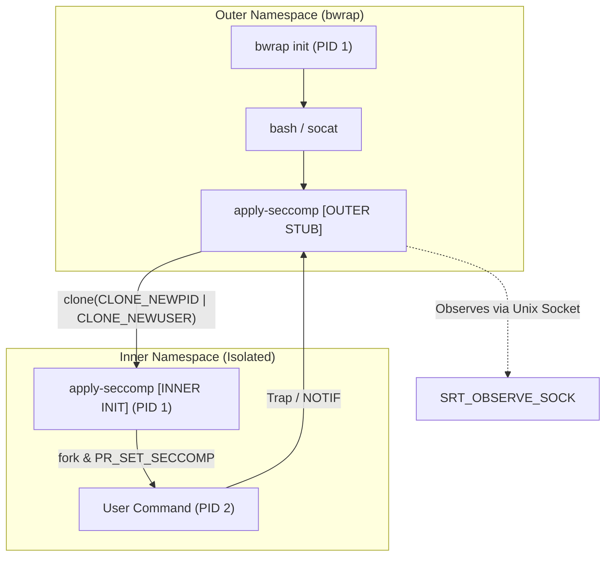
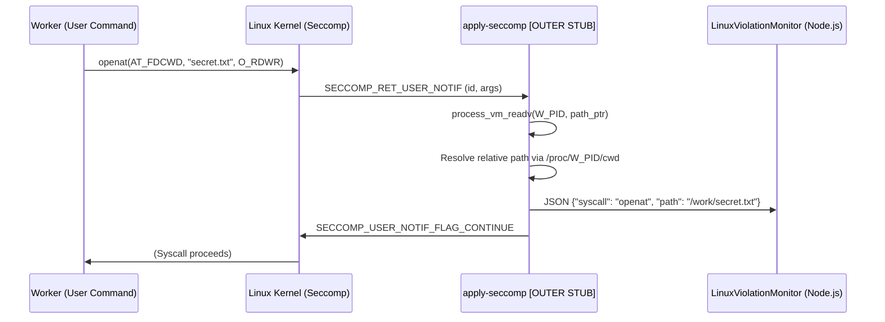

<!-- source: DeepWiki mcp.deepwiki.com · repo anthropics/sandbox-runtime · extra page apply-seccomp Native Binary · fetched 2026-10-26 -->

# apply-seccomp Native Binary

Relevant source files

The following files were used as context for generating this wiki page:

- [src/sandbox/generate-seccomp-filter.ts](src/sandbox/generate-seccomp-filter.ts)
- [src/sandbox/sandbox-schemas.ts](src/sandbox/sandbox-schemas.ts)
- [test/sandbox/allow-read.test.ts](test/sandbox/allow-read.test.ts)
- [test/sandbox/integration.test.ts](test/sandbox/integration.test.ts)
- [test/sandbox/linux-violation-monitor.test.ts](test/sandbox/linux-violation-monitor.test.ts)
- [test/sandbox/macos-glob-deny-reemit.test.ts](test/sandbox/macos-glob-deny-reemit.test.ts)
- [test/sandbox/pid-namespace-isolation.test.ts](test/sandbox/pid-namespace-isolation.test.ts)
- [test/sandbox/seccomp-filter.test.ts](test/sandbox/seccomp-filter.test.ts)
- [vendor/seccomp-src/apply-seccomp.c](vendor/seccomp-src/apply-seccomp.c)
- [vendor/seccomp-src/seccomp-unix-block.c](vendor/seccomp-src/seccomp-unix-block.c)
- [vendor/seccomp/build.ts](vendor/seccomp/build.ts)

The `apply-seccomp` utility is a critical security component of the Linux sandbox backend. It is a static C binary responsible for enforcing kernel-level restrictions that `bubblewrap` cannot achieve alone, specifically blocking Unix domain sockets and providing a high-fidelity observation pipeline for filesystem violations via the `SECCOMP_RET_USER_NOTIF` mechanism.

## Overview and Process Architecture

`apply-seccomp` implements a nested isolation model. While `bubblewrap` provides the primary filesystem and network namespace isolation, `apply-seccomp` creates an additional inner layer of protection to prevent the sandboxed process from ptracing or inspecting the sandbox orchestration helpers (like `socat` or the `bwrap` init process) [vendor/seccomp-src/apply-seccomp.c:11-27]().

### Process Hierarchy
The following diagram illustrates the transition from the host environment into the deep-isolated worker process.

**Diagram: apply-seccomp Namespace Transition**

*Sources: [vendor/seccomp-src/apply-seccomp.c:11-24]()*

## BPF Filter Generation

The sandbox uses a pre-compiled BPF (Berkeley Packet Filter) to enforce socket restrictions. This filter is generated by `seccomp-unix-block.c` and baked into the `apply-seccomp` binary during the build process [vendor/seccomp/build.ts:32-55]().

### AF_UNIX Blocking
The primary goal of the BPF filter is to block `socket(AF_UNIX, ...)` calls to prevent the sandbox from communicating with host services via Unix sockets.
- **Implementation**: It uses `SCMP_CMP_MASKED_EQ` with a `0xffffffff` mask on the first argument (domain) to ensure it catches `AF_UNIX` even if upper register bits are set [vendor/seccomp-src/seccomp-unix-block.c:92-105]().
- **Architecture Support**: Filters are generated specifically for `x86_64` and `aarch64`. 32-bit x86 is explicitly unsupported because it uses the `socketcall()` multiplexer, which allows trivial bypasses of simple `socket()` filters [src/sandbox/generate-seccomp-filter.ts:86-123](), [vendor/seccomp-src/seccomp-unix-block.c:11-24]().

### io_uring Blocking
Since `io_uring` can be used to bypass `seccomp` (by performing socket operations in kernel context via shared memory rings), the filter unconditionally blocks:
- `io_uring_setup`
- `io_uring_enter`
- `io_uring_register`

This ensures that even if a process inherits a ring file descriptor, it cannot use it to perform restricted operations [vendor/seccomp-src/seccomp-unix-block.c:107-125]().

*Sources: [vendor/seccomp-src/seccomp-unix-block.c:92-125](), [src/sandbox/generate-seccomp-filter.ts:86-123]()*

## USER_NOTIF Observation Pipeline

`apply-seccomp` provides a "passive observation" mode. When the `SRT_OBSERVE_SOCK` environment variable is set, the binary installs a second seccomp filter that traps write-intent filesystem syscalls using `SECCOMP_RET_USER_NOTIF` [vendor/seccomp-src/apply-seccomp.c:92-110]().

### Observed Syscalls
The system maintains a single source of truth for observed calls in the `observe_calls` table, including:
- **Creation/Deletion**: `openat`, `unlinkat`, `mkdirat`, `mknodat`, `symlinkat`, `linkat`.
- **Renaming**: `renameat`, `renameat2`.
- **Metadata**: `fchmodat`, `fchownat`, `utimensat`.
- **Legacy Support**: Includes non-`at` versions (e.g., `open`, `unlink`) for `x86_64` compatibility [vendor/seccomp-src/apply-seccomp.c:157-183]().

### Path Resolution and Magic Symlinks
When a syscall is trapped, the **Outer Stub** acts as the supervisor:
1. It receives a notification containing the syscall arguments and the PID of the worker.
2. It resolves relative paths by inspecting the worker's `/proc/[pid]/cwd`.
3. It handles `dirfd` arguments (like `AT_FDCWD`) by using "magic symlinks" in `/proc/[pid]/fd/[dirfd]` to resolve the base directory [vendor/seccomp-src/apply-seccomp.c:102-107]().
4. It reads path strings from the worker's memory using `process_vm_readv` [vendor/seccomp-src/apply-seccomp.c:102]().
5. The resulting absolute path is sent as a JSON line to the `SRT_OBSERVE_SOCK` Unix socket for processing by the `LinuxViolationMonitor` [test/sandbox/linux-violation-monitor.test.ts:48-63]().

**Diagram: Observation Data Flow**

*Sources: [vendor/seccomp-src/apply-seccomp.c:92-110](), [test/sandbox/linux-violation-monitor.test.ts:48-90]()*

## Build Process

The build system for `apply-seccomp` is automated via `vendor/seccomp/build.ts`. It follows a multi-stage compilation strategy to ensure the binary is statically linked and architecture-independent.

| Step | Action | Description |
|:---|:---|:---|
| 1 | Compile Generator | Compiles `seccomp-unix-block.c` into a temporary host binary. |
| 2 | Generate BPF | Runs the generator for `x86_64` and `aarch64` to produce `.bpf` files. |
| 3 | Create Header | Converts BPF bytecode into C hex arrays and writes `unix-block-bpf.h`. |
| 4 | Final Compile | Compiles `apply-seccomp.c` using `-static` and `-O2`, including the generated header. |
| 5 | Strip | Runs `strip` on the final binary to reduce size. |

*Sources: [vendor/seccomp/build.ts:11-69]()*

## Path Resolution and Resilience

The `SandboxManager` uses `getApplySeccompBinaryPath` to locate the binary. It checks multiple locations to support different installation environments:
1. **Explicit Path**: Provided via `seccompConfig.applyPath` [src/sandbox/generate-seccomp-filter.ts:160-185]().
2. **Bundled Path**: `vendor/seccomp/{arch}/apply-seccomp` relative to the library [src/sandbox/generate-seccomp-filter.ts:132-140]().
3. **Global NPM**: Fallback to `/usr/lib/node_modules/@anthropic-ai/sandbox-runtime` [src/sandbox/generate-seccomp-filter.ts:18-80]().

*Sources: [src/sandbox/generate-seccomp-filter.ts:18-185](), [test/sandbox/seccomp-filter.test.ts:24-54]()*

---

