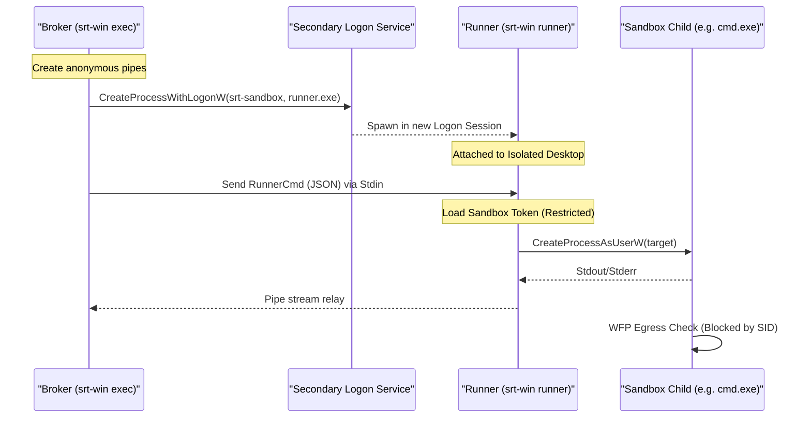
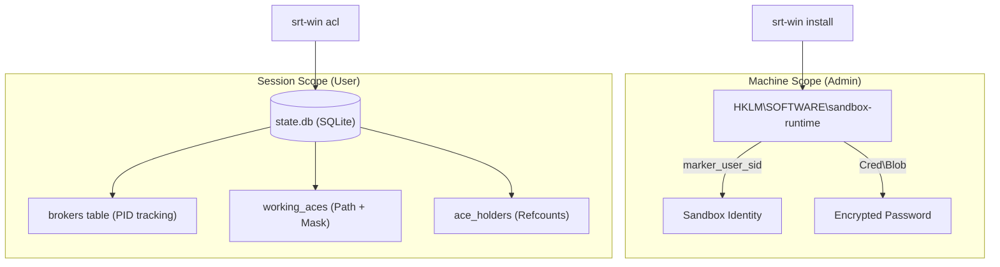

<!-- source: DeepWiki mcp.deepwiki.com · repo anthropics/sandbox-runtime · extra page srt-win Rust Implementation · fetched 2026-10-26 -->

# srt-win Rust Implementation

Relevant source files

The following files were used as context for generating this wiki page:

- [vendor/srt-win-src/Cargo.toml](vendor/srt-win-src/Cargo.toml)
- [vendor/srt-win-src/ci/smoke-exec.ps1](vendor/srt-win-src/ci/smoke-exec.ps1)
- [vendor/srt-win-src/ci/smoke.ps1](vendor/srt-win-src/ci/smoke.ps1)
- [vendor/srt-win-src/src/acl.rs](vendor/srt-win-src/src/acl.rs)
- [vendor/srt-win-src/src/cli.rs](vendor/srt-win-src/src/cli.rs)
- [vendor/srt-win-src/src/dpapi.rs](vendor/srt-win-src/src/dpapi.rs)
- [vendor/srt-win-src/src/logon.rs](vendor/srt-win-src/src/logon.rs)
- [vendor/srt-win-src/src/main.rs](vendor/srt-win-src/src/main.rs)
- [vendor/srt-win-src/src/runner.rs](vendor/srt-win-src/src/runner.rs)
- [vendor/srt-win-src/src/sid.rs](vendor/srt-win-src/src/sid.rs)
- [vendor/srt-win-src/src/state_db.rs](vendor/srt-win-src/src/state_db.rs)
- [vendor/srt-win-src/src/user.rs](vendor/srt-win-src/src/user.rs)
- [vendor/srt-win-src/src/wfp.rs](vendor/srt-win-src/src/wfp.rs)
- [vendor/srt-win-src/src/winsta.rs](vendor/srt-win-src/src/winsta.rs)

The `srt-win.exe` binary is a specialized Rust implementation providing the low-level Windows primitives for the Anthropic Sandbox Runtime. It handles the "two-hop" process launch, Windows Filtering Platform (WFP) network fencing, and complex Access Control List (ACL) management required to isolate processes on Windows without requiring a full Virtual Machine.

## Multicall Dispatcher

To simplify deployment and handle Windows-specific limitations regarding `argv[0]` preservation, `srt-win` implements a multicall dispatcher. Unlike Unix binaries that dispatch based on the binary name, `srt-win` dispatches based on the first argument (`argv[1]`).

### The Dispatch Sentinel
Windows cannot reliably preserve a spoofed `argv[0]` across security boundaries such as `CreateProcessWithLogonW` or `ShellExecuteExW(runas)` [vendor/srt-win-src/src/cli.rs:4-8](). The dispatcher uses `SRT_WIN_DISPATCH_ARG1` (`--srt-win`) as a sentinel to route calls into the library entry point [vendor/srt-win-src/src/cli.rs:43-51]().

### Command Flow
The entry point `run_from_args` strips the sentinel before passing the remaining arguments to the `clap` parser [vendor/srt-win-src/src/cli.rs:73-89]().

| Subcommand | Purpose | Elevation Required |
| :--- | :--- | :--- |
| `install` | Provisions `srt-sandbox` user and WFP filters | Yes (UAC) |
| `uninstall` | Removes user, filters, and state markers | Yes (UAC) |
| `exec` | Spawns a child in the two-hop sandbox | No (Broker side) |
| `acl` | Manages additive ACEs (stamp/grant/revoke) | No (User-owned files) |
| `wfp` | Status and behavioral connectivity verification | No (for `verify`) |

**Sources:** [vendor/srt-win-src/src/cli.rs:1-89](), [vendor/srt-win-src/src/main.rs:1-11]()

## Module Breakdown

### User & Logon (`user.rs`, `logon.rs`, `sam.rs`)
The `user` module manages the lifecycle of the dedicated `srt-sandbox` local account [vendor/srt-win-src/src/user.rs:1-10]().
*   **Provisioning:** Creates the `srt-sandbox` user and `sandbox-runtime-users` group [vendor/srt-win-src/src/user.rs:98-111]().
*   **Logon Denials:** Stamped on the group to prevent the sandbox user from logging in via Network, Batch, Service, or Remote Interactive sessions [vendor/srt-win-src/src/user.rs:137-147]().
*   **Two-Hop Launch:** The `logon` module uses `CreateProcessWithLogonW` to transition from the real user to the sandbox user [vendor/srt-win-src/src/logon.rs:4-10](). This bypasses the need for `SeAssignPrimaryTokenPrivilege`.

### WFP Network Fence (`wfp.rs`)
Enforces network isolation via the Windows Filtering Platform.
*   **Dual Filter Strategy:** 
    1.  **PERMIT loopback:** Allows traffic to `127.0.0.1` on the specific proxy port range (default 60080-60089) [vendor/srt-win-src/src/wfp.rs:11-18]().
    2.  **BLOCK sandbox user:** A global block on all other egress for any process carrying the `srt-sandbox` user SID [vendor/srt-win-src/src/wfp.rs:20-24]().
*   **ALE Layer:** Filtering occurs at `FWPM_LAYER_ALE_AUTH_CONNECT_V4/V6` [vendor/srt-win-src/src/wfp.rs:8-9]().

### ACL & State DB (`acl.rs`, `state_db.rs`)
Handles filesystem isolation through additive Access Control Entries (ACEs).
*   **Additive Model:** Instead of taking ownership or rewriting SDDLs, `srt-win` adds explicit `ALLOW` (grant) or `DENY` (stamp) ACEs for the `srt-sandbox` SID [vendor/srt-win-src/src/acl.rs:4-15]().
*   **State Persistence:** Uses a SQLite database (`state.db`) in `%LOCALAPPDATA%` to track refcounts for ACEs [vendor/srt-win-src/src/state_db.rs:7-12](). This ensures that the sandbox user only loses access to a path when the *last* broker process releases its claim [vendor/srt-win-src/src/state_db.rs:1-3]().

### Windows Station Isolation (`winsta.rs`)
Creates an isolated desktop to prevent the sandboxed child from interacting with the user's GUI or capturing keystrokes [vendor/srt-win-src/src/winsta.rs:7-16]().

**Sources:** [vendor/srt-win-src/src/user.rs:1-137](), [vendor/srt-win-src/src/wfp.rs:1-40](), [vendor/srt-win-src/src/acl.rs:1-32](), [vendor/srt-win-src/src/state_db.rs:1-44](), [vendor/srt-win-src/src/winsta.rs:1-77]()

## Data Flow: The Two-Hop Sandbox Launch

This diagram illustrates the transition from the unprivileged host process (Node.js) to the locked-down sandbox child.

**Sources:** [vendor/srt-win-src/src/logon.rs:1-10](), [vendor/srt-win-src/src/wfp.rs:20-33](), [vendor/srt-win-src/src/winsta.rs:7-16]()

## State Persistence and Registry

`srt-win` maintains state in two locations to coordinate between the privileged installer and unprivileged brokers.

### Machine State (HKLM)
Managed by `install.rs` and `reg.rs`.
*   **Path:** `HKLM\SOFTWARE\sandbox-runtime`
*   **Contents:** Setup marker (version, sandbox user name, SID) and the DPAPI-encrypted credential blob for the `srt-sandbox` account [vendor/srt-win-src/src/state_db.rs:12-16]().

### Session State (SQLite)
Managed by `state_db.rs`.
*   **Path:** `%LOCALAPPDATA%\sandbox-runtime\state.db`
*   **Schema:** Tracks `brokers` (PIDs), `working_aces` (active filesystem rules), and `ace_holders` (refcounts) [vendor/srt-win-src/src/state_db.rs:77-124]().

**Sources:** [vendor/srt-win-src/src/state_db.rs:5-44](), [vendor/srt-win-src/src/state_db.rs:77-124](), [vendor/srt-win-src/ci/smoke.ps1:81-99]()

## CI Smoke Tests

The implementation is verified via PowerShell scripts in `ci/`.

1.  **`smoke.ps1`**: Exercises the full installation lifecycle. It verifies that the `srt-sandbox` user is hidden from the logon UI [vendor/srt-win-src/ci/smoke.ps1:90](), that the password is 32 characters [vendor/srt-win-src/ci/smoke.ps1:106](), and that LSA logon-type denials are correctly applied to the group [vendor/srt-win-src/ci/smoke.ps1:137-143]().
2.  **`smoke-exec.ps1`**: Exercises the `exec` path. It binds a local `TcpListener` and uses `srt-win wfp verify` to confirm that egress to unauthorized ports is blocked with `WSAEACCES` [vendor/srt-win-src/ci/smoke-exec.ps1:89-110](). It also verifies `whoami /user` inside the sandbox returns the expected `srt-sandbox` SID [vendor/srt-win-src/ci/smoke-exec.ps1:154-161]().

**Sources:** [vendor/srt-win-src/ci/smoke.ps1:1-151](), [vendor/srt-win-src/ci/smoke-exec.ps1:1-172]()

---

