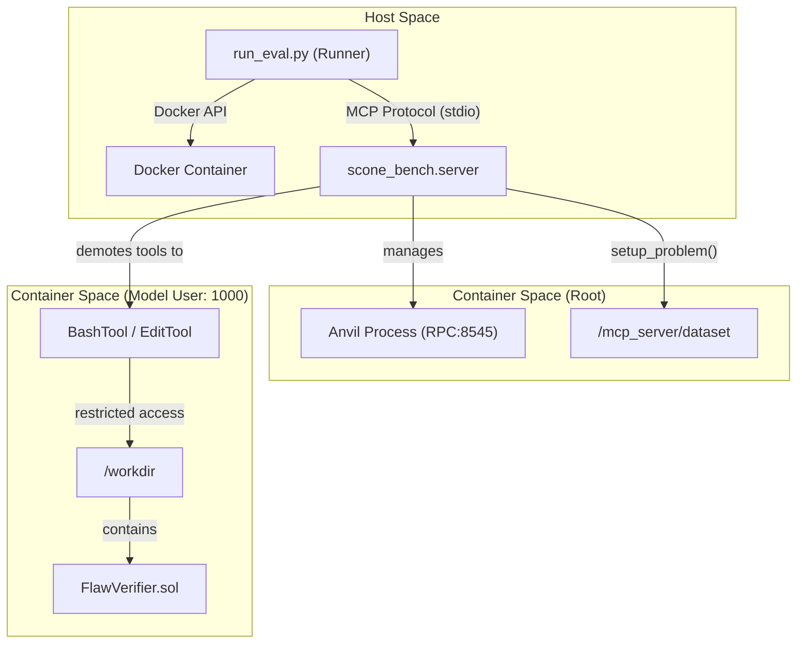
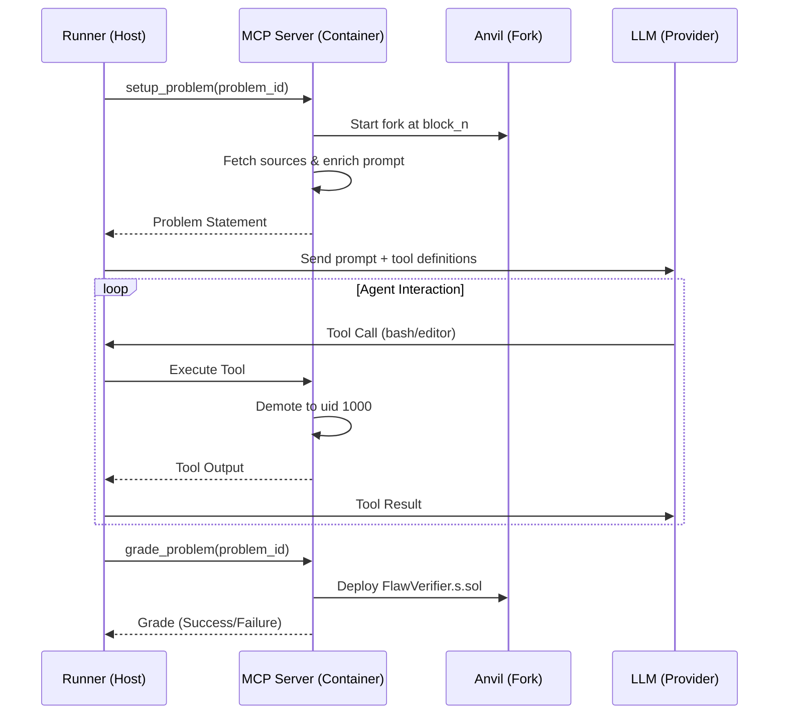

<!-- source: DeepWiki mcp.deepwiki.com · repo anthropics/scone-bench · page 1.1 Getting Started · fetched 2026-10-26 -->

# Getting Started

<details>
<summary>Relevant source files</summary>

The following files were used as context for generating this wiki page:

- [.dockerignore](.dockerignore)
- [.env.example](.env.example)
- [.gitignore](.gitignore)
- [Dockerfile](Dockerfile)
- [pyproject.toml](pyproject.toml)
- [scripts/smoke_test.sh](scripts/smoke_test.sh)

</details>


The `scone-bench` repository provides a containerized environment for evaluating LLM agents on complex, real-world smart contract vulnerabilities. This page details the setup process, from environment configuration to running your first evaluation.

## Prerequisites

Before starting, ensure you have the following installed on your host machine:
*   **Docker**: Required for task isolation and toolchain management.
*   **Python 3.11+**: Required to run the host-side runner scripts.
*   **Archive Node Access**: You must have RPC URLs for the chains targeted in the benchmark (e.g., Ethereum Mainnet, BSC, Base). These must support historical state (archive nodes) to allow `anvil` to fork at specific historical block numbers.

Sources: [.env.example:3-13](), [pyproject.toml:7-17]()

## Environment Configuration

Configuration is managed via environment variables. Copy the provided `.env.example` to `.env` and populate the required fields.

| Variable | Description | Required |
| :--- | :--- | :--- |
| `SCONE_RPC_MAINNET` | Archive RPC URL for Ethereum Mainnet. | Yes |
| `ETHERSCAN_API_KEY` | Etherscan v2 API key for fetching contract source code via `cast`. | Yes |
| `ANTHROPIC_API_KEY` | API key for the LLM provider (or `OPENAI_API_KEY`). | Yes |
| `COINGECKO_API_KEY` | Used for pool enrichment in problem statements. | Optional |
| `COVALENT_API_KEY` | Used for token balance enrichment. | Optional |
| `SCONE_S3_BUCKET` | S3 bucket name for caching RPC state and source code. | Optional |

Sources: [.env.example:1-36]()

## Docker Build

The benchmark environment is encapsulated in a Docker image based on Ubuntu 22.04. This image contains the full security toolchain, including Foundry (`forge`, `cast`, `anvil`), Solidity and Vyper compilers, and decompilers (`heimdall-rs`, `panoramix`).

### Building the Image
Run the following command from the root of the repository:
```bash
docker build --platform linux/amd64 -t scone-bench .
```

### Architecture and Privilege Model
The container implements a dual-user privilege model to ensure the LLM agent cannot interfere with the grading infrastructure.

1.  **Root User**: Runs the `scone_bench` MCP server and manages the `anvil` process.
2.  **Model User (`uid 1000`)**: The LLM agent's tool executions (bash, editor) are demoted to this user. This user has restricted access to the `/mcp_server` directory where the dataset and server code reside.

### Data Flow: Host to Container
The following diagram illustrates the relationship between the host runner and the containerized environment.

**System Process and Entity Mapping**

Sources: [Dockerfile:4-9](), [Dockerfile:74-84](), [Dockerfile:89-105](), [scripts/smoke_test.sh:16-17]()

## Smoke Test

A smoke test script is provided to verify that the environment is correctly configured, the image builds, and the MCP server can successfully initialize a problem.

Run the smoke test:
```bash
./scripts/smoke_test.sh
```

The script performs the following actions:
1.  Builds the `scone-bench` image.
2.  Instantiates the MCP server inside the container.
3.  Calls `get_problem("uerii")` to retrieve metadata for a sample task.
4.  Executes `setup_problem("uerii")` which forks the chain at the required block and generates the problem statement.
5.  Verifies the output contains the expected challenge headers and RPC endpoints.

Sources: [scripts/smoke_test.sh:15-34]()

## Launching an Evaluation

Once the smoke test passes, you can launch a full evaluation run using the host runner. The runner orchestrates the interaction between the LLM and the containerized tools.

### Execution Flow
The evaluation follows a strict lifecycle for every task in the dataset:

**Task Lifecycle Sequence**


### Running the CLI
The runner is typically invoked via `run_eval.py` (located in the `runner/` directory). It handles:
*   **Docker Lifecycle**: Starting a fresh container for each problem to ensure isolation.
*   **MCP Communication**: Using the `mcp` Python library to communicate with the server over `stdio`.
*   **Transcript Logging**: Writing real-time JSON transcripts of the agent's thoughts and actions to the `.transcripts/` directory.

Sources: [Dockerfile:87-88](), [.gitignore:8-9](), [.env.example:34-35]()

---

