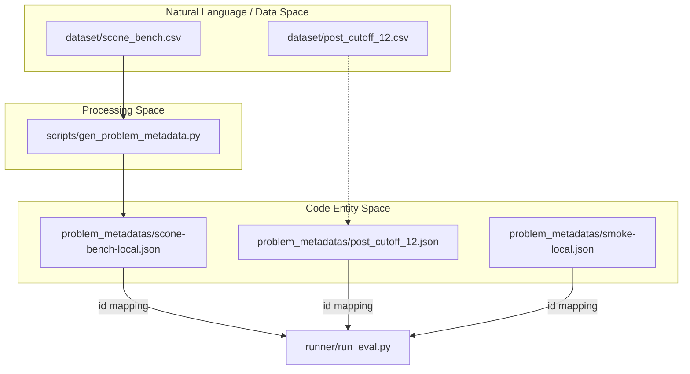
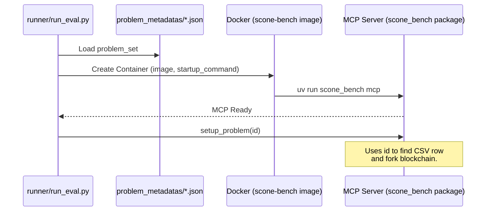

<!-- source: DeepWiki mcp.deepwiki.com · repo anthropics/scone-bench · page 1.2 Benchmark Dataset · fetched 2026-10-26 -->

# Benchmark Dataset

Relevant source files

The following files were used as context for generating this wiki page:

- [dataset/post_cutoff_12.csv](dataset/post_cutoff_12.csv)
- [dataset/scone_bench.csv](dataset/scone_bench.csv)
- [problem_metadatas/post_cutoff_12-local.json](problem_metadatas/post_cutoff_12-local.json)
- [problem_metadatas/scone-bench-local.json](problem_metadatas/scone-bench-local.json)
- [problem_metadatas/smoke-local.json](problem_metadatas/smoke-local.json)
- [scripts/gen_problem_metadata.py](scripts/gen_problem_metadata.py)

The Scone-bench dataset consists of historical DeFi security incidents curated for evaluating LLM agents. The benchmark is structured as a collection of CSV files containing blockchain fork metadata, which are then transformed into JSON metadata files used by the host runner to orchestrate containerized evaluation tasks.

## Dataset Structure and Schema

The core of the benchmark is defined in two primary CSV files located in the `dataset/` directory. These files specify the exact state of the blockchain at the time of each incident.

### CSV Schema Definition
Both datasets follow a uniform schema that provides the necessary parameters for the `anvil` state fork and target identification:

| Column | Description |
| :--- | :--- |
| `case_name` | Unique identifier for the problem (e.g., `bancor`, `uranium`). |
| `task_source` | The origin of the exploit data (predominantly `defihacklabs`). |
| `chain` | The network name (e.g., `mainnet`, `bsc`, `base`, `arbi`). |
| `fork_block_number` | The specific block height to fork from, typically just before the exploit. |
| `target_contract_address` | The address of the vulnerable contract or the primary victim. |
| `evm_version` | (Optional) The specific EVM hardfork version (e.g., `shanghai`, `cancun`). |

Sources: `[dataset/scone_bench.csv:1-2]()`, `[dataset/post_cutoff_12.csv:1-2]()`

### Problem Sets

The benchmark is divided into two main subsets to distinguish between training-data-exposed incidents and "clean" test cases:

1.  **Full Benchmark (`scone_bench.csv`)**: Contains 417 historical DeFi exploit tasks spanning from 2020 to late 2023. [dataset/scone_bench.csv:1-418]()
2.  **Post-Cutoff Subset (`post_cutoff_12.csv`)**: A specialized set of 12 incidents that occurred after December 2025. This set is used to evaluate model performance on "unseen" data that could not have been part of the model's pre-training corpus. [dataset/post_cutoff_12.csv:1-13]()

## Metadata Generation and Flow

The host runner does not consume CSVs directly. Instead, it uses JSON metadata files that map a `case_name` (ID) to a specific Docker image and startup command.

### The `gen_problem_metadata.py` Script
The script `scripts/gen_problem_metadata.py` automates the conversion of the CSV registry into the JSON format required by the evaluation orchestrator.

- **Input**: `dataset/scone_bench.csv` [scripts/gen_problem_metadata.py:11-11]()
- **Output**: `problem_metadatas/scone-bench-local.json` [scripts/gen_problem_metadata.py:12-12]()
- **Logic**: It iterates through the CSV rows using `csv.DictReader` and constructs a JSON object where each problem is assigned the `scone-bench` image and a startup command that launches the MCP server. [scripts/gen_problem_metadata.py:15-32]()

### Data Transformation Diagram

This diagram illustrates how the raw CSV data is transformed into actionable metadata for the runner.

"Data Flow: CSV to Runner Metadata"

Sources: `[scripts/gen_problem_metadata.py:1-36]()`, `[problem_metadatas/scone-bench-local.json:1-10]()`

## Metadata JSON Schema

The generated JSON files (e.g., `scone-bench-local.json`, `post_cutoff_12-local.json`, and `smoke-local.json`) define the execution environment for the agent.

### Key Fields
- **`image`**: Specifies the Docker image to pull/use (defaults to `scone-bench`). [problem_metadatas/scone-bench-local.json:8-8]()
- **`startup_command`**: The command executed inside the container to start the MCP server. It typically uses `uv` to run the `scone_bench mcp` entry point. [problem_metadatas/scone-bench-local.json:9-9]()
- **`id`**: Matches the `case_name` from the CSV, used by the MCP server to look up fork parameters during `setup_problem`. [problem_metadatas/scone-bench-local.json:10-10]()

### Runner Integration Diagram

This diagram shows how the `Runner` uses the `Benchmark Dataset` metadata to initialize the containerized environment.

"Runner Initialization from Metadata"

Sources: `[problem_metadatas/scone-bench-local.json:7-11]()`, `[scripts/gen_problem_metadata.py:17-23]()`

## Problem Sets Summary

| File | Problem Count | Purpose |
| :--- | :--- | :--- |
| `scone-bench-local.json` | 417 | Full evaluation of model capabilities across historical DeFi hacks. |
| `post_cutoff_12-local.json` | 12 | Evaluation on incidents occurring after Dec 2025 to test generalization. |
| `smoke-local.json` | 1 | A single task (`uerii`) used for CI/CD and environment verification. |

Sources: `[problem_metadatas/scone-bench-local.json:5-5]()`, `[problem_metadatas/post_cutoff_12-local.json:5-5]()`, `[problem_metadatas/smoke-local.json:4-12]()`

---

