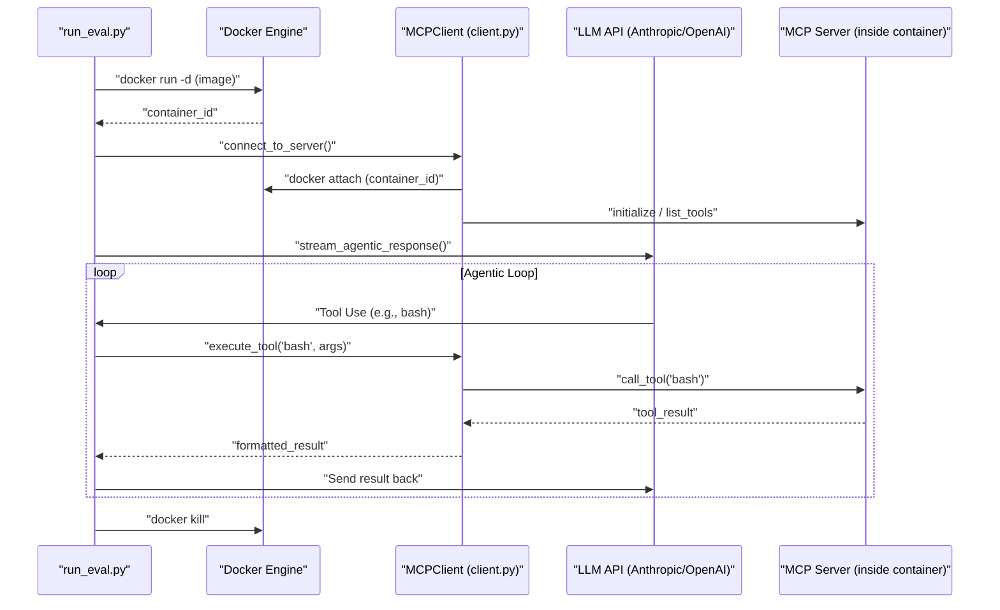
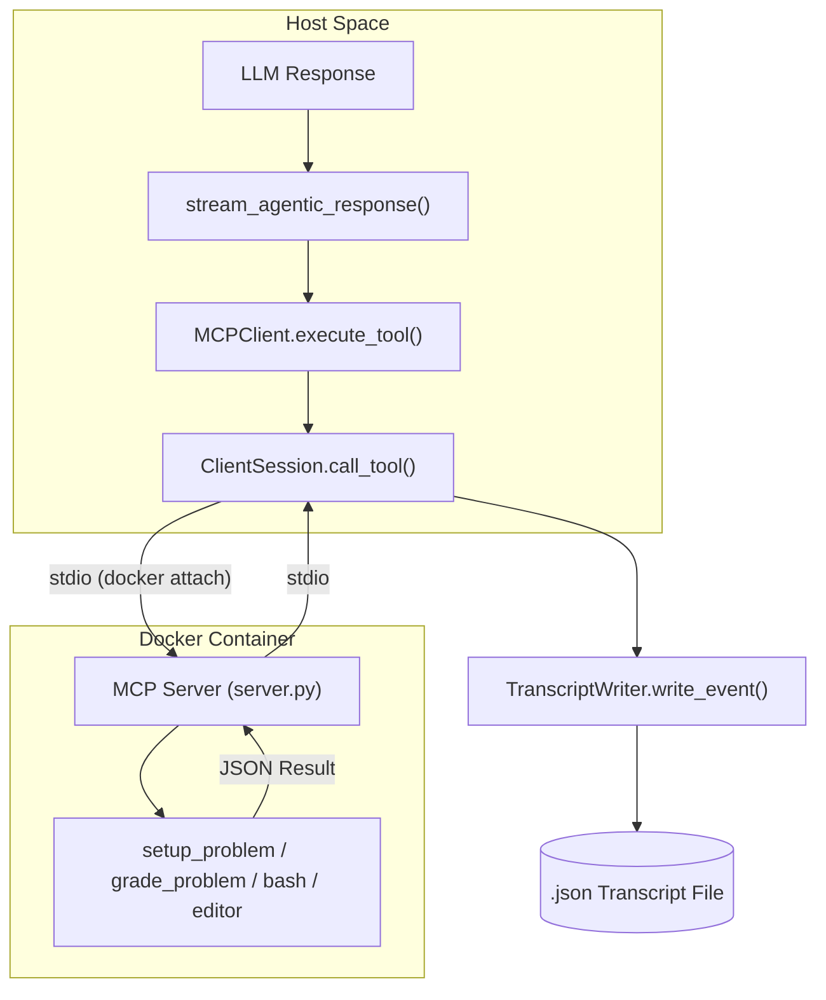

<!-- source: DeepWiki mcp.deepwiki.com · repo anthropics/scone-bench · page 2.2 Runner (Host Orchestrator) · fetched 2026-10-26 -->

# Runner (Host Orchestrator)

Relevant source files

The following files were used as context for generating this wiki page:

- [runner/__init__.py](runner/__init__.py)
- [runner/client.py](runner/client.py)
- [runner/pyproject.toml](runner/pyproject.toml)
- [runner/run_eval.py](runner/run_eval.py)
- [runner/transcript_writer.py](runner/transcript_writer.py)
- [runner/utils.py](runner/utils.py)

The `runner/` package is the host-side orchestrator responsible for managing the lifecycle of evaluation tasks. It handles the creation of Docker containers, manages API interactions with LLM providers (Anthropic, OpenAI, OpenRouter), and provides real-time transcript logging.

## Core Responsibilities

- **Container Lifecycle**: Spawning and killing Docker containers for each problem attempt to ensure environment isolation [runner/run_eval.py:37-78]().
- **MCP Client**: Acting as the bridge between the LLM and the Model Context Protocol (MCP) server running inside the container [runner/client.py:17-166]().
- **Agent Orchestration**: Driving the agentic loop, including tool execution, thinking budget management, and retry logic [runner/utils.py:200-500]().
- **Observability**: Writing real-time JSON transcripts of the agent's actions, thoughts, and tool outputs [runner/transcript_writer.py:9-153]().

## System Flow: Host to Container

The runner operates on the host machine and communicates with the `scone-bench` MCP server inside a Docker container via `stdin`/`stdout` using the `docker attach` command.

### Entity Mapping: Runner Orchestration
The following diagram illustrates how the host-side Python entities interact with the Dockerized environment and external LLM APIs.

| Entity | Code Identifier | Role |
| :--- | :--- | :--- |
| **CLI Entry** | `run_eval.py` | Orchestrates parallel runs and parses metadata. |
| **Host Client** | `MCPClient` | Manages the `ClientSession` and tool mapping. |
| **Agent Loop** | `stream_agentic_response` | The main async generator driving the LLM-Tool cycle. |
| **Output Handler** | `TranscriptWriter` | Streams events to a `.json` file on disk. |

### Orchestration Sequence
"Host Runner Sequence"

Sources: [runner/run_eval.py:37-90](), [runner/client.py:54-71](), [runner/client.py:137-156](), [runner/utils.py:200-250]()

## Key Components

### 1. run_eval.py (CLI Entry Point)
The `run_eval.py` script is the main entry point for running benchmarks. It performs the following:
- **Parallelism**: Uses `asyncio.Task` sets and `asyncio.Semaphore` (via `parallel_requests`) to manage concurrent evaluations [runner/run_eval.py:93-132]().
- **Port Management**: To prevent conflicts between parallel `anvil` instances, it binds to an ephemeral host port and maps it to the container's 8545 port [runner/run_eval.py:40-46]().
- **Security**: Validates image names and problem IDs against regex patterns to prevent shell injection via Docker commands [runner/run_eval.py:62-67]().

Sources: [runner/run_eval.py:11-132]()

### 2. MCPClient (API Integration)
The `MCPClient` class handles the low-level communication with the MCP server and the mapping of tools to provider-specific formats.

- **Tool Mapping**: It converts standard MCP `Tool` definitions into Anthropic `ToolParam` or OpenAI function formats [runner/client.py:76-126]().
- **Specialized Tools**: It explicitly handles "beta" tools like `computer` and the `str_replace_editor` (mapping it to `text_editor_20250124` for Claude 3.x models) [runner/client.py:79-101]().
- **Session Management**: Uses `AsyncExitStack` to manage the lifecycle of the `stdio_client` and `ClientSession` [runner/client.py:25-26](), [runner/client.py:64-71]().

Sources: [runner/client.py:17-166]()

### 3. Agentic Loop and Retry Logic
The `stream_agentic_response` function in `runner/utils.py` implements the core agent loop.

- **Thinking Budget**: For supported models (e.g., Claude 3.7+), it passes a `thinking` block with a specific budget [runner/utils.py:230-245]().
- **Tool Result Conversion**: It converts MCP tool outputs (Text, Image, Audio) into the format expected by the LLM provider [runner/utils.py:540-575]().
- **Retry Logic**: Uses the `tenacity` library to handle `APIConnectionError`, `APITimeoutError`, and `RateLimitError` with exponential backoff [runner/utils.py:100-154]().

Sources: [runner/utils.py:100-154](), [runner/utils.py:200-500]()

### 4. TranscriptWriter
The `TranscriptWriter` provides a real-time audit log of the evaluation.

- **Live Updates**: Instead of writing once at the end, it updates the JSON file on disk after every significant event (tool start, tool result, message completion) [runner/transcript_writer.py:40-84]().
- **Scoring**: It includes a `_calculate_score` helper that applies weights to subscores returned by the `grade_problem` tool to determine the final success/failure status [runner/transcript_writer.py:88-94]().

Sources: [runner/transcript_writer.py:9-153]()

## Data Flow: Tool Execution
This diagram details how a tool call is processed through the host runner.

"Tool Execution Data Flow"

Sources: [runner/client.py:137-156](), [runner/utils.py:400-450](), [runner/transcript_writer.py:40-84]()

---

