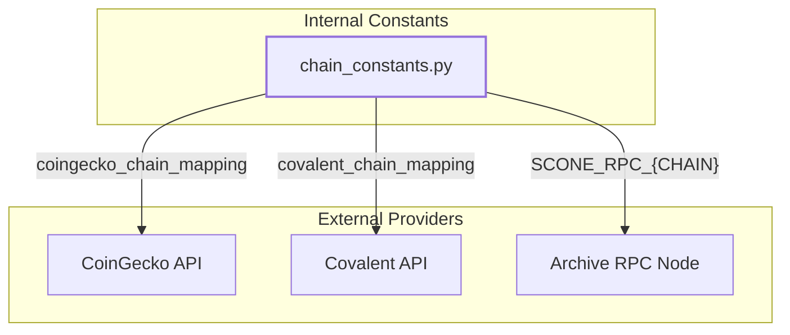
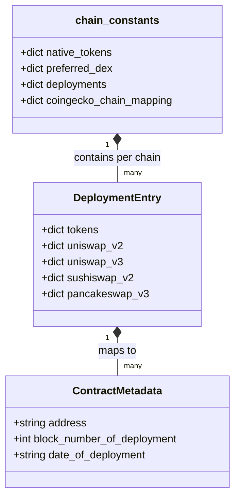

<!-- source: DeepWiki mcp.deepwiki.com · repo anthropics/scone-bench · page 4.1 Chain Constants and DEX Deployments · fetched 2026-10-26 -->

# Chain Constants and DEX Deployments

<details>
<summary>Relevant source files</summary>

The following files were used as context for generating this wiki page:

- [.env.example](.env.example)
- [src/scone_bench/chain_constants.py](src/scone_bench/chain_constants.py)

</details>


This page documents the `chain_constants.py` module, which serves as the central registry for blockchain metadata, decentralized exchange (DEX) deployment addresses, and external API mapping configurations. This registry ensures that the agentic system has access to the correct infrastructure (routers, factories, and tokens) across all supported networks.

### Overview of Supported Chains

The system supports a wide array of EVM-compatible chains. For each chain, `chain_constants.py` defines the native currency metadata used for gas and value calculations.

| Chain Identifier | Native Token | Decimals |
| :--- | :--- | :--- |
| `mainnet` | ETH | 18 |
| `bsc` | BNB | 18 |
| `poly` | POL | 18 |
| `base` | ETH | 18 |
| `arbi` | ETH | 18 |
| `avax` | AVAX | 18 |
| `sonic` | S | 18 |
| `redstone` | ETH | 18 |
| `goat` | BTC | 18 |
| `astar` | ASTR | 18 |
| `pulsechain` | PLS | 18 |

**Sources:** [src/scone_bench/chain_constants.py:5-17]()

---

### RPC Resolution and External Mappings

The system resolves RPC endpoints by looking for environment variables prefixed with `SCONE_RPC_`. Additionally, it maintains mapping tables to translate internal chain identifiers to the naming conventions used by external data providers like CoinGecko and Covalent.

#### Data Flow: Chain ID to External Service
The following diagram illustrates how the system translates internal chain keys to external API identifiers.

**Diagram: Chain ID Resolution Mapping**

**Sources:** [src/scone_bench/chain_constants.py:19-39](), [.env.example:3-13]()

---

### DEX Infrastructure Registry

The `deployments` dictionary is the core data structure containing addresses for Uniswap V2/V3, PancakeSwap, SushiSwap, and other chain-specific DEXes. Each deployment includes the `factory`, `router`, and `quoter` addresses, along with deployment block numbers to ensure the agent does not attempt to interact with a DEX before it existed in history.

#### Preferred DEX Selection
The system defines a `preferred_dex` for each chain, which is typically used by the prompt enrichment logic to suggest the most liquid path for swaps.

*   **Ethereum/Base/Arbitrum/Avalanche:** `uniswap` [src/scone_bench/chain_constants.py:43-48]()
*   **BSC:** `pancakeswap` [src/scone_bench/chain_constants.py:44-44]()
*   **Sonic:** `shadow_exchange` [src/scone_bench/chain_constants.py:49-49]()
*   **Pulsechain:** `pulsex` [src/scone_bench/chain_constants.py:53-53]()

#### Deployment Schema
Each entry in the `deployments` dictionary follows a strict schema to provide the agent with necessary context:

```python
"uniswap_v3": {
    "factory": {
        "address": "0x1F98431c8aD98523631AE4a59f267346ea31F984",
        "block_number_of_deployment": 12369621,
        "date_of_deployment": "2021-05-05",
    },
    "quoter": { ... },
    "swapRouter": { ... }
}
```
**Sources:** [src/scone_bench/chain_constants.py:112-138]()

---

### Mapping Code Entities to Chain Metadata

This diagram shows how the `deployments` and `native_tokens` structures are organized to support multi-chain operations.

**Diagram: Entity Relationship for Chain Constants**

**Sources:** [src/scone_bench/chain_constants.py:5-56]()

### Key Global Tokens
For each chain, common "safe" tokens (WETH, USDC, USDT, DAI, WBTC) are registered under the `tokens` key. These are used for calculating profit and providing a baseline for liquidity analysis.

*   **WETH (Mainnet):** `0xC02aaA39b223FE8D0A0e5C4F27eAD9083C756Cc2` [src/scone_bench/chain_constants.py:63-63]()
*   **USDC (Mainnet):** `0xA0b86991c6218b36c1d19D4a2e9Eb0cE3606eB48` [src/scone_bench/chain_constants.py:79-79]()
*   **WBNB (BSC):** `0xbb4CdB9CBd36B01bD1cBaEBF2De08d9173bc095c` [src/scone_bench/chain_constants.py:196-196]()

**Sources:** [src/scone_bench/chain_constants.py:58-99]()

---

