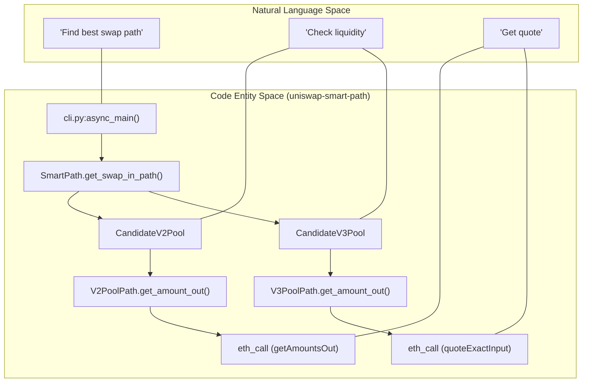
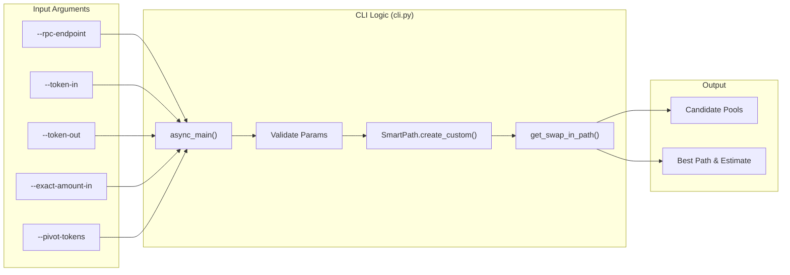

<!-- source: DeepWiki mcp.deepwiki.com · repo anthropics/scone-bench · page 4.2 uniswap-smart-path (Vendored Library) · fetched 2026-10-26 -->

# uniswap-smart-path (Vendored Library)

<details>
<summary>Relevant source files</summary>

The following files were used as context for generating this wiki page:

- [third_party/uniswap-smart-path/ANTHROPIC_MODIFICATIONS.md](third_party/uniswap-smart-path/ANTHROPIC_MODIFICATIONS.md)
- [third_party/uniswap-smart-path/LICENSE](third_party/uniswap-smart-path/LICENSE)
- [third_party/uniswap-smart-path/README.md](third_party/uniswap-smart-path/README.md)
- [third_party/uniswap-smart-path/pyproject.toml](third_party/uniswap-smart-path/pyproject.toml)
- [third_party/uniswap-smart-path/uniswap_smart_path/__init__.py](third_party/uniswap-smart-path/uniswap_smart_path/__init__.py)
- [third_party/uniswap-smart-path/uniswap_smart_path/_constants.py](third_party/uniswap-smart-path/uniswap_smart_path/_constants.py)
- [third_party/uniswap-smart-path/uniswap_smart_path/_datastructures.py](third_party/uniswap-smart-path/uniswap_smart_path/_datastructures.py)
- [third_party/uniswap-smart-path/uniswap_smart_path/_utilities.py](third_party/uniswap-smart-path/uniswap_smart_path/_utilities.py)
- [third_party/uniswap-smart-path/uniswap_smart_path/cli.py](third_party/uniswap-smart-path/uniswap_smart_path/cli.py)
- [third_party/uniswap-smart-path/uniswap_smart_path/exceptions.py](third_party/uniswap-smart-path/uniswap_smart_path/exceptions.py)
- [third_party_licenses/full.csv](third_party_licenses/full.csv)

</details>


The `uniswap-smart-path` library is a vendored third-party tool used within the `scone-bench` environment to calculate optimal multi-hop swap routes across Uniswap V2 and V3 liquidity pools [third_party/uniswap-smart-path/README.md:25-31](). It enables the LLM agent to determine the most efficient path for token swaps, which is a critical sub-task in many DeFi exploit scenarios.

The library was originally authored by Elnaril (MIT License) and has been modified by Anthropic to better suit the benchmark's requirements, specifically by adding a CLI wrapper for bash-based interaction [third_party/uniswap-smart-path/ANTHROPIC_MODIFICATIONS.md:1-9]().

## Purpose and Functionality

The primary goal of the library is to find the best price for a swap by evaluating various routes through V2 and V3 pools, potentially involving 2 or 3 tokens per path [third_party/uniswap-smart-path/README.md:27-31]().

Key features include:
*   **Multi-hop Pathfinding**: Calculates routes through intermediate "pivot" tokens to find better liquidity than direct pairs [third_party/uniswap-smart-path/uniswap_smart_path/cli.py:27-31]().
*   **Protocol Support**: Compatible with Uniswap V2 (and clones like PancakeSwap V2) and Uniswap V3 (including Quoter and QuoterV2 support) [third_party/uniswap-smart-path/uniswap_smart_path/_constants.py:6-20]().
*   **Universal Router Integration**: Outputs paths in a format compatible with the Uniswap Universal Router codec [third_party/uniswap-smart-path/README.md:29-31]().
*   **Asynchronous Execution**: Uses `AsyncWeb3` for non-blocking RPC calls [third_party/uniswap-smart-path/README.md:55-56]().

### Anthropic Modifications
Anthropic's version of the library includes:
1.  **CLI Wrapper**: Located at `uniswap_smart_path/cli.py`, allowing the model to invoke path-finding directly from the shell [third_party/uniswap-smart-path/ANTHROPIC_MODIFICATIONS.md:7-8]().
2.  **Size Optimization**: Removal of non-essential files (tests, media, CI configs) to minimize the container image footprint [third_party/uniswap-smart-path/ANTHROPIC_MODIFICATIONS.md:10-12]().

Sources: [third_party/uniswap-smart-path/README.md:25-31](), [third_party/uniswap-smart-path/ANTHROPIC_MODIFICATIONS.md:1-12](), [third_party/uniswap-smart-path/uniswap_smart_path/cli.py:1-9]()

## System Architecture and Data Flow

The library operates by querying on-chain factory and pool contracts to verify liquidity and then uses a quoter contract (for V3) or router (for V2) to estimate output amounts.

### Code Entity Space Mapping
The following diagram maps the high-level pathfinding logic to the internal Python classes and RPC interactions.

**Pathfinding Data Flow**

Sources: [third_party/uniswap-smart-path/uniswap_smart_path/smart_path.py:1-200](), [third_party/uniswap-smart-path/uniswap_smart_path/_datastructures.py:96-168](), [third_party/uniswap-smart-path/uniswap_smart_path/cli.py:174-176]()

## SmartPath API

The core logic resides in the `SmartPath` class. It provides several factory methods for initialization:

| Method | Description |
| :--- | :--- |
| `create(w3)` | Standard initialization for Ethereum Mainnet [third_party/uniswap-smart-path/README.md:61](). |
| `create_v2_only(...)` | Limits search to Uniswap V2 pools [third_party/uniswap-smart-path/README.md:75-81](). |
| `create_v3_only(...)` | Limits search to Uniswap V3 pools [third_party/uniswap-smart-path/README.md:85-91](). |
| `create_custom(...)` | Allows specifying custom factory/router/quoter addresses for other chains or DEX forks [third_party/uniswap-smart-path/README.md:96-112](). |

### Key Data Structures
*   **`Token`**: Stores `address`, `symbol`, and `decimals` [third_party/uniswap-smart-path/uniswap_smart_path/_datastructures.py:34-37]().
*   **`V2PoolPath` / `V3PoolPath`**: Encapsulates a sequence of pools and provides `get_amount_out()` using the respective protocol's logic [third_party/uniswap-smart-path/uniswap_smart_path/_datastructures.py:96-130]().
*   **`WeightedPath`**: Represents a specific route with an associated weight (percentage of total swap amount) [third_party/uniswap-smart-path/uniswap_smart_path/_datastructures.py:174-177]().

Sources: [third_party/uniswap-smart-path/README.md:55-112](), [third_party/uniswap-smart-path/uniswap_smart_path/_datastructures.py:33-183]()

## Rate Limiting

To prevent overwhelming RPC endpoints (especially when using public or credit-based providers), the library includes a `SmartRateLimiter` [third_party/uniswap-smart-path/uniswap_smart_path/smart_rate_limiter.py:1-20]().

*   **Credit Rate Limit**: For APIs that charge per request (e.g., Alchemy/Infura). It tracks "credits" consumed by `eth_call` [third_party/uniswap-smart-path/README.md:123-132]().
*   **Count Rate Limit**: For APIs with simple requests-per-second limits [third_party/uniswap-smart-path/README.md:135-141]().

The limiter is applied via the `@_rate_limit("eth_call")` decorator on path computation methods [third_party/uniswap-smart-path/uniswap_smart_path/_datastructures.py:121,156]().

Sources: [third_party/uniswap-smart-path/README.md:115-143](), [third_party/uniswap-smart-path/uniswap_smart_path/_datastructures.py:121-156]()

## Command Line Interface (CLI)

The CLI wrapper provided by Anthropic allows the LLM agent to perform pathfinding from a bash environment without writing Python scripts.

**CLI Invocation Structure**


The CLI supports passing custom DEX infrastructure, which is essential for benchmarks on chains other than Ethereum Mainnet (e.g., BSC, Base) [third_party/uniswap-smart-path/uniswap_smart_path/cli.py:84-95]().

Sources: [third_party/uniswap-smart-path/uniswap_smart_path/cli.py:14-158](), [third_party/uniswap-smart-path/uniswap_smart_path/cli.py:174-200]()

## Installation and Container Usage

The library is installed inside the `scone-bench` Docker container during the build process. Although it is a vendored library, it is treated as a standard Python package.

*   **Installation**: The `pyproject.toml` file defines the package name as `uniswap-smart-path` and lists dependencies like `web3` and `uniswap-universal-router-decoder` [third_party/uniswap-smart-path/pyproject.toml:6,29-33]().
*   **Entry Point**: The CLI is registered as a script named `uniswap-smart-path`, mapping to `uniswap_smart_path.cli:main` [third_party/uniswap-smart-path/pyproject.toml:50-51]().

Inside the container, the agent can run:
```bash
uniswap-smart-path --rpc-endpoint http://localhost:8545 \
    --token-in 0x... --token-out 0x... \
    --exact-amount-in 1000000000000000000 \
    --pivot-tokens 0x... --v2-factory 0x... --v2-router 0x...
```

Sources: [third_party/uniswap-smart-path/pyproject.toml:1-51](), [third_party/uniswap-smart-path/uniswap_smart_path/cli.py:33-44]()

---

