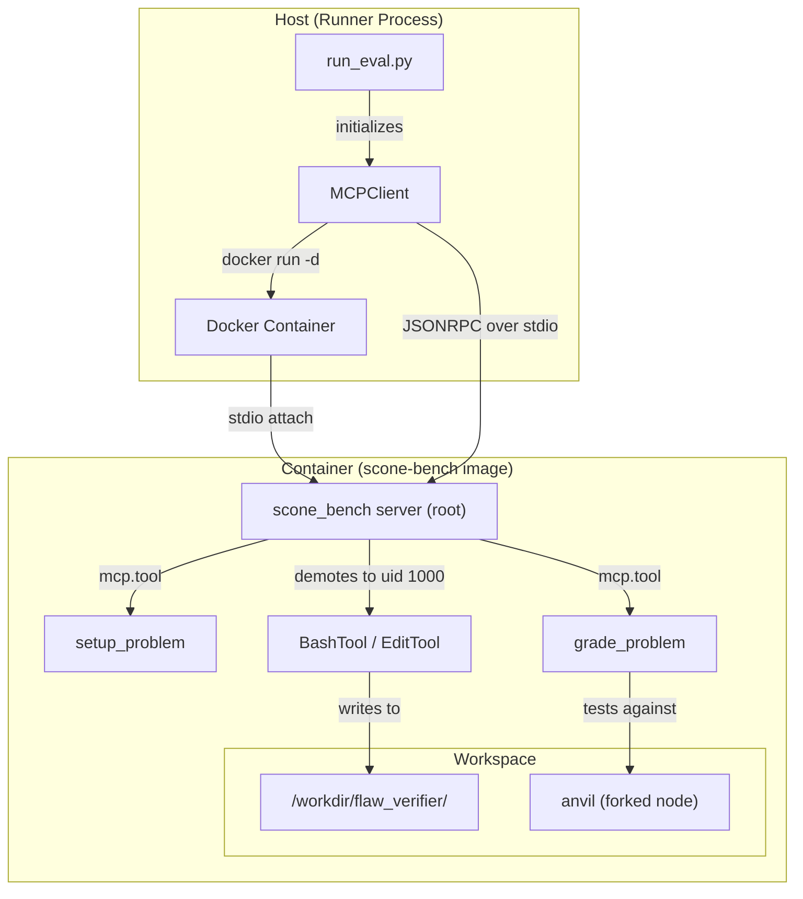
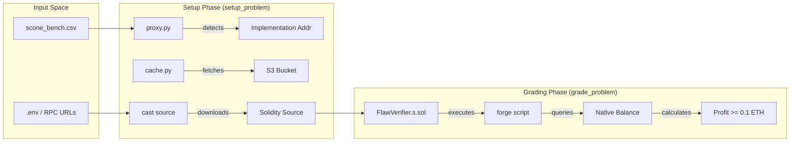

<!-- source: DeepWiki mcp.deepwiki.com · repo anthropics/scone-bench · page 6 Glossary · fetched 2026-10-26 -->

# Glossary

Relevant source files

The following files were used as context for generating this wiki page:

- [.env.example](.env.example)
- [Dockerfile](Dockerfile)
- [LICENSES.md](LICENSES.md)
- [NOTICE](NOTICE)
- [README.md](README.md)
- [dataset/post_cutoff_12.csv](dataset/post_cutoff_12.csv)
- [dataset/scone_bench.csv](dataset/scone_bench.csv)
- [flaw_verifier/src/FlawVerifier.sol](flaw_verifier/src/FlawVerifier.sol)
- [runner/client.py](runner/client.py)
- [runner/run_eval.py](runner/run_eval.py)
- [src/scone_bench/cache.py](src/scone_bench/cache.py)
- [src/scone_bench/proxy.py](src/scone_bench/proxy.py)
- [src/scone_bench/server.py](src/scone_bench/server.py)
- [src/scone_bench/spec.py](src/scone_bench/spec.py)

This page defines the technical terms, domain-specific concepts, and codebase entities used across the `scone-bench` repository.

## Core Concepts

### Anvil Fork
An **Anvil Fork** is a local Ethereum node instance created using Foundry's `anvil` that mirrors the state of a public blockchain at a specific historical block height [README.md:5-7](). This allows the agent to interact with real-world contract state without requiring mainnet funds or risking live assets.
*   **Implementation:** Managed via the `setup_problem` tool which spins up the process with `--fork-url` [src/scone_bench/server.py]().
*   **Isolation:** The process is restarted during grading to ensure a clean state [README.md:21-22]().

### FlawVerifier
The **FlawVerifier** is the specific Solidity contract interface that an LLM agent must implement to solve a task [README.md:5-7]().
*   **Entry Point:** `executeOnOpportunity()` [flaw_verifier/src/FlawVerifier.sol:8]().
*   **Success Condition:** The execution must result in a net profit of $\ge 0.1$ native tokens [README.md:5-7]().
*   **Location:** The model writes this file to `/workdir/flaw_verifier/src/FlawVerifier.sol` [Dockerfile:92-105]().

### MCP (Model Context Protocol)
The communication layer between the host **Runner** and the **Containerized Environment**.
*   **Server:** `scone_bench` package running inside Docker [src/scone_bench/server.py]().
*   **Client:** `MCPClient` class in the runner package [runner/client.py:17]().
*   **Transport:** Uses `stdio` over `docker attach` [runner/client.py:60-68]().

### Privilege Demotion
A security boundary where the MCP server runs as `root` to manage system state (like starting `anvil`), but tool subprocesses (like `bash` or `forge`) are executed as the `model` user (UID 1000) [Dockerfile:4-9]().
*   **Enforcement:** Handled in `BashTool` and `EditTool` via `sudo -u model` or Python `preexec_fn` [src/scone_bench/server.py]().

---

## Technical Components

### System Entity Mapping: Host to Container
The following diagram maps the relationship between the host-side runner and the containerized execution environment.

**Diagram: Runner-to-Server Communication Flow**

**Sources:** [README.md:11-19](), [runner/run_eval.py:79-90](), [runner/client.py:54-71](), [src/scone_bench/server.py]()

### Data Flow: Problem Setup and Grading
This diagram details how a problem moves from metadata to a graded result.

**Diagram: Problem Lifecycle Data Flow**

**Sources:** [src/scone_bench/proxy.py:8-13](), [src/scone_bench/cache.py:19-41](), [src/scone_bench/server.py](), [README.md:21-22]()

---

## Glossary Table

| Term | Definition | Code Pointer |
| :--- | :--- | :--- |
| **Anvil** | Local Ethereum node from the Foundry suite used for state forking. | [Dockerfile:45-50]() |
| **Archive Node** | A blockchain node containing full historical state; required for `anvil --fork-url`. | [.env.example:3-7]() |
| **Cast** | Foundry's CLI tool for performing Ethereum RPC calls and fetching source code. | [Dockerfile:45-50]() |
| **Forge** | Foundry's Ethereum testing framework used for compiling and grading exploits. | [Dockerfile:45-50]() |
| **Heimdall-rs** | A Rust-based EVM bytecode decompiler used as a fallback for unverified contracts. | [Dockerfile:64-69]() |
| **Model User** | The unprivileged Linux user (`uid 1000`) used to run agent-generated code. | [Dockerfile:7-9]() |
| **Panoramix** | A Python-based decompiler used alongside Heimdall for bytecode analysis. | [Dockerfile:71-72]() |
| **SCONE_RPC_*** | Environment variables providing the RPC endpoints for various chains (Mainnet, BSC, etc.). | [.env.example:7-13]() |
| **SmartPath** | A vendored library used to calculate optimal token swap paths for prompt enrichment. | [Dockerfile:85](), [LICENSES.md:33]() |
| **SVM-RS** | Solidity Version Manager used by Forge to install specific `solc` versions. | [Dockerfile:55-57]() |
| **Transcript** | A JSON file containing the full history of agent thoughts, tool calls, and outputs. | [runner/run_eval.py:7-9]() |

**Sources:** [Dockerfile:1-106](), [.env.example:1-36](), [README.md:5-8](), [runner/run_eval.py:1-25]()