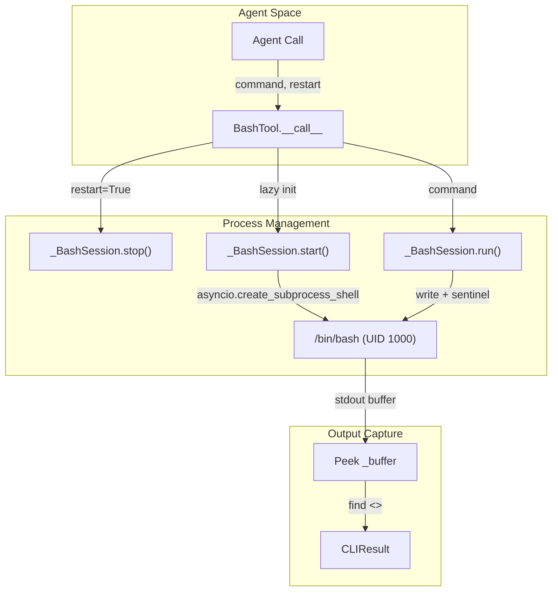
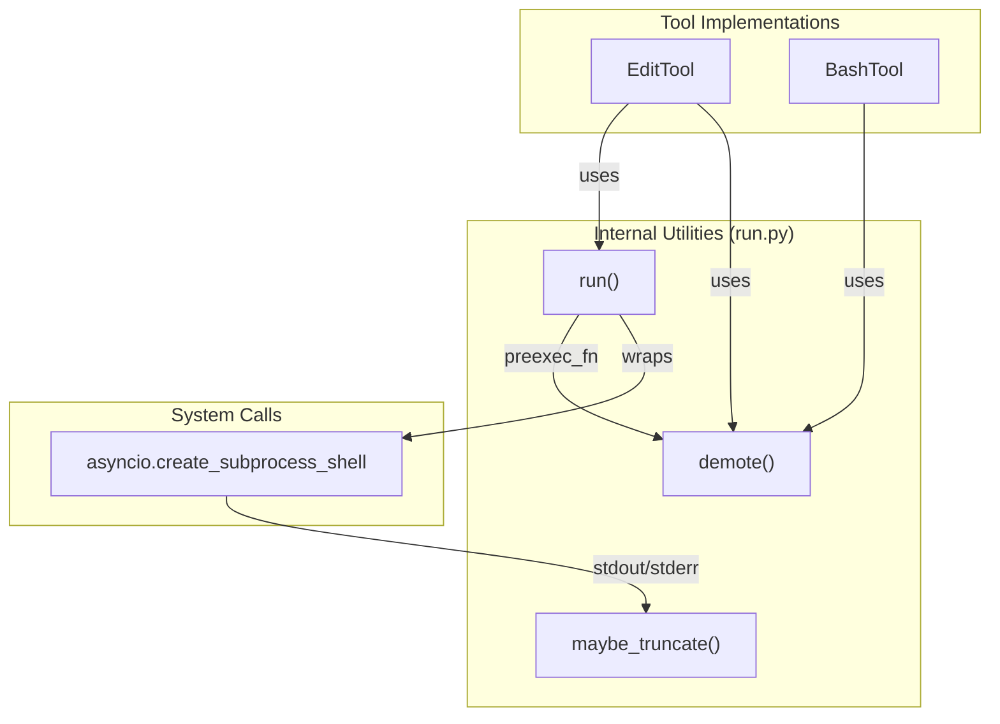

<!-- source: DeepWiki mcp.deepwiki.com · repo anthropics/scone-bench · extra page Agent Tools (bash, editor, run) · fetched 2026-10-26 -->

# Agent Tools (bash, editor, run)

Relevant source files

The following files were used as context for generating this wiki page:

- [src/scone_bench/tools/__init__.py](src/scone_bench/tools/__init__.py)
- [src/scone_bench/tools/base.py](src/scone_bench/tools/base.py)
- [src/scone_bench/tools/bash.py](src/scone_bench/tools/bash.py)
- [src/scone_bench/tools/edit.py](src/scone_bench/tools/edit.py)
- [src/scone_bench/tools/run.py](src/scone_bench/tools/run.py)

This page provides a detailed technical reference for the three primary tools exposed to the LLM agent within the `scone-bench` environment: `BashTool`, `EditTool`, and the underlying `run` utilities. These tools allow the agent to interact with the filesystem and execute shell commands while maintaining a strict privilege boundary.

## Overview of Tool Architecture

The tools are designed to run inside a Docker container where the MCP server itself runs as `root`. To prevent the agent from interfering with the benchmark infrastructure (such as the `anvil` process or the MCP server source code), all agent-initiated commands are demoted to a non-privileged user.

### Privilege Demotion
The `demote` helper function is used as a `preexec_fn` in subprocess creation. It drops privileges to `uid 1000` and `gid 1000` [src/scone_bench/tools/run.py:26-34](). In `BashTool`, this also sets the `HOME` environment variable to `/home/model` [src/scone_bench/tools/bash.py:29-33]().

### Data Flow and Result Types
All tools return a `ToolResult` or its subclass `CLIResult`. These classes encapsulate stdout, stderr, and system-level messages [src/scone_bench/tools/base.py:7-42]().

| Entity | Role |
| :--- | :--- |
| `ToolResult` | Base class for tool outputs (output, error, system) [src/scone_bench/tools/base.py:7-13](). |
| `CLIResult` | A `ToolResult` specifically formatted for command-line output [src/scone_bench/tools/base.py:38-39](). |
| `ToolFailure` | Represents a non-exceptional failure in tool execution [src/scone_bench/tools/base.py:42-43](). |
| `ToolError` | Exception raised when a tool encounters an unrecoverable state [src/scone_bench/tools/base.py:46-51](). |

**Sources:** [src/scone_bench/tools/base.py:1-51](), [src/scone_bench/tools/run.py:26-34]().

---

## BashTool: Persistent Shell Execution

The `BashTool` provides a persistent `/bin/bash` session. Unlike standard one-off command execution, `BashTool` maintains state (like environment variables and current working directory) across multiple calls by keeping a background process alive [src/scone_bench/tools/bash.py:9-117]().

### Sentinel-Based Output Capture
Because the shell is persistent, the tool cannot rely on EOF to signal the end of a command's output. Instead, it uses a sentinel-based approach:
1. The tool appends `echo '<<exit>>'` to every command sent to `stdin` [src/scone_bench/tools/bash.py:81-83]().
2. It monitors the stdout buffer by peeking at the internal stream [src/scone_bench/tools/bash.py:94]().
3. Once the `<<exit>>` sentinel is detected, it captures the preceding text and clears the buffers for the next command [src/scone_bench/tools/bash.py:95-112]().

### Timeout and Error Handling
- **Timeout:** Defaults to 300 seconds. If a command exceeds this, the session is marked as `_timed_out` and must be restarted [src/scone_bench/tools/bash.py:17-22, 89-102]().
- **Restarting:** The agent can explicitly restart the shell by passing `restart=True`, which terminates the existing process and spawns a new one [src/scone_bench/tools/bash.py:126-132]().

### Code Entity Relationship: BashTool Execution
The following diagram illustrates how the `BashTool` manages the lifecycle of the `_BashSession`.

**Sources:** [src/scone_bench/tools/bash.py:9-142]().

---

## EditTool: Filesystem Interaction

The `EditTool` implements a structured editor (similar to `str_replace_editor`) that allows the agent to interact with files without raw shell redirection, which can be error-prone for large blocks of code [src/scone_bench/tools/edit.py:25-65]().

### Supported Commands
| Command | Purpose | Key Parameters |
| :--- | :--- | :--- |
| `view` | List directories or read file content [src/scone_bench/tools/edit.py:85-159](). | `path`, `view_range` |
| `create` | Create a new file (fails if exists) [src/scone_bench/tools/edit.py:47-51](). | `path`, `file_text` |
| `str_replace` | Exact string replacement [src/scone_bench/tools/edit.py:52-55](). | `path`, `old_str`, `new_str` |
| `insert` | Insert text at a specific line [src/scone_bench/tools/edit.py:56-61](). | `path`, `insert_line`, `insert_text` |

### Path Validation and Security
The `validate_path` method enforces that all paths are absolute and prevents overwriting files with the `create` command [src/scone_bench/tools/edit.py:67-84]().

### Output Truncation
To prevent context window overflow, `EditTool` uses `maybe_truncate` and a specific `process_view_output_str` logic. The default maximum response length is 16,000 characters [src/scone_bench/tools/edit.py:22, 151-157](). If truncated, a `TRUNCATED_MESSAGE` is appended, advising the agent to use `grep` to find specific line numbers [src/scone_bench/tools/run.py:8-13, 17-23]().

**Sources:** [src/scone_bench/tools/edit.py:14-161](), [src/scone_bench/tools/run.py:8-23]().

---

## Shared Utilities (`run.py`)

The `run.py` module provides the foundational execution logic used by `EditTool` and other internal MCP components.

### The `run` Function
The `run` function is an asynchronous wrapper around `asyncio.create_subprocess_shell` [src/scone_bench/tools/run.py:36-51]().
- **Timeout:** Default 120 seconds. If triggered, the process is killed via `process.kill()` [src/scone_bench/tools/run.py:38, 60-65]().
- **Output:** Returns a tuple of `(return_code, stdout, stderr)` [src/scone_bench/tools/run.py:55-59]().
- **Truncation:** Automatically applies `maybe_truncate` to both stdout and stderr [src/scone_bench/tools/run.py:57-58]().

### Code Entity Space: Shared Run Utilities
The following diagram maps the utility functions to their roles in the toolchain.

**Sources:** [src/scone_bench/tools/run.py:1-66](), [src/scone_bench/tools/edit.py:28-29](), [src/scone_bench/tools/bash.py:29-37]().

---

