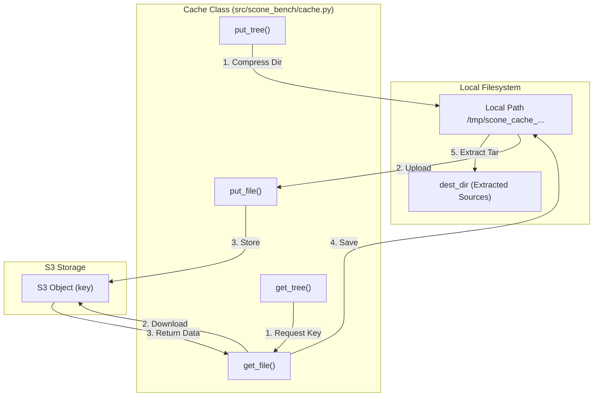
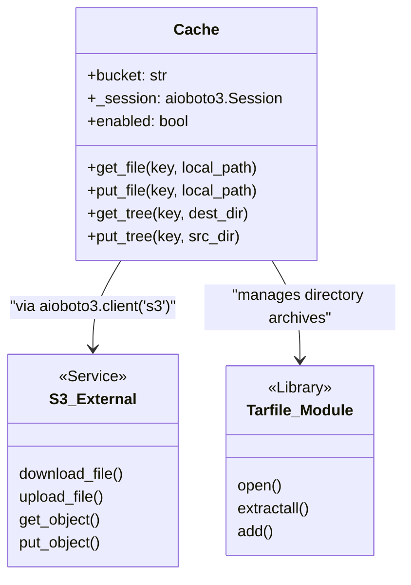

<!-- source: DeepWiki mcp.deepwiki.com · repo anthropics/scone-bench · extra page S3 Cache Layer · fetched 2026-10-26 -->

# S3 Cache Layer

Relevant source files

The following files were used as context for generating this wiki page:

- [.env.example](.env.example)
- [src/scone_bench/cache.py](src/scone_bench/cache.py)

The `scone-bench` environment includes an optional S3-backed caching layer designed to accelerate benchmark execution by avoiding redundant network-intensive operations. When enabled, it stores and retrieves heavy assets such as Anvil RPC fork state, contract source code tarballs, and generated problem statements.

### Purpose and Scope

The cache is implemented via the `Cache` class in [src/scone_bench/cache.py:19-115](). It is entirely optional; if the required environment variables are not set, the system defaults to "cold start" behavior where every resource is fetched fresh from original sources (e.g., Etherscan or Archive RPC nodes) [src/scone_bench/cache.py:5-8]().

The primary goals of the cache layer are:
1.  **Latency Reduction**: Avoiding the overhead of `cast source` hitting Etherscan or Anvil fetching state from archive nodes [src/scone_bench/cache.py:5-8]().
2.  **Cost Efficiency**: Reducing the number of requests made to paid Archive RPC providers (like Alchemy or QuickNode) [.env.example:3-7]().
3.  **Consistency**: Ensuring that multiple runs of the same problem use the exact same starting state and source files.

---

### Configuration and Activation

The cache is enabled by setting the `SCONE_S3_BUCKET` environment variable [.env.example:28](). If this variable is unset, the `Cache` class methods become no-ops [src/scone_bench/cache.py:45-46]().

| Environment Variable | Description | Default |
| :--- | :--- | :--- |
| `SCONE_S3_BUCKET` | The name of the S3 bucket to use for caching. | None (Disabled) |
| `SCONE_S3_REGION` | The AWS region for the bucket. | `us-east-1` |
| `AWS_ACCESS_KEY_ID` | AWS credentials for bucket access. | Required if bucket set |
| `AWS_SECRET_ACCESS_KEY` | AWS credentials for bucket access. | Required if bucket set |

**Sources:** [.env.example:28-31](), [src/scone_bench/cache.py:21-37]()

---

### Architecture and Data Flow

The cache layer uses `aioboto3` for asynchronous communication with S3 [src/scone_bench/cache.py:25-33](). It handles two main types of data: individual files/text and directory trees (which are transparently tarred/untarred).

#### Cache Interaction Logic
The following diagram illustrates how the `Cache` class mediates between the local file system and S3 storage.

**Diagram: Cache Data Flow**

**Sources:** [src/scone_bench/cache.py:43-115]()

---

### Key API Methods

The `Cache` class provides a high-level API for managing different types of benchmark artifacts.

#### File and Text Operations
*   `get_file(key, local_path)`: Downloads an object from S3 to a specific local path. Returns `True` on hit, `False` on miss [src/scone_bench/cache.py:43-57]().
*   `put_file(key, local_path)`: Uploads a local file to S3 [src/scone_bench/cache.py:59-68]().
*   `get_text(key)`: Directly retrieves the contents of an S3 object as a UTF-8 string [src/scone_bench/cache.py:70-82]().
*   `put_text(key, text)`: Directly uploads a string to S3 [src/scone_bench/cache.py:84-92]().

#### Tree (Directory) Operations
These methods are used for caching entire directories, such as the contract source code fetched via `cast source`.
*   `get_tree(key, dest_dir)`: Downloads a `.tar.gz` from S3, extracts it into the destination directory, and then cleans up the temporary archive [src/scone_bench/cache.py:94-105]().
*   `put_tree(key, src_dir)`: Compresses the source directory into a `.tar.gz` archive and uploads it to S3 [src/scone_bench/cache.py:107-114]().

**Sources:** [src/scone_bench/cache.py:43-115]()

---

### Implementation Details

#### Code Entity Mapping
The following diagram maps the high-level cache functions to the internal Python logic and external dependencies.

**Diagram: Code Entity Mapping**

**Sources:** [src/scone_bench/cache.py:13-115]()

#### Error Handling and Logging
*   **Missing Dependencies**: If `SCONE_S3_BUCKET` is set but `aioboto3` is not installed, the cache logs a warning and disables itself [src/scone_bench/cache.py:26-32]().
*   **Cache Misses**: On a miss, the system logs the event to `stderr` and returns `False` or `None`, allowing the caller to proceed with the standard (slow) fetching logic [src/scone_bench/cache.py:54-57, 80-82]().
*   **Write Failures**: Failures to write to the cache (e.g., permission issues) are logged as warnings but do not crash the benchmark run [src/scone_bench/cache.py:68, 92]().

**Sources:** [src/scone_bench/cache.py:23-37, 54-57, 67-68, 80-82, 92]()

---

