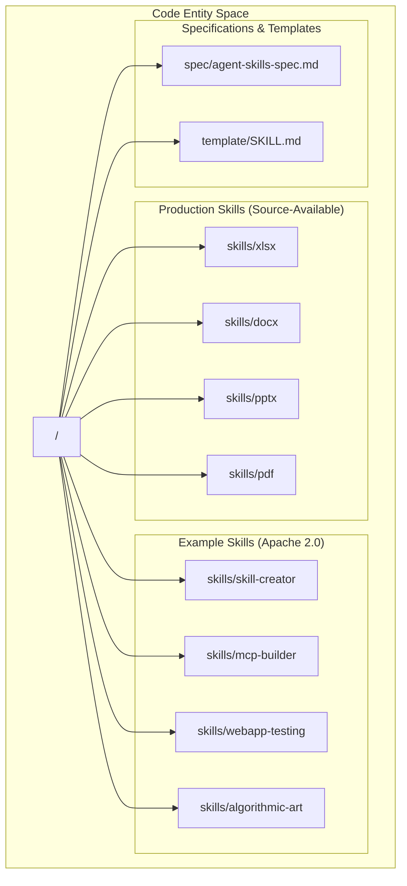
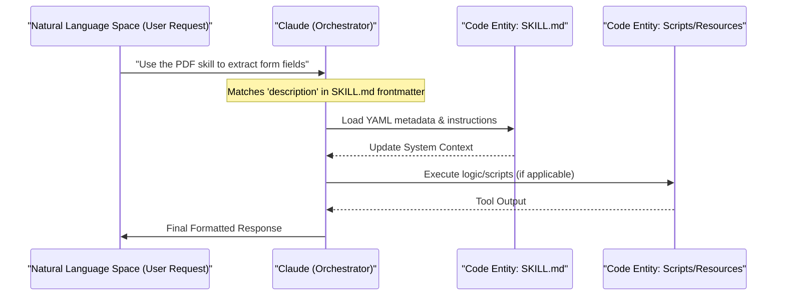

<!-- source: DeepWiki mcp.deepwiki.com · repo anthropics/skills · page 1 Overview · fetched 2026-10-30 -->

# Overview

Relevant source files

The following files were used as context for generating this wiki page:

- [.claude-plugin/marketplace.json](.claude-plugin/marketplace.json)
- [.gitignore](.gitignore)
- [README.md](README.md)
- [skills/academy-guide/LICENSE.txt](skills/academy-guide/LICENSE.txt)
- [skills/academy-guide/SKILL.md](skills/academy-guide/SKILL.md)
- [spec/agent-skills-spec.md](spec/agent-skills-spec.md)

The `anthropics/skills` repository is Anthropic's reference implementation of the Agent Skills standard, providing a collection of skills that extend Claude's capabilities for specialized tasks. Skills are self-contained directories containing a `SKILL.md` file with instructions, along with optional scripts and resources that Claude loads dynamically at runtime [README.md:5-18]().

This page introduces the repository's purpose, the Agent Skills standard, skill types and licensing, and deployment paths. For installation instructions, see [Quick Start](#1.1). For a view of the codebase layout, see [Repository Layout at a Glance](#1.2).

## What Are Skills?

Skills teach Claude how to complete specific tasks in a repeatable way. Each skill is a directory containing a mandatory `SKILL.md` file with YAML frontmatter and instructions [README.md:18](), [README.md:63-65](). When a user's request matches a skill's `description` field in the frontmatter, Claude loads the instructions into its execution context to perform the task [README.md:68-90]().

Sources: [README.md:5-11](), [README.md:63-90]()

## Agent Skills Standard

This repository implements the **Agent Skills** standard, a community specification for defining reusable AI capabilities [README.md:1](). The full specification is published at [agentskills.io](https://agentskills.io/specification) [spec/agent-skills-spec.md:1-3](). The standard defines the `SKILL.md` format, including required fields like `name` and `description` [README.md:86-89]().

Sources: [README.md:1](), [spec/agent-skills-spec.md:1-3]()

## Repository Purpose and Scope

The repository serves as a production reference and a community resource:

1.  **Production Reference**: Contains the `document-skills` which power Claude's production document capabilities (Word, Excel, PDF, PowerPoint) [README.md:19-21]().
2.  **Educational Examples**: Provides `example-skills` with open-source (Apache 2.0) skills for creative, technical, and enterprise workflows [README.md:16-20]().
3.  **Template**: Provides a `template` directory for creating new skills [README.md:29]().

**Licensing Model:**

| Category | License | Usage |
| :--- | :--- | :--- |
| **Document Skills** | Source-available | Production-grade reference for complex AI applications [README.md:19-21]() |
| **Example Skills** | Apache 2.0 | Open-source examples for developers [README.md:19-20]() |

Sources: [README.md:14-25](), [README.md:26-30]()

## Repository Structure

The repository is organized around the `skills/` directory and the Agent Skills specification.

**Organization of Skill Entities**

Sources: [README.md:26-30](), [README.md:19-21]()

## Skill Execution Model

Skills bridge the gap between natural language requests and specific code execution or behavioral constraints.

**Natural Language to Code Entity Mapping**

Sources: [README.md:5-12](), [README.md:50-52](), [README.md:68-90]()

## Skill Catalog Overview

The repository includes several specialized skill sets:

*   **Document Skills**: Production-grade tools for `docx`, `pdf`, `pptx`, and `xlsx` [README.md:19-21]().
*   **Creative & Design**: Skills for algorithmic art, canvas design, and music [README.md:16-18](), [README.md:27]().
*   **Development & Technical**: Tools for MCP server generation and webapp testing [README.md:16-18](), [README.md:27]().
*   **Enterprise & Communication**: Skills for brand guidelines and internal communications [README.md:16-18](), [README.md:27]().

Sources: [README.md:14-21](), [README.md:26-30]()

## Deployment Paths

Skills can be used across multiple Anthropic platforms:

*   **Claude Code**: Installed via `/plugin install` commands or by adding the marketplace [README.md:33-52]().
*   **Claude.ai**: Pre-integrated for paid plans or available via custom skill uploads [README.md:53-57]().
*   **Claude API**: Created and managed programmatically via the Skills API [README.md:59-61]().

For detailed setup instructions, see [Quick Start](#1.1).

Sources: [README.md:31-61]()

---

