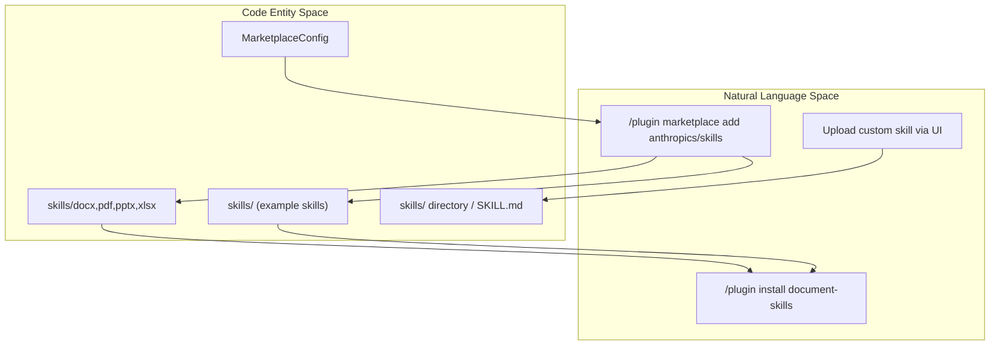
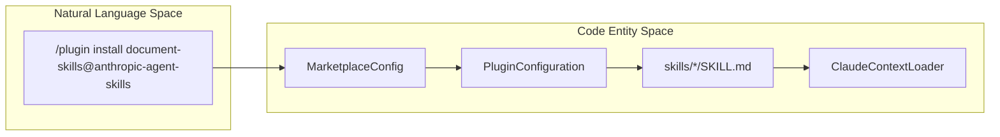
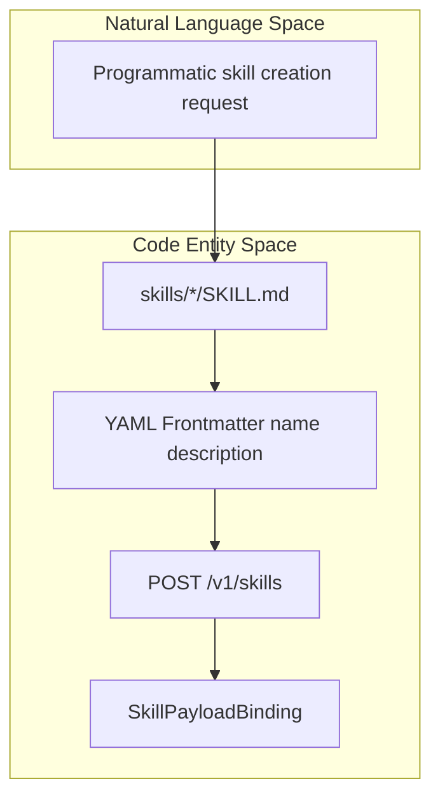
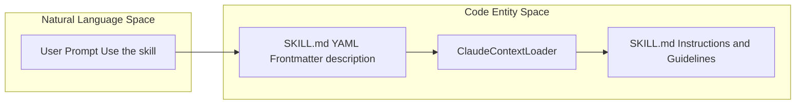

<!-- source: DeepWiki mcp.deepwiki.com · repo anthropics/skills · page 1.1 Quick Start · fetched 2026-10-30 -->

# Quick Start

<details>
<summary>Relevant source files</summary>

The following files were used as context for generating this wiki page:

- [.gitignore](.gitignore)
- [README.md](README.md)
- [spec/agent-skills-spec.md](spec/agent-skills-spec.md)

</details>


This page provides installation and basic usage instructions for getting started with skills across Claude's three deployment platforms: Claude Code, Claude.ai, and the Claude API [README.md:31-61]().

## Prerequisites

Before installing skills, ensure you have access to one of the following platforms:

| Platform | Requirements | Skill Access |
|----------|-------------|--------------|
| **Claude Code** | Desktop application installed | Plugin marketplace system with manual installation [README.md:33-49]() |
| **Claude.ai** | Paid plan (Pro, Team, or Enterprise) | Example skills pre-integrated; custom upload supported [README.md:53-57]() |
| **Claude API** | API key and SDK setup | Programmatic skill management via API endpoints [README.md:59-61]() |

Sources: [README.md:33-61]()

## Installation Paths Overview

The following diagram bridges user commands in Natural Language Space to code entities and configuration files in Code Entity Space.

Title: Deployment Paths for Skills Installation



Sources: [README.md:20-61]()

## Claude Code Installation

### Register the Plugin Marketplace

Register the `anthropics/skills` repository as a plugin marketplace by running the command within Claude Code [README.md:33-37]():

```bash
/plugin marketplace add anthropics/skills
```

### Install a Plugin

**Interactive Installation:**
1. Select `Browse and install plugins` [README.md:39-43]()
2. Select `anthropic-agent-skills` [README.md:42-42]()
3. Choose plugin (`document-skills` or `example-skills`) [README.md:43-43]()
4. Select `Install now` [README.md:43-43]()

**Direct Installation:** [README.md:45-49]()
```bash
/plugin install document-skills@anthropic-agent-skills
/plugin install example-skills@anthropic-agent-skills
```

Title: Plugin Installation and Loading Flow



Sources: [README.md:33-51]()

### Invoke a Skill

After installation, skills are invoked through natural language references [README.md:51-51]():

```
Use the PDF skill to extract the form fields from path/to/some-file.pdf
```

Claude dynamically loads the corresponding `SKILL.md` file located in the skill directory and executes the instructions [README.md:18-51]().

Sources: [README.md:18-51]()

## Claude.ai Installation

### Pre-integrated Skills

Example skills are pre-integrated into Claude.ai for users on paid plans (Pro, Team, Enterprise) [README.md:53-55](). 

### Upload Custom Skills

To upload custom skills or creations, follow the instructions in the official Claude documentation referenced in [README.md:57-57]().

Sources: [README.md:53-57]()

## Claude API Installation

### Prerequisites

Install the Anthropic SDK as outlined in the official API guides [README.md:59-61]().

Title: API Skill Integration Flow



Sources: [README.md:59-61](), [README.md:68-89]()

## Skill Invocation Pattern

Once installed, skills follow a uniform loading and execution pattern across platforms:

Title: Skill Loading and Execution



The `description` field in the YAML frontmatter [README.md:88-88]() determines when Claude activates a skill, while the markdown content provides execution instructions [README.md:90-90]().

Sources: [README.md:63-90]()

## Next Steps

- **Understand skill structure:** See the template definition [README.md:65-84]()
- **Review the Agent Skills standard:** See [spec/agent-skills-spec.md:1-3]() and [agentskills.io](http://agentskills.io) [README.md:1-1]()

Sources: [README.md:1-96](), [spec/agent-skills-spec.md:1-3]()

---

