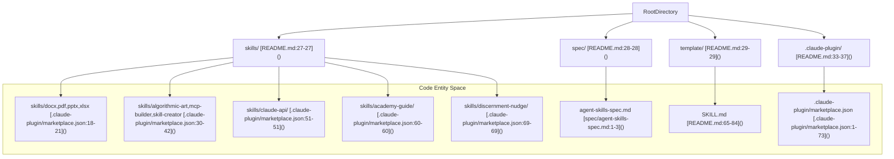

<!-- source: DeepWiki mcp.deepwiki.com · repo anthropics/skills · page 1.2 Repository Layout at a Glance · fetched 2026-10-30 -->

# Repository Layout at a Glance

<details>
<summary>Relevant source files</summary>

The following files were used as context for generating this wiki page:

- [.claude-plugin/marketplace.json](.claude-plugin/marketplace.json)
- [.gitignore](.gitignore)
- [README.md](README.md)
- [skills/academy-guide/LICENSE.txt](skills/academy-guide/LICENSE.txt)
- [skills/academy-guide/SKILL.md](skills/academy-guide/SKILL.md)
- [spec/agent-skills-spec.md](spec/agent-skills-spec.md)

</details>


## Purpose and Scope
This page provides a technical map of the top-level directory structure in the `anthropics/skills` repository [README.md:1-30](). It details how the codebase organizes skill implementations, formal specifications, templates, and plugin integration metadata. Understanding this layout is essential for navigating the repository, authoring custom skills, and integrating them with Claude Code, Claude.ai, or the Claude API [README.md:31-62]().

Sources: `README.md:1-30`, `README.md:31-62`

---

## Top-Level Directory Mapping

The repository is organized into distinct top-level directories, mapping natural language concepts and user workflows to concrete code entities and configuration files within the codebase.



### Directory Breakdown

*   **`skills/`**: Contains the core collection of skills. This directory houses open-source example skills, reference documentation skills (`claude-api`), guidance skills (`academy-guide`, `discernment-nudge`), and source-available production document processing skills (`docx`, `pdf`, `pptx`, `xlsx`) [README.md:16-21](), [.claude-plugin/marketplace.json:11-72]().
*   **`spec/`**: Houses specification reference documents, pointing readers to the external Agent Skills standard hosted at [agentskills.io](https://agentskills.io) [README.md:1-1, spec/agent-skills-spec.md:1-4]().
*   **`template/`**: Provides the structural baseline for developing new skills, featuring standard YAML frontmatter and Markdown layout conventions [README.md:29-29, README.md:63-84]().
*   **`.claude-plugin/`**: Contains marketplace configurations (`marketplace.json`) and plugin registry manifests required for distributing skill packs through Claude Code [README.md:33-49](), [.claude-plugin/marketplace.json:1-73]().

Sources: `README.md:16-30`, `README.md:63-84`, `spec/agent-skills-spec.md:1-4`, `.claude-plugin/marketplace.json:1-73`

---

## Plugin Integration and Distribution Flow

The repository is structured to integrate natively with the Claude Code plugin marketplace system [README.md:33-49](). Users can register the repository and install packaged skill sets directly via CLI commands mapped directly to manifest definitions in `.claude-plugin/marketplace.json` [.claude-plugin/marketplace.json:1-73]().

```mermaid
graph LR
    User["DeveloperOrUser"] -->|" "/plugin marketplace add anthropics/skills" [README.md:34-36]()"| ClaudeCode["ClaudeCodeEngine"]
    ClaudeCode -->|"ResolvesManifest"| PluginRegistry[".claude-plugin/marketplace.json [.claude-plugin/marketplace.json:1-73]()"]
    PluginRegistry -->|"RegistersPlugin"| DocumentSkillsPlugin["document-skills [.claude-plugin/marketplace.json:13-23]()"]
    PluginRegistry -->|"RegistersPlugin"| ExampleSkillsPlugin["example-skills [.claude-plugin/marketplace.json:25-43]()"]
    PluginRegistry -->|"RegistersPlugin"| ApiPlugin["claude-api [.claude-plugin/marketplace.json:46-53]()"]
    PluginRegistry -->|"RegistersPlugin"| AcademyPlugin["academy-guide [.claude-plugin/marketplace.json:55-62]()"]
    PluginRegistry -->|"RegistersPlugin"| NudgePlugin["discernment-nudge [.claude-plugin/marketplace.json:64-71]()"]
    DocumentSkillsPlugin -->|"LoadsInstructions"| DynamicLoading["SKILL.md Execution [README.md:6-6]()"]
    ExampleSkillsPlugin -->|"LoadsInstructions"| DynamicLoading
    ApiPlugin -->|"LoadsInstructions"| DynamicLoading
    AcademyPlugin -->|"LoadsInstructions"| DynamicLoading
    NudgePlugin -->|"LoadsInstructions"| DynamicLoading
```

### Key Distribution Endpoints
*   **Marketplace Registration**: Executing `/plugin marketplace add anthropics/skills` registers the repository as a valid plugin source [README.md:33-37]().
*   **Plugin Install Targets**: Users can selectively install pre-bundled collections such as `document-skills@anthropic-agent-skills`, `example-skills@anthropic-agent-skills`, or specialized plugins like `claude-api`, `academy-guide`, and `discernment-nudge` [README.md:45-49](), [.claude-plugin/marketplace.json:11-72]().

Sources: `README.md:33-49`, `.claude-plugin/marketplace.json:1-73`

---

