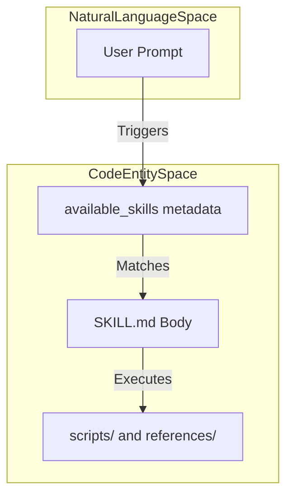
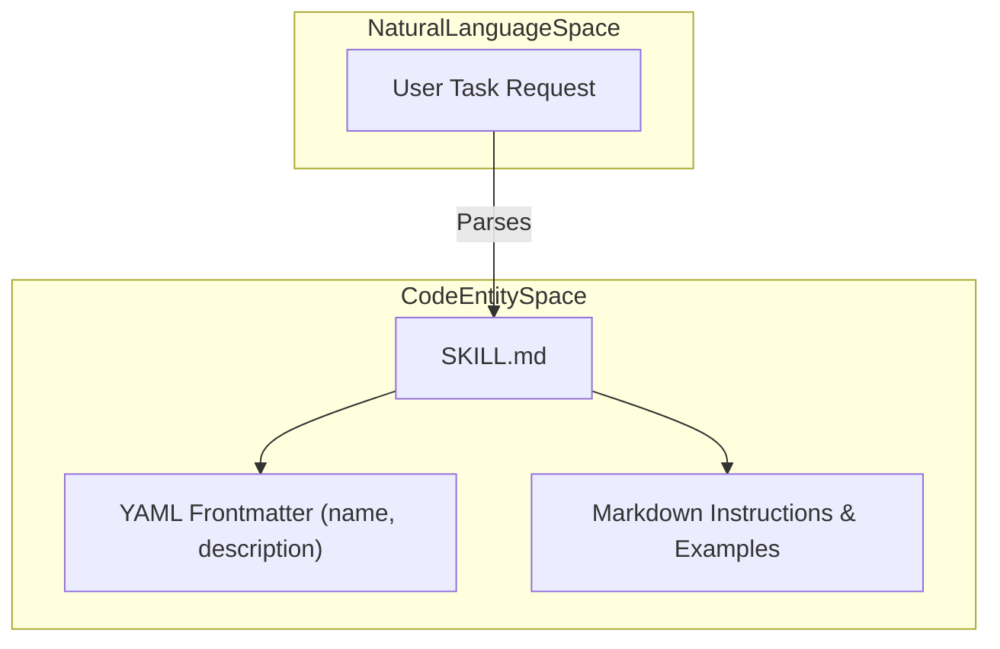
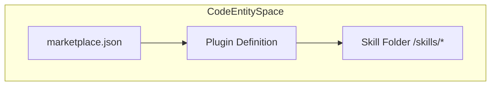
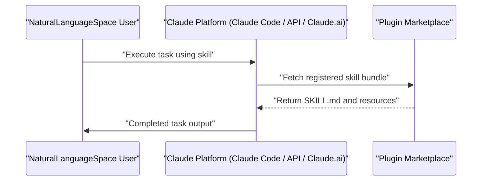

<!-- source: DeepWiki mcp.deepwiki.com · repo anthropics/skills · page 2 Core Concepts · fetched 2026-10-30 -->

# Core Concepts

Relevant source files

The following files were used as context for generating this wiki page:

- [.gitignore](.gitignore)
- [README.md](README.md)
- [spec/agent-skills-spec.md](spec/agent-skills-spec.md)

This page introduces the fundamental concepts of the Claude skills system, explaining what skills are, how they are structured, and the core principles that govern their execution. 

Skills are folders of instructions, scripts, and resources that Claude loads dynamically to improve performance on specialized tasks [README.md:5-6](). They operate on a progressive disclosure model to maintain context efficiency.

As a parent page, this document provides a high-level overview. For deep technical details, please refer to the child pages:
- For runtime execution and loading architecture, see [Skills System Architecture](#2.1).
- For file structure and syntax rules, see [SKILL.md Format Specification](#2.2).
- For packaging and distribution, see [Marketplace and Plugin System](#2.3).
- For platform-specific invocation, see [Platform Integration](#2.4).

---

## 2.1. Skills System Architecture

The skills system uses a **progressive disclosure model** to manage context window efficiency. Claude does not pre-load all available skills into its context; instead, it exposes only lightweight metadata initially and loads full instructions and resources on demand.

For detailed information on how skills are loaded, executed, and integrated with Claude's execution context, see [Skills System Architecture](#2.1).

Sources: [README.md:5-12](), [README.md:63-88]()

---

## 2.2. SKILL.md Format Specification

Every skill is encapsulated in a self-contained folder containing a required `SKILL.md` file [README.md:18](). The file combines YAML frontmatter for metadata with Markdown for instructional guidance.

For comprehensive syntax requirements, frontmatter schemas, and Markdown guidelines, see [SKILL.md Format Specification](#2.2).

Sources: [README.md:63-91]()

---

## 2.3. Marketplace and Plugin System

Skills can be bundled into plugins and distributed via a marketplace structure defined by `marketplace.json` [README.md:34-36](). This allows teams and the broader community to share sets of specialized capabilities—such as document processing or example workflows—in a unified registry.

For details on plugin organization, registry configuration, and distribution mechanics, see [Marketplace and Plugin System](#2.3).

Sources: [README.md:34-49](), [README.md:5-6]()

---

## 2.4. Platform Integration

Skills integrate seamlessly across multiple Claude deployment surfaces, including Claude Code, Claude.ai, and the Claude API [README.md:31-62](). Installation and invocation methods vary slightly by platform, ranging from CLI plugin commands (`/plugin install`) to API tool definitions.

For platform-specific installation guides, invocation syntax, and execution environments, see [Platform Integration](#2.4).

Sources: [README.md:31-62]()

---

