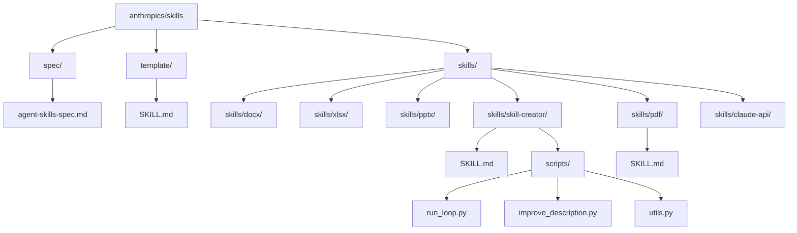
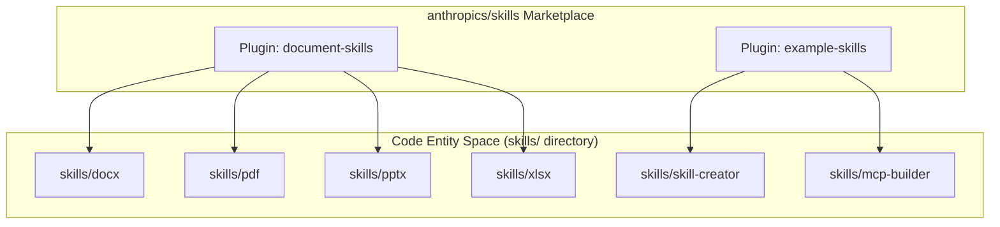
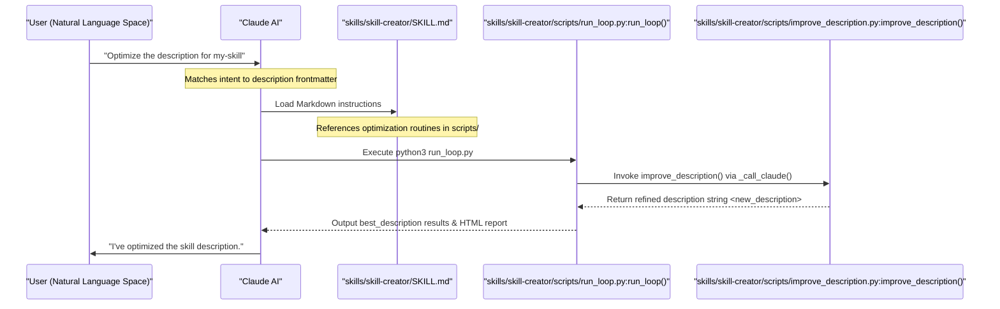

<!-- source: DeepWiki mcp.deepwiki.com · repo anthropics/skills · page 2.1 Skills System Architecture · fetched 2026-10-30 -->

# Skills System Architecture

Relevant source files

The following files were used as context for generating this wiki page:

- [.gitignore](.gitignore)
- [README.md](README.md)
- [skills/skill-creator/SKILL.md](skills/skill-creator/SKILL.md)
- [skills/skill-creator/scripts/improve_description.py](skills/skill-creator/scripts/improve_description.py)
- [skills/skill-creator/scripts/run_loop.py](skills/skill-creator/scripts/run_loop.py)
- [spec/agent-skills-spec.md](spec/agent-skills-spec.md)

## Purpose and Scope
This page explains the high-level technical architecture of the Anthropic skills system. It covers how skills are structured, how Claude dynamically discovers and loads them via progressive disclosure, how they map to plugins and the filesystem, and how programmatic execution and optimization loops (such as `run_loop.py` and `improve_description.py`) bridge natural language user requests to concrete code entities.

---

## 1. Core Anatomy of a Skill

A skill is a self-contained directory containing a `SKILL.md` file [README.md:18-18](). The `SKILL.md` file serves as the primary entry point for Claude and consists of two core components:

1. **YAML Frontmatter**: Machine-readable metadata containing the skill's identity and activation criteria [README.md:68-71]().
   - `name`: A unique lowercase identifier utilizing hyphens for spaces [README.md:87-87]().
   - `description`: A complete specification of what the skill does and when Claude should invoke it, functioning as the primary triggering mechanism [README.md:88-88]().
2. **Markdown Body**: The instructional set, examples, and guidelines that Claude executes when the skill is active [README.md:73-84]().

Skills may also package optional supporting resources [skills/skill-creator/SKILL.md:75-84]():
- `scripts/`: Executable code for deterministic or repetitive tasks [skills/skill-creator/SKILL.md:81-81]().
- `references/`: Documentation or large context files loaded only as needed [skills/skill-creator/SKILL.md:82-82]().
- `assets/`: Files used during output generation, such as templates, icons, or fonts [skills/skill-creator/SKILL.md:83-83]().

Sources: [README.md:18-18](), [README.md:68-90](), [skills/skill-creator/SKILL.md:75-84]()

---

## 2. Directory Layout and Organization

The repository organizes skills under a flat directory structure within the `skills/` folder [README.md:27-27](). Each subfolder represents a standalone skill containing its own configuration and execution assets.

**Diagram: Repository Structure and Code Entities**

Sources: [README.md:26-30](), [spec/agent-skills-spec.md:1-3](), [skills/skill-creator/scripts/run_loop.py:1-20]()

---

## 3. The Plugin System and Marketplace Integration

While individual skill directories represent the atomic unit of execution, they are organized into logical **Plugins** for packaging and distribution, particularly within Claude Code [README.md:33-49]().

- **Marketplace**: Users register the repository as a plugin marketplace via `/plugin marketplace add anthropics/skills` [README.md:36-36]().
- **Plugins**: Skills are grouped into logical bundles like `document-skills` (containing document processing binaries) or `example-skills` [README.md:41-48]().

**Diagram: Plugin to Code Entity Mapping**

Sources: [README.md:20-20](), [README.md:33-49]()

---

## 4. Progressive Disclosure and Runtime Lifecycle

Skills are loaded dynamically based on contextual relevance [README.md:6-6](). Claude utilizes a three-tier system of **Progressive Disclosure** to manage context efficiency [skills/skill-creator/SKILL.md:88-92]().

1. **Metadata** (`name` + `description`): Always maintained in active context (~100 words) for trigger evaluation [skills/skill-creator/SKILL.md:89-89]().
2. **`SKILL.md` Body**: Injected into context whenever the skill triggers (<500 lines ideal) [skills/skill-creator/SKILL.md:90-90]().
3. **Bundled Resources**: Loaded or executed selectively as needed (e.g., executing scripts without loading entire reference documents into context) [skills/skill-creator/SKILL.md:91-91]().

Sources: [README.md:6-6](), [skills/skill-creator/SKILL.md:88-92]()

---

## 5. Execution Flow and Optimization Engine

Meta-skills like `skills/skill-creator/SKILL.md` provide automated workflows that bridge natural language prompts to concrete Python execution pipelines (`run_loop.py`, `improve_description.py`, `run_eval.py`). 

**Diagram: Natural Language Space to Code Entity Space Execution Flow**

Sources: [README.md:6-6](), [README.md:51-51](), [skills/skill-creator/SKILL.md:88-109](), [skills/skill-creator/scripts/run_loop.py:47-61](), [skills/skill-creator/scripts/improve_description.py:20-60]()

---

## 6. Architectural Principles

1. **Self-Containment**: Each skill folder encapsulates instructions (`SKILL.md`) and supporting logic (`scripts/`) or assets [README.md:18-18]().
2. **Progressive Disclosure**: Detailed instructions remain deferred until triggered, preventing context window saturation [skills/skill-creator/SKILL.md:88-92]().
3. **Standardization**: All implementations comply with the open **Agent Skills Spec** [README.md:1-1](), [spec/agent-skills-spec.md:3-3]().
4. **Optimization Loop**: Meta-skills such as `skill-creator` incorporate evaluation scripts (`run_loop.py`) [skills/skill-creator/scripts/run_loop.py:1-7]() and description tuning functions (`improve_description.py`) [skills/skill-creator/scripts/improve_description.py:1-7]() to systematically measure and improve triggering accuracy.

Sources: [README.md:1-1](), [README.md:18-20](), [skills/skill-creator/SKILL.md:88-92](), [skills/skill-creator/scripts/run_loop.py:1-7](), [skills/skill-creator/scripts/improve_description.py:1-7]()

---

