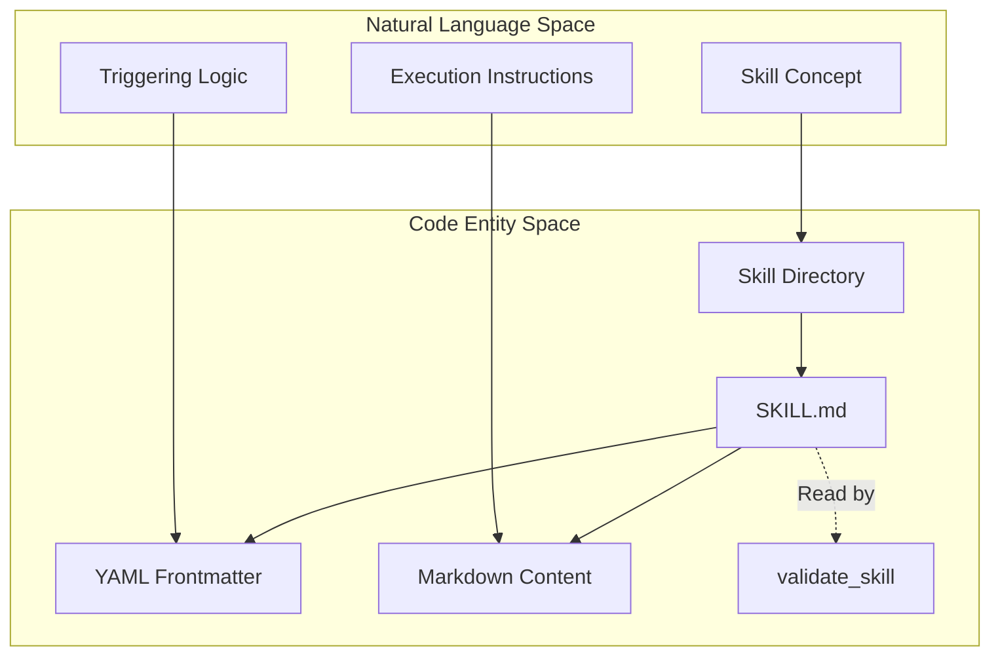
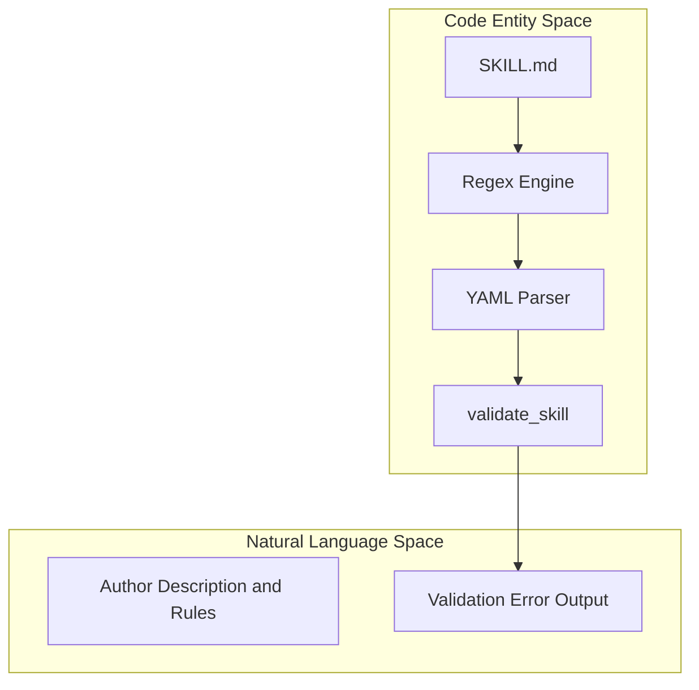

<!-- source: DeepWiki mcp.deepwiki.com · repo anthropics/skills · page 2.2 SKILL.md Format Specification · fetched 2026-10-30 -->

# SKILL.md Format Specification

<details>
<summary>Relevant source files</summary>

The following files were used as context for generating this wiki page:

- [.gitignore](.gitignore)
- [README.md](README.md)
- [skills/docx/SKILL.md](skills/docx/SKILL.md)
- [skills/docx/scripts/merge_runs.py](skills/docx/scripts/merge_runs.py)
- [spec/agent-skills-spec.md](spec/agent-skills-spec.md)

</details>


## Purpose and Scope
This document defines the technical structure, format requirements, and validation logic for `SKILL.md` files, which serve as the primary entry point and configuration for all skills in the `anthropics/skills` repository. It covers YAML frontmatter property constraints, Markdown body conventions, and the programmatic validation rules enforced by tools such as `quick_validate.py`. 

Sources: [README.md:63-90]()

## File Structure Overview
Every skill is encapsulated within its own directory under the `skills/` folder, containing a mandatory `SKILL.md` entry point. The file combines structured metadata headers (YAML frontmatter) with freeform instruction bodies (Markdown) that dictate how Claude should execute the skill.

### Natural Language to Code Entity Mapping: File Structure
This diagram illustrates how high-level natural language concepts map onto concrete file artifacts and parser functions in the codebase.



Sources: [README.md:14-20]()

## YAML Frontmatter Specification
The YAML frontmatter must appear at the exact beginning of the `SKILL.md` file, bounded by `---` markers. It is parsed to drive skill discovery, routing, and tool access permissions.

### Allowed and Required Properties
The validation engine strictly enforces an allowlist of properties:

| Field | Type | Constraints | Purpose |
|-------|------|-------------|---------|
| `name` | string | Kebab-case (`[a-z0-9-]+`), max 64 chars | Unique identifier for the skill [README.md:87]() |
| `description` | string | Max 1024 chars, no angle brackets (`<`, `>`) | Drives skill triggering and routing [README.md:88]() |
| `license` | string | Optional | Clarifies usage rights (e.g. `Apache-2.0`) [README.md:20]() |
| `allowed-tools` | list/string | Optional | Restricts tool execution permissions |
| `metadata` | map | Optional | Nested metadata dictionary |
| `compatibility` | string | Max 500 chars, optional | Environment or platform requirements |

### Parsing and Validation Rules
The validation function performs the following validation steps:
1. Verifies the existence of `SKILL.md` within the target directory.
2. Ensures the file starts with `---` and extracts the frontmatter text block using regular expression matching.
3. Safely parses the extracted text using YAML parsing into a dictionary structure.
4. Compares frontmatter keys against allowed properties (`name`, `description`, `license`, `allowed-tools`, `metadata`, `compatibility`).
5. Validates name formatting: checks that `name` consists entirely of lowercase alphanumeric characters and hyphens, avoids consecutive or leading/trailing hyphens, and adheres to a maximum length of 64 characters.
6. Validates description string: prohibits angle brackets (`<` or `>`) to prevent injection/parsing errors and enforces a 1024-character maximum length.

Sources: [README.md:86-90]()

## Markdown Body Specification
Following the closing `---` frontmatter delimiter, the Markdown body contains the procedural instructions, context, examples, and guidelines loaded into Claude's context window upon activation.

### Progressive Disclosure System
* **Metadata Layer (Frontmatter)**: Always active or indexable for routing decisions.
* **Instruction Body**: Dynamically loaded into context only when the skill is invoked [README.md:6-11]().
* **Bundled Resources**: Reference scripts, templates, and assets embedded in the skill folder that Claude can access via tool calls as needed [README.md:6]().

### Content Conventions
* **Headings**: Use structured H1 and H2 headers (`#`, `##`) to logically divide instructions, workflows, and reference sections [README.md:73-84]().
* **Examples**: Provide clear sample usage blocks under an `## Examples` header to guide Claude's generation pattern [README.md:77-79]().
* **Guidelines**: Itemize boundary conditions, formatting rules, or constraints under an `## Guidelines` header [README.md:81-83]().

Sources: [README.md:6-11](), [README.md:65-84]()

## Validation and Execution Logic
Python scripts in the repository parse and validate `SKILL.md` to ensure structural integrity before test evaluations or packaging.

### Natural Language to Code Entity Mapping: Validation Flow
This diagram maps frontmatter and body evaluation rules to their underlying code components.



Sources: [README.md:63-90]()

## Complete Format Example
A standard `SKILL.md` compliant with parser rules follows this template:

```markdown
---
name: my-skill-name
description: A clear description of what this skill does and when to use it
---

# My Skill Name

[Add your instructions here that Claude will follow when this skill is active]

## Examples
- Example usage 1
- Example usage 2

## Guidelines
- Guideline 1
- Guideline 2
```

Sources: [README.md:65-84]()

---

