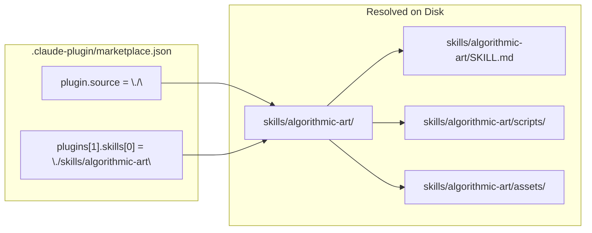
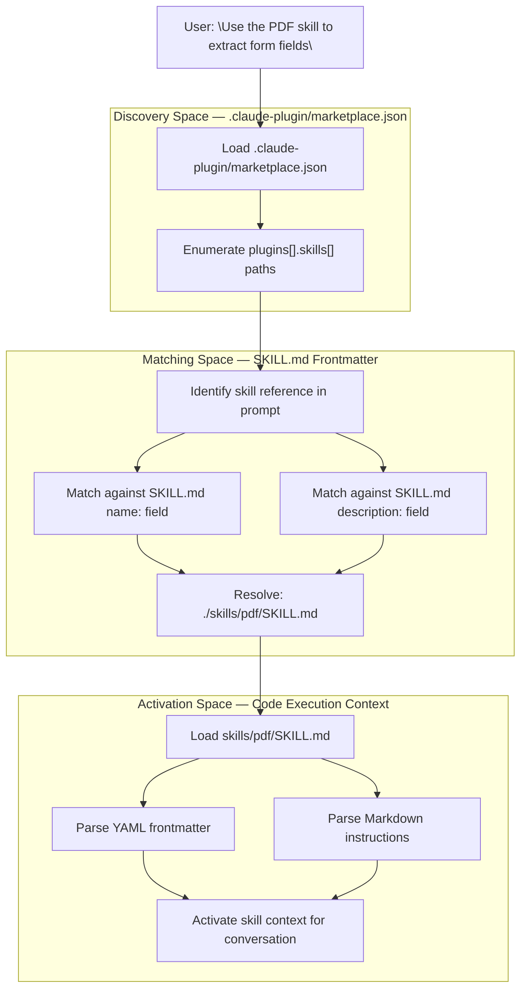

<!-- source: DeepWiki mcp.deepwiki.com · repo anthropics/skills · page 2.3 Marketplace and Plugin System · fetched 2026-10-30 -->

# Marketplace and Plugin System

<details>
<summary>Relevant source files</summary>

The following files were used as context for generating this wiki page:

- [.claude-plugin/marketplace.json](.claude-plugin/marketplace.json)
- [skills/academy-guide/LICENSE.txt](skills/academy-guide/LICENSE.txt)
- [skills/academy-guide/SKILL.md](skills/academy-guide/SKILL.md)

</details>


## Purpose and Scope

This document explains the marketplace and plugin system that enables skill discovery and loading in Claude. It covers the structure of `.claude-plugin/marketplace.json`, how plugins organize skills into bundles, the `strict` resolution mode, how skill paths resolve relative to the repo root, and the licensing boundaries between different skill groups. For information about the `SKILL.md` format that defines individual skills, see page 2.2. For the overall architecture of how skills are loaded and executed, see page 2.1.

Sources: [.claude-plugin/marketplace.json:1-73]()

## Marketplace.json Structure

The `.claude-plugin/marketplace.json` file serves as the central registry for all skills available in the repository. It defines plugins, which are logical groupings of related skills, and provides metadata about the marketplace itself.

### Top-Level Fields

The marketplace file contains four primary sections:

| Field | Type | Purpose | Example |
|-------|------|---------|---------|
| `name` | string | Unique identifier for the marketplace | `"anthropic-agent-skills"` |
| `owner` | object | Contact information for marketplace maintainer | `{"name": "Keith Lazuka", "email": "..."}` |
| `metadata` | object | Descriptive information and versioning | `{"description": "...", "version": "1.0.0"}` |
| `plugins` | array | List of plugin definitions | See Plugin Structure below |

Sources: [.claude-plugin/marketplace.json:1-11]()

### Plugin Structure

Each plugin in the `plugins` array defines a collection of related skills:

| Field | Type | Required | Purpose |
|-------|------|----------|---------|
| `name` | string | Yes | Unique identifier for the plugin |
| `description` | string | Yes | Human-readable description of plugin capabilities |
| `source` | string | Yes | Base path for skill resolution (typically `"./"`) |
| `strict` | boolean | Yes | Whether to enforce strict loading rules |
| `skills` | array | Yes | List of relative paths to skill directories |

**Example Plugin Definition:**

```json
{
  "name": "example-skills",
  "description": "Collection of example skills demonstrating various capabilities including skill creation, MCP building, visual design, algorithmic art, internal communications, web testing, artifact building, Slack GIFs, and theme styling",
  "source": "./",
  "strict": false,
  "skills": [
    "./skills/algorithmic-art",
    "./skills/brand-guidelines",
    "./skills/canvas-design",
    "./skills/doc-coauthoring",
    "./skills/frontend-design",
    "./skills/internal-comms",
    "./skills/mcp-builder",
    "./skills/skill-creator",
    "./skills/slack-gif-creator",
    "./skills/theme-factory",
    "./skills/web-artifacts-builder",
    "./skills/webapp-testing"
  ]
}
```

Sources: [.claude-plugin/marketplace.json:24-43]()

## Plugin Organization Hierarchy

The following diagram illustrates how `.claude-plugin/marketplace.json` organizes plugins and skills across all five registered plugin suites, linking JSON structural definitions directly to filesystem paths.

### Diagram: Marketplace Registry to Filesystem Layout

```mermaid
graph TB
    subgraph marketplace[".claude-plugin/marketplace.json"]
        mname["name: \"anthropic-agent-skills\""]
        owner["owner: {name, email}"]
        metadata["metadata: {description, version: \"1.0.0\"}"]
        plugins["plugins: [ ... ]"]
    end

    subgraph plugin1["plugins[0]: document-skills"]
        p1_source["source: \"./\""]
        p1_strict["strict: false"]
        p1_skills["skills: [...]"]
    end

    subgraph plugin2["plugins[1]: example-skills"]
        p2_source["source: \"./\""]
        p2_strict["strict: false"]
        p2_skills["skills: [...]"]
    end

    subgraph plugin3["plugins[2]: claude-api"]
        p3_source["source: \"./\""]
        p3_strict["strict: false"]
        p3_skills["skills: [\"./skills/claude-api\"]"]
    end

    subgraph plugin4["plugins[3]: academy-guide"]
        p4_source["source: \"./\""]
        p4_strict["strict: false"]
        p4_skills["skills: [\"./skills/academy-guide\"]"]
    end

    subgraph plugin5["plugins[4]: discernment-nudge"]
        p5_source["source: \"./\""]
        p5_strict["strict: false"]
        p5_skills["skills: [\"./skills/discernment-nudge\"]"]
    end

    plugins --> plugin1
    plugins --> plugin2
    plugins --> plugin3
    plugins --> plugin4
    plugins --> plugin5

    p1_skills --> xlsx["\"./skills/xlsx\""]
    p1_skills --> docx["\"./skills/docx\""]
    p1_skills --> pptx["\"./skills/pptx\""]
    p1_skills --> pdf["\"./skills/pdf\""]

    p2_skills --> skill_creator["\"./skills/skill-creator\""]
    p2_skills --> mcp["\"./skills/mcp-builder\""]
    p2_skills --> canvas["\"./skills/canvas-design\""]
    p2_skills --> algo["\"./skills/algorithmic-art\""]
    p2_skills --> brand["\"./skills/brand-guidelines\""]
    p2_skills --> doc["\"./skills/doc-coauthoring\""]
    p2_skills --> frontend["\"./skills/frontend-design\""]
    p2_skills --> comms["\"./skills/internal-comms\""]
    p2_skills --> slack["\"./skills/slack-gif-creator\""]
    p2_skills --> theme["\"./skills/theme-factory\""]
    p2_skills --> artifacts["\"./skills/web-artifacts-builder\""]
    p2_skills --> webapp["\"./skills/webapp-testing\""]

    p3_skills --> claudeapi["\"./skills/claude-api\""]
    p4_skills --> academy["\"./skills/academy-guide\""]
    p5_skills --> discernment["\"./skills/discernment-nudge\""]
```

Sources: [.claude-plugin/marketplace.json:11-72]()

## Skill Path Resolution

Skills are referenced by relative paths in the `skills` array. The path resolution combines the plugin's `source` field with the skill path to locate the `SKILL.md` file.

### Diagram: Skill Path Resolution Architecture



The resolution process:
1. Parse `.claude-plugin/marketplace.json` to extract plugin definitions.
2. For each entry in `plugin.skills`, treat the path as relative to the repository root (the `source` field `"./"` anchors it there).
3. Locate `SKILL.md` inside the resolved directory — this is the skill definition file.
4. Additional resources (scripts, assets) are loaded from the same directory as needed during execution.

All skill paths in this repository follow the pattern `./skills/<skill-name>`, meaning every skill lives directly under the top-level `skills/` directory.

Sources: [.claude-plugin/marketplace.json:11-73]()

## Plugin Groups and Licensing

The marketplace is divided into five distinct plugins, each with different purposes and licensing constraints.

### 1. `document-skills` Plugin
*   **Name**: `document-skills`
*   **Skills**: `xlsx`, `docx`, `pptx`, `pdf`
*   **Purpose**: Production-grade document processing suite [.claude-plugin/marketplace.json:13-22]().
*   **License**: Source-available (not open source). These are published for reference but not licensed for redistribution.

### 2. `example-skills` Plugin
*   **Name**: `example-skills`
*   **Skills**: 12 skills including `skill-creator`, `mcp-builder`, `algorithmic-art`, etc. [.claude-plugin/marketplace.json:25-42]()
*   **Purpose**: Demonstrating various Agent Skills capabilities.
*   **License**: Apache 2.0. Fully open source and redistributable.

### 3. `claude-api` Plugin
*   **Name**: `claude-api`
*   **Skills**: `claude-api` [.claude-plugin/marketplace.json:46-52]()
*   **Purpose**: Documentation and SDK examples for building with Claude.
*   **License**: Apache 2.0.

### 4. `academy-guide` Plugin
*   **Name**: `academy-guide`
*   **Skills**: `academy-guide` [.claude-plugin/marketplace.json:55-61]()
*   **Purpose**: Recommends relevant Claude Academy courses, tutorials, and use cases when users ask how to use Claude.
*   **License**: Apache 2.0.

### 5. `discernment-nudge` Plugin
*   **Name**: `discernment-nudge`
*   **Skills**: `discernment-nudge` [.claude-plugin/marketplace.json:64-70]()
*   **Purpose**: Appends short follow-up questions after substantive answers to help users check key facts, probe reasoning, and notice missing context.
*   **License**: Apache 2.0.

Sources: [.claude-plugin/marketplace.json:11-72]()

### Strict vs. Permissive Resolution Mode

The `strict` field on each plugin controls how the plugin loader handles missing or malformed skill metadata:

| `strict` value | Behavior |
|----------------|---------|
| `true` | All skills in the plugin must pass validation; a single failure prevents the entire plugin from loading. |
| `false` | The loader attempts to load each skill independently; a malformed or missing `SKILL.md` in one skill does not block others. |

All plugins in `.claude-plugin/marketplace.json` currently set `"strict": false`.

Sources: [.claude-plugin/marketplace.json:16,28,49,58,67]()

## Skill Discovery Workflow

When a user mentions a skill by name or intent, Claude performs a discovery process that bridges natural language input to code entity resolution via `.claude-plugin/marketplace.json` and `SKILL.md` files.

### Diagram: Natural Language to Code Entity Mapping



Sources: [.claude-plugin/marketplace.json:1-73]()

---

