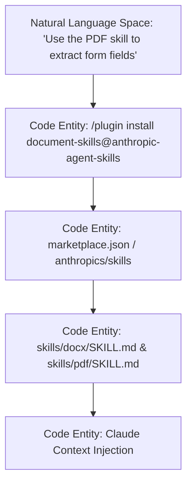
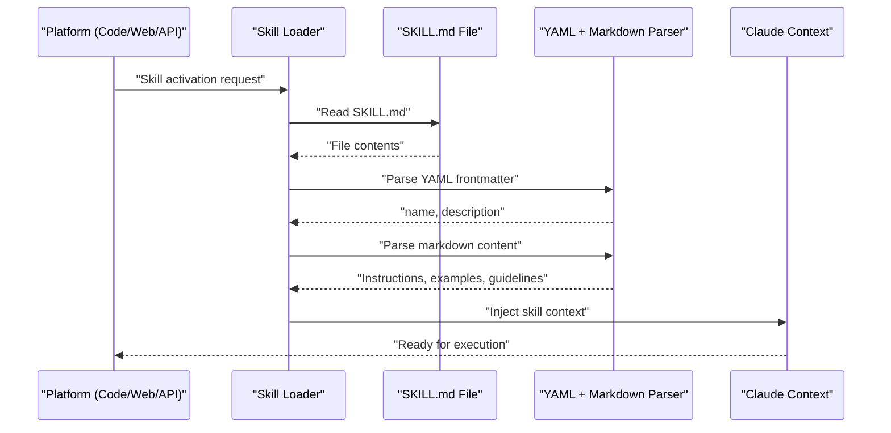
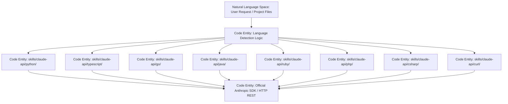

<!-- source: DeepWiki mcp.deepwiki.com · repo anthropics/skills · page 2.4 Platform Integration · fetched 2026-10-30 -->

# Platform Integration

<details>
<summary>Relevant source files</summary>

The following files were used as context for generating this wiki page:

- [.gitignore](.gitignore)
- [README.md](README.md)
- [skills/claude-api/SKILL.md](skills/claude-api/SKILL.md)
- [spec/agent-skills-spec.md](spec/agent-skills-spec.md)

</details>


This page describes how skills from the `anthropics/skills` repository integrate across three distinct Claude surfaces: Claude Code (via the plugin marketplace), Claude.ai (pre-integrated for paid plans), and the Claude API (via the Skills API). While each surface employs a different installation and invocation mechanism, all three rely on the standard `SKILL.md` format loaded at runtime.

For details on the `SKILL.md` format, see page 2.2. For how skills are packaged into plugins, see page 2.3.

## Platform Comparison

| Platform | Access Method | Pre-installed | Custom Skills | Activation |
|----------|---------------|---------------|---------------|------------|
| Claude Code | `/plugin` commands + marketplace | No (manual install required) | Yes (local repo files) | Natural language mention |
| Claude.ai | Web interface | Yes (paid plans) | Yes (upload via UI) | Auto-available after upload |
| Claude API | Skills API endpoints | Yes (Anthropic pre-built) | Yes (upload via API) | API parameter / natural language |

Sources: [README.md:31-61]()

## Claude Code Integration

Claude Code accesses skills through a plugin marketplace system that requires explicit registration and installation steps.

### Marketplace Registration

Register the repository as a plugin marketplace source:

```
/plugin marketplace add anthropics/skills
```

This registers the repository as an available plugin source.

Sources: [README.md:33-37]()

### Plugin Installation Methods

After marketplace registration, install a plugin bundle using either method:

**Interactive:**
1. Select `Browse and install plugins`
2. Select `anthropic-agent-skills`
3. Choose `document-skills` or `example-skills`
4. Select `Install now`

**Direct command:**
```
/plugin install document-skills@anthropic-agent-skills
/plugin install example-skills@anthropic-agent-skills
```

The syntax is `/plugin install <plugin-name>@<marketplace-name>`.

Sources: [README.md:39-49]()

### Skill Activation

Once installed, invoke a skill by mentioning it in natural language:

```
Use the PDF skill to extract the form fields from path/to/some-file.pdf
```

Claude Code matches the mention against loaded `SKILL.md` `description` fields and injects the matching skill's instructions into context.

Sources: [README.md:51-52](), [README.md:68-71]()

**Diagram: Natural Language Space to Code Entity Space — Claude Code Installation and Execution Flow**



Sources: [README.md:31-52](), [README.md:68-71]()

## Claude.ai Integration

### Pre-integrated Skills

The example skills from this repository are already available to paid plan users on Claude.ai without any manual installation step.

Sources: [README.md:53-56]()

### Custom Skill Upload

Paid users can upload additional skills (including custom-authored ones) through the Claude.ai web interface. The upload accepts a `SKILL.md` file and supporting assets.

Sources: [README.md:57-58]()

Sources: [README.md:53-58]()

## Claude API Integration

### Pre-built Skills

The Skills API exposes Anthropic's pre-built skills directly. No repository setup is required.

### Custom Skill Upload

Developers can upload custom `SKILL.md`-based skills to the API for use in production applications. The `claude-api` skill specifically provides documentation for integrating these features using the Anthropic SDKs (`anthropic`, `@anthropic-ai/sdk`, etc.) as defined in [skills/claude-api/SKILL.md:1-25]().

| Language | Feature Support | Tool Runner | Managed Agents |
|----------|-----------------|-------------|----------------|
| Python | Full | Yes (beta) | Yes (beta) |
| TypeScript | Full | Yes (beta) | Yes (beta) |
| Java | Full | Yes (beta) | Yes (beta) |
| Go | Full | Yes (beta) | Yes (beta) |
| Ruby | Full | Yes (beta) | Yes (beta) |
| PHP | Full | Yes (beta) | Yes (beta) |
| C# | Official SDK | No | No |

Sources: [README.md:59-61](), [skills/claude-api/SKILL.md:1-25]()

## Cross-Platform Execution Model

All three platforms share a common execution model despite different integration methods:

### Unified Skill Loading



Sources: [README.md:63-90](), [skills/claude-api/SKILL.md:1-5]()

### Platform-Specific Features

| Feature | Claude Code | Claude.ai | Claude API |
|---------|-------------|-----------|------------|
| Installation method | `/plugin` commands | Pre-integrated + upload | API endpoint |
| Skill discovery | Marketplace browse UI | Web interface | Programmatic query |
| Custom skills | Local repository files | Upload interface | API upload |
| Activation | Natural language mention | Automatic | API parameter |
| Skill updates | Re-install plugin | Re-upload | Re-upload via API |

Sources: [README.md:31-61]()

### Language and SDK Integration (Claude API)

For API-based integration, the `claude-api` skill manages language detection and provides specific implementation details for calling Claude.

**Diagram: Natural Language Space to Code Entity Space — Claude API Language Detection and SDK Invocation**



Sources: [skills/claude-api/SKILL.md:15-22](), [skills/claude-api/SKILL.md:41-50]()

## Platform Integration Summary

The three platforms provide different developer experiences while maintaining compatibility with the same skill format:

- **Claude Code** requires explicit marketplace registration and plugin installation, offering fine-grained control over which skills are available.
- **Claude.ai** provides immediate access to example skills for paid users and supports custom uploads through a web interface.
- **Claude API** enables programmatic skill management and execution, suitable for production applications, with SDK support for automated tool loops and Managed Agents.

All platforms load `SKILL.md` files dynamically at skill activation time, ensuring that skill updates are immediately available to the model.

Sources: [README.md:31-61](), [skills/claude-api/SKILL.md:1-50]()

---

