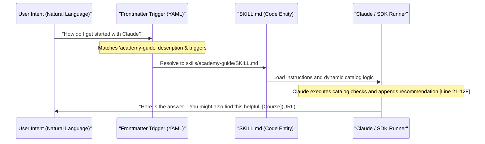

<!-- source: DeepWiki mcp.deepwiki.com · repo anthropics/skills · page 3 Skills Catalog · fetched 2026-10-30 -->

# Skills Catalog

Relevant source files

The following files were used as context for generating this wiki page:

- [.claude-plugin/marketplace.json](.claude-plugin/marketplace.json)
- [skills/academy-guide/LICENSE.txt](skills/academy-guide/LICENSE.txt)
- [skills/academy-guide/SKILL.md](skills/academy-guide/SKILL.md)

This page provides a high-level catalog of all skills available in the `anthropics/skills` repository. These skills are organized into functional plugins that extend Claude's capabilities across document processing, software development, creative design, API integration, and behavioral guidance `[.claude-plugin/marketplace.json:1-73]()`.

For detailed technical specifications of individual skills, refer to the child pages:
- [Document Skills](#3.1) — Production-grade document processing (PDF, DOCX, XLSX, PPTX).
- [Example Skills](#3.2) — Open-source tools for design, development, and communication.
- [Claude API Documentation Skill](#3.3) — Language-specific SDK guides and API examples.
- [Guidance and Behavior Skills](#3.4) — Academy recommendations and response discernment nudges.

## Marketplace Structure

The repository organizes skills into five primary plugins defined in the marketplace configuration. These plugins group related `SKILL.md` files into installable units for Claude Code, Claude.ai, and the Claude API `[.claude-plugin/marketplace.json:11-72]`.

**Skills Hierarchy and Code Mapping**

```mermaid
graph TD
    Marketplace["marketplace.json"]
    
    subgraph Plugin1["document-skills"]
        P1["Plugin: document-skills"]
        S1["./skills/xlsx"]
        S2["./skills/docx"]
        S3["./skills/pptx"]
        S4["./skills/pdf"]
    end
    
    subgraph Plugin2["example-skills"]
        P2["Plugin: example-skills"]
        S5["./skills/algorithmic-art"]
        S6["./skills/canvas-design"]
        S7["./skills/mcp-builder"]
        S8["./skills/skill-creator"]
        S9["./skills/webapp-testing"]
        S10["...and others"]
    end

    subgraph Plugin3["claude-api"]
        P3["Plugin: claude-api"]
        S11["./skills/claude-api"]
    end

    subgraph Plugin4["academy-guide"]
        P4["Plugin: academy-guide"]
        S12["./skills/academy-guide"]
    end

    subgraph Plugin5["discernment-nudge"]
        P5["Plugin: discernment-nudge"]
        S13["./skills/discernment-nudge"]
    end
    
    Marketplace --> P1
    Marketplace --> P2
    Marketplace --> P3
    Marketplace --> P4
    Marketplace --> P5
    
    P1 --> S1 & S2 & S3 & S4
    P2 --> S5 & S6 & S7 & S8 & S9 & S10
    P3 --> S11
    P4 --> S12
    P5 --> S13
```

Sources: `[.claude-plugin/marketplace.json:1-73]()`

## Document Skills

The `document-skills` plugin contains production-grade, source-available skills that power Claude's core document capabilities `[.claude-plugin/marketplace.json:11-23]()`. These skills utilize system-level integrations to perform complex manipulations on binary formats including spreadsheets, documents, presentations, and portable documents.

- **XLSX**: Advanced spreadsheet manipulation including formula recalculation.
- **DOCX**: Word document processing with support for tracked changes and comments.
- **PPTX**: Presentation generation, slide manipulation, and thumbnail rendering.
- **PDF**: Structural extraction from non-fillable PDFs and document assembly.

For details, see [Document Skills](#3.1).

Sources: `[.claude-plugin/marketplace.json:11-23]()`

## Example Skills

The `example-skills` plugin showcases the versatility of the Agent Skills standard through a variety of open-source tools `[.claude-plugin/marketplace.json:24-43]()`. These serve as reference implementations for developers building custom skills for software development, creative design, and communication workflows.

| Category | Skills |
| :--- | :--- |
| **Creative** | `algorithmic-art`, `canvas-design`, `slack-gif-creator` |
| **Development** | `mcp-builder`, `webapp-testing`, `web-artifacts-builder`, `frontend-design` |
| **Enterprise** | `brand-guidelines`, `internal-comms`, `theme-factory` |
| **Meta-Skills** | `skill-creator`, `doc-coauthoring` |

For details, see [Example Skills](#3.2).

Sources: `[.claude-plugin/marketplace.json:24-43]()`

## Claude API Documentation Skill

The `claude-api` skill is a specialized documentation tool designed to assist developers in building LLM-powered applications using Anthropic's platform `[.claude-plugin/marketplace.json:45-53]()`. It provides language-specific guides, core SDK reference materials, and support for advanced features like prompt caching and tool use.

For details, see [Claude API Documentation Skill](#3.3).

Sources: `[.claude-plugin/marketplace.json:45-53]()`

## Guidance and Behavior Skills

The guidance and behavior skills include `academy-guide` and `discernment-nudge` `[.claude-plugin/marketplace.json:54-71]()`. The `academy-guide` skill recommends relevant Claude Academy learning resources from a remote catalog with freshness checks `[skills/academy-guide/SKILL.md:1-135]()`, while the `discernment-nudge` skill appends short follow-up questions to substantive answers to prompt critical thinking.

For details, see [Guidance and Behavior Skills](#3.4).

Sources: `[.claude-plugin/marketplace.json:54-71]()`, `[skills/academy-guide/SKILL.md:1-135]()`

## Skill Discovery and Execution

The skills system bridges natural language requests to specific filesystem entities. When a user interacts with Claude, the system resolves intent based on the frontmatter definition in each skill's configuration `[.claude-plugin/marketplace.json:1-73]()`, `[skills/academy-guide/SKILL.md:1-19]()`.

**Natural Language to Code Entity Mapping**

Sources: `[.claude-plugin/marketplace.json:1-73]()`, `[skills/academy-guide/SKILL.md:1-128]()`

---

