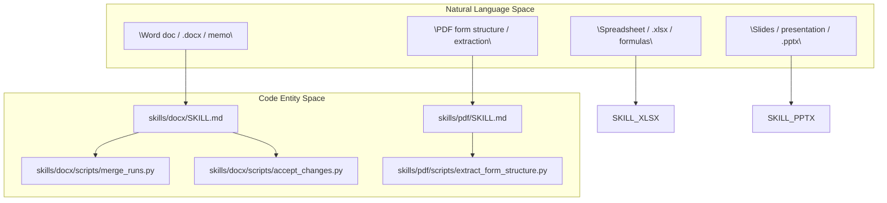
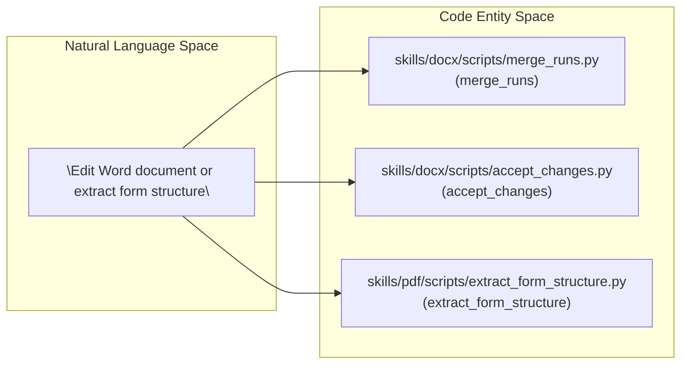

<!-- source: DeepWiki mcp.deepwiki.com · repo anthropics/skills · page 3.1 Document Skills · fetched 2026-10-30 -->

# Document Skills

<details>
<summary>Relevant source files</summary>

The following files were used as context for generating this wiki page:

- [skills/docx/SKILL.md](skills/docx/SKILL.md)
- [skills/docx/scripts/accept_changes.py](skills/docx/scripts/accept_changes.py)
- [skills/docx/scripts/merge_runs.py](skills/docx/scripts/merge_runs.py)
- [skills/pdf/scripts/extract_form_structure.py](skills/pdf/scripts/extract_form_structure.py)

</details>


This page covers the **document-skills** plugin bundle: a suite of four production-grade, source-available skills for processing Word (`.docx`), Excel (`.xlsx`), PowerPoint (`.pptx`), and PDF (`.pdf`) files. It documents what is common across the suite — bundle registration, the shared Open XML processing workflow, and LibreOffice headless integration. For per-skill technical detail, see [DOCX Skill](#3.1.1), [PDF Skill](#3.1.2), [PPTX Skill](#3.1.3), and [XLSX Skill](#3.1.4).

---

## Bundle Registration and Code Mapping

The four skills are registered under the document processing ecosystem. The bundle uses loose resolution (`"strict": false`), allowing Claude to match user intents with appropriate script execution engines.

**Diagram: Natural Language to Code Entity Mapping for Document Skills**



Sources: [skills/docx/SKILL.md:1-5](), [skills/docx/scripts/merge_runs.py:20-24](), [skills/docx/scripts/accept_changes.py:36-88](), [skills/pdf/scripts/extract_form_structure.py:20-88]()

---

## Skills at a Glance

| Skill | File Format | Primary Engine | Key Capabilities | Unique Scripts / Modules |
|---|---|---|---|---|
| `docx` | `.docx` | `docx-js` / LibreOffice | Tracked changes, comment insertion, XML editing | `skills/docx/scripts/merge_runs.py` [skills/docx/scripts/merge_runs.py:1-24](), `accept_changes.py` [skills/docx/scripts/accept_changes.py:36-39]() |
| `xlsx` | `.xlsx` | LibreOffice / `openpyxl` | Formula recalculation, error reporting | `skills/xlsx/SKILL.md:37-38`() |
| `pptx` | `.pptx` | LibreOffice / `pptxgenjs` | Slide manipulation, thumbnail generation | `skills/pptx/SKILL.md:24-24`() |
| `pdf` | `.pdf` | `pdfplumber` | Form structure & coordinate extraction | `skills/pdf/scripts/extract_form_structure.py:20-27`() |

Sources: [skills/docx/SKILL.md:13-16](), [skills/docx/scripts/merge_runs.py:1-24](), [skills/docx/scripts/accept_changes.py:36-39](), [skills/pdf/scripts/extract_form_structure.py:20-27]()

---

## Shared Architecture

### Open XML: Unpack → Edit → Repack

The `.docx`, `.xlsx`, and `.pptx` formats are ZIP archives containing XML. Each skill that edits these files follows a common workflow implemented across respective helper tools:

1. **Unpack**: The archive is extracted into a directory tree (`unzip -q doc.docx -d unpacked/`) [skills/docx/SKILL.md:52-52]().
2. **Edit**: XML files are modified directly or via script utilities (e.g., `merge_runs.py` [skills/docx/scripts/merge_runs.py:1-24](), `accept_changes.py` [skills/docx/scripts/accept_changes.py:36-39](), `extract_form_structure.py` [skills/pdf/scripts/extract_form_structure.py:20-27]()).
3. **Repack**: The directory is compressed back into a valid archive structure [skills/docx/SKILL.md:56-56]().

**Diagram: Workflow Bridge from Task Space to Code Execution**



Sources: [skills/docx/SKILL.md:51-59](), [skills/docx/scripts/merge_runs.py:40-61](), [skills/docx/scripts/accept_changes.py:36-39](), [skills/pdf/scripts/extract_form_structure.py:20-27]()

---

### LibreOffice Headless Integration

Multiple document skills invoke LibreOffice (`soffice`) in `--headless` mode to perform rendering, PDF conversion, macro execution, and formula evaluation [skills/docx/scripts/accept_changes.py:58-65](). 

* **DOCX**: Used for rendering previews via PDF conversion and running tracked change acceptance macros via StarBasic [skills/docx/SKILL.md:40-43](), [skills/docx/scripts/accept_changes.py:19-33]().
* **XLSX**: Used by spreadsheet calculation helpers to evaluate formulas and cache values.
* **PPTX**: Used for headless conversion to image/PDF pipelines.

Sources: [skills/docx/SKILL.md:40-43](), [skills/docx/scripts/accept_changes.py:19-65]()

---

## Child Pages

For deep technical details on specific document types, refer to the following child pages:

* **[DOCX Skill](#3.1.1)** — Document the DOCX skill's capabilities, including accepting tracked changes and adding comments via LibreOffice integration.
* **[PDF Skill](#3.1.2)** — Document the PDF skill's capabilities, including form structure extraction for non-fillable PDFs.
* **[PPTX Skill](#3.1.3)** — Document the PPTX skill's capabilities, including slide manipulation and thumbnail generation.
* **[XLSX Skill](#3.1.4)** — Document the XLSX skill's capabilities, including formula recalculation via LibreOffice.

Sources: [skills/docx/SKILL.md:1-5](), [skills/docx/scripts/accept_changes.py:1-4]()

---

## Licensing

The document skills are released under a **proprietary, source-available license**. Each skill configuration specifies:

```yaml
license: Proprietary. LICENSE.txt has complete terms
```

Sources: [skills/docx/SKILL.md:4]()

---

