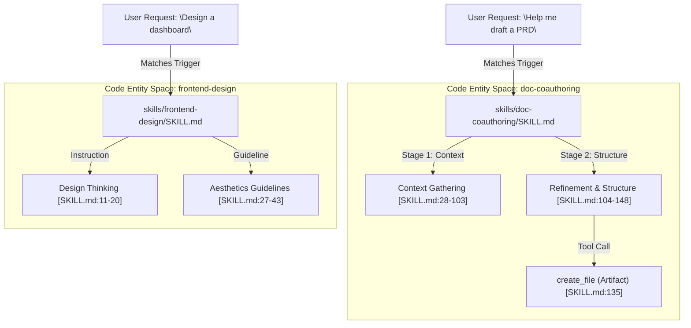
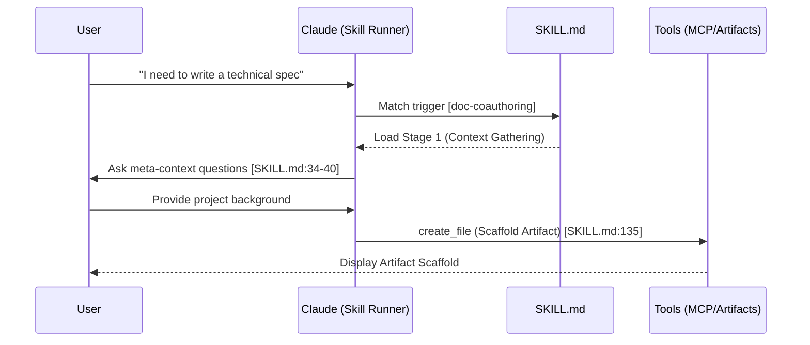

<!-- source: DeepWiki mcp.deepwiki.com · repo anthropics/skills · page 3.2 Example Skills · fetched 2026-10-30 -->

# Example Skills

Relevant source files

The following files were used as context for generating this wiki page:

- [skills/doc-coauthoring/SKILL.md](skills/doc-coauthoring/SKILL.md)
- [skills/frontend-design/SKILL.md](skills/frontend-design/SKILL.md)
- [skills/mcp-builder/LICENSE.txt](skills/mcp-builder/LICENSE.txt)
- [skills/theme-factory/LICENSE.txt](skills/theme-factory/LICENSE.txt)
- [skills/webapp-testing/LICENSE.txt](skills/webapp-testing/LICENSE.txt)

This page documents the **`example-skills`** plugin bundle: its constituent skills, their categories, intended use cases, and technical implementation details. These skills are open-source reference implementations licensed under Apache 2.0.

For the parallel bundle of document-processing skills (`docx`, `xlsx`, `pptx`, `pdf`), see [Document Skills](3.1). For a deep dive into the `skill-creator` skill specifically, see [Skill Creator](4).

---

## License and Distribution

All skills in the `example-skills` bundle are licensed under the **Apache License 2.0**. This distinguishes them from the `document-skills` bundle, which is source-available but not open-source. Each skill directory contains a `LICENSE.txt` file confirming these terms.

**Bundle Registration and Skill Paths**

| Skill Name | Directory Path | License |
| :--- | :--- | :--- |
| `algorithmic-art` | `skills/algorithmic-art` | [skills/algorithmic-art/LICENSE.txt:1-132]() |
| `brand-guidelines` | `skills/brand-guidelines` | [skills/brand-guidelines/LICENSE.txt:1-132]() |
| `canvas-design` | `skills/canvas-design` | [skills/canvas-design/LICENSE.txt:1-132]() |
| `doc-coauthoring` | `skills/doc-coauthoring` | (Included in bundle) |
| `frontend-design` | `skills/frontend-design` | [skills/frontend-design/SKILL.md:4-4]() |
| `internal-comms` | `skills/internal-comms` | [skills/internal-comms/LICENSE.txt:1-132]() |
| `mcp-builder` | `skills/mcp-builder` | [skills/mcp-builder/LICENSE.txt:1-132]() |
| `slack-gif-creator` | `skills/slack-gif-creator` | [skills/slack-gif-creator/LICENSE.txt:1-132]() |
| `theme-factory` | `skills/theme-factory` | [skills/theme-factory/LICENSE.txt:1-132]() |
| `web-artifacts-builder` | `skills/web-artifacts-builder` | [skills/web-artifacts-builder/LICENSE.txt:1-132]() |
| `webapp-testing` | `skills/webapp-testing` | [skills/webapp-testing/LICENSE.txt:1-132]() |

Sources: [skills/algorithmic-art/LICENSE.txt:1-132](), [skills/brand-guidelines/LICENSE.txt:1-132](), [skills/canvas-design/LICENSE.txt:1-132](), [skills/internal-comms/LICENSE.txt:1-132](), [skills/mcp-builder/LICENSE.txt:1-132](), [skills/slack-gif-creator/LICENSE.txt:1-132](), [skills/theme-factory/LICENSE.txt:1-132](), [skills/web-artifacts-builder/LICENSE.txt:1-132](), [skills/webapp-testing/LICENSE.txt:1-132]()

---

## Technical Implementation & Data Flow

Example skills utilize the `SKILL.md` format to define triggers, instructions, and workflows. Some skills, like `doc-coauthoring` and `frontend-design`, implement complex state-based logic through Markdown-defined stages.

### Skill Invocation Flow

The following diagram illustrates how a user request flows from natural language into the specific code entities defined in the example skills.

**Natural Language to Code Entity Mapping**

Sources: [skills/doc-coauthoring/SKILL.md:1-148](), [skills/frontend-design/SKILL.md:1-43]()

---

## Design & Visual

These skills focus on visual output, creative generation, and design system enforcement.

### `frontend-design`
Located at `skills/frontend-design/`. This skill directs Claude to avoid "AI slop" aesthetics such as generic font families (Inter, Roboto) or purple gradients [skills/frontend-design/SKILL.md:36](). It emphasizes bold aesthetic directions like editorial, broadsheet, or opinionated token systems [skills/frontend-design/SKILL.md:15]().

**Key Logic:**
- **Typography**: Mandates avoiding generic fonts in favor of distinctive pairings [skills/frontend-design/SKILL.md:19-21]().
- **Motion**: Prioritizes restrained, purposeful transitions rather than scattered generic entrance animations [skills/frontend-design/SKILL.md:32]().
- **Spatial Composition**: Encourages deliberate palette token systems and layout structuring [skills/frontend-design/SKILL.md:47-52]().

### `brand-guidelines`
Located at `skills/brand-guidelines/`. Encodes organizational rules into the model's prompt context to ensure consistency across all generated artifacts and brand communications.

### `algorithmic-art`
Located at `skills/algorithmic-art/`. Uses code-based generation (SVG, Canvas, or CSS) to create generative art based on mathematical patterns and randomized procedural rules.

### `canvas-design`
Located at `skills/canvas-design/`. Guides the generation of HTML5 Canvas graphics, diagrams, and visual layouts with precise positioning and aesthetic formatting.

### `theme-factory`
Located at `skills/theme-factory/`. Provides systematic color palettes, typography scales, and CSS token configurations to generate coherent visual themes across web applications.

Sources: [skills/frontend-design/SKILL.md:1-58](), [skills/brand-guidelines/LICENSE.txt:1-102](), [skills/algorithmic-art/LICENSE.txt:1-102](), [skills/canvas-design/LICENSE.txt:1-102](), [skills/theme-factory/LICENSE.txt:1-102]()

---

## Communication & Co-authoring

### `doc-coauthoring`
Located at `skills/doc-coauthoring/`. Implements a structured three-stage workflow: Context Gathering, Refinement & Structure, and Reader Testing [skills/doc-coauthoring/SKILL.md:18-22]().

**Workflow Implementation:**
1. **Context Gathering**: Claude asks 5-10 numbered questions to close the knowledge gap between the user and the agent [skills/doc-coauthoring/SKILL.md:90-92]().
2. **Refinement**: Uses `create_file` to build a scaffold artifact if available [skills/doc-coauthoring/SKILL.md:135]().
3. **Integration Check**: Detects if Slack, Teams, or Google Drive MCP servers are available to pull context [skills/doc-coauthoring/SKILL.md:70-74]().

### `internal-comms`
Located at `skills/internal-comms/`. Standardizes internal announcements, memos, and team updates to maintain a professional organizational voice.

### `slack-gif-creator`
Located at `skills/slack-gif-creator/`. Assists in generating or formatting concise, animated assets optimized for Slack custom emojis and chat sharing.

Sources: [skills/doc-coauthoring/SKILL.md:1-148](), [skills/internal-comms/LICENSE.txt:1-102](), [skills/slack-gif-creator/LICENSE.txt:1-102]()

---

## Developer Tooling & Web/Testing

### `mcp-builder`
Located at `skills/mcp-builder/`. Provides instructions for generating Model Context Protocol (MCP) server code, allowing Claude to extend its own toolset via standardized interfaces.

### `web-artifacts-builder`
Located at `skills/web-artifacts-builder/`. Focuses on generating complete, self-contained HTML/JS/CSS bundles that function as standalone applications within Claude's artifact view.

### `webapp-testing`
Located at `skills/webapp-testing/`. Guides the model in writing and executing automated UI tests, bridging high-level requirements with executable verification scripts.

Sources: [skills/mcp-builder/LICENSE.txt:1-102](), [skills/web-artifacts-builder/LICENSE.txt:1-102](), [skills/webapp-testing/LICENSE.txt:1-102]()

---

## Reference Implementation Patterns

The `example-skills` serve as a blueprint for developers. Key patterns demonstrated include:

1. **Progressive Disclosure**: Using stages (like in `doc-coauthoring`) to avoid overwhelming the user with questions [skills/doc-coauthoring/SKILL.md:104-116]().
2. **Aesthetic Constraints**: Using negative constraints (like in `frontend-design`) to steer the model away from common LLM pitfalls [skills/frontend-design/SKILL.md:38-45]().
3. **Contextual Awareness**: Checking for available integrations (MCP servers) before attempting to pull external data [skills/doc-coauthoring/SKILL.md:70-80]().

**Skill Execution Architecture**

Sources: [skills/doc-coauthoring/SKILL.md:18-148](), [skills/frontend-design/SKILL.md:36-45]()

---

