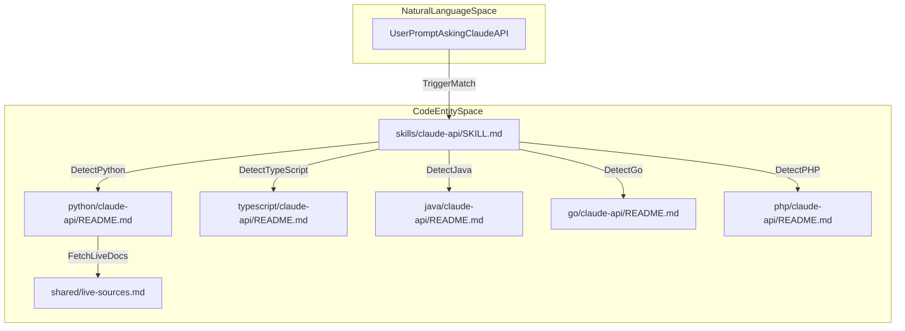

<!-- source: DeepWiki mcp.deepwiki.com · repo anthropics/skills · page 3.3 Claude API Documentation Skill · fetched 2026-10-30 -->

# Claude API Documentation Skill

<details>
<summary>Relevant source files</summary>

The following files were used as context for generating this wiki page:

- [skills/claude-api/LICENSE.txt](skills/claude-api/LICENSE.txt)
- [skills/claude-api/SKILL.md](skills/claude-api/SKILL.md)
- [skills/claude-api/shared/live-sources.md](skills/claude-api/shared/live-sources.md)

</details>


## Purpose and Scope

The Claude API Documentation Skill (`claude-api`) is a specialized technical documentation skill designed to guide developers in building, debugging, and optimizing applications with the Claude API and Anthropic SDKs [skills/claude-api/SKILL.md:1-5](). This skill provides automated language detection, architectural decision support, and language-specific code examples across all official Anthropic SDKs (Python, TypeScript, Go, Java, Ruby, PHP, C#, cURL), along with shared reference documents and the Managed Agents documentation suite [skills/claude-api/SKILL.md:1-13]().

Sources: [skills/claude-api/SKILL.md:1-13]()

---

## Skill Definition and Trigger Logic

The skill is defined in `skills/claude-api/SKILL.md`. It uses YAML frontmatter to define activation triggers based on code imports, SDK usage, and user intent [skills/claude-api/SKILL.md:1-8]().

**Trigger Conditions:**
- **Code Analysis**: Presence of imports or project files referencing `anthropic` (Python), `@anthropic-ai/sdk` (TypeScript), or `com.anthropic.*` (Java) [skills/claude-api/SKILL.md:5]().
- **Direct Inquiry**: The prompt explicitly names Claude, Anthropic, or specific model IDs (`claude-*`, `us.anthropic.*`, `[1m]`) [skills/claude-api/SKILL.md:5]().
- **LLM-Shaped Tasks**: Tasks involving agents, MCP, tool definitions, multi-agent frameworks, RAG, LLM-judges, computer use, or debugging streaming/refusals/tokens where the provider is unstated [skills/claude-api/SKILL.md:5]().

**Non-Trigger Conditions (SKIP Rules):**
- Explicit work on another provider (`openai`, `langchain_openai`, `google.generativeai`, `mistralai`, `cohere`, `ollama`) [skills/claude-api/SKILL.md:6]().
- Files containing non-Anthropic provider markers unless explicitly overridden [skills/claude-api/SKILL.md:14-16]().

Sources: [skills/claude-api/SKILL.md:1-8](), [skills/claude-api/SKILL.md:14-16]()

---

## Skill Architecture and Routing

The skill organizes documentation by programming language and shared technical reference files [skills/claude-api/SKILL.md:1-13]().


Sources: [skills/claude-api/SKILL.md:1-13](), [skills/claude-api/shared/live-sources.md:1-12]()

---

## Language-Specific SDK Implementation

The skill enforces strict adherence to official language SDK namespaces and methods, avoiding cross-language inference [skills/claude-api/SKILL.md:27-28]().

### Client Initialization Across Languages

| Language | Initialization Snippet / Pattern | Source Citation |
| :--- | :--- | :--- |
| **Python** | `client = anthropic.Anthropic()` | [skills/claude-api/python/claude-api/README.md:17-20]() |
| **TypeScript** | `const client = new Anthropic();` | [skills/claude-api/typescript/claude-api/README.md:18-23]() |
| **Java** | `AnthropicClient client = AnthropicOkHttpClient.fromEnv();` | [skills/claude-api/java/claude-api/README.md:63-67]() |
| **Go** | `client := anthropic.NewClient()` | [skills/claude-api/go/claude-api/README.md:14-20]() |
| **PHP** | `$client = new Client(apiKey: getenv("ANTHROPIC_API_KEY"));` | [skills/claude-api/php/claude-api/README.md:13-17]() |

Sources: [skills/claude-api/python/claude-api/README.md:17-20](), [skills/claude-api/typescript/claude-api/README.md:18-23](), [skills/claude-api/java/claude-api/README.md:63-67](), [skills/claude-api/go/claude-api/README.md:14-20](), [skills/claude-api/php/claude-api/README.md:13-17]()

---

## Core Features: Defaults, Adaptive Thinking, and Eager Input Streaming

### Defaults and Model Versions
Unless otherwise specified, requests default to model string `claude-opus-5-5` (Claude Opus 5.5) [skills/claude-api/SKILL.md:35](). 

### Adaptive Thinking and Eager Streaming
For complex reasoning tasks, the skill mandates adaptive thinking (`thinking: {type: "adaptive"}`) [skills/claude-api/SKILL.md:35](). Deprecated parameters like `budget_tokens` are rejected with a `400` error on modern models [skills/claude-api/SKILL.md:43](). Additionally, for streaming requests involving user-defined tools, `eager_input_streaming: true` should be set on each tool so inputs stream as they are generated [skills/claude-api/SKILL.md:35]().

```mermaid
graph TD
    subgraph "NaturalLanguageSpace"
        ComplexReq["ComplexReasoningTask"]
    end
    subgraph "CodeEntitySpace"
        ThinkingAdaptive["thinking: {type: \"adaptive\"}"]
        ModelOpus55["model: \"claude-opus-5-5\""]
        MsgCreate["client.messages.create()"]
        ToolRunnerMethod["client.beta.messages.toolRunner()"]
    end
    ComplexReq -->|"ApplyDefaults"| ModelOpus55
    ModelOpus55 --> ThinkingAdaptive
    ThinkingAdaptive --> MsgCreate
    ComplexReq -->|"ToolAutomation"| ToolRunnerMethod
```
Sources: [skills/claude-api/SKILL.md:35-43](), [skills/claude-api/python/claude-api/README.md:92-104]()

---

## Tool Use, Tool Runner, and API Drift Guidelines

The skill documents both manual tool execution loops and automated SDK tool runners across supported languages [skills/claude-api/java/claude-api/tool-use.md:7-14]().

- **API Drift Mitigations**: Stale training priors (e.g., `budget_tokens` on newer models, or old tool version suffixes like `web_search_20250305` vs current `web_search_20260209`) are corrected via authoritative skill rules [skills/claude-api/SKILL.md:39-47]().
- **Files API & Skills**: Out of beta, namespaces have stabilized from `client.beta.files.*` to `client.files.*` and `client.skills.*` [skills/claude-api/SKILL.md:47]().

Sources: [skills/claude-api/SKILL.md:39-47](), [skills/claude-api/java/claude-api/tool-use.md:7-58]()

---

## Message Batches and API Operations

Asynchronous batch processing (`client.messages.batches.create`) enables high-throughput request handling with significant cost efficiency [skills/claude-api/csharp/claude-api/batches.md:5-10](), [skills/claude-api/php/claude-api/batches.md:6-10]().

- **Polling Pattern**: Poll the batch retrieve endpoint until `processingStatus` / `processing_status` reaches `"ended"`, then retrieve results [skills/claude-api/csharp/claude-api/batches.md:11-13](), [skills/claude-api/php/claude-api/batches.md:10-12]().

Sources: [skills/claude-api/csharp/claude-api/batches.md:5-13](), [skills/claude-api/php/claude-api/batches.md:6-12]()

---

