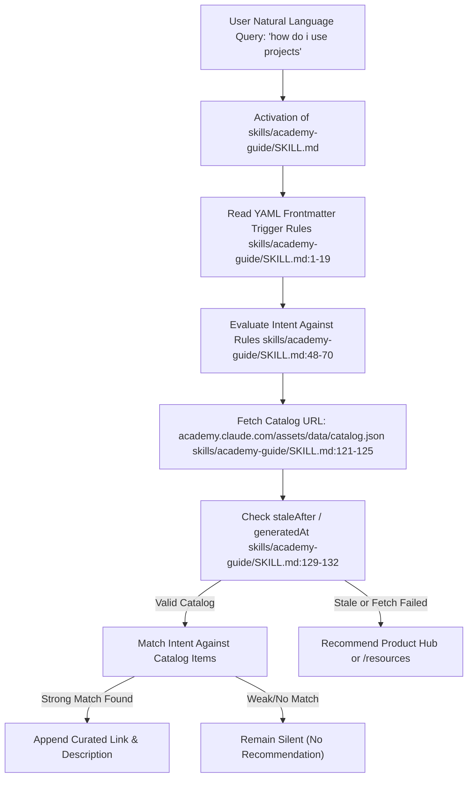
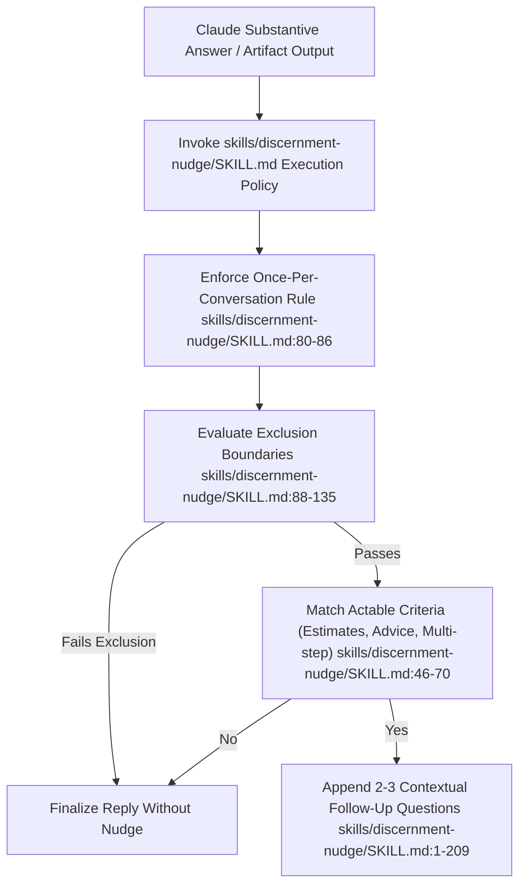

<!-- source: DeepWiki mcp.deepwiki.com · repo anthropics/skills · page 3.4 Guidance and Behavior Skills · fetched 2026-10-30 -->

# Guidance and Behavior Skills

Relevant source files

The following files were used as context for generating this wiki page:

- [.claude-plugin/marketplace.json](.claude-plugin/marketplace.json)
- [skills/academy-guide/LICENSE.txt](skills/academy-guide/LICENSE.txt)
- [skills/academy-guide/SKILL.md](skills/academy-guide/SKILL.md)
- [skills/discernment-nudge/LICENSE.txt](skills/discernment-nudge/LICENSE.txt)
- [skills/discernment-nudge/SKILL.md](skills/discernment-nudge/SKILL.md)

## Purpose and Scope

This page documents section 3.4 of the `anthropics/skills` repository, covering the **Guidance and Behavior Skills** category. Unlike document processing tools or code generators, guidance and behavior skills operate as meta-prompting and policy overlays that dictate how Claude structures its interactions, recommends learning resources, and prompts critical thinking. Specifically, this document details two production skills:
1. `academy-guide`: Recommends verified Claude Academy courses, tutorials, and use cases by dynamically querying a remote catalog with freshness validation [skills/academy-guide/SKILL.md:1-147]().
2. `discernment-nudge`: Appends structured, context-specific follow-up questions to substantive answers to encourage user fact-checking and reasoning validation [skills/discernment-nudge/SKILL.md:1-209]().

Sources: [skills/academy-guide/SKILL.md:1-147](), [skills/discernment-nudge/SKILL.md:1-209](), [.claude-plugin/marketplace.json:55-71]()

---

## 1. The Academy Guide Skill (`academy-guide`)

The `academy-guide` skill directs Claude to recommend relevant learning materials from Claude Academy (`academy.claude.com`) when a user inquires about how to use Claude, specific product features, or broader AI workflows [skills/academy-guide/SKILL.md:1-47](). 

### Key Behavioral Rules

The instruction set defined in `skills/academy-guide/SKILL.md` enforces strict protocols to maintain user trust and avoid hallucination:
* **Answer First**: The primary question must always be answered directly before any learning recommendation is appended [skills/academy-guide/SKILL.md:48-52]().
* **Strong Match Criteria**: Recommendations occur only when the user expresses clear intent to *learn* a feature or workflow (e.g., "how do projects work?"), rather than when they are mid-task and seeking immediate task execution ("help me organize this document") [skills/academy-guide/SKILL.md:53-70]().
* **No Hallucination**: Claude is prohibited from generating Academy links or titles from parametric memory. All recommendations must be pulled from the fetched JSON catalog or designated static product hubs (`/claude`, `/code`, `/cowork`, `/fluency`, `/platform`) [skills/academy-guide/SKILL.md:73-79]().
* **Conciseness**: At most two items (ideally one) are recommended per response using a standardized short format [skills/academy-guide/SKILL.md:80-94]().

### Remote Catalog and Freshness Validation

To prevent stale documentation, the skill references a dynamic JSON catalog rather than embedding hardcoded URLs [skills/academy-guide/SKILL.md:121-125](). Claude fetches `https://academy.claude.com/assets/data/catalog.json` once per conversation [skills/academy-guide/SKILL.md:126-127](). 

Validation checks enforce:
1. **`staleAfter` Timestamp**: If the catalog contains a `staleAfter` ISO timestamp, it is compared against the current execution date [skills/academy-guide/SKILL.md:129-130]().
2. **Fallback Window**: If `staleAfter` is missing, the catalog is considered valid only if `generatedAt` is within a 30-day window [skills/academy-guide/SKILL.md:130-132]().
3. **Graceful Degradation**: If the fetch fails or the catalog is stale, Claude falls back to general product hub links or `academy.claude.com/resources` without guessing individual item slugs [skills/academy-guide/SKILL.md:108-117]().

Diagram: Academy Catalog Retrieval and Recommendation Flow (Natural Language to Code Entity Space)

Sources: [skills/academy-guide/SKILL.md:1-147](), [.claude-plugin/marketplace.json:55-62]()

---

## 2. The Discernment Nudge Skill (`discernment-nudge`)

The `discernment-nudge` skill prompts Claude to append two or three short follow-up questions after providing a substantive answer [skills/discernment-nudge/SKILL.md:1-11](). These questions model core AI Fluency habits: checking facts, questioning reasoning, and noticing missing context [skills/discernment-nudge/SKILL.md:34-43]().

### Inclusion and Exclusion Boundaries

The skill establishes strict guardrails to ensure nudges add value rather than functioning as repetitive noise:
* **Frequency Cap**: Offered *at most once per conversation* [skills/discernment-nudge/SKILL.md:80-86]().
* **Qualified Content Types**: Applied to estimates/projections, consequential advice (business, financial, health), factual claims intended for external decision-making, multi-step reasoning, and drafted artifacts (plans, pitches, proposals) [skills/discernment-nudge/SKILL.md:46-70]().
* **Exclusions**: Skipped during creative writing, casual conversation, executable code generation, simple lookups, purely educational/definitional explanations, and cases where the user explicitly requested verification, a quick version, or asked Claude to review their own pre-supplied material [skills/discernment-nudge/SKILL.md:88-135]().

Diagram: Discernment Nudge Evaluation Pipeline (Natural Language to Code Entity Space)

Sources: [skills/discernment-nudge/SKILL.md:1-209](), [.claude-plugin/marketplace.json:63-71]()

---

## 3. Marketplace and Plugin Registration

Both guidance and behavior skills are packaged as individual plugins within the top-level marketplace catalog file [.claude-plugin/marketplace.json:55-71](). They operate as modular extensions that can be loaded independently or alongside document and developer skills.

Table: Guidance and Behavior Skill Registrations

| Skill Name | Plugin Name | Source Directory | Primary Purpose |
| :--- | :--- | :--- | :--- |
| `academy-guide` | `academy-guide` | `./skills/academy-guide` | Recommends relevant Claude Academy courses and tutorials [skills/academy-guide/SKILL.md:1-17]() |
| `discernment-nudge` | `discernment-nudge` | `./skills/discernment-nudge` | Appends follow-up questions for fact-checking and reasoning verification [skills/discernment-nudge/SKILL.md:1-19]() |

Sources: [.claude-plugin/marketplace.json:55-71](), [skills/academy-guide/SKILL.md:1-19](), [skills/discernment-nudge/SKILL.md:1-19]()

---

