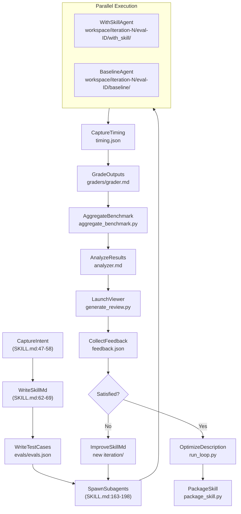
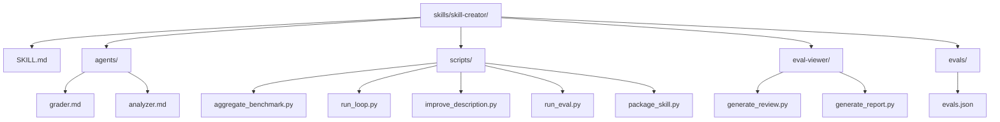

<!-- source: DeepWiki mcp.deepwiki.com · repo anthropics/skills · page 4 Skill Creator · fetched 2026-10-30 -->

# Skill Creator

Relevant source files

The following files were used as context for generating this wiki page:

- [skills/skill-creator/SKILL.md](skills/skill-creator/SKILL.md)
- [skills/skill-creator/scripts/improve_description.py](skills/skill-creator/scripts/improve_description.py)
- [skills/skill-creator/scripts/run_loop.py](skills/skill-creator/scripts/run_loop.py)

This page introduces the `skill-creator` meta-skill: what it is, why it exists, and how its internal subsystems fit together. It is the entry point for the section; detailed documentation for each subsystem is in the child pages:
- For the end-to-end process, see [Skill Creator Workflow](#4.1)
- For test case design and execution, see [Test Case Creation and Evaluation](#4.2)
- For reporting, metrics, and review, see [Review and Benchmarking](#4.3)
- For triggering tuning, see [Description Optimization](#4.4)

For background on what a skill is and how `SKILL.md` works, see [SKILL.md Format Specification](#2.2).

---

## What It Is

`skill-creator` is a meta-skill that creates and iteratively improves other skills. It lives at `skills/skill-creator/SKILL.md` and is triggered by prompts expressing intent to build, test, benchmark, or optimize skills [skills/skill-creator/SKILL.md:1-3]().

Its core capability is orchestrating a feedback loop for skill development: Claude drafts a `SKILL.md`, spawns subagents to execute test cases in parallel, grades outputs against assertions, aggregates quantitative metrics, launches a browser-based viewer for human review, and iterates based on feedback until quality criteria are met [skills/skill-creator/SKILL.md:10-21]().

`skill-creator` is the most operationally complex skill in the repository, coordinating multiple subsystems (parallel subagent execution, grading agents, benchmark aggregation scripts, HTML viewer generation, and Claude API-powered description optimization via `skills/skill-creator/scripts/run_loop.py`) that implement a CI/CD-style pipeline for skill development [skills/skill-creator/scripts/run_loop.py:1-7]().

Sources: [skills/skill-creator/SKILL.md:1-31](), [skills/skill-creator/scripts/run_loop.py:1-45]()

---

## Subsystems and Lifecycle Overview

The `skill-creator` architecture bridges natural language instructions with concrete code entities. The workflow spans requirements capture, parallel subagent execution, automated grading, human-in-the-loop review, and description tuning.

**Diagram: Skill Creation Workflow and Code Mapping**

Sources: [skills/skill-creator/SKILL.md:163-416](), [skills/skill-creator/scripts/run_loop.py:1-10](), [skills/skill-creator/scripts/improve_description.py:1-10]()

---

## Internal File Layout

The workspace and source organization separates human-authored configuration from generated evaluation runs and snapshots.

**Diagram: skill-creator Directory Structure and Artifacts**

Sources: [skills/skill-creator/SKILL.md:459-469](), [skills/skill-creator/scripts/run_loop.py:1-22](), [skills/skill-creator/scripts/improve_description.py:1-20]()

---

## Workflow and Subsystem Summary

For comprehensive procedures and technical specifics, consult the child pages:

1. **[Skill Creator Workflow](#4.1)**: Covers capturing intent, interactive prompt refinement, drafting `SKILL.md` with progressive disclosure rules, and final packaging via `package_skill.py`.
2. **[Test Case Creation and Evaluation](#4.2)**: Explains structured test definitions in `evals/evals.json`, setting up assertions, and executing runs through parallel subagents with `run_eval.py`.
3. **[Review and Benchmarking](#4.3)**: Documents metric collection (`grading.json`, `timing.json`), benchmark aggregation (`aggregate_benchmark.py`), and launching the browser-based review UI via `eval-viewer/generate_review.py`.
4. **[Description Optimization](#4.4)**: Details the automated description tuning pipeline implemented in `run_loop.py` and `improve_description.py`, including train/test holdouts to prevent overfitting.

Sources: [skills/skill-creator/SKILL.md:1-416](), [skills/skill-creator/scripts/run_loop.py:1-137](), [skills/skill-creator/scripts/improve_description.py:1-146]()

---

