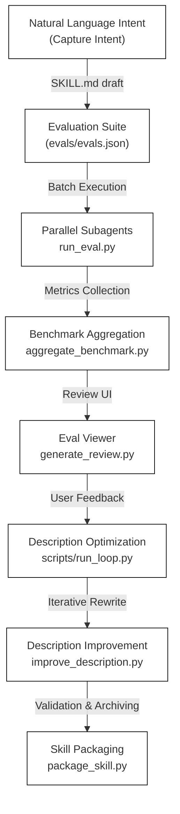
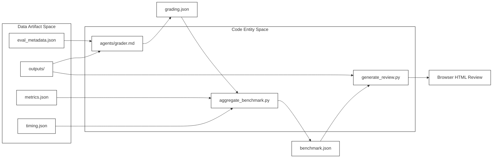

<!-- source: DeepWiki mcp.deepwiki.com · repo anthropics/skills · page 4.1 Skill Creator Workflow · fetched 2026-10-30 -->

# Skill Creator Workflow

<details>
<summary>Relevant source files</summary>

The following files were used as context for generating this wiki page:

- [skills/skill-creator/SKILL.md](skills/skill-creator/SKILL.md)
- [skills/skill-creator/scripts/improve_description.py](skills/skill-creator/scripts/improve_description.py)
- [skills/skill-creator/scripts/run_loop.py](skills/skill-creator/scripts/run_loop.py)

</details>


This page provides a detailed technical reference for the full skill creation lifecycle as managed by the `skill-creator` meta-skill system. It covers the end-to-end journey from initial requirements capture through parallel evaluation, iterative refinement, automated description optimization via `run_loop.py` and `improve_description.py`, and final packaging.

Sources: [skills/skill-creator/SKILL.md:1-30](), [skills/skill-creator/scripts/run_loop.py:1-7](), [skills/skill-creator/scripts/improve_description.py:1-8]()

---

## Workflow Overview

The `skill-creator` workflow operates as an iterative loop combining requirements gathering, automated evaluation, benchmarking, description optimization, and packaging [skills/skill-creator/SKILL.md:10-28](). 

### End-to-End Workflow & Code Mapping



Sources: [skills/skill-creator/SKILL.md:10-28](), [skills/skill-creator/scripts/run_loop.py:47-61]()

---

## Phase 1: Capture Intent

Before authoring code or documentation, the `skill-creator` extracts requirements across four core dimensions [skills/skill-creator/SKILL.md:47-55]():

| Question | Purpose |
|---|---|
| What should the skill enable Claude to do? | Defines the structural scope of the `SKILL.md` body |
| When should the skill trigger? | Drives the frontmatter `description` field |
| What is the expected output format? | Shapes example data and assertion criteria |
| Should test cases be set up? | Determines if quantitative evals are warranted |

Skills with objectively verifiable outputs (such as file transformations, data extraction, or fixed code generation workflows) benefit significantly from test cases. Skills focused on subjective traits (such as writing style or visual design) typically omit them [skills/skill-creator/SKILL.md:54-55]().

Sources: [skills/skill-creator/SKILL.md:47-58]()

---

## Phase 2: Interview and Research

This phase addresses edge cases, input/output formats, example files, success criteria, and dependencies. Test prompts are withheld until these constraints are clarified [skills/skill-creator/SKILL.md:56-58]().

Model Context Protocol (MCP) servers and documentation search tools are queried in parallel via subagents to gather best practices and reference implementations, reducing manual user burden [skills/skill-creator/SKILL.md:60-61]().

Sources: [skills/skill-creator/SKILL.md:56-61]()

---

## Phase 3: Write SKILL.md

The drafted `SKILL.md` file integrates specific frontmatter and Markdown instruction blocks [skills/skill-creator/SKILL.md:62-69]().

| Component | Specifications |
|---|---|
| `name` (Frontmatter) | Kebab-case identifier, maximum 64 characters |
| `description` (Frontmatter) | Primary triggering mechanism; must contain both functional capabilities and triggering contexts. Phrased assertively to counter undertriggering |
| `compatibility` (Frontmatter) | Optional list of required tools or external system dependencies |
| Body Instructions | Markdown format; kept under 500 lines with explicit pointers to bundled resources |

To combat model undertriggering, descriptions use assertive imperative phrasing (e.g., "Make sure to use this skill whenever the user mentions...") [skills/skill-creator/SKILL.md:67-67]().

**Skill Directory Layout:**
```
skill-name/
├── SKILL.md          (required)
├── scripts/          (executable code for deterministic tasks)
├── references/       (docs loaded into context as needed)
└── assets/           (templates, icons, fonts used in output)
```

Progressive disclosure ensures only metadata (`name` and `description`) remains permanently in context (~100 words), while the body loads on trigger, and bundled resources load strictly on demand [skills/skill-creator/SKILL.md:86-92]().

Sources: [skills/skill-creator/SKILL.md:62-138]()

---

## Phase 4: Write Test Cases

After the skill draft is established, 2 to 3 representative prompt scenarios are authored into `evals/evals.json` [skills/skill-creator/SKILL.md:143-161](). At this stage, assertions are left unpopulated to be drafted dynamically during evaluation execution [skills/skill-creator/SKILL.md:152-161]().

Sources: [skills/skill-creator/SKILL.md:143-161]()

---

## Phase 5: Run Parallel Evaluations

Subagents are spawned concurrently for each test case—one operating with the skill loaded (`with_skill`), and one acting as a control (`without_skill`) [skills/skill-creator/SKILL.md:168-175]().

Sources: [skills/skill-creator/SKILL.md:168-197]()

---

## Phase 6: Draft Assertions

While subagent background runs execute, verification assertions are finalized for each test case. Assertions target objectively verifiable properties of the generated outputs [skills/skill-creator/SKILL.md:199-206]().

Sources: [skills/skill-creator/SKILL.md:199-206]()

---

## Phase 7: Capture Timing Data

Execution telemetry—including `total_tokens` and `duration_ms`—is captured upon task completion and written directly to `timing.json` within each run directory [skills/skill-creator/SKILL.md:207-219]().

Sources: [skills/skill-creator/SKILL.md:207-219]()

---

## Phase 8: Grade, Aggregate, and Launch the Viewer

The evaluation pipeline chains grading, aggregation, and review UI generation [skills/skill-creator/SKILL.md:221-266]().

### Evaluation Pipeline & Code Entity Mapping



- **Grading**: A grader subagent executes `agents/grader.md` instructions, populating `grading.json` [skills/skill-creator/SKILL.md:223-231]().
- **Aggregation**: `aggregate_benchmark.py` compiles metrics into `benchmark.json` and `benchmark.md` [skills/skill-creator/SKILL.md:233-242]().
- **Viewer**: `generate_review.py` initializes the interactive review server [skills/skill-creator/SKILL.md:254-266]().

Sources: [skills/skill-creator/SKILL.md:221-266]()

---

## Phase 9: Read Feedback and Improve

Review outcomes are logged to `feedback.json`. Refinements generalize from specific failures to broad user intent categories, avoiding overfitting [skills/skill-creator/SKILL.md:268-322]().

Sources: [skills/skill-creator/SKILL.md:268-322]()

---

## Phase 10: Description Optimization

Once the skill body is stable, the `description` frontmatter field is optimized using `scripts/run_loop.py` [skills/skill-creator/SKILL.md:334-340](), [skills/skill-creator/scripts/run_loop.py:47-61]().

- **Stratification**: `split_eval_set` splits evaluation queries into training and holdout test sets based on `should_trigger` parameters [skills/skill-creator/scripts/run_loop.py:24-44]().
- **Optimization Loop**: `run_loop` coordinates evaluation runs and description generation across iterations [skills/skill-creator/scripts/run_loop.py:47-137]().
- **Subprocess Invocation**: `improve_description.py` defines `_call_claude` to invoke `claude -p` subprocesses (stripping `CLAUDECODE` environment variables safely) and `improve_description` to prompt Claude for revised descriptions [skills/skill-creator/scripts/improve_description.py:20-60]().
- **Constraints**: Descriptions must remain under the hard 1024-character ceiling [skills/skill-creator/scripts/improve_description.py:132-132]().

Sources: [skills/skill-creator/SKILL.md:334-404](), [skills/skill-creator/scripts/run_loop.py:24-174](), [skills/skill-creator/scripts/improve_description.py:20-142]()

---

## Phase 11: Package

Final packaging is handled by `scripts/package_skill.py`. The script executes:
1. **Validation**: Calls `validate_skill` from `quick_validate.py` to confirm structure and frontmatter validity [skills/skill-creator/scripts/package_skill.py:71-77]().
2. **Exclusion Filtering**: Skips build caches (`__pycache__`, `node_modules`) and intermediate `evals/` directories [skills/skill-creator/scripts/package_skill.py:20-39]().
3. **Compression**: Archives the valid directory into a deployable `.skill` bundle [skills/skill-creator/scripts/package_skill.py:91-101]().

Sources: [skills/skill-creator/SKILL.md:408-416](), [skills/skill-creator/scripts/package_skill.py:1-136]()

---

