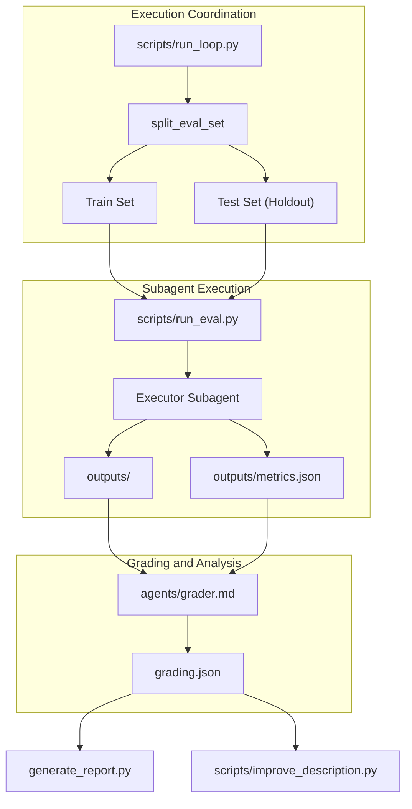
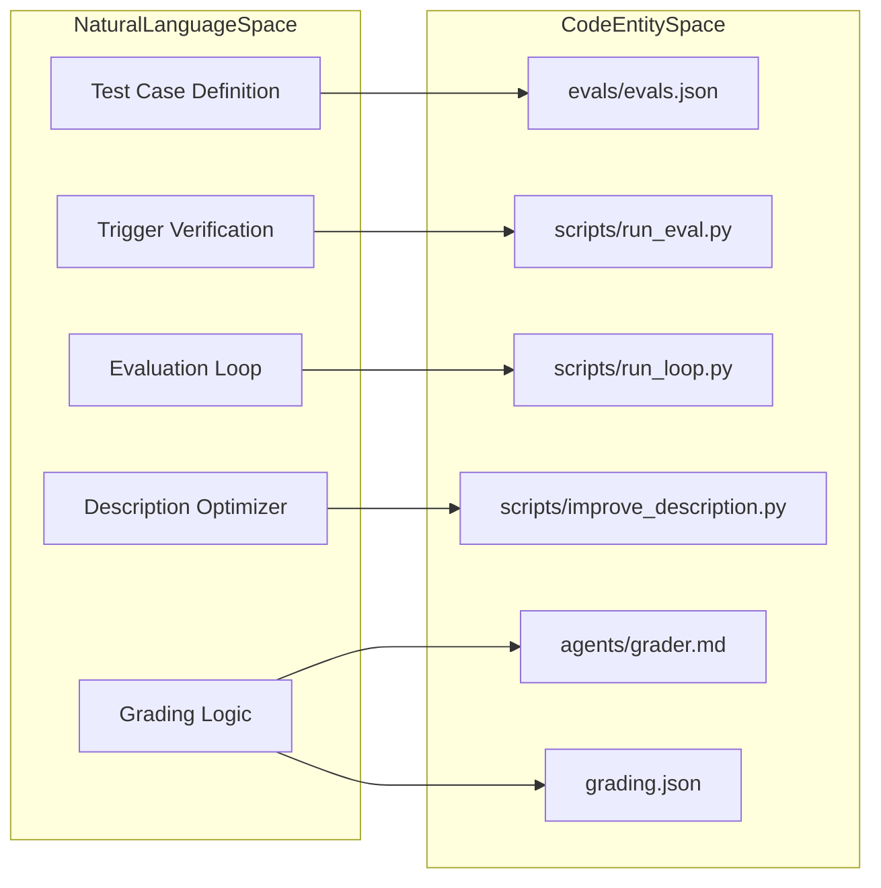

<!-- source: DeepWiki mcp.deepwiki.com · repo anthropics/skills · page 4.2 Test Case Creation and Evaluation · fetched 2026-10-30 -->

# Test Case Creation and Evaluation

<details>
<summary>Relevant source files</summary>

The following files were used as context for generating this wiki page:

- [skills/skill-creator/SKILL.md](skills/skill-creator/SKILL.md)
- [skills/skill-creator/agents/analyzer.md](skills/skill-creator/agents/analyzer.md)
- [skills/skill-creator/agents/comparator.md](skills/skill-creator/agents/comparator.md)
- [skills/skill-creator/agents/grader.md](skills/skill-creator/agents/grader.md)
- [skills/skill-creator/assets/eval_review.html](skills/skill-creator/assets/eval_review.html)
- [skills/skill-creator/eval-viewer/generate_review.py](skills/skill-creator/eval-viewer/generate_review.py)
- [skills/skill-creator/eval-viewer/viewer.html](skills/skill-creator/eval-viewer/viewer.html)
- [skills/skill-creator/references/schemas.md](skills/skill-creator/references/schemas.md)
- [skills/skill-creator/scripts/improve_description.py](skills/skill-creator/scripts/improve_description.py)
- [skills/skill-creator/scripts/run_loop.py](skills/skill-creator/scripts/run_loop.py)

</details>


This page explains how to create test cases for skills and execute them using subagents. Test cases are stored in `evals/evals.json` and form the foundation of the skill development and evaluation loop, providing concrete examples to validate that a skill behaves correctly and triggers under the appropriate conditions [skills/skill-creator/references/schemas.md:7-36]().

---

## Test Case Structure in `evals.json`

Test cases are defined in `evals/evals.json` at the root of each skill directory. Each test case represents a realistic user task that the skill should handle.

The JSON schema defines the skill name and an array of individual evaluation test cases [skills/skill-creator/references/schemas.md:7-36]().

```json
{
  "skill_name": "example-skill",
  "evals": [
    {
      "id": 1,
      "prompt": "User's example prompt",
      "expected_output": "Description of expected result",
      "files": ["evals/files/sample1.pdf"],
      "expectations": [
        "The output includes X",
        "The skill used script Y"
      ]
    }
  ]
}
```

| Field | Type | Description |
|-------|------|-------------|
| `skill_name` | String | Name matching the skill's frontmatter [skills/skill-creator/references/schemas.md:30-30]() |
| `evals` | Array | Array of test case objects [skills/skill-creator/references/schemas.md:14-25]() |
| `evals[].id` | Integer | Unique integer identifier for the test case [skills/skill-creator/references/schemas.md:31-31]() |
| `evals[].prompt` | String | The task prompt to execute during evaluation [skills/skill-creator/references/schemas.md:32-32]() |
| `evals[].expected_output` | String | Human-readable description of success [skills/skill-creator/references/schemas.md:33-33]() |
| `evals[].files` | Array[String] | Optional list of input file paths relative to the skill root [skills/skill-creator/references/schemas.md:34-34]() |
| `evals[].expectations` | Array[String] | List of verifiable assertions used by the grader [skills/skill-creator/references/schemas.md:35-35]() |

Sources: [skills/skill-creator/references/schemas.md:7-36]()

---

## Executing Test Cases with Subagents

The evaluation framework automates testing by invoking execution agents against the defined prompts in `evals.json`.

### Diagram: Evaluation Execution and Data Flow



Sources: [skills/skill-creator/references/schemas.md:1-247](), [skills/skill-creator/agents/grader.md:1-184]()

---

## Grading and Analysis Agents

Once an execution run completes, results are evaluated using dedicated subagent roles and grading schemas.

### Grader Agent (`agents/grader.md`)

The **Grader Agent** reviews execution transcripts and generated output files to determine whether each expectation passes or fails [skills/skill-creator/agents/grader.md:1-7]().

- **Inputs**: `expectations`, `transcript_path`, and `outputs_dir` [skills/skill-creator/agents/grader.md:11-17]().
- **Process**:
  1. Reads the markdown execution transcript [skills/skill-creator/agents/grader.md:21-25]().
  2. Examines generated files in `outputs_dir` using inspection tools [skills/skill-creator/agents/grader.md:27-32]().
  3. Evaluates each expectation, providing explicit evidence strings for `PASS` or `FAIL` verdicts [skills/skill-creator/agents/grader.md:33-42]().
  4. Extracts and verifies implicit factual, process, and quality claims [skills/skill-creator/agents/grader.md:43-60]().
- **Output**: Writes structured results to `grading.json` [skills/skill-creator/agents/grader.md:81-83](), containing expectational verdicts, execution metrics, timing, and claims [skills/skill-creator/references/schemas.md:86-160]().

### Blind Comparison and Post-hoc Analysis

When comparing competing skill versions (such as a baseline against an optimized version), the framework utilizes two specialized agents:
1. **Blind Comparator** (`agents/comparator.md`): Evaluates two outputs labeled A and B without knowing which skill produced them, scoring them against a dynamically generated Content and Structure rubric [skills/skill-creator/agents/comparator.md:1-85]().
2. **Post-hoc Analyzer** (`agents/analyzer.md`): Unblinds the comparison results, inspects both `SKILL.md` instructions and execution transcripts, and generates actionable improvement suggestions categorized by instructions, tools, and error handling [skills/skill-creator/agents/analyzer.md:1-89]().

Sources: [skills/skill-creator/agents/grader.md:1-184](), [skills/skill-creator/agents/comparator.md:1-85](), [skills/skill-creator/agents/analyzer.md:1-89](), [skills/skill-creator/references/schemas.md:86-160]()

---

## Execution Metrics and Timing

Execution metadata and performance characteristics are captured across specialized JSON files.

- `metrics.json`: Records counts per tool type (`Read`, `Write`, `Bash`, `Edit`, `Glob`, `Grep`), total steps, created files, and character metrics [skills/skill-creator/references/schemas.md:163-194]().
- `timing.json`: Captures wall-clock duration and token counts across executor and grader subagents [skills/skill-creator/references/schemas.md:197-215]().

Sources: [skills/skill-creator/references/schemas.md:163-215]()

---

## Natural Language Space to Code Entity Mapping

The following mapping associates the conceptual components of the evaluation system with their concrete code implementations.

### Diagram: Natural Language to Code Entity Space



| Natural Language Concept | Code Entity / File Path |
|--------------------------|-------------------------|
| Test Case Definitions    | `evals/evals.json` [skills/skill-creator/references/schemas.md:7-9]() |
| Trigger Test Execution   | `scripts/run_eval.py` [skills/skill-creator/scripts/run_eval.py:1-6]() |
| Evaluation Coordination  | `scripts/run_loop.py` [skills/skill-creator/scripts/run_loop.py:1-7]() |
| Description Optimization | `scripts/improve_description.py` [skills/skill-creator/scripts/improve_description.py:1-7]() |
| Grader Agent Definition  | `agents/grader.md` [skills/skill-creator/agents/grader.md:1-3]() |
| Grading Output Schema    | `grading.json` [skills/skill-creator/references/schemas.md:86-88]() |

Sources: [skills/skill-creator/references/schemas.md:1-220](), [skills/skill-creator/agents/grader.md:1-184]()

---

