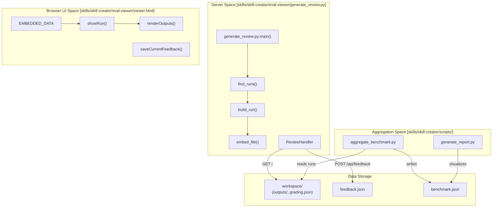

<!-- source: DeepWiki mcp.deepwiki.com · repo anthropics/skills · page 4.3 Review and Benchmarking · fetched 2026-10-30 -->

# Review and Benchmarking

Relevant source files

The following files were used as context for generating this wiki page:

- [skills/skill-creator/agents/analyzer.md](skills/skill-creator/agents/analyzer.md)
- [skills/skill-creator/agents/comparator.md](skills/skill-creator/agents/comparator.md)
- [skills/skill-creator/agents/grader.md](skills/skill-creator/agents/grader.md)
- [skills/skill-creator/assets/eval_review.html](skills/skill-creator/assets/eval_review.html)
- [skills/skill-creator/eval-viewer/generate_review.py](skills/skill-creator/eval-viewer/generate_review.py)
- [skills/skill-creator/eval-viewer/viewer.html](skills/skill-creator/eval-viewer/viewer.html)
- [skills/skill-creator/references/schemas.md](skills/skill-creator/references/schemas.md)

This page documents the evaluation review and benchmarking tools within the `skill-creator` system. These tools facilitate qualitative inspection of model outputs, collection of human feedback, automated grading, post-hoc analysis, and quantitative performance aggregation across skill iterations.

---

## 1. Component Overview and Architecture

The review system bridges raw execution outputs in the workspace (`outputs/`, `grading.json`, `metrics.json`) with a structured browser interface (`viewer.html`), standalone Python review servers (`generate_review.py`), and downstream benchmarking aggregators.

### Component-to-Code Map

Sources: [skills/skill-creator/eval-viewer/generate_review.py:1-29](), [skills/skill-creator/eval-viewer/viewer.html:1-12](), [skills/skill-creator/scripts/aggregate_benchmark.py:1-35]()

---

## 2. Evaluation Review Server (`generate_review.py`)

`generate_review.py` is a standalone Python script that scans a workspace for evaluation runs and serves a self-contained HTML page for human review. It requires no external dependencies beyond the Python standard library [skills/skill-creator/eval-viewer/generate_review.py:8-13]().

### Workspace Discovery and Run Building
The server utilizes `find_runs()` to recursively search a workspace directory for folders containing an `outputs/` subdirectory [skills/skill-creator/eval-viewer/generate_review.py:60-66](). It filters out unrelated directories such as `node_modules`, `.git`, `__pycache__`, and `inputs` [skills/skill-creator/eval-viewer/generate_review.py:79-83]().

For each discovered run directory, `build_run()` extracts metadata and artifacts:
*   **Prompt extraction**: Reads `eval_metadata.json` or parses `transcript.md` via regular expressions looking for `## Eval Prompt` headers [skills/skill-creator/eval-viewer/generate_review.py:85-118]().
*   **Output collection**: Gathers files inside `outputs/` while excluding system metadata files (`transcript.md`, `user_notes.md`, `metrics.json`) [skills/skill-creator/eval-viewer/generate_review.py:31-31](), [skills/skill-creator/eval-viewer/generate_review.py:121-128]().
*   **Grading integration**: Loads `grading.json` if generated by the evaluation subagent [skills/skill-creator/eval-viewer/generate_review.py:129-139]().

### File Embedding
To make the review page fully portable without external static file hosting, `embed_file()` transforms output files into embedded representations based on their extensions [skills/skill-creator/eval-viewer/generate_review.py:149-153]():
*   **Text files**: Extensions matching `TEXT_EXTENSIONS` (e.g., `.py`, `.json`, `.md`, `.txt`) are read as plain strings [skills/skill-creator/eval-viewer/generate_review.py:34-38](), [skills/skill-creator/eval-viewer/generate_review.py:154-163]().
*   **Image files**: Extensions matching `IMAGE_EXTENSIONS` (e.g., `.png`, `.jpg`, `.svg`) are converted to base64 data URIs [skills/skill-creator/eval-viewer/generate_review.py:40-42](), [skills/skill-creator/eval-viewer/generate_review.py:164-175]().
*   **Specialized documents**: `.pdf` and `.xlsx` files are encoded in base64 streams for specialized browser viewers (such as SheetJS for spreadsheets) [skills/skill-creator/eval-viewer/generate_review.py:176-197]().

Sources: [skills/skill-creator/eval-viewer/generate_review.py:1-58](), [skills/skill-creator/eval-viewer/generate_review.py:60-146](), [skills/skill-creator/eval-viewer/generate_review.py:149-203]()

---

## 3. Viewer Interface (`viewer.html`)

The viewer front-end is a single-page application embedded with run data injected via `generate_review.py`.

### Run Visualization and Grading Display
*   `showRun(index)` manages navigation between different test cases [skills/skill-creator/eval-viewer/viewer.html:689-761]().
*   **Configuration Badges**: Distinguishes between configuration types (e.g., `config-primary` vs `config-baseline`) [skills/skill-creator/eval-viewer/viewer.html:98-119]().
*   **Output Rendering**: `renderOutputs()` handles inline text, image tags, iframes for PDFs, and SheetJS-rendered tables for `.xlsx` spreadsheets [skills/skill-creator/eval-viewer/viewer.html:763-855]().
*   **Automated Grades**: `renderGrades()` reads structured pass/fail verdicts and evidence from the automated grader [skills/skill-creator/eval-viewer/viewer.html:857-912]().

### Feedback Collection Process
The interface provides textareas for capturing developer and reviewer notes:
*   As users type into the `feedback-textarea`, `saveCurrentFeedback()` initiates a debounced `POST` request to `/api/feedback` [skills/skill-creator/eval-viewer/viewer.html:993-1025]().
*   Feedback is persisted locally to `feedback.json` within the workspace directory, ensuring reviewer insights are captured alongside run artifacts.

Sources: [skills/skill-creator/eval-viewer/viewer.html:1-12](), [skills/skill-creator/eval-viewer/viewer.html:239-255](), [skills/skill-creator/eval-viewer/viewer.html:993-1067]()

---

## 4. Specialized Evaluation Agents

Beyond simple scripts, the evaluation suite deploys subagents to grade, compare, and analyze runs qualitatively.

### Grader Agent (`grader.md`)
The Grader agent evaluates execution transcripts and output files against defined expectations [skills/skill-creator/agents/grader.md:1-7]().
*   **Evidence Checking**: Searches transcripts and outputs for strict proof, marking assertions as `PASS` or `FAIL` with explicit citations [skills/skill-creator/agents/grader.md:33-42]().
*   **Claim Extraction**: Extracts implicit factual and quality claims from outputs to verify correctness beyond rigid assertions [skills/skill-creator/agents/grader.md:43-59]().
*   **Eval Critique**: Critiques the quality of the evals themselves, flagging assertions that are too weak or fail to discriminate success [skills/skill-creator/agents/grader.md:68-80]().
*   **Output Schema**: Writes its findings to `grading.json` (sibling to `outputs/`) [skills/skill-creator/agents/grader.md:81-108]().

### Blind Comparator Agent (`comparator.md`)
The Blind Comparator compares two outputs (A and B) without knowing which skill version produced them, mitigating bias [skills/skill-creator/agents/comparator.md:1-9]().
*   **Rubric Generation**: Constructs a two-dimensional rubric covering *Content* (correctness, completeness, accuracy) and *Structure* (organization, formatting, usability) [skills/skill-creator/agents/comparator.md:37-59]().
*   **Scoring & Decision**: Assigns 1–5 scores per criterion, scales overall scores to 1–10, and determines a decisive winner (`A`, `B`, or `TIE`) [skills/skill-creator/agents/comparator.md:60-85]().

### Post-hoc Analyzer Agent (`analyzer.md`)
After a winner is declared, the Post-hoc Analyzer "unblinds" the results to extract actionable improvement insights [skills/skill-creator/agents/analyzer.md:1-8]().
*   **Instruction Following Analysis**: Evaluates how closely each execution transcript followed the `SKILL.md` instructions [skills/skill-creator/agents/analyzer.md:49-58]().
*   **Suggestion Generation**: Produces prioritized suggestions categorized under `instructions`, `tools`, `examples`, `error_handling`, `structure`, or `references` [skills/skill-creator/agents/analyzer.md:77-85](), [skills/skill-creator/agents/analyzer.md:166-178]().

Sources: [skills/skill-creator/agents/comparator.md:1-11](), [skills/skill-creator/agents/grader.md:1-10](), [skills/skill-creator/agents/analyzer.md:1-18]()

---

## 5. Benchmark Aggregation and Schemas

Quantitative analysis across multiple runs and configurations is handled by aggregation scripts and structured JSON schemas.

### Benchmark Aggregation (`aggregate_benchmark.py`)
`aggregate_benchmark.py` parses `grading.json` files across run directories to compute aggregate statistics (mean pass rates, token counts, execution durations) and generate comparative summaries between skill-enabled configurations and baseline runs [skills/skill-creator/scripts/aggregate_benchmark.py:45-64]().

### Structured Data Schemas

The following JSON schemas define the core data artifacts generated during review and benchmarking:

| Artifact | Location | Description |
| :--- | :--- | :--- |
| `evals.json` | `evals/evals.json` | Defines skill test cases, prompts, input files, and expectation assertions [skills/skill-creator/references/schemas.md:7-27]() |
| `grading.json` | `<run-dir>/grading.json` | Output from the grader agent containing assertion pass/fail results, evidence, and execution metrics [skills/skill-creator/references/schemas.md:86-150]() |
| `metrics.json` | `<run-dir>/outputs/metrics.json` | Executor agent telemetry including tool call counts, steps, and character output volume [skills/skill-creator/references/schemas.md:163-184]() |
| `benchmark.json` | `benchmarks/<timestamp>/benchmark.json` | Aggregated multi-run benchmark results comparing configurations [skills/skill-creator/references/schemas.md:219-247]() |

Sources: [skills/skill-creator/references/schemas.md:1-27](), [skills/skill-creator/references/schemas.md:86-160](), [skills/skill-creator/references/schemas.md:163-194](), [skills/skill-creator/references/schemas.md:219-247]()

---

## 6. Eval Set Review Tool (`eval_review.html`)

The `eval_review.html` asset provides a developer UI for managing and refining test queries in `evals.json` [skills/skill-creator/assets/eval_review.html:1-60]().

| Function Name | Description |
| :--- | :--- |
| `addRow()` | Appends a new query entry to the local eval set state and focuses the input [skills/skill-creator/assets/eval_review.html:115-120]() |
| `updateTrigger()` | Toggles whether a query should trigger the skill (`should_trigger: true/false`) and re-renders [skills/skill-creator/assets/eval_review.html:112-112]() |
| `exportEvalSet()` | Serializes the validated query list into a downloadable `eval_set.json` file [skills/skill-creator/assets/eval_review.html:129-141]() |

The interface automatically sorts evaluation queries by their `should_trigger` classification to help developers maintain a balanced mix of positive and negative trigger test cases [skills/skill-creator/assets/eval_review.html:71-85]().

Sources: [skills/skill-creator/assets/eval_review.html:1-60](), [skills/skill-creator/assets/eval_review.html:71-141]()

---

