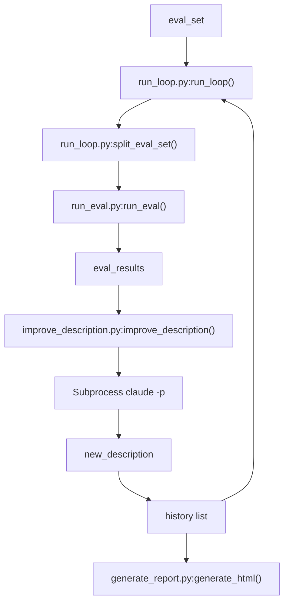
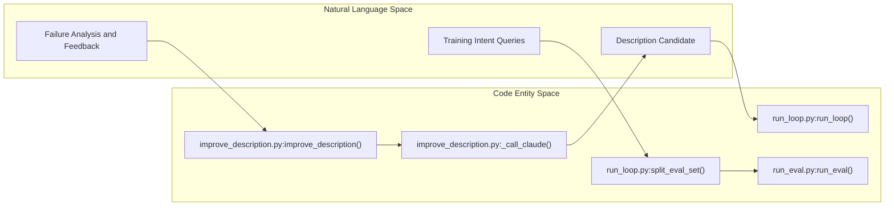

<!-- source: DeepWiki mcp.deepwiki.com · repo anthropics/skills · page 4.4 Description Optimization · fetched 2026-10-30 -->

# Description Optimization

Relevant source files

The following files were used as context for generating this wiki page:

- [skills/skill-creator/SKILL.md](skills/skill-creator/SKILL.md)
- [skills/skill-creator/scripts/improve_description.py](skills/skill-creator/scripts/improve_description.py)
- [skills/skill-creator/scripts/run_loop.py](skills/skill-creator/scripts/run_loop.py)

This page documents the automated description optimization subsystem located within the `skill-creator` meta-skill [skills/skill-creator/SKILL.md:28-28](). Its purpose is to iteratively refine a `SKILL.md` description field so that Claude triggers the skill accurately on relevant user queries and correctly ignores it on irrelevant ones [skills/skill-creator/scripts/improve_description.py:2-7](), [skills/skill-creator/scripts/run_loop.py:2-6]().

Sources: [skills/skill-creator/SKILL.md:28-28](), [skills/skill-creator/scripts/improve_description.py:2-7](), [skills/skill-creator/scripts/run_loop.py:2-6]()

---

## Why Description Optimization Exists

A skill's `description` field (bounded by a hard limit of 1024 characters) is the primary signal Claude evaluates in its `available_skills` list to decide whether to invoke a skill for a given user query [skills/skill-creator/scripts/improve_description.py:81-82](), [skills/skill-creator/scripts/improve_description.py:132-132](). Sub-optimal wording results in two primary failure modes:

| Failure Mode | Meaning | Code Representation |
|---|---|---|
| **Failed trigger** | The skill should have activated for a query, but the description did not match (False Negative) | `[r for r in eval_results["results"] if r["should_trigger"] and not r["pass"]]` [skills/skill-creator/scripts/improve_description.py:62-65]() |
| **False trigger** | The skill activated when it should have stayed dormant (False Positive) | `[r for r in eval_results["results"] if not r["should_trigger"] and not r["pass"]]` [skills/skill-creator/scripts/improve_description.py:66-69]() |

The optimization subsystem treats description tuning as an iterative search problem over a labeled set of test queries [skills/skill-creator/scripts/run_loop.py:2-7]().

Sources: [skills/skill-creator/scripts/improve_description.py:62-69](), [skills/skill-creator/scripts/improve_description.py:81-82](), [skills/skill-creator/scripts/improve_description.py:132-132](), [skills/skill-creator/scripts/run_loop.py:2-7]()

---

## Key Files and Roles

| File Path | Role and Description |
|---|---|
| `skills/skill-creator/scripts/run_loop.py` | Orchestrates the evaluation and improvement loop, handles train/test splitting, and records iteration history [skills/skill-creator/scripts/run_loop.py:1-7]() |
| `skills/skill-creator/scripts/improve_description.py` | Core optimization logic; formats failure feedback into prompts and calls Claude via subprocess [skills/skill-creator/scripts/improve_description.py:1-7]() |
| `skills/skill-creator/scripts/run_eval.py` | Executes skill descriptions against query sets to measure triggering accuracy [skills/skill-creator/scripts/run_loop.py:20-20]() |
| `skills/skill-creator/scripts/generate_report.py` | Renders iteration history into an interactive HTML summary report [skills/skill-creator/scripts/run_loop.py:18-18]() |
| `skills/skill-creator/scripts/utils.py` | Provides `parse_skill_md` for parsing YAML frontmatter fields from `SKILL.md` [skills/skill-creator/scripts/utils.py:7-47]() |

Sources: [skills/skill-creator/scripts/run_loop.py:1-20](), [skills/skill-creator/scripts/improve_description.py:1-7](), [skills/skill-creator/scripts/utils.py:7-47]()

---

## The Optimization Loop Architecture

The optimization process follows a continuous loop: evaluating descriptions against query sets, analyzing failure categories, invoking Claude to generate improved text, and repeating until convergence or iteration limits are reached [skills/skill-creator/scripts/run_loop.py:2-7]().

Title: Description Optimization Data Flow

Sources: [skills/skill-creator/scripts/run_loop.py:24-151](), [skills/skill-creator/scripts/improve_description.py:50-60](), [skills/skill-creator/scripts/improve_description.py:146-147]()

---

## Implementation Details

### Train vs. Test Split
To prevent descriptions from overfitting to specific evaluation queries, `run_loop.py` splits the query list into training and testing partitions using `split_eval_set` [skills/skill-creator/scripts/run_loop.py:24-44]().
- **Train Set**: Utilized by `improve_description.py` to analyze failed triggers and false positives [skills/skill-creator/scripts/improve_description.py:62-69]().
- **Test Set**: Acts as an independent holdout evaluation layer to verify generalization [skills/skill-creator/scripts/run_loop.py:112-120]().

Splitting is stratified by the `should_trigger` boolean flag to maintain proportional representation across positive and negative cases [skills/skill-creator/scripts/run_loop.py:25-30]().

Sources: [skills/skill-creator/scripts/run_loop.py:24-44](), [skills/skill-creator/scripts/run_loop.py:112-120](), [skills/skill-creator/scripts/improve_description.py:62-69]()

### `improve_description.py` Subsystem
The core function `improve_description` formats an extensive prompt incorporating current metrics, failure items, previous attempts, and SKILL.md body context [skills/skill-creator/scripts/improve_description.py:50-125](). It expects responses enclosed within `<new_description>` XML tags [skills/skill-creator/scripts/improve_description.py:142-146]().

Key prompt engineering constraints enforced on Claude include:
- **Imperative Phrasing**: Descriptions must start with imperative framing like "Use this skill for..." rather than declarative phrasing [skills/skill-creator/scripts/improve_description.py:135-135]().
- **Intent Focus**: Focus on user objectives and goals rather than low-level implementation logic [skills/skill-creator/scripts/improve_description.py:136-136]().
- **Character Budget**: Keep word counts between 100–200 words, strictly bounded below the 1024-character truncation threshold [skills/skill-creator/scripts/improve_description.py:132-132]().
- **Generalization**: Avoid appending exhaustive lists of literal query strings to prevent prompt bloat and overfitting [skills/skill-creator/scripts/improve_description.py:127-130]().

Sources: [skills/skill-creator/scripts/improve_description.py:50-146]()

---

## Technical Flow and Code Entities

This diagram bridges natural language optimization concepts to their concrete code entities and functions within the repository.

Title: Natural Language to Code Entity Mapping

Sources: [skills/skill-creator/scripts/run_loop.py:24-99](), [skills/skill-creator/scripts/improve_description.py:20-61]()

---

## Execution and Reporting

### The `run_loop` Orchestration Function
The loop runner in `run_loop.py` iterates up to `max_iterations`, executing evaluations and invoking description improvements [skills/skill-creator/scripts/run_loop.py:47-177]().
1. Executes `run_eval` across all training and testing queries in batch [skills/skill-creator/scripts/run_loop.py:89-99]().
2. Computes summary metrics (precision, recall, accuracy) and records history entries [skills/skill-creator/scripts/run_loop.py:121-137](), [skills/skill-creator/scripts/run_loop.py:164-166]().
3. Writes live HTML diagnostic reports via `generate_html` [skills/skill-creator/scripts/run_loop.py:140-151]().
4. Feeds performance data into `improve_description` to generate subsequent candidates [skills/skill-creator/scripts/improve_description.py:50-60]().

### Subprocess Execution Model
To invoke Claude without requiring separate API keys, `improve_description.py` executes the local Claude Code CLI via `_call_claude` using `subprocess.run` [skills/skill-creator/scripts/improve_description.py:20-47](). It purges the `CLAUDECODE` environment variable to safely allow nested execution when run inside an active interactive session [skills/skill-creator/scripts/improve_description.py:30-33]().

Sources: [skills/skill-creator/scripts/run_loop.py:47-177](), [skills/skill-creator/scripts/improve_description.py:20-60]()

---

