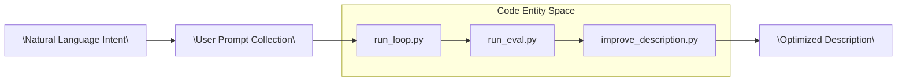

<!-- source: DeepWiki mcp.deepwiki.com · repo anthropics/skills · page 5 Developer Guide · fetched 2026-10-30 -->

# Developer Guide

<details>
<summary>Relevant source files</summary>

The following files were used as context for generating this wiki page:

- [.gitignore](.gitignore)
- [README.md](README.md)
- [skills/skill-creator/SKILL.md](skills/skill-creator/SKILL.md)
- [skills/skill-creator/scripts/improve_description.py](skills/skill-creator/scripts/improve_description.py)
- [skills/skill-creator/scripts/run_loop.py](skills/skill-creator/scripts/run_loop.py)
- [spec/agent-skills-spec.md](spec/agent-skills-spec.md)

</details>


This guide provides a high-level overview of the developer workflow for creating, validating, and packaging new skills for Claude. Skills are modular folders containing instructions, scripts, and resources that Claude loads dynamically `[README.md:6-6]()`. Developers can author custom skills using a simple Markdown format with YAML frontmatter `[README.md:63-71]()`.

This is a parent page. For detailed step-by-step instructions, see [Creating a New Skill](#5.1). For automated validation requirements, see [Skill Validation](#5.2). For bundling and marketplace distribution, see [Skill Packaging and Distribution](#5.3).

---

## Developer Workflow Overview

The skill development lifecycle flows from authoring a new skill directory to validating its structure and finally packaging it for distribution.

### Diagram: Skill Development Lifecycle
```mermaid
graph TB
    Start["\"Developer Intent\""] --> Create["\"Creating a New Skill\"<br/>(`SKILL.md`)"]
    Create --> Validate["\"Skill Validation\"<br/>(`quick_validate.py`)"]
    Validate -->|Passes| Package["\"Skill Packaging & Distribution\"<br/>(`package_skill.py`)"]
    Validate -->|Fails| Create
    Package --> Marketplace["\"Marketplace Registration\"<br/>(`marketplace.json`)"]

    subgraph "Code Entity Space"
        Create
        Validate
        Package
    end
```
**Sources:** `[README.md:6-18]`, `[README.md:63-91]`

---

## Skill Creator and Optimization Pipeline

Developers leveraging the `skill-creator` meta-skill can programmatically evaluate, test, and optimize skill descriptions using automated Python scripts.

### Diagram: Optimization Pipeline Architecture

**Sources:** `[skills/skill-creator/scripts/run_loop.py:47-61]`, `[skills/skill-creator/scripts/improve_description.py:50-60]`

---

## 5.1 Creating a New Skill

Creating a skill starts with setting up a dedicated directory under the `skills/` or `template/` path containing a required `SKILL.md` file `[README.md:18-29]()`. The frontmatter requires unique identification and descriptive metadata, while the body defines operational instructions and guidelines `[README.md:68-84]()`.

Developers can also organize optional supporting directories such as `scripts/` for executable code, `references/` for contextual documentation, and `assets/` for template files `[README.md:18-20]()`.

For step-by-step authoring instructions, directory structure conventions, and resource organization, see [Creating a New Skill](#5.1).

**Sources:** `[README.md:6-30]`, `[README.md:63-91]`

---

## 5.2 Skill Validation

Before distributing or registering a skill, developers must ensure that metadata fields, YAML frontmatter syntax, and file structures adhere to the Agent Skills standard and repository requirements. Automated validation checks prevent runtime loading errors and ensure correct parsing of skill triggers.

For detailed documentation on executing validation scripts like `quick_validate.py` and checking SKILL.md requirements, see [Skill Validation](#5.2).

**Sources:** `[README.md:1-6]`, `[README.md:63-91]`

---

## 5.3 Skill Packaging and Distribution

Once a skill is authored and validated, it can be bundled into a distributable plugin package or integrated directly into plugin marketplaces such as Claude Code `[README.md:33-49]()`. Packaging ensures all required assets, scripts, and instructions are correctly bundled for target environments.

For information on packaging scripts, distribution formats, and marketplace integration steps, see [Skill Packaging and Distribution](#5.3).

**Sources:** `[README.md:33-52]`, `[README.md:63-91]`

---

