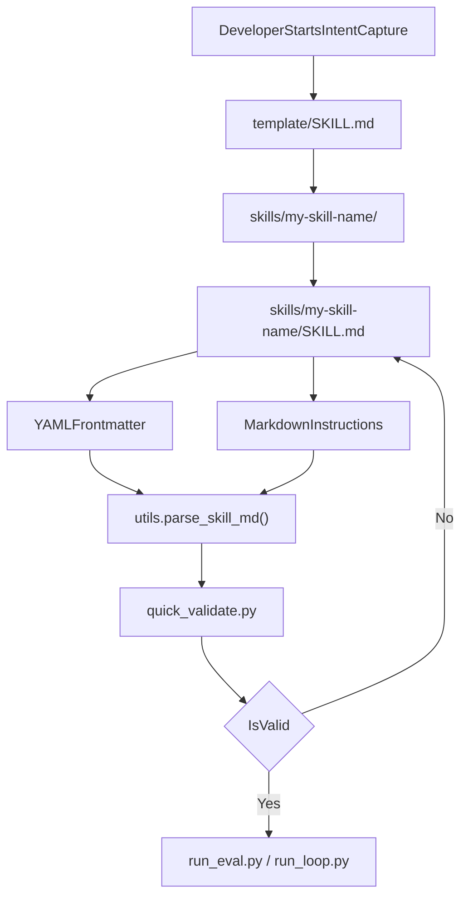
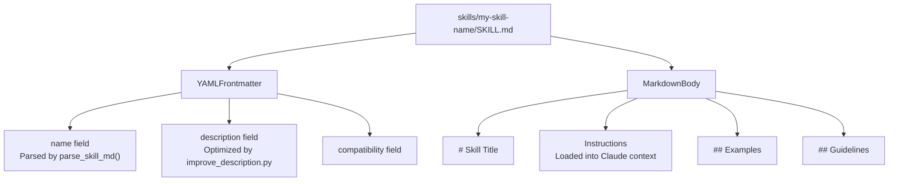
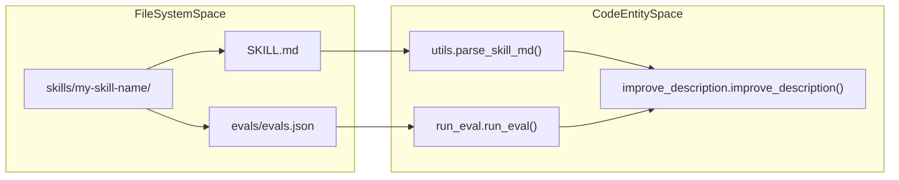

<!-- source: DeepWiki mcp.deepwiki.com · repo anthropics/skills · page 5.1 Creating a New Skill · fetched 2026-10-30 -->

# Creating a New Skill

<details>
<summary>Relevant source files</summary>

The following files were used as context for generating this wiki page:

- [skills/skill-creator/SKILL.md](skills/skill-creator/SKILL.md)
- [skills/skill-creator/scripts/improve_description.py](skills/skill-creator/scripts/improve_description.py)
- [skills/skill-creator/scripts/run_loop.py](skills/skill-creator/scripts/run_loop.py)

</details>


This page provides a step-by-step technical guide for creating a new skill in the `anthropics/skills` repository. It covers the directory structure, `SKILL.md` authoring, YAML frontmatter requirements, and the validation process using the repository's internal tooling (`skills/skill-creator/scripts/run_loop.py` and `skills/skill-creator/scripts/improve_description.py`).

## Prerequisites

Before creating a new skill, ensure you have:
- A clear understanding of the task your skill should accomplish `[skills/skill-creator/SKILL.md:10-12]()`.
- Familiarity with YAML syntax for frontmatter `[skills/skill-creator/SKILL.md:78-79]()`.
- Knowledge of Markdown formatting for instructions `[skills/skill-creator/SKILL.md:79-79]()`.
- Reference to the Agent Skills specification `[spec/agent-skills-spec.md:1-3]()`.

Sources: `[skills/skill-creator/SKILL.md:10-12]`, `[skills/skill-creator/SKILL.md:78-79]`, `[spec/agent-skills-spec.md:1-3]()`

## Skill Creation Workflow

The following diagram maps the creation workflow to the actual file system artifacts and tooling involved in the repository, bridging natural language authoring concepts to code execution functions like `parse_skill_md()` and `run_eval()`.

**Skill Creation File System and Tooling Map**



Sources: `[skills/skill-creator/SKILL.md:47-69]`, `[skills/skill-creator/scripts/run_loop.py:20-21]()`

## Step 1: Create the Skill Folder

Create a new directory under `skills/`. The folder name should be a unique identifier using lowercase letters and hyphens (kebab-case) `[README.md:85-86]()`.

```text
skills/
└── my-skill-name/
    ├── SKILL.md
    └── [optional resource folders]
```

Sources: `[skills/skill-creator/SKILL.md:76-84]()`

## Step 2: Author the SKILL.md File

Every skill must contain a `SKILL.md` file `[skills/skill-creator/SKILL.md:77-77]()`. This file is the primary interface between the skill and the Claude model. It consists of a YAML frontmatter block for metadata and a Markdown body for instructions.

### SKILL.md Internal Structure

The following diagram illustrates how the `SKILL.md` file sections map to the internal logic of the skills system and code functions.

**SKILL.md: Sections and Their Code-Level Roles**



Sources: `[skills/skill-creator/SKILL.md:77-84]`, `[skills/skill-creator/scripts/run_loop.py:64-64]`, `[skills/skill-creator/scripts/improve_description.py:79-86]()`

## Step 3: Define YAML Frontmatter

The frontmatter is delimited by `---` markers. The `skill-creator` system enforces specific rules on these fields `[skills/skill-creator/SKILL.md:63-69]()`.

| Field | Required | Constraints | Role |
| :--- | :--- | :--- | :--- |
| `name` | Yes | Unique, kebab-case identifier `[skills/skill-creator/SKILL.md:66-66]()` | Used for installation and internal routing. |
| `description` | Yes | Max 1024 chars `[skills/skill-creator/scripts/improve_description.py:132-132]()` | Primary triggering mechanism. Claude decides to use the skill based on this `[skills/skill-creator/scripts/improve_description.py:79-81]()`. |
| `compatibility` | No | Optional notes `[skills/skill-creator/SKILL.md:68-68]()` | Documents required tools or dependencies. |

### Progressive Disclosure
Skills utilize a three-level loading system to manage context window efficiency `[skills/skill-creator/SKILL.md:86-92]()`:
1. **Metadata**: `name` and `description` are always in context (~100 words) `[skills/skill-creator/SKILL.md:89-89]()`.
2. **SKILL.md body**: Loaded only when the skill is triggered (< 500 lines ideal) `[skills/skill-creator/SKILL.md:90-90]()`.
3. **Resources**: Loaded as-needed by the model `[skills/skill-creator/SKILL.md:91-91]()`.

Sources: `[skills/skill-creator/SKILL.md:63-92]`, `[skills/skill-creator/scripts/improve_description.py:132-132]()`

## Step 4: Author Instructions and Examples

The Markdown body provides the logic for the skill.
- **Intent**: Use "pushy" descriptions to ensure Claude triggers the skill when relevant `[skills/skill-creator/SKILL.md:67-67]()`.
- **Structure**: Include an H1 title, clear instructions, and a `## Examples` section `[skills/skill-creator/SKILL.md:79-79]()`.
- **Generalization**: Avoid overfitting descriptions to specific queries; focus on user intent `[skills/skill-creator/scripts/improve_description.py:127-130]()`.

Sources: `[skills/skill-creator/SKILL.md:67-79]`, `[skills/skill-creator/scripts/improve_description.py:127-130]()`

## Step 5: Organize Optional Resources

Complex skills should use subdirectories to keep the main `SKILL.md` concise `[skills/skill-creator/SKILL.md:96-109]()`:

- **`scripts/`**: Executable code for deterministic tasks `[skills/skill-creator/SKILL.md:81-81]()`.
- **`references/`**: Documentation or large datasets loaded on-demand. Use a table of contents if files exceed 300 lines `[skills/skill-creator/SKILL.md:82-98]()`.
- **`assets/`**: Static files like templates, icons, or fonts `[skills/skill-creator/SKILL.md:83-83]()`.

Sources: `[skills/skill-creator/SKILL.md:81-109]()`

## Step 6: Testing and Validation

Once the skill is authored, it should be validated and tested using the `skill-creator` tools:

1. **Test Cases**: Create an `evals/evals.json` file to define expected behavior `[skills/skill-creator/SKILL.md:14-16]()`.
2. **Evaluation**: Run `run_eval.py` to check the skill against defined prompts `[skills/skill-creator/scripts/run_loop.py:89-99]()`.
3. **Optimization**: Use `run_loop.py` and `improve_description.py` to iteratively improve the skill's `description` field based on pass/fail rates `[skills/skill-creator/scripts/run_loop.py:47-62]`, `[skills/skill-creator/scripts/improve_description.py:50-60]()`.

**Validation Mapping: File Sections to Code Entities**



Sources: `[skills/skill-creator/scripts/run_loop.py:20-64]`, `[skills/skill-creator/scripts/improve_description.py:50-60]()`

---

