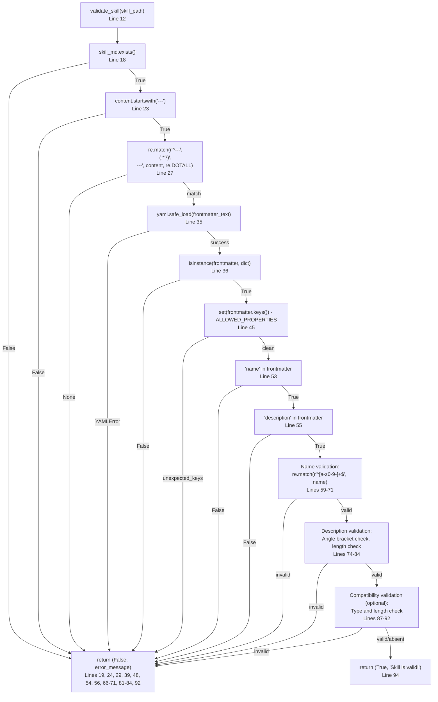
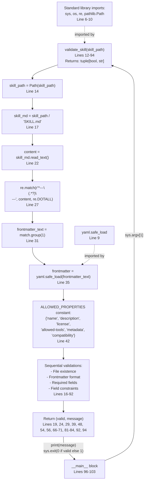

<!-- source: DeepWiki mcp.deepwiki.com · repo anthropics/skills · page 5.2 Skill Validation · fetched 2026-10-30 -->

# Skill Validation

<details>
<summary>Relevant source files</summary>

The following files were used as context for generating this wiki page:

- [skills/skill-creator/scripts/quick_validate.py](skills/skill-creator/scripts/quick_validate.py)

</details>


This page documents the `quick_validate.py` script located in `skills/skill-creator/scripts/quick_validate.py`, which provides a command-line tool for statically validating a skill directory against the `SKILL.md` specification. The script checks structural and content constraints and exits with a non-zero code on failure, making it suitable for CI integration.

For the full `SKILL.md` format specification (field definitions, allowed values, and semantic meaning), see [SKILL.md Format Specification](). For guidance on creating a new skill from scratch, see [Creating a New Skill]().

---

## Running the Validator

The script accepts a single positional argument: the path to the skill directory to validate [skills/skill-creator/scripts/quick_validate.py:96-103]().

```bash
python quick_validate.py <skill_directory>
```

**Exit codes:**

| Exit Code | Meaning |
|-----------|---------|
| `0` | Skill passed all validation gates |
| `1` | At least one validation gate failed |

**Example output (passing):**

```text
Skill is valid!
```

**Example output (failing):**

```text
Name 'My Skill' should be kebab-case (lowercase letters, digits, and hyphens only)
```

The script always prints exactly one message to stdout describing the outcome. On failure, the message identifies the specific gate that was violated.

Sources: [skills/skill-creator/scripts/quick_validate.py:96-103]()

---

## Validation Gates

The validator applies checks sequentially. The first failed check terminates validation and returns its error message. All gates must pass for the skill to be considered valid [skills/skill-creator/scripts/quick_validate.py:12-94]().

Title: "Logic Flow of validate_skill Function"


Sources: [skills/skill-creator/scripts/quick_validate.py:12-94]()

---

## Gate-by-Gate Reference

### Gate 1 — SKILL.md Existence

Checks that a file named `SKILL.md` exists directly inside the provided skill directory path [skills/skill-creator/scripts/quick_validate.py:17-19]().

- **Checked by:** [skills/skill-creator/scripts/quick_validate.py:17-19]()
- **Error:** `SKILL.md not found`

### Gate 2 — Frontmatter Presence

The full file content is read and checked to ensure it begins with the string `---`, indicating the start of YAML frontmatter [skills/skill-creator/scripts/quick_validate.py:23-24]().

- **Checked by:** [skills/skill-creator/scripts/quick_validate.py:23-24]()
- **Error:** `No YAML frontmatter found`

### Gate 3 — Frontmatter Format

A regex match extracts the frontmatter block. The pattern `^---\n(.*?)\n---` is applied with `re.DOTALL`. If no match is found, the frontmatter is considered malformed [skills/skill-creator/scripts/quick_validate.py:27-29]().

- **Checked by:** [skills/skill-creator/scripts/quick_validate.py:27-29]()
- **Error:** `Invalid frontmatter format`

### Gate 4 — YAML Parse

The extracted frontmatter text is parsed using `yaml.safe_load`. Two failure conditions exist:

1. The YAML itself is syntactically invalid (`yaml.YAMLError` is raised).
2. The parsed result is not a Python `dict` (e.g., a bare scalar or list) [skills/skill-creator/scripts/quick_validate.py:34-39]().

| Condition | Error Message |
|-----------|---------------|
| YAML syntax error | `Invalid YAML in frontmatter: <exception>` |
| Not a dict | `Frontmatter must be a YAML dictionary` |

- **Checked by:** [skills/skill-creator/scripts/quick_validate.py:34-39]()

### Gate 5 — Allowed Property Set

The set of keys present in the parsed frontmatter is compared against the hardcoded `ALLOWED_PROPERTIES` constant [skills/skill-creator/scripts/quick_validate.py:42-50]():

```python
ALLOWED_PROPERTIES = {'name', 'description', 'license', 'allowed-tools', 'metadata', 'compatibility'}
```

The check is performed using set difference:
```python
unexpected_keys = set(frontmatter.keys()) - ALLOWED_PROPERTIES
```

Any key not in this set causes a failure. The error message lists all unexpected keys and the full set of allowed properties [skills/skill-creator/scripts/quick_validate.py:42-50]().

- **Checked by:** [skills/skill-creator/scripts/quick_validate.py:42-50]()
- **Error:** `Unexpected key(s) in SKILL.md frontmatter: <keys>. Allowed properties are: <allowed>`

### Gate 6 — Required Field: `name`

Checks that a `name` key exists in the parsed frontmatter dictionary [skills/skill-creator/scripts/quick_validate.py:53-54]().

- **Checked by:** [skills/skill-creator/scripts/quick_validate.py:53-54]()
- **Error:** `Missing 'name' in frontmatter`

### Gate 7 — Required Field: `description`

Checks that a `description` key exists in the parsed frontmatter dictionary [skills/skill-creator/scripts/quick_validate.py:55-56]().

- **Checked by:** [skills/skill-creator/scripts/quick_validate.py:55-56]()
- **Error:** `Missing 'description' in frontmatter`

### Gate 8 — Name Validation

The `name` field is extracted using `frontmatter.get('name', '')` and validated after stripping whitespace [skills/skill-creator/scripts/quick_validate.py:59-71](). Four sub-checks are applied in order:

| Sub-check | Rule | Implementation | Error |
|-----------|------|----------------|-------|
| Type | Must be a `str` | `isinstance(name, str)` check [skills/skill-creator/scripts/quick_validate.py:60-60]() | `Name must be a string, got <type>` |
| Character set | Must match kebab-case | `re.match(r'^[a-z0-9-]+$', name)` [skills/skill-creator/scripts/quick_validate.py:65-65]() | `Name '<name>' should be kebab-case (lowercase letters, digits, and hyphens only)` |
| Hyphen position | No leading/trailing/double hyphens | `name.startswith('-') or name.endswith('-') or '--' in name` [skills/skill-creator/scripts/quick_validate.py:67-67]() | `Name '<name>' cannot start/end with hyphen or contain consecutive hyphens` |
| Length | Maximum 64 characters | `len(name) > 64` [skills/skill-creator/scripts/quick_validate.py:70-70]() | `Name is too long (<n> characters). Maximum is 64 characters.` |

- **Checked by:** [skills/skill-creator/scripts/quick_validate.py:59-71]()

### Gate 9 — Description Validation

The `description` field is extracted using `frontmatter.get('description', '')` and validated after stripping whitespace [skills/skill-creator/scripts/quick_validate.py:74-84](). Three sub-checks apply:

| Sub-check | Rule | Implementation | Error |
|-----------|------|----------------|-------|
| Type | Must be a `str` | `isinstance(description, str)` check [skills/skill-creator/scripts/quick_validate.py:75-75]() | `Description must be a string, got <type>` |
| Angle brackets | Must not contain `<` or `>` | `'<' in description or '>' in description` [skills/skill-creator/scripts/quick_validate.py:80-80]() | `Description cannot contain angle brackets (< or >)` |
| Length | Maximum 1024 characters | `len(description) > 1024` [skills/skill-creator/scripts/quick_validate.py:83-83]() | `Description is too long (<n> characters). Maximum is 1024 characters.` |

- **Checked by:** [skills/skill-creator/scripts/quick_validate.py:74-84]()

### Gate 10 — Compatibility Validation (Optional Field)

The `compatibility` field is optional and extracted using `frontmatter.get('compatibility', '')`. If present and non-empty, two sub-checks apply [skills/skill-creator/scripts/quick_validate.py:87-92]():

| Sub-check | Rule | Implementation | Error |
|-----------|------|----------------|-------|
| Type | Must be a `str` | `isinstance(compatibility, str)` check [skills/skill-creator/scripts/quick_validate.py:89-89]() | `Compatibility must be a string, got <type>` |
| Length | Maximum 500 characters | `len(compatibility) > 500` [skills/skill-creator/scripts/quick_validate.py:91-91]() | `Compatibility is too long (<n> characters). Maximum is 500 characters.` |

- **Checked by:** [skills/skill-creator/scripts/quick_validate.py:87-92]()

Sources: [skills/skill-creator/scripts/quick_validate.py:12-94]()

---

## Field Constraints Summary

The following table summarizes all field-level constraints enforced by `quick_validate.py` [skills/skill-creator/scripts/quick_validate.py:42-92]():

| Field | Required | Type | Max Length | Additional Constraints |
|-------|----------|------|-----------|------------------------|
| `name` | Yes | `str` | 64 chars | kebab-case only (`[a-z0-9-]+`); no leading/trailing/double hyphens |
| `description` | Yes | `str` | 1024 chars | No angle brackets (`<`, `>`) |
| `license` | No | (unchecked) | — | Presence allowed; value not validated |
| `allowed-tools` | No | (unchecked) | — | Presence allowed; value not validated |
| `metadata` | No | (unchecked) | — | Top-level key allowed; nested keys not inspected |
| `compatibility` | No | `str` | 500 chars | — |

Sources: [skills/skill-creator/scripts/quick_validate.py:42-92]()

---

## Code Structure

The script exposes a single public function `validate_skill()` and a `__main__` entry point for command-line execution [skills/skill-creator/scripts/quick_validate.py:12-103]().

Title: "Implementation Details of quick_validate.py"


Sources: [skills/skill-creator/scripts/quick_validate.py:1-103]()

---

## Usage in Context

The `quick_validate.py` script is part of the `skill-creator` skill's utility scripts [skills/skill-creator/scripts/quick_validate.py:1-11](). It is a standalone tool with dependencies restricted to the Python standard library and `PyYAML` [skills/skill-creator/scripts/quick_validate.py:6-10]().

Sources: [skills/skill-creator/scripts/quick_validate.py:1-11]()

---

