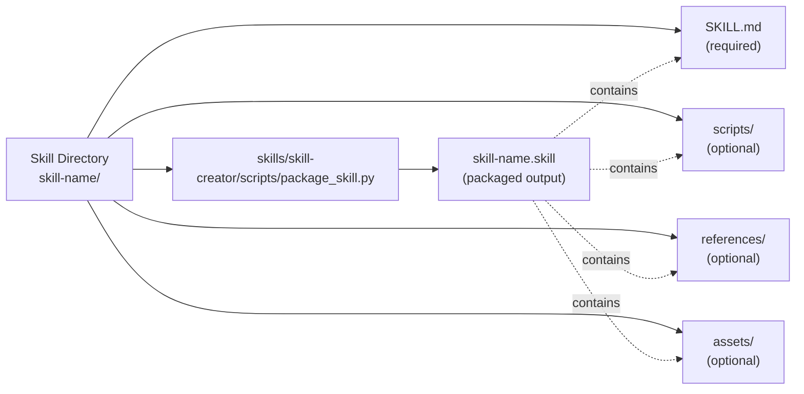
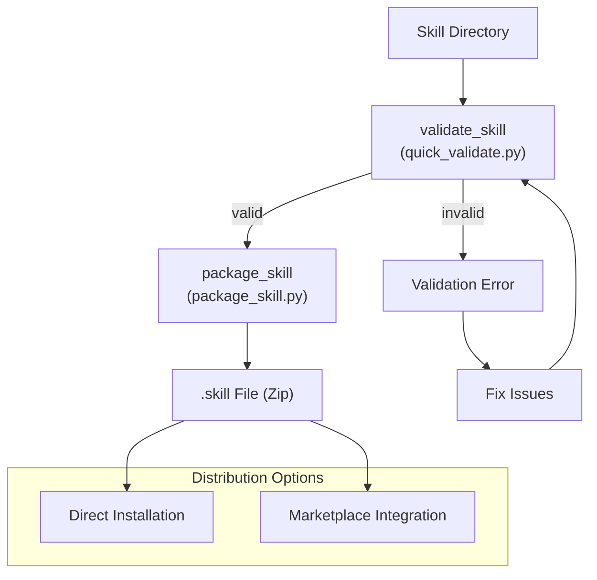
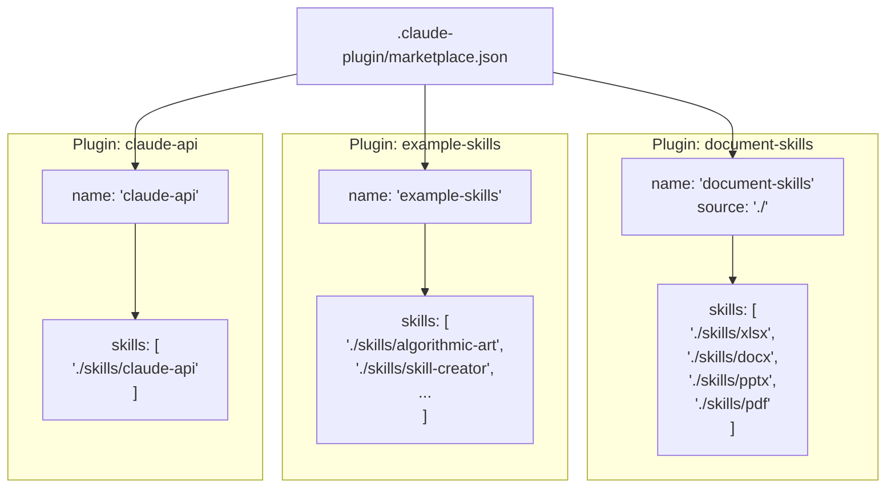
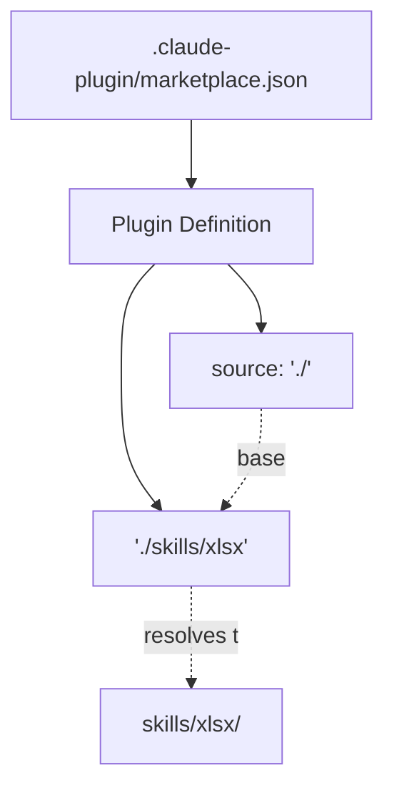

<!-- source: DeepWiki mcp.deepwiki.com · repo anthropics/skills · page 5.3 Skill Packaging and Distribution · fetched 2026-10-30 -->

# Skill Packaging and Distribution

<details>
<summary>Relevant source files</summary>

The following files were used as context for generating this wiki page:

- [.claude-plugin/marketplace.json](.claude-plugin/marketplace.json)
- [skills/academy-guide/LICENSE.txt](skills/academy-guide/LICENSE.txt)
- [skills/academy-guide/SKILL.md](skills/academy-guide/SKILL.md)
- [skills/skill-creator/SKILL.md](skills/skill-creator/SKILL.md)
- [skills/skill-creator/scripts/improve_description.py](skills/skill-creator/scripts/improve_description.py)
- [skills/skill-creator/scripts/run_loop.py](skills/skill-creator/scripts/run_loop.py)

</details>


This document explains how to package individual skills for distribution and how to organize skills into plugins within the marketplace system [.claude-plugin/marketplace.json:1-73](). For information about creating the initial skill structure, see [Creating A New Skill](). For validation requirements before packaging, see [Skill Validation]().

## Overview

Skills can be distributed in two primary forms:

1.  **Packaged `.skill` files** - Self-contained archives for individual skill distribution and installation.
2.  **Marketplace plugins** - Collections of related skills organized through `.claude-plugin/marketplace.json` for bulk installation [.claude-plugin/marketplace.json:1-73]().

The packaging process transforms a skill directory containing `SKILL.md` and optional resources into a distributable format using `package_skill.py`. The marketplace system groups related skills into named plugins that users can install as collections [.claude-plugin/marketplace.json:11-72]().

Sources: [.claude-plugin/marketplace.json:1-73]()

## Skill Packaging

### Package Format

A packaged skill is a single `.skill` file created from a skill directory. The `package_skill.py` script bundles the entire skill directory structure (`SKILL.md`, `scripts/`, `references/`, `assets/`, etc.) into this portable format.

Title: Skill Packaging Data Flow

Sources: [skills/skill-creator/scripts/package_skill.py:1-17]()

### Packaging Command

The `package_skill.py` script is used to create a distributable `.skill` file from a skill folder [skills/skill-creator/scripts/package_skill.py:2-3]().

**Usage:**
```bash
python skills/skill-creator/scripts/package_skill.py <path/to/skill-folder> [output-directory]
```
Sources: [skills/skill-creator/scripts/package_skill.py:5-11]()

**Requirements:**
- The path must be a directory containing a `SKILL.md` file [skills/skill-creator/scripts/package_skill.py:53-68]().
- The skill must pass validation via `validate_skill` from `scripts.quick_validate` before packaging [skills/skill-creator/scripts/package_skill.py:71-77]().

### Excluded Files and Directories

The packager automatically excludes specific patterns to keep the `.skill` file clean:
- **Global Exclusions:** `__pycache__`, `node_modules`, `*.pyc`, and `.DS_Store` [skills/skill-creator/scripts/package_skill.py:20-22]().
- **Root-only Exclusions:** The `evals` directory is excluded only if it exists at the root of the skill folder [skills/skill-creator/scripts/package_skill.py:24-35]().

### Packaging Workflow

Title: Skill Packaging and Validation Workflow

Sources: [skills/skill-creator/scripts/package_skill.py:71-108]()

## Marketplace Structure

### marketplace.json Schema

The marketplace is defined by `.claude-plugin/marketplace.json`, which organizes skills into named plugins. This file contains metadata about the owner and a list of plugin definitions [.claude-plugin/marketplace.json:1-11]().

Title: Marketplace Plugin Organization

Sources: [.claude-plugin/marketplace.json:11-72]()

### Marketplace Fields

| Field | Type | Description |
|-------|------|-------------|
| `name` | string | Marketplace identifier [.claude-plugin/marketplace.json:2]() |
| `owner` | object | Contains `name` and `email` of the maintainer [.claude-plugin/marketplace.json:3-6]() |
| `metadata` | object | Contains `description` and `version` [.claude-plugin/marketplace.json:7-10]() |
| `plugins` | array | List of plugin objects [.claude-plugin/marketplace.json:11]() |

### Plugin Fields

| Field | Type | Description |
|-------|------|-------------|
| `name` | string | Unique name for the plugin (e.g., `document-skills`) [.claude-plugin/marketplace.json:13]() |
| `description` | string | Summary of what the plugin provides [.claude-plugin/marketplace.json:14]() |
| `source` | string | The base directory for skill paths [.claude-plugin/marketplace.json:15]() |
| `strict` | boolean | Whether to enforce strict skill loading [.claude-plugin/marketplace.json:16]() |
| `skills` | array | List of relative paths to skill directories [.claude-plugin/marketplace.json:17-22]() |

Sources: [.claude-plugin/marketplace.json:1-73]()

## Distribution Paths

### Path 1: Marketplace Plugin Installation

Users install skills through the plugin marketplace system in Claude Code. The system resolves paths in `marketplace.json` relative to the repository root.

**Current Marketplace Plugins:**

| Plugin Name | Description | Skill Count |
|-------------|-------------|-------------|
| `document-skills` | Document processing (Excel, Word, PPT, PDF) [.claude-plugin/marketplace.json:13-23]() | 4 |
| `example-skills` | Demonstrations of various capabilities [.claude-plugin/marketplace.json:25-43]() | 12 |
| `claude-api` | Claude API and SDK documentation [.claude-plugin/marketplace.json:46-53]() | 1 |
| `academy-guide` | Recommends relevant Claude Academy learning courses and tutorials [.claude-plugin/marketplace.json:55-62]() | 1 |
| `discernment-nudge` | Appends follow-up questions after answers [.claude-plugin/marketplace.json:64-71]() | 1 |

Sources: [.claude-plugin/marketplace.json:11-73]()

### Path 2: Direct .skill File Installation

The `package_skill.py` script creates a ZIP-compressed archive with the `.skill` extension [skills/skill-creator/scripts/package_skill.py:87-91](). This file can be shared directly and contains all necessary logic and assets defined in the skill directory.

Sources: [skills/skill-creator/scripts/package_skill.py:80-108]()

## Integrating Skills into the Marketplace

### Adding a New Skill to an Existing Plugin

To add a new skill to an existing plugin:
1. Ensure the skill directory is correctly structured with a `SKILL.md`.
2. Locate the target plugin in `.claude-plugin/marketplace.json`.
3. Add the relative path to the skill directory to the `skills` array [.claude-plugin/marketplace.json:17-22]().

### Skill Path Resolution

The `source` field in the plugin definition determines how the `skills` paths are resolved. In the current configuration, `source` is set to `./`, meaning skill paths are relative to the root of the repository [.claude-plugin/marketplace.json:15]().

Title: Marketplace Path Resolution

Sources: [.claude-plugin/marketplace.json:12-23]()

## Licensing and Third-Party Notices

When distributing skills, ensure appropriate licenses are included. Skills may depend on third-party components that require attribution.

### Third-Party Dependencies
The repository maintains license information across individual skills, such as Apache 2.0 notices found in package directories (e.g., [skills/academy-guide/LICENSE.txt:1-126]() and [skills/claude-api/LICENSE.txt:1-126]()). When packaging skills that utilize external libraries or code, developers must ensure the corresponding `LICENSE.txt` remains accurate and is distributed alongside the skill.

Sources: [skills/academy-guide/LICENSE.txt:1-126](), [skills/claude-api/LICENSE.txt:1-126]()

---

