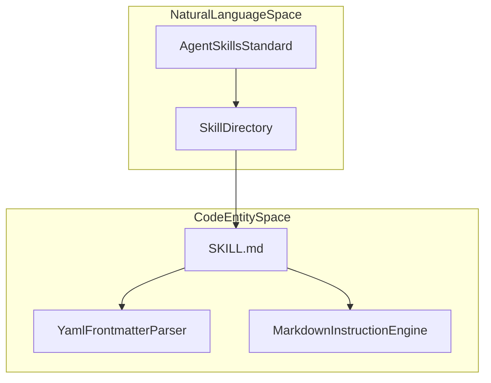
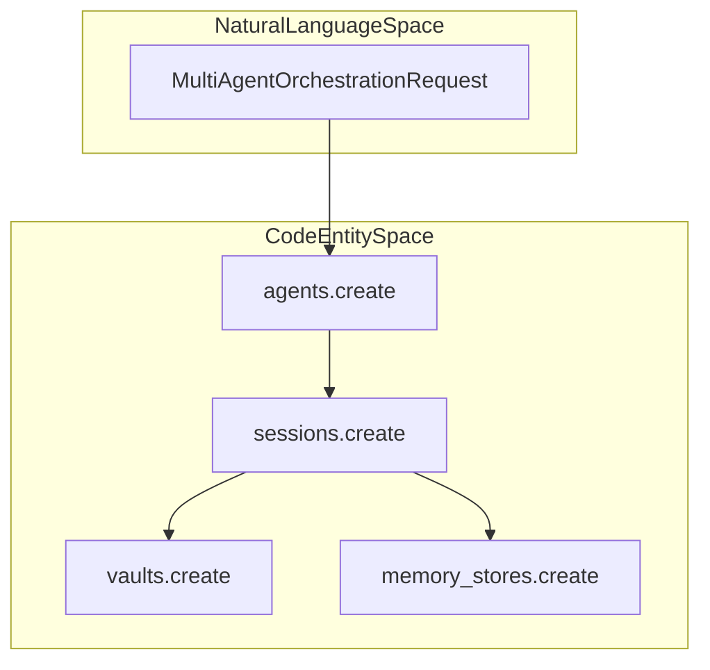
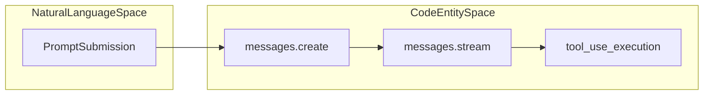
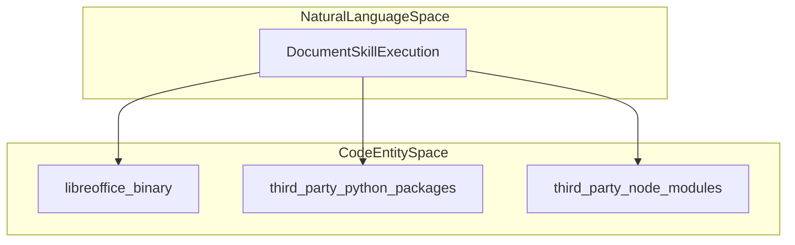
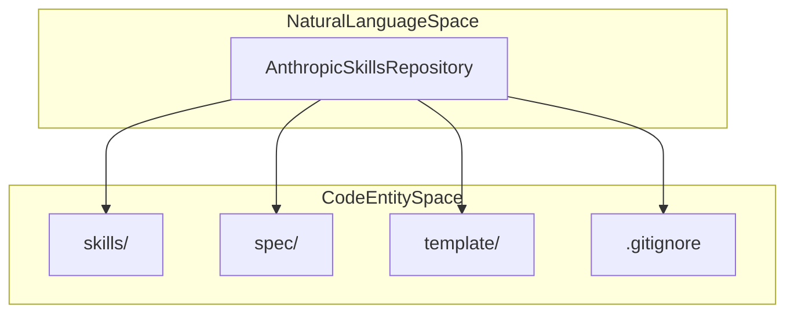

<!-- source: DeepWiki mcp.deepwiki.com · repo anthropics/skills · page 6 Technical Reference · fetched 2026-10-30 -->

# Technical Reference

Relevant source files

The following files were used as context for generating this wiki page:

- [.gitignore](.gitignore)
- [README.md](README.md)
- [skills/claude-api/SKILL.md](skills/claude-api/SKILL.md)
- [spec/agent-skills-spec.md](spec/agent-skills-spec.md)

This section provides technical reference materials and specifications for the skills system, linking to comprehensive child pages covering the Agent Skills standard, Claude API reference, Managed Agents API, third-party dependencies, and repository structure [README.md:1-28](). 

For detailed information, see the following child pages:
- **Agent Skills Specification** ([Agent Skills Specification](#6.1)) — Document the external Agent Skills standard at `agentskills.io` that this repository implements [spec/agent-skills-spec.md:1-3]().
- **Managed Agents API Reference** ([Managed Agents API Reference](#6.2)) — Comprehensive reference for the Managed Agents platform documented in `skills/claude-api/shared`: agents, sessions, environments, and deployments [skills/claude-api/SKILL.md:46-46]().
- **Claude API Core Reference** ([Claude API Core Reference](#6.3)) — Reference for core Claude API usage documented by the `claude-api` skill: messages, streaming, tool use, batches, prompt caching, and cloud backends [skills/claude-api/SKILL.md:1-5]().
- **Third-Party Dependencies** ([Third-Party Dependencies](#6.4)) — Catalog third-party dependencies used across skills, including licensing information [README.md:7-20]().
- **Repository Structure** ([Repository Structure](#6.5)) — Document the repository's directory structure and organization conventions [README.md:26-30]().

---

## Agent Skills Specification

The skills system is founded upon the Agent Skills standard, which defines how portable instructions, scripts, and resources are structured and loaded dynamically by Claude [README.md:6-6](). The standard mandates the use of a self-contained folder structure centered around a `SKILL.md` manifest file containing YAML frontmatter and Markdown instructions [README.md:18-88]().

For deep technical details, specifications, and compliance guidelines, see [Agent Skills Specification](#6.1).

**Specification Architecture**

**Sources:** [README.md:6-18](), [spec/agent-skills-spec.md:1-3]()

---

## Managed Agents API Reference

The Managed Agents API provides primitives for stateful, long-running multi-agent execution. It manages agent lifecycles, execution sessions, security vaults, memory stores, and scheduled deployments [skills/claude-api/SKILL.md:46-46]().

For complete API signatures, payload schemas, and orchestration workflows, see [Managed Agents API Reference](#6.2).

**Managed Agents Orchestration Entities**

**Sources:** [README.md:16-16](), [skills/claude-api/SKILL.md:46-46]()

---

## Claude API Core Reference

The `claude-api` skill documents core Claude API capabilities, including message generation, streaming responses, tool use declarations, message batches, the Files API, token counting, error handling, prompt caching, and cloud platform integrations [skills/claude-api/SKILL.md:1-5]().

For complete code examples across Python, TypeScript, Go, Ruby, and other languages, see [Claude API Core Reference](#6.3).

**API Core Workflow**

**Sources:** [skills/claude-api/SKILL.md:1-5]()

---

## Third-Party Dependencies

Skills within the repository rely on various third-party libraries, binaries, and runtime environments (such as LibreOffice for document rendering in DOCX and XLSX skills) [README.md:20-20](). 

For a complete catalog of external dependencies, version requirements, and licensing details, see [Third-Party Dependencies](#6.4).

**Dependency Integration Structure**

**Sources:** [README.md:20-20]()

---

## Repository Structure

The repository is organized into distinct subdirectories separating production document skills, open-source example skills, skill creation templates, and specifications [README.md:26-30]().

For a complete breakdown of directory hierarchies and organization conventions, see [Repository Structure](#6.5).

**Top-Level Repository Layout**

**Sources:** [README.md:26-30](), [.gitignore:1-5]()

---

