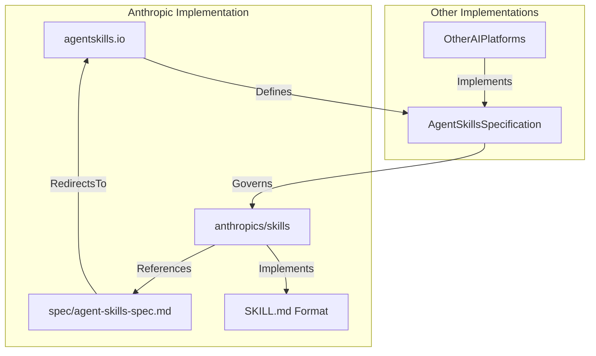
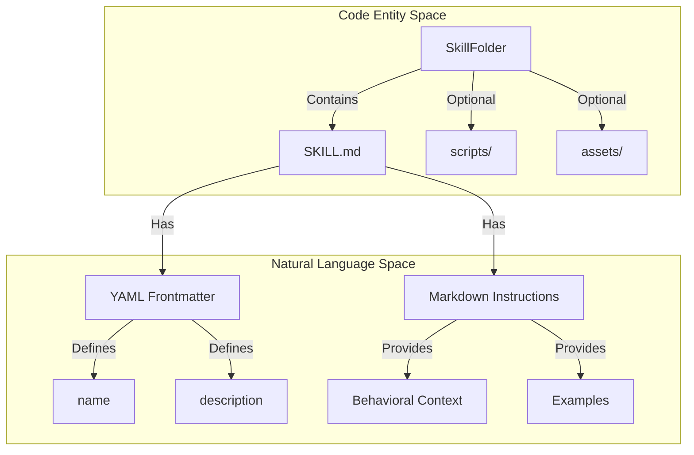
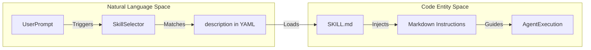

<!-- source: DeepWiki mcp.deepwiki.com · repo anthropics/skills · page 6.1 Agent Skills Specification · fetched 2026-10-30 -->

# Agent Skills Specification

Relevant source files

The following files were used as context for generating this wiki page:

- [.gitignore](.gitignore)
- [README.md](README.md)
- [spec/agent-skills-spec.md](spec/agent-skills-spec.md)

This section documents the external Agent Skills standard defined at `agentskills.io` that serves as the foundation for Claude's skills system [README.md:1-1](). The specification defines a portable, platform-agnostic format for encoding specialized capabilities that AI agents can dynamically load and execute.

For implementation details specific to this repository's `SKILL.md` format, see [SKILL.md Format Specification]() (or [README.md:63-90]()). For practical guidance on creating skills, see [Creating a New Skill]().

Sources: [README.md:1-1](), [spec/agent-skills-spec.md:1-3]()

## Overview

The Agent Skills Specification is an open standard for packaging instructions, scripts, and resources that enable AI agents to perform specialized tasks. The specification is maintained externally at `agentskills.io` and implemented by various platforms, including Anthropic's Claude AI system [README.md:1-1]().

This repository (`anthropics/skills`) contains Anthropic's reference implementation of skills conforming to this standard, along with production-grade examples demonstrating advanced patterns [README.md:14-20]().

Sources: [README.md:1-1](), [spec/agent-skills-spec.md:1-3]()

## Specification Location and Governance

The authoritative specification is hosted externally at `https://agentskills.io/specification` [spec/agent-skills-spec.md:3-3](). This repository contains a pointer file at `spec/agent-skills-spec.md` that redirects to the canonical specification, ensuring developers always reference the current standard [spec/agent-skills-spec.md:1-3]().

### Specification Relationship Diagram

**Diagram 1: Specification Governance and Implementation Relationship**

Sources: [README.md:1-1](), [spec/agent-skills-spec.md:1-3]()

## Core Specification Concepts

The Agent Skills Specification defines several foundational concepts for skill packaging and execution:

### Skill Definition
A skill is a self-contained directory containing:
- Declarative instructions for AI agent behavior [README.md:5-6]().
- Optional executable scripts or resources [README.md:5-6]().
- Metadata for identification and invocation [README.md:85-88]().

### Skill File (`SKILL.md`)
The specification requires a `SKILL.md` file as the primary skill definition. This file combines machine-readable YAML frontmatter and human-readable Markdown content [README.md:18-18](), [README.md:63-65]().

### Skill Structure Mapping

**Diagram 2: Mapping Code Entities to Specification Concepts**

Sources: [README.md:5-18](), [README.md:63-88]()

## YAML Frontmatter Requirements

The specification mandates two required fields in the YAML frontmatter of the `SKILL.md` file [README.md:86-89]().

| Field | Type | Required | Purpose |
|-------|------|----------|---------|
| `name` | string | Yes | Unique skill identifier (lowercase, hyphen-separated). |
| `description` | string | Yes | Complete description of skill purpose and invocation triggers. |

### Field Specifications
- **`name`**: A unique identifier for the skill. It should use lowercase letters and hyphens for spaces (e.g., `my-skill-name`) [README.md:69-69](), [README.md:87-87]().
- **`description`**: A clear and complete description of what the skill does and when the agent should use it. This is used for dynamic loading and triggering [README.md:70-70](), [README.md:88-88]().

Sources: [README.md:63-90]()

## Markdown Content Structure

While the specification allows for flexible Markdown content, this repository follows a standard pattern for instructions that Claude uses to execute the skill [README.md:63-90]().

### Standard Sections
1. **Title**: The name of the skill as a Level 1 header [README.md:73-73]().
2. **Instructions**: Detailed guidance that Claude will follow when the skill is active [README.md:75-75]().
3. **Examples**: Concrete usage examples to help the agent understand triggering and execution [README.md:77-80]().
4. **Guidelines**: Constraints and best practices for the agent to observe [README.md:81-84]().

### Execution Flow Diagram

**Diagram 3: Natural Language Triggering to Code-Defined Execution**

Sources: [README.md:5-11](), [README.md:63-90]()

## Skill Template Implementation

The repository provides a reference implementation at `template/` that demonstrates compliance with the Agent Skills Specification [README.md:29-29]().

- **`template/`**: Contains the basic structure for a new skill [README.md:29-29]().
- **`SKILL.md` (within template)**: Shows the required YAML frontmatter structure (`name`, `description`) and the recommended Markdown headers (`# Name`, `## Examples`, `## Guidelines`) [README.md:63-84]().

Sources: [README.md:29-29](), [README.md:63-84]()

## Relationship to This Repository

This repository serves as a practical implementation of the Agent Skills standard for the Claude ecosystem [README.md:1-6]().

- **Spec Pointer**: The `spec/agent-skills-spec.md` file explicitly points to the external standard at `agentskills.io` [spec/agent-skills-spec.md:1-3]().
- **Production Examples**: Skills like `skills/docx`, `skills/pdf`, `skills/pptx`, and `skills/xlsx` demonstrate how complex, source-available tools are packaged using this standard [README.md:20-20]().
- **Community Skills**: The `skills/` directory contains various open-source (Apache 2.0) skills that follow the specification for creative and technical tasks [README.md:14-18](), [README.md:27-27]().

Sources: [README.md:12-23](), [spec/agent-skills-spec.md:1-3]()

---

