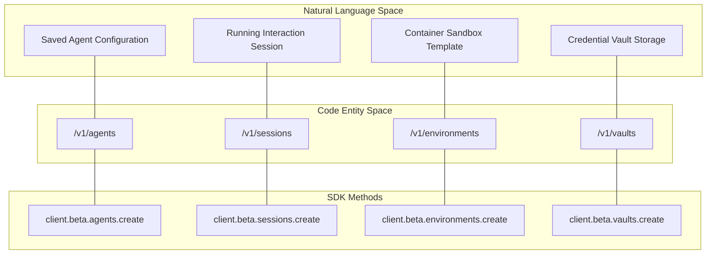
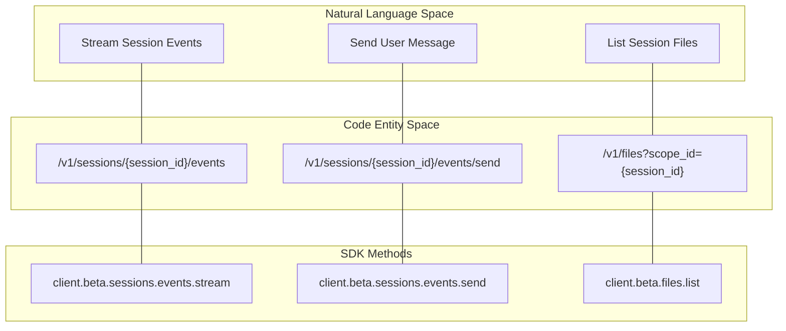

<!-- source: DeepWiki mcp.deepwiki.com · repo anthropics/skills · page 6.2 Managed Agents API Reference · fetched 2026-10-30 -->

# Managed Agents API Reference

Relevant source files

The following files were used as context for generating this wiki page:

- [skills/claude-api/shared/managed-agents-api-reference.md](skills/claude-api/shared/managed-agents-api-reference.md)
- [skills/claude-api/shared/managed-agents-core.md](skills/claude-api/shared/managed-agents-core.md)
- [skills/claude-api/shared/managed-agents-overview.md](skills/claude-api/shared/managed-agents-overview.md)
- [skills/claude-api/shared/managed-agents-scheduled-deployments.md](skills/claude-api/shared/managed-agents-scheduled-deployments.md)

Managed Agents is a hosted infrastructure for Claude AI that provides sandboxed execution environments for tool use [skills/claude-api/shared/managed-agents-overview.md:3-4](). The system is built on an orchestration layer that runs the agent loop while offloading tool execution—such as bash commands, file operations, and code—to isolated containers [skills/claude-api/shared/managed-agents-overview.md:3-4](). 

This page serves as a high-level overview of the Managed Agents platform documented across `skills/claude-api/shared`. For detailed technical specifications, resource models, and runtime patterns, consult the child pages:
- [Agents, Sessions, Environments, and Resources](#6.2.1) — Detailed core Managed Agents resource model: versioned agents, session lifecycle, environments (cloud and self-hosted sandboxes), file resources, credential vaults, memory stores, and scheduled deployments.
- [Events, Tools, and Client Patterns](#6.2.2) — Session event streaming (SSE), event types, tool confirmation gates, managed agent tools, webhooks, outcomes, multi-agent orchestration, and per-language SDK patterns (Python, TypeScript, Go, Java, Ruby, PHP, cURL).
- [Onboarding and Quickstart Templates](#6.2.3) — Onboarding flows (from quickstart, from URL) and the quickstart template library (support agent, data analyst, deep researcher, incident commander, bug hunter, and others).

---

## 1. Core Resource Model and Architecture

Managed Agents centers around persistent, versioned objects and execution sandboxes [skills/claude-api/shared/managed-agents-core.md:5-12](). 

*   **Agent (`/v1/agents`)**: A persisted, versioned object defining the agent's capabilities, model selection, system prompt, tools, MCP servers, and skills [skills/claude-api/shared/managed-agents-core.md:9-9](). Agent creation is a mandatory prerequisite; sessions reference a pre-created agent ID and version rather than embedding inline configurations [skills/claude-api/shared/managed-agents-overview.md:7-16]().
*   **Session (`/v1/sessions`)**: A stateful interaction referencing an agent and environment, producing an event stream [skills/claude-api/shared/managed-agents-core.md:10-10]().
*   **Environment (`/v1/environments`)**: A template defining container provisioning and networking policies [skills/claude-api/shared/managed-agents-core.md:11-11]().
*   **Vaults & Memory Stores**: Secure credential containers (`/v1/vaults`) and persistent cross-session memory stores (`/v1/memory_stores`) [skills/claude-api/shared/managed-agents-api-reference.md:33-35]().

For comprehensive details on versioning semantics, state machines, container sandboxes, vaults, and cron-based deployments, see [Agents, Sessions, Environments, and Resources](#6.2.1).

### Diagram: Natural Language to Code Entity Space - Core Resources

Title: Natural Language to Code Entity Space: Core Managed Agents Resources

Sources: [skills/claude-api/shared/managed-agents-core.md:7-12](), [skills/claude-api/shared/managed-agents-api-reference.md:21-35]()

---

## 2. Runtime, Events, Tools, and Client Patterns

The Managed Agents platform communicates asynchronously via Server-Sent Events (SSE) and maintains state transitions between `idle`, `running`, `rescheduling`, and `terminated` [skills/claude-api/shared/managed-agents-core.md:36-44](), [skills/claude-api/shared/managed-agents-api-reference.md:27-28](). Tool execution is driven by prebuilt toolsets (such as `agent_toolset_20260401`) supporting configurable permission policies like `always_allow` and `always_ask` [skills/claude-api/shared/managed-agents-tools.md:19-76](). Multi-agent coordination enables coordinator agents to spawn sub-agents across isolated threads [skills/claude-api/shared/managed-agents-multiagent.md:3-11]().

For deep dives into stream reconstruction, webhook event notifications, rubric-graded outcomes, tool confirmation gates, and multi-language SDK implementations, see [Events, Tools, and Client Patterns](#6.2.2).

### Diagram: Natural Language to Code Entity Space - Runtime and Events

Title: Natural Language to Code Entity Space: Runtime Operations and Event Streaming

Sources: [skills/claude-api/shared/managed-agents-api-reference.md:28-30](), [skills/claude-api/shared/managed-agents-overview.md:31-32]()

Sources: [skills/claude-api/shared/managed-agents-api-reference.md:27-30](), [skills/claude-api/shared/managed-agents-overview.md:31-32](), [skills/claude-api/shared/managed-agents-tools.md:19-76]()

---

## 3. Onboarding and Quickstart Templates

Deploying managed agents is supported by guided onboarding workflows and version-controlled project layouts synced via `ant apply` [skills/claude-api/shared/managed-agents-api-reference.md:5](), [skills/claude-api/shared/managed-agents-overview.md:38-40](). Developers can leverage pre-built templates for support agents, data analysts, deep researchers, incident commanders, and bug hunters.

For step-by-step onboarding flows and template configurations, see [Onboarding and Quickstart Templates](#6.2.3).

Sources: [skills/claude-api/shared/managed-agents-overview.md:38-40](), [skills/claude-api/shared/managed-agents-api-reference.md:5]()

---

