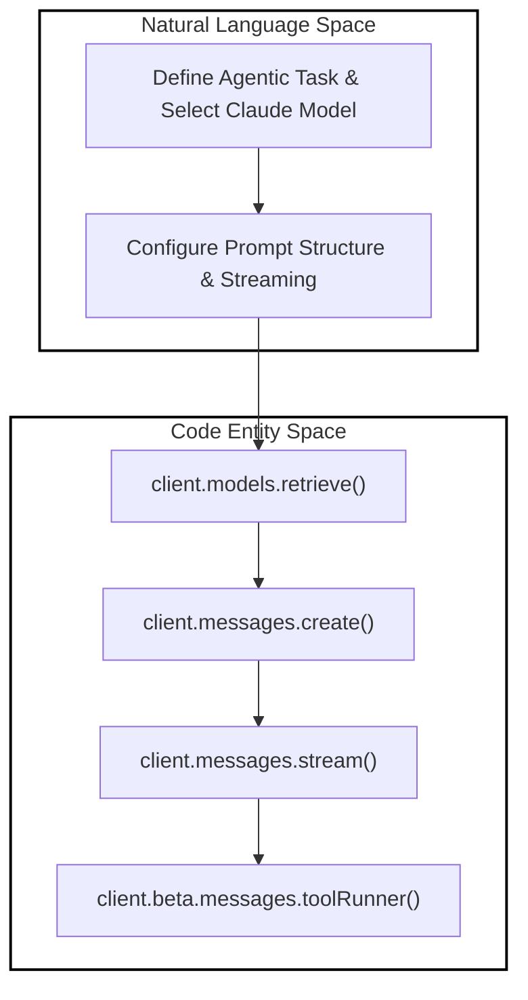
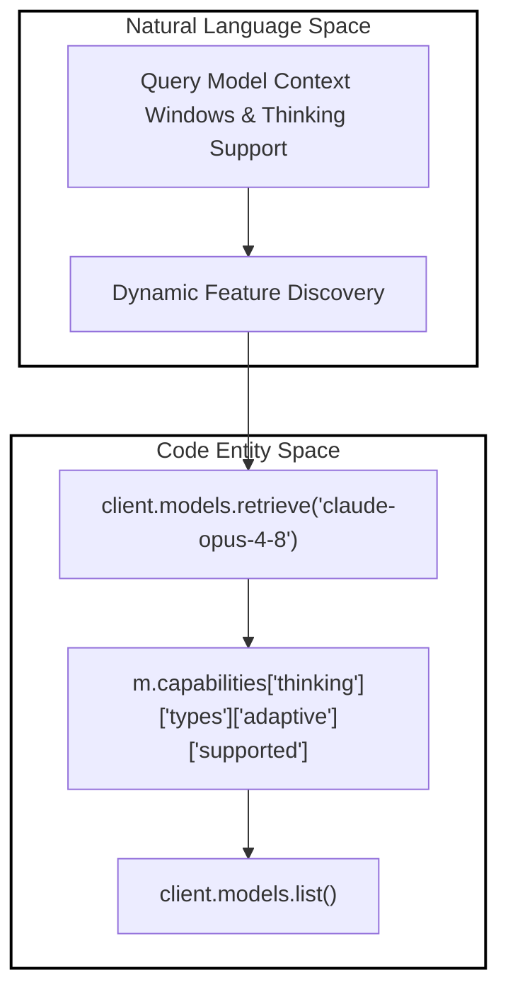

<!-- source: DeepWiki mcp.deepwiki.com · repo anthropics/skills · page 6.3 Claude API Core Reference · fetched 2026-10-30 -->

# Claude API Core Reference

Relevant source files

The following files were used as context for generating this wiki page:

- [skills/claude-api/SKILL.md](skills/claude-api/SKILL.md)
- [skills/claude-api/shared/live-sources.md](skills/claude-api/shared/live-sources.md)
- [skills/claude-api/shared/models.md](skills/claude-api/shared/models.md)

## Purpose and Scope

This document serves as the high-level parent reference for core Claude API usage as documented by the `claude-api` skill. It provides an overview of foundational API mechanics, model catalogs, and the broader architectural surfaces of the Anthropic SDK. Because this is a parent page, deep technical specifics are delegated to specialized child pages covering messaging, tool use, caching, multi-language SDK guides, and operational migration or cost-optimization workflows.

Sources: `[skills/claude-api/SKILL.md:1-13]()`, `[skills/claude-api/shared/models.md:1-10]()`

---

## 1. Core Architecture and API Navigation

Interacting with Claude requires selecting the appropriate SDK or transport surface, adhering to model discovery protocols, and observing modern API constraints such as adaptive thinking defaults and strict model ID usage (`[skills/claude-api/SKILL.md:20-36]()`). Developers should consult the child pages for granular protocol breakdowns.

For comprehensive details on specific operational domains, refer to the following child sections:
- **Messages, Tool Use, and Caching**: See [Messages, Tool Use, and Caching](#6.3.1) for streaming mechanics, server-defined tools, prompt caching, batch processing, token counting, and the files API.
- **SDK Language Guides**: See [SDK Language Guides](#6.3.2) for implementation details across Python, TypeScript, Go, Java, Ruby, PHP, C#, and cURL.
- **Migration and Optimization**: See [Migration, Audits, Evals, and Cost Optimization](#6.3.3) for model migration strategies, preserved-thinking rules, prompt auditing, and cloud backend integrations.

### Diagram: API Request Lifecycle & Natural Language Bridge
The following diagram bridges high-level developer goals (Natural Language Space) to concrete SDK entrypoints and client methods (Code Entity Space).

Sources: `[skills/claude-api/SKILL.md:20-36]`, `[skills/claude-api/shared/models.md:10-31]`

---

## 2. Models, Messages, and Protocol Mechanics

The Claude API relies on precise model identifiers and dynamic capability discovery. Applications query the Models API at runtime to inspect context windows, input capabilities, and supported features like adaptive thinking and structured outputs (`[skills/claude-api/shared/models.md:5-30]`). 

Default runtime configurations prioritize `claude-opus-5-5` with adaptive thinking (`thinking: {type: "adaptive"}`) and streaming enabled for robust long-context handling (`[skills/claude-api/SKILL.md:35-36]()`).

### Diagram: Model Capability Discovery Bridge
This diagram connects conceptual feature checks (Natural Language Space) to programmatically invoked model attributes and client queries (Code Entity Space).

Sources: `[skills/claude-api/SKILL.md:35-36]`, `[skills/claude-api/shared/models.md:5-31]`

---

## 3. Overview of Child Sub-Topics

To implement specific features or manage production deployments, navigate directly to the respective child pages:

- **[Messages, Tool Use, and Caching](#6.3.1)**: Covers the Messages API, SSE streaming event loops, user-defined tools, eager input streaming, server tools, prompt caching ephemeral breakpoints, message batches, the files API, and organization admin endpoints.
- **[SDK Language Guides](#6.3.2)**: Summarizes language-specific documentation bundles, import paths, idiomatic wrappers, and tool-use patterns for Python, TypeScript, Go, Java, Ruby, PHP, C#, and cURL.
- **[Migration, Audits, Evals, and Cost Optimization](#6.3.3)**: Documents legacy model deprecations, preserved-thinking constraints, prompt auditing utilities, evaluation building, cost levers, and cloud platform integrations across AWS Bedrock, Vertex AI, Foundry, and AWS Platform.

Sources: `[skills/claude-api/SKILL.md:40-48]`, `[skills/claude-api/shared/live-sources.md:12-76]`

---

