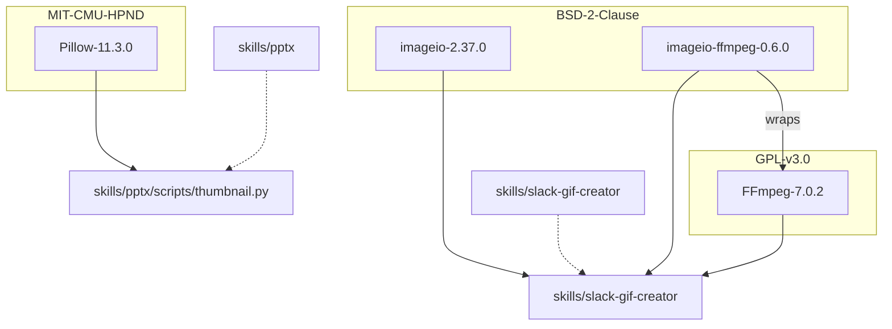
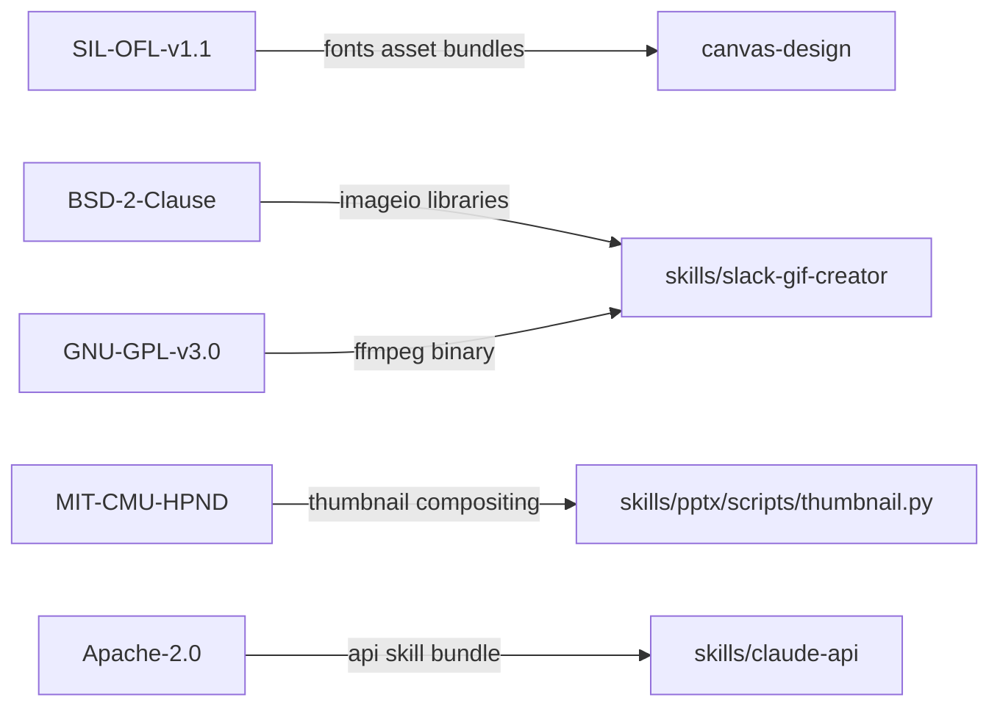

<!-- source: DeepWiki mcp.deepwiki.com · repo anthropics/skills · page 6.4 Third-Party Dependencies · fetched 2026-10-30 -->

# Third-Party Dependencies

Relevant source files

The following files were used as context for generating this wiki page:

- [THIRD_PARTY_NOTICES.md](THIRD_PARTY_NOTICES.md)
- [skills/algorithmic-art/LICENSE.txt](skills/algorithmic-art/LICENSE.txt)
- [skills/canvas-design/LICENSE.txt](skills/canvas-design/LICENSE.txt)

This page documents all third-party software components—libraries, binaries, and font assets—that are bundled with or required by skills in this repository, along with the license terms that govern their use. The authoritative attribution text is maintained in `[THIRD_PARTY_NOTICES.md:1-403]()`.

This page covers runtime and asset dependencies only. For information about the repository's own licensing structure (source-available vs. Apache 2.0 skill bundles), see `[skills/claude-api/LICENSE.txt:1-176]()` and `[skills/algorithmic-art/LICENSE.txt:1-126]()`. For an overview of which Python libraries are invoked by each document skill's scripts, see the Technical Reference section.

---

## Summary

The repository bundles four categories of third-party components:

| Component | Version | License | Type |
|---|---|---|---|
| `imageio` | 2.37.0 | BSD 2-Clause | Python library |
| `imageio-ffmpeg` | 0.6.0 | BSD 2-Clause | Python library |
| FFmpeg | 7.0.2 | GNU GPL v3.0 | Binary executable |
| Pillow | 11.3.0 | MIT-CMU (HPND) | Python library |
| 27 font families | — | SIL OFL v1.1 | Font assets |

Sources: `[THIRD_PARTY_NOTICES.md:11-13]()`, `[THIRD_PARTY_NOTICES.md:31-33]()`, `[THIRD_PARTY_NOTICES.md:287-300]()`

---

## Python Libraries

### `imageio` and `imageio-ffmpeg`

Both packages are licensed under the **BSD 2-Clause License**.

| Field | Value |
|---|---|
| Package | `imageio` |
| Version | 2.37.0 |
| Copyright | 2014–2022, imageio developers |
| License | BSD 2-Clause |

| Field | Value |
|---|---|
| Package | `imageio-ffmpeg` |
| Version | 0.6.0 |
| Copyright | 2019–2025, imageio |
| License | BSD 2-Clause |

`imageio-ffmpeg` provides Python bindings to an FFmpeg binary. The two packages are used together wherever the repository needs to read or write video/animation formats (e.g., GIF output in the `slack-gif-creator` skill).

The BSD 2-Clause license permits redistribution in source and binary form provided that the copyright notice and disclaimer are retained `[THIRD_PARTY_NOTICES.md:17-21]()`. No advertising clause is imposed.

Sources: `[THIRD_PARTY_NOTICES.md:7-23]()`

---

### FFmpeg

FFmpeg is licensed under the **GNU General Public License v3.0**. Its inclusion in the repository is mediated through `imageio-ffmpeg`, which downloads or bundles an FFmpeg binary at install time.

| Field | Value |
|---|---|
| Component | FFmpeg |
| Version | 7.0.2 |
| Copyright | 2000–2024, the FFmpeg developers |
| License | GNU GPL v3.0 |
| Source tarball | `https://ffmpeg.org/releases/ffmpeg-7.0.2.tar.xz` |

The GPL v3.0 requires that any distribution of a covered work (or work incorporating it) must: carry a copy of the license, provide access to the corresponding source code, and pass the same license terms to downstream recipients `[THIRD_PARTY_NOTICES.md:79-84]()`. Because FFmpeg is accessed as a subprocess binary (not statically linked into Python code), the GPL boundary is at the process level.

Sources: `[THIRD_PARTY_NOTICES.md:27-34]()`

---

### Pillow

Pillow is licensed under the **MIT-CMU License (Historical Permission Notice and Disclaimer, HPND)**.

| Field | Value |
|---|---|
| Package | `Pillow` |
| Version | 11.3.0 |
| Copyright | 1997–2011, Secret Labs AB; 1995–2011, Fredrik Lundh and contributors; 2010, Jeffrey A. Clark and contributors |
| License | MIT-CMU (HPND) |

Pillow (`PIL`) is used by the PPTX skill's `thumbnail.py` script to composite slide images into a grid view after rendering. The HPND license permits use, copying, modification, and distribution for any purpose without fee, provided the copyright notice appears in all copies and the name "Secret Labs AB" is not used in advertising without permission `[THIRD_PARTY_NOTICES.md:290-300]()`.

Sources: `[THIRD_PARTY_NOTICES.md:287-300]()`

---

## Dependency–Skill Mapping

The diagram below maps each third-party library and binary to the skill and script file that depends on it, bridging natural language descriptions to code entities.

Diagram: Third-Party Libraries to Skill Scripts

Sources: `[THIRD_PARTY_NOTICES.md:7-34]()`, `[THIRD_PARTY_NOTICES.md:287-300]()`

---

## Font Assets

Twenty-seven font families are bundled as static assets under the **SIL Open Font License v1.1**. These are used by the design and visual skills (e.g., `canvas-design`, `theme-factory`, `brand-guidelines`, `frontend-design`) to embed typography in generated documents and visual output.

### Font Inventory

| Font Family | Copyright Holder | Source |
|---|---|---|
| Arsenal SC | The Arsenal Project Authors | andrij.design@gmail.com |
| Big Shoulders | The Big Shoulders Project Authors | github.com/xotypeco/big_shoulders |
| Boldonse | The Boldonse Project Authors | github.com/googlefonts/boldonse |
| Bricolage Grotesque | The Bricolage Grotesque Project Authors | github.com/ateliertriay/bricolage |
| Crimson Pro | The Crimson Pro Project Authors | github.com/Fonthausen/CrimsonPro |
| DM Mono | The DM Mono Project Authors | github.com/googlefonts/dm-mono |
| Erica One | LatinoType Limitada | luciano@latinotype.com |
| Geist Mono | The Geist Project Authors | github.com/vercel/geist-font |
| Gloock | The Gloock Project Authors | github.com/duartp/gloock |
| IBM Plex Mono | IBM Corp. | — |
| Instrument Sans | The Instrument Sans Project Authors | github.com/Instrument/instrument-sans |
| Italiana | Santiago Orozco | hi@typemade.mx |
| JetBrains Mono | The JetBrains Mono Project Authors | github.com/JetBrains/JetBrainsMono |
| Jura | The Jura Project Authors | github.com/ossobuffo/jura |
| Libre Baskerville | The Libre Baskerville Project Authors | github.com/impallari/Libre-Baskerville |
| Lora | The Lora Project Authors | github.com/cyrealtype/Lora-Cyrillic |
| National Park | The National Park Project Authors | github.com/benhoepner/National-Park |
| Nothing You Could Do | Kimberly Geswein | kimberlygeswein.com |
| Outfit | The Outfit Project Authors | github.com/Outfitio/Outfit-Fonts |
| Pixelify Sans | The Pixelify Sans Project Authors | github.com/eifetx/Pixelify-Sans |
| Poiret One | Denis Masharov | denis.masharov@gmail.com |
| Red Hat Mono | The Red Hat Project Authors | github.com/RedHatOfficial/RedHatFont |
| Silkscreen | The Silkscreen Project Authors | github.com/googlefonts/silkscreen |
| Smooch Sans | The Smooch Sans Project Authors | github.com/googlefonts/smooch-sans |
| Tektur | The Tektur Project Authors | github.com/hyvyys/Tektur |
| Work Sans | The Work Sans Project Authors | github.com/weiweihuanghuang/Work-Sans |
| Young Serif | The Young Serif Project Authors | github.com/noirblancrouge/YoungSerif |

Sources: `[THIRD_PARTY_NOTICES.md:303-360]()`

### SIL OFL v1.1 Key Terms

The SIL Open Font License v1.1 permits fonts to be used, studied, modified, and redistributed freely, subject to these conditions:

| Condition | Detail |
|---|---|
| No standalone sale | Font files cannot be sold by themselves; they may be bundled with software. |
| License must travel | Every copy of the font must include the copyright notice and the OFL license. |
| Reserved Font Names | Modified versions may not use the Reserved Font Name of the original. |
| No re-licensing | Font files (modified or not) must remain under the OFL; documents created with the font are not affected. |

Sources: `[THIRD_PARTY_NOTICES.md:365-403]()`

---

## Dependency Licensing Overview

Diagram: License Types Across Bundled Components

Sources: `[THIRD_PARTY_NOTICES.md:1-403]()`, `[skills/claude-api/LICENSE.txt:1-176]()`

---

## Full License Texts

The complete, verbatim license texts for the primary licenses are reproduced in the repository:

| License | Location in file |
|---|---|
| BSD 2-Clause | `[THIRD_PARTY_NOTICES.md:7-23]()` |
| GNU GPL v3.0 | `[THIRD_PARTY_NOTICES.md:27-283]()` |
| MIT-CMU (HPND) | `[THIRD_PARTY_NOTICES.md:287-300]()` |
| SIL OFL v1.1 | `[THIRD_PARTY_NOTICES.md:365-403]()` |
| Apache 2.0 | `[skills/claude-api/LICENSE.txt:1-176]()` |

Sources: `[THIRD_PARTY_NOTICES.md:1-403]()`, `[skills/claude-api/LICENSE.txt:1-176]()`

---

