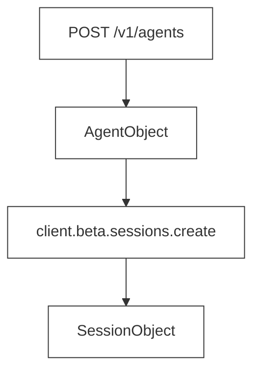
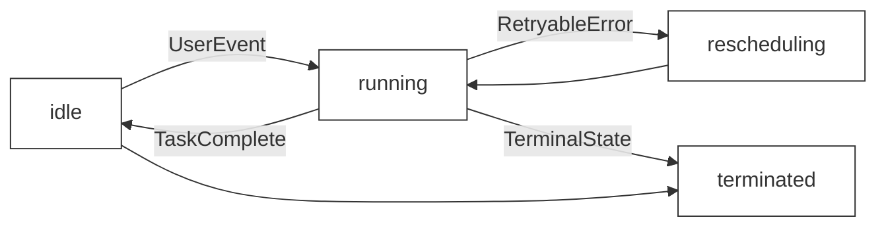
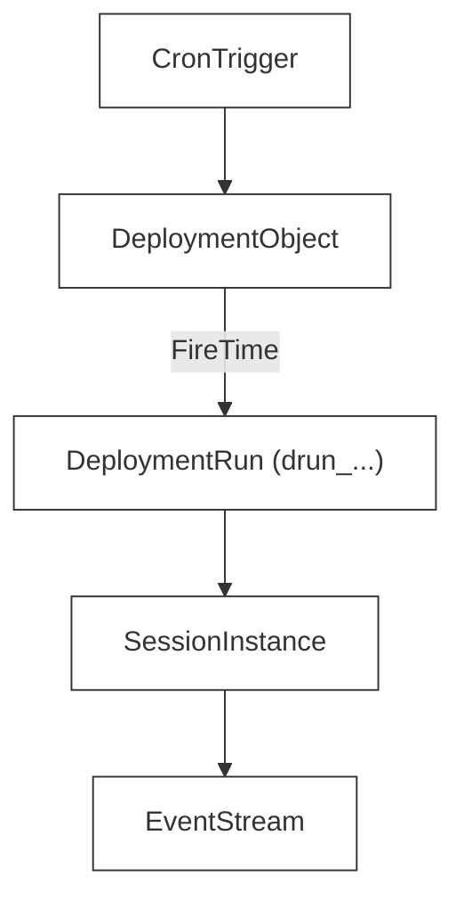

<!-- source: DeepWiki mcp.deepwiki.com · repo anthropics/skills · extra page Agents, Sessions, Environments, and Resources · fetched 2026-10-30 -->

# Agents, Sessions, Environments, and Resources

Relevant source files

The following files were used as context for generating this wiki page:

- [skills/claude-api/shared/managed-agents-core.md](skills/claude-api/shared/managed-agents-core.md)
- [skills/claude-api/shared/managed-agents-environments.md](skills/claude-api/shared/managed-agents-environments.md)
- [skills/claude-api/shared/managed-agents-memory.md](skills/claude-api/shared/managed-agents-memory.md)
- [skills/claude-api/shared/managed-agents-scheduled-deployments.md](skills/claude-api/shared/managed-agents-scheduled-deployments.md)
- [skills/claude-api/shared/managed-agents-self-hosted-sandboxes.md](skills/claude-api/shared/managed-agents-self-hosted-sandboxes.md)

This page details the core Managed Agents resource model documented within the Managed Agents API reference suite [skills/claude-api/shared/managed-agents-core.md:1](). It covers the primary system abstractions: persisted and versioned agents, session lifecycles, execution environments (cloud and self-hosted sandboxes), data resources, memory stores, and recurring scheduled deployments.

---

## 1. Versioned Agents and Prerequisites

Every agent interaction begins with a persisted, versioned agent object managed via `/v1/agents` [skills/claude-api/shared/managed-agents-core.md:5](). The agent definition encapsulates the model selection, system prompt, tool configurations, MCP servers, and skills [skills/claude-api/shared/managed-agents-core.md:9](). 

Agent creation is a strict prerequisite; sessions reference a pre-created agent by its unique identifier (`agent_id`) [skills/claude-api/shared/managed-agents-core.md:29](). Configuration parameters such as `model`, `system`, and `tools` reside exclusively on the agent object rather than on session initiation payloads [skills/claude-api/shared/managed-agents-core.md:29]().

*Figure 1: Agent creation prerequisite data flow mapping API routes to SDK methods.*

Sources: [skills/claude-api/shared/managed-agents-core.md:5-30]()

---

## 2. Session Lifecycle and State Machine

A session (`/v1/sessions`) represents a stateful interaction instance executing against an agent inside a specific environment [skills/claude-api/shared/managed-agents-core.md:9](). Sessions emit an asynchronous event stream consumed via Server-Sent Events or SDK pollers [skills/claude-api/shared/managed-agents-core.md:10]().

### Lifecycle States

Sessions transition through distinct runtime states managed by Anthropic's orchestration layer:
* `idle`: The agent has completed a task turn and awaits input (e.g., `user.message`, `user.custom_tool_result`, `user.tool_confirmation`) or has hit a budget limit [skills/claude-api/shared/managed-agents-core.md:41]().
* `running`: The agent is actively processing work turns [skills/claude-api/shared/managed-agents-core.md:43]().
* `rescheduling`: The session is recovering or rescheduling following a transient execution error [skills/claude-api/shared/managed-agents-core.md:43]().
* `terminated`: Terminal state reached upon completion or unrecoverable error [skills/claude-api/shared/managed-agents-core.md:44]().

*Figure 2: Session lifecycle state machine.*

Sources: [skills/claude-api/shared/managed-agents-core.md:33-49]()

---

## 3. Environments: Cloud and Self-Hosted Sandboxes

Environments (`/v1/environments`) act as reusable container configuration templates [skills/claude-api/shared/managed-agents-environments.md:5](). Environment names must be globally unique within the workspace, returning a `409 Conflict` upon duplication [skills/claude-api/shared/managed-agents-environments.md:7]().

### Environment Configuration Types
1. **Cloud Sandboxes (`config: { type: "cloud" }`)**: Managed containers provisioned inside Anthropic's infrastructure [skills/claude-api/shared/managed-agents-environments.md:5](). Networking policies can be set to `unrestricted` or `limited` (supporting opt-ins via `allowed_hosts`, `allow_package_managers`, and `allow_mcp_servers`) [skills/claude-api/shared/managed-agents-environments.md:11]().
2. **Self-Hosted Sandboxes (`config: { type: "self_hosted" }`)**: Execution occurs within client-controlled infrastructure [skills/claude-api/shared/managed-agents-self-hosted-sandboxes.md:3](). The agent loop remains on Anthropic's orchestration plane while tool invocations (`bash`, file operations) are polled and executed locally via `EnvironmentWorker` or `ant beta:worker poll` [skills/claude-api/shared/managed-agents-self-hosted-sandboxes.md:3]().

| Operation | Method | Route | Notes |
| --- | --- | --- | --- |
| Create | `POST` | `/v1/environments` | [skills/claude-api/shared/managed-agents-environments.md:57]() |
| List | `GET` | `/v1/environments` | Paginated via `limit`, `after_id`, `before_id` [skills/claude-api/shared/managed-agents-environments.md:58]() |
| Get | `GET` | `/v1/environments/{id}` | [skills/claude-api/shared/managed-agents-environments.md:59]() |
| Update | `POST` | `/v1/environments/{id}` | Applies to new containers only [skills/claude-api/shared/managed-agents-environments.md:60]() |
| Archive | `POST` | `/v1/environments/{id}/archive` | Sets environment to read-only terminal state [skills/claude-api/shared/managed-agents-environments.md:62]() |

Sources: [skills/claude-api/shared/managed-agents-environments.md:3-63](), [skills/claude-api/shared/managed-agents-self-hosted-sandboxes.md:1-109]()

---

## 4. Resources and Files

Sessions accept up to 999 file resources attached during creation [skills/claude-api/shared/managed-agents-environments.md:68](). Files are uploaded via the Files API (`client.beta.files.upload`) and referenced by `file_id` [skills/claude-api/shared/managed-agents-environments.md:72]().

* **Input Mounts (`mount_path`)**: Optional absolute paths rooted under `/mnt/session/uploads/`. Files are mounted read-only [skills/claude-api/shared/managed-agents-environments.md:90]().
* **Session Outputs**: Agents write output files to `/mnt/session/outputs/` [skills/claude-api/shared/managed-agents-environments.md:94](). These are captured automatically by the Files API and retrieved post-execution via `client.beta.files.list({ scope_id: session.id })` [skills/claude-api/shared/managed-agents-environments.md:98]().

Sources: [skills/claude-api/shared/managed-agents-environments.md:66-110]()

---

## 5. Vaults and Memory Stores

### Memory Stores (`memstore_...`)
Memory stores provide persistent workspace-scoped cross-session memory [skills/claude-api/shared/managed-agents-memory.md:5](). Attached via session `resources[]` (up to 8 per session), stores are mounted into the container at `/mnt/memory/<store-name>/` [skills/claude-api/shared/managed-agents-memory.md:5]().

* **Object Hierarchy**:
  * Store: `memstore_...` [skills/claude-api/shared/managed-agents-memory.md:15]()
  * Memory: `mem_...` (individual <= 100KB text files accessed via path) [skills/claude-api/shared/managed-agents-memory.md:16]()
  * Memory Version: `memver_...` (immutable point-in-time audit snapshot) [skills/claude-api/shared/managed-agents-memory.md:17]()

> **Security Warning**: Credentials or API keys must never be stored in memory stores; use vault environment variables instead [skills/claude-api/shared/managed-agents-memory.md:9]().

Sources: [skills/claude-api/shared/managed-agents-memory.md:1-96]()

---

## 6. Scheduled Deployments and Deployment Runs

Scheduled deployments (`/v1/deployments`) execute agents on recurring POSIX cron schedules [skills/claude-api/shared/managed-agents-scheduled-deployments.md:3](). Each trigger generates a deployment run (`drun_...`) record and spawns an autonomous session [skills/claude-api/shared/managed-agents-scheduled-deployments.md:3]().

*Figure 3: Scheduled deployment execution pipeline.*

* **Budgets**: Deployments accept spend limits via `budget` parameters which copy down to generated sessions [skills/claude-api/shared/managed-agents-scheduled-deployments.md:86]().
* **Audit & Inspection**: List runs via `client.beta.deployment_runs.list()` to inspect failures or execution metadata [skills/claude-api/shared/managed-agents-scheduled-deployments.md:100]().

Sources: [skills/claude-api/shared/managed-agents-scheduled-deployments.md:1-127]()

---

