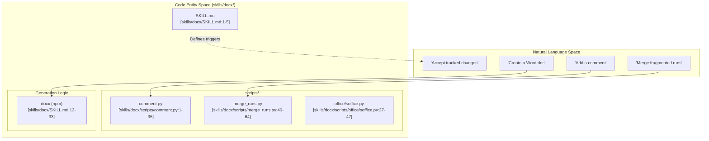
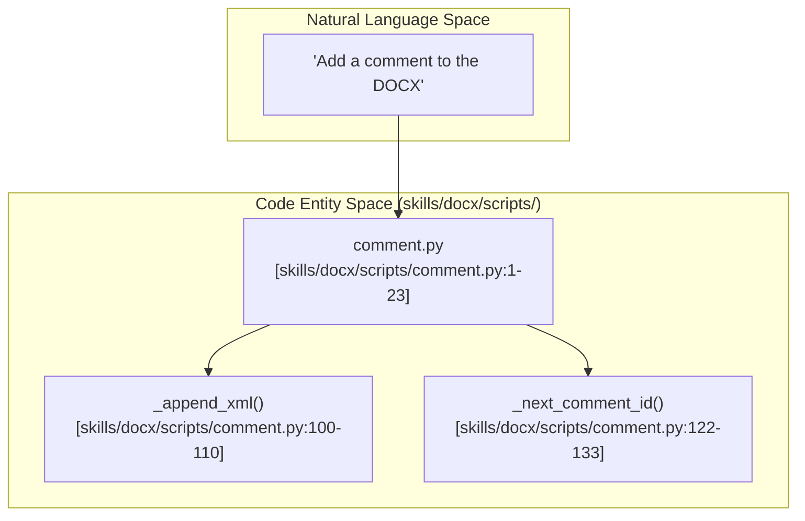

<!-- source: DeepWiki mcp.deepwiki.com · repo anthropics/skills · extra page DOCX Skill · fetched 2026-10-30 -->

# DOCX Skill

Relevant source files

The following files were used as context for generating this wiki page:

- [skills/docx/SKILL.md](skills/docx/SKILL.md)
- [skills/docx/scripts/comment.py](skills/docx/scripts/comment.py)
- [skills/docx/scripts/merge_runs.py](skills/docx/scripts/merge_runs.py)
- [skills/docx/scripts/office/helpers/pptx_slide.py](skills/docx/scripts/office/helpers/pptx_slide.py)
- [skills/docx/scripts/office/helpers/pptx_theme.py](skills/docx/scripts/office/helpers/pptx_theme.py)
- [skills/docx/scripts/office/soffice.py](skills/docx/scripts/office/soffice.py)

## Purpose and Scope

The DOCX skill provides production-grade Microsoft Word document processing capabilities for Claude. It enables advanced operations including accepting tracked changes, adding comments, merging fragmented text runs, validating redlines, and document manipulation through a combination of JavaScript-based generation (`docx-js`) and Python-based XML/LibreOffice automation. This skill is part of the document processing skills plugin that powers Claude's production document capabilities.

This page documents the DOCX skill's technical implementation, capabilities, helpers, and dependencies.

Sources: [skills/docx/SKILL.md:1-91](), [skills/docx/scripts/comment.py:1-175]()

## Skill Architecture

The DOCX skill combines declarative instructions in `SKILL.md` with Python automation scripts and JavaScript generation logic.

### Component Overview

The following diagram maps natural language requests to the underlying codebase entities.

Sources: [skills/docx/SKILL.md:1-33](), [skills/docx/scripts/comment.py:1-35](), [skills/docx/scripts/merge_runs.py:40-64](), [skills/docx/scripts/office/soffice.py:27-47]()

## Capabilities

### 1. Accept Tracked Changes and Editing Existing Documents

Word splits text across many `<w:r>` runs (revision ids, spell-check markers), so phrases often don't exist as contiguous strings. The skill uses `merge_runs.py` to coalesce adjacent identically-formatted runs [skills/docx/scripts/merge_runs.py:1-24](). Tracked changes can be accepted via LibreOffice automation or scripts [skills/docx/SKILL.md:65-72]().

Sources: [skills/docx/SKILL.md:47-72](), [skills/docx/scripts/merge_runs.py:1-24]()

### 2. Add Comments and Replies

The skill adds comments and nested replies through direct XML manipulation of the unpacked DOCX structure or via direct file execution using `comment.py` [skills/docx/scripts/comment.py:1-23]().

**Comment System Metadata:**
The script coordinates entries across multiple XML parts to ensure full compatibility with Word:
* `comments.xml`: Primary comment content (`w:id`, `w:author`, `w14:paraId`) [skills/docx/scripts/comment.py:49-65]().
* `commentsExtended.xml`: Reply threading structure (`w15:paraIdParent`) [skills/docx/scripts/comment.py:166]().
* `commentsIds.xml`: Durable IDs (`w16cid:durableId`) [skills/docx/scripts/comment.py:167]().
* `commentsExtensible.xml`: UTC timestamps (`w16cex:dateUtc`) [skills/docx/scripts/comment.py:168]().

Sources: [skills/docx/scripts/comment.py:1-175]()

## Technical Implementation Details

### LibreOffice Headless Execution and Socket Shim

The `office/soffice.py` helper manages running LibreOffice (`soffice`) in sandboxed environments where Unix domain sockets (`AF_UNIX`) may be restricted [skills/docx/scripts/office/soffice.py:1-16](). It detects restrictions at runtime via `_needs_shim()` and applies an `LD_PRELOAD` socket shim if necessary [skills/docx/scripts/office/soffice.py:27-35]().

Sources: [skills/docx/scripts/office/soffice.py:1-47]()

### XML Security and Parsing

The skill utilizes `defusedxml` to parse XML documents securely, preventing XML External Entity (XXE) vulnerabilities [skills/docx/scripts/comment.py:34]().

**Utility Functions:**
* `_append_xml()`: Imports nodes from a wrapper DOM into the target document DOM [skills/docx/scripts/comment.py:100-110]().
* `_encode_smart_quotes()`: Escapes smart quote characters into standard XML entities [skills/docx/scripts/comment.py:94-97]().
* `_next_comment_id()`: Determines the next available comment ID [skills/docx/scripts/comment.py:122-133]().

Sources: [skills/docx/scripts/comment.py:34-133]()

## Dependencies

| Dependency | Purpose | Location |
|------------|---------|----------|
| `docx` (npm) | Generating new `.docx` files | [skills/docx/SKILL.md:13]() |
| `pandoc` | Reading and extracting content (`-t markdown`) | [skills/docx/SKILL.md:15]() |
| LibreOffice (`soffice`) | Headless conversion and tracking acceptance | [skills/docx/SKILL.md:91]() |
| `defusedxml` | Secure XML parsing | [skills/docx/scripts/comment.py:34]() |
| `pdftoppm` (Poppler) | Rendering PDF pages to images for visual verification | [skills/docx/SKILL.md:41]() |

Sources: [skills/docx/SKILL.md:13-91](), [skills/docx/scripts/comment.py:34]()

---

