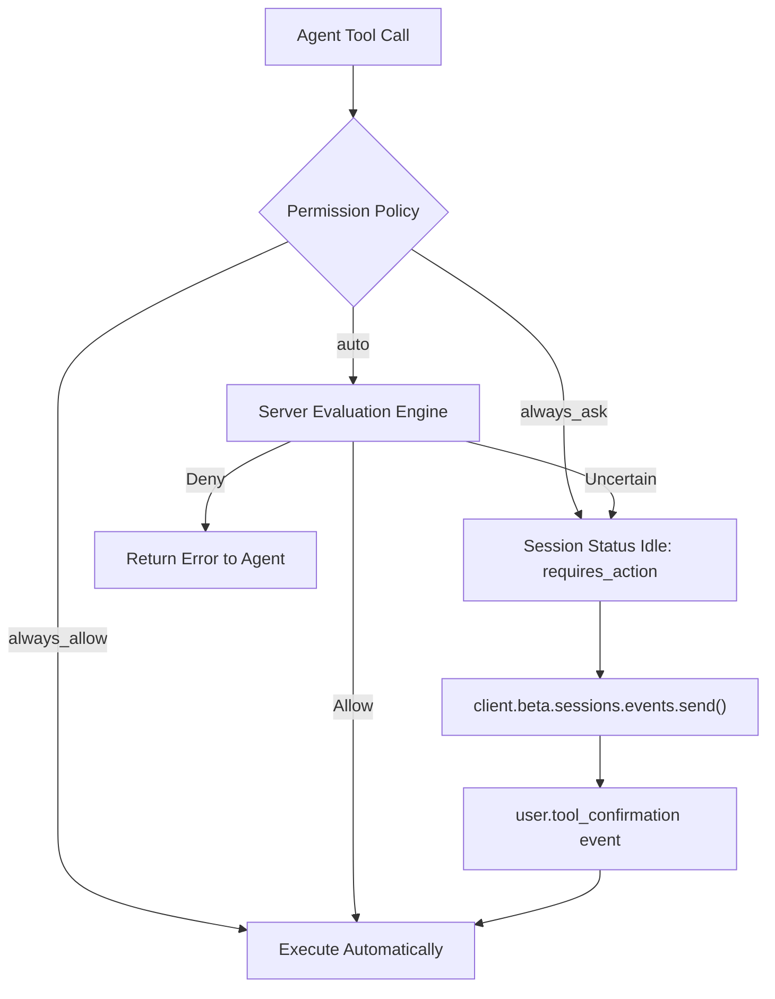
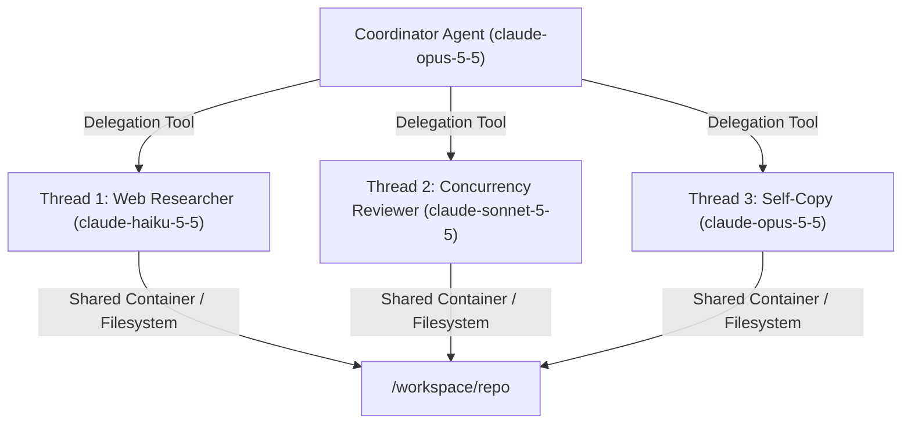

<!-- source: DeepWiki mcp.deepwiki.com · repo anthropics/skills · extra page Events, Tools, and Client Patterns · fetched 2026-10-30 -->

# Events, Tools, and Client Patterns

<details>
<summary>Relevant source files</summary>

The following files were used as context for generating this wiki page:

- [skills/claude-api/curl/managed-agents.md](skills/claude-api/curl/managed-agents.md)
- [skills/claude-api/go/managed-agents/README.md](skills/claude-api/go/managed-agents/README.md)
- [skills/claude-api/java/managed-agents/README.md](skills/claude-api/java/managed-agents/README.md)
- [skills/claude-api/php/managed-agents/README.md](skills/claude-api/php/managed-agents/README.md)
- [skills/claude-api/python/managed-agents/README.md](skills/claude-api/python/managed-agents/README.md)
- [skills/claude-api/ruby/managed-agents/README.md](skills/claude-api/ruby/managed-agents/README.md)
- [skills/claude-api/shared/managed-agents-client-patterns.md](skills/claude-api/shared/managed-agents-client-patterns.md)
- [skills/claude-api/shared/managed-agents-events.md](skills/claude-api/shared/managed-agents-events.md)
- [skills/claude-api/shared/managed-agents-multiagent.md](skills/claude-api/shared/managed-agents-multiagent.md)
- [skills/claude-api/shared/managed-agents-outcomes.md](skills/claude-api/shared/managed-agents-outcomes.md)
- [skills/claude-api/shared/managed-agents-tools.md](skills/claude-api/shared/managed-agents-tools.md)
- [skills/claude-api/shared/managed-agents-webhooks.md](skills/claude-api/shared/managed-agents-webhooks.md)
- [skills/claude-api/typescript/managed-agents/README.md](skills/claude-api/typescript/managed-agents/README.md)

</details>


## Purpose and Scope

This page documents the operational mechanics of Anthropic's Managed Agents platform, covering real-time session event streaming via Server-Sent Events (SSE), event types, tool permission policies, tool confirmation gates, automated outcome grading, multi-agent orchestration, and per-language client integration patterns across Python, TypeScript, Go, Java, Ruby, PHP, and raw HTTP (`cURL`) [skills/claude-api/shared/managed-agents-events.md:1-72](), [skills/claude-api/shared/managed-agents-tools.md:1-98](), [skills/claude-api/shared/managed-agents-client-patterns.md:1-128]().

---

## 1. Tools and Permission Gates

Managed Agents distinguish between server-executed tools, Model Context Protocol (MCP) tools, and client-executed custom tools [skills/claude-api/shared/managed-agents-tools.md:5-12]().

### Tool Execution Types

- **Prebuilt Claude Agent Tools (`agent_toolset_20260401`)**: Run on the session's container (for `cloud` environments) or worker application (`self_hosted`). Includes `bash`, `read`, `write`, `edit`, `glob`, `grep`, `web_fetch`, and `web_search` [skills/claude-api/shared/managed-agents-tools.md:9-31]().
- **MCP Tools (`mcp_toolset`)**: Managed by Anthropic's orchestration layer, connecting capabilities from external MCP servers [skills/claude-api/shared/managed-agents-tools.md:10]().
- **Custom Tools**: Handled entirely by the client application. The agent emits an `agent.custom_tool_use` event, transitioning the session state to idle (`requires_action`), requiring the client to respond with a `user.custom_tool_result` event [skills/claude-api/shared/managed-agents-tools.md:11]().

### Permission Policies

Tool calls are governed by three permission policies [skills/claude-api/shared/managed-agents-tools.md:63-70]():
1. `always_allow`: Executes automatically (default for `agent_toolset_20260401`) [skills/claude-api/shared/managed-agents-tools.md:67]().
2. `always_ask`: Pauses execution, emitting `session.status_idle` with `stop_reason.type: requires_action`, awaiting a `user.tool_confirmation` event [skills/claude-api/shared/managed-agents-tools.md:68]().
3. `auto`: The server evaluates each call contextually, deciding whether to run, deny, or pause for user confirmation [skills/claude-api/shared/managed-agents-tools.md:69]().


*Sources: [skills/claude-api/shared/managed-agents-tools.md:63-94](), [skills/claude-api/shared/managed-agents-events.md:9-14]() *

---

## 2. Session Events and Streaming (SSE)

Sessions emit and ingest events via REST endpoints and real-time streaming [skills/claude-api/shared/managed-agents-events.md:5-49]().

### Sending Events

Events are sent via `POST /v1/sessions/{id}/events` [skills/claude-api/shared/managed-agents-events.md:5-7](). Supported payload types include `user.message`, `user.interrupt`, `user.tool_confirmation`, `user.custom_tool_result`, `user.define_outcome`, and `system.message` [skills/claude-api/shared/managed-agents-events.md:9-17]().

Mid-session system prompts can be injected using `system.message`:
```python
client.beta.sessions.events.send(
    session.id,
    events=[
        {
            "type": "system.message",
            "content": [
                {"type": "text", "text": "The user's current timezone is America/New_York."},
            ],
        },
    ],
)
```
*Sources: [skills/claude-api/shared/managed-agents-events.md:18-34]()*

### Receiving Events

Clients consume event streams using three patterns [skills/claude-api/shared/managed-agents-events.md:42-48]():
1. **Streaming (SSE)**: `GET /v1/sessions/{id}/events/stream` for real-time delivery with server heartbeats [skills/claude-api/shared/managed-agents-events.md:46]().
2. **Polling**: `GET /v1/sessions/{id}/events` for paginated historical fetches (`limit` default 1000) [skills/claude-api/shared/managed-agents-events.md:47]().
3. **Webhooks**: HTTPS endpoint callbacks for asynchronous state transitions [skills/claude-api/shared/managed-agents-events.md:48]().

---

## 3. Outcomes and Automated Grading

Outcomes elevate standard conversations to goal-directed execution [skills/claude-api/shared/managed-agents-outcomes.md:1-4](). A dedicated grader evaluates artifacts against a provided markdown rubric across iterative refinement cycles [skills/claude-api/shared/managed-agents-outcomes.md:3-7]().

### The `user.define_outcome` Event

An outcome is initialized by sending `user.define_outcome` after creating a session (or seeding it in `initial_events`) [skills/claude-api/shared/managed-agents-outcomes.md:11-15]().

```python
client.beta.sessions.events.send(
    session_id=session.id,
    events=[
        {
            "type": "user.define_outcome",
            "description": "Build a DCF model for Costco in .xlsx",
            "rubric": {"type": "text", "content": RUBRIC_MD},
            "max_iterations": 5,
        }
    ],
)
```
*Sources: [skills/claude-api/shared/managed-agents-outcomes.md:24-36]()*

### Outcome Evaluation Span Events

During evaluation, the event stream emits specific span markers:
- `span.outcome_evaluation_start`: Signals the beginning of grader assessment for an iteration [skills/claude-api/shared/managed-agents-outcomes.md:57]().
- `span.outcome_evaluation_ongoing`: Periodic heartbeat during evaluation [skills/claude-api/shared/managed-agents-outcomes.md:58]().
- `span.outcome_evaluation_end`: Returns evaluation results (`satisfied`, `needs_revision`, `max_iterations_reached`, `failed`, `interrupted`) along with structured explanations and token usage metrics [skills/claude-api/shared/managed-agents-outcomes.md:59-69]().

---

## 4. Multi-Agent Orchestration

Multi-agent sessions allow a coordinator agent to delegate isolated sub-tasks to specialized sub-agents [skills/claude-api/shared/managed-agents-multiagent.md:1-4](). All agents share the execution container and filesystem while running in separate event-stream contexts (threads) [skills/claude-api/shared/managed-agents-multiagent.md:3]().


*Sources: [skills/claude-api/shared/managed-agents-multiagent.md:1-65]() *

---

## 5. Cross-Language Client Patterns

Robust client implementations must handle stream reconnections, queuing delays, and correct idle states [skills/claude-api/shared/managed-agents-client-patterns.md:1-125]().

### Stream Reconnection and Deduplication
Because Server-Sent Events do not support native replay, clients must fetch historical events via `events.list()` upon reconnecting and deduplicate by event ID before consuming live SSE chunks [skills/claude-api/shared/managed-agents-client-patterns.md:9-36]().

### SDK Integration Summary across Languages

| Language / Interface | Initialization SDK / Command | Stream Method | Tool Confirmation Pattern |
|---|---|---|---|
| **Python** | `anthropic.Anthropic()` [skills/claude-api/python/managed-agents/README.md:21]() | `client.beta.sessions.events.stream()` | Check `event.evaluated_permission == 'ask'` and send `user.tool_confirmation` |
| **TypeScript** | `new Anthropic()` [skills/claude-api/typescript/managed-agents/README.md:21]() | `client.beta.sessions.events.stream(id)` | Check `event.evaluated_permission === 'ask'` |
| **Go** | `anthropic.NewClient()` [skills/claude-api/go/managed-agents/README.md:24]() | `client.Beta.Sessions.Events.New(...)` | Handle union event types and send confirmation |
| **Java** | `AnthropicOkHttpClient.fromEnv()` [skills/claude-api/java/managed-agents/README.md:22]() | `client.beta().sessions().events().stream(...)` | Inspect `evaluatedPermission()` builder states |
| **Ruby** | `Anthropic::Client.new` [skills/claude-api/ruby/managed-agents/README.md:19]() | `client.beta.sessions.events.stream_events(id)` | Pattern match `in :"agent.tool_use"` and check `evaluated_permission == :ask` |
| **PHP** | `new Client()` [skills/claude-api/php/managed-agents/README.md:19]() | `client->beta->sessions->events->streamStream(...)` | Match `$event->type` and check `$event->evaluatedPermission === 'ask'` |
| **cURL** | Raw HTTP Headers with `x-api-key` [skills/claude-api/curl/managed-agents.md:10-16]() | `GET /v1/sessions/{id}/events/stream` [skills/claude-api/curl/managed-agents.md:200]() | POST `user.tool_confirmation` to `/events` |

Sources: [skills/claude-api/shared/managed-agents-events.md:1-72](), [skills/claude-api/shared/managed-agents-tools.md:1-98](), [skills/claude-api/shared/managed-agents-client-patterns.md:1-128](), [skills/claude-api/typescript/managed-agents/README.md:1-165](), [skills/claude-api/python/managed-agents/README.md:1-157](), [skills/claude-api/go/managed-agents/README.md:1-168](), [skills/claude-api/php/managed-agents/README.md:1-163](), [skills/claude-api/ruby/managed-agents/README.md:1-184](), [skills/claude-api/java/managed-agents/README.md:1-146](), [skills/claude-api/curl/managed-agents.md:1-218]()

---

