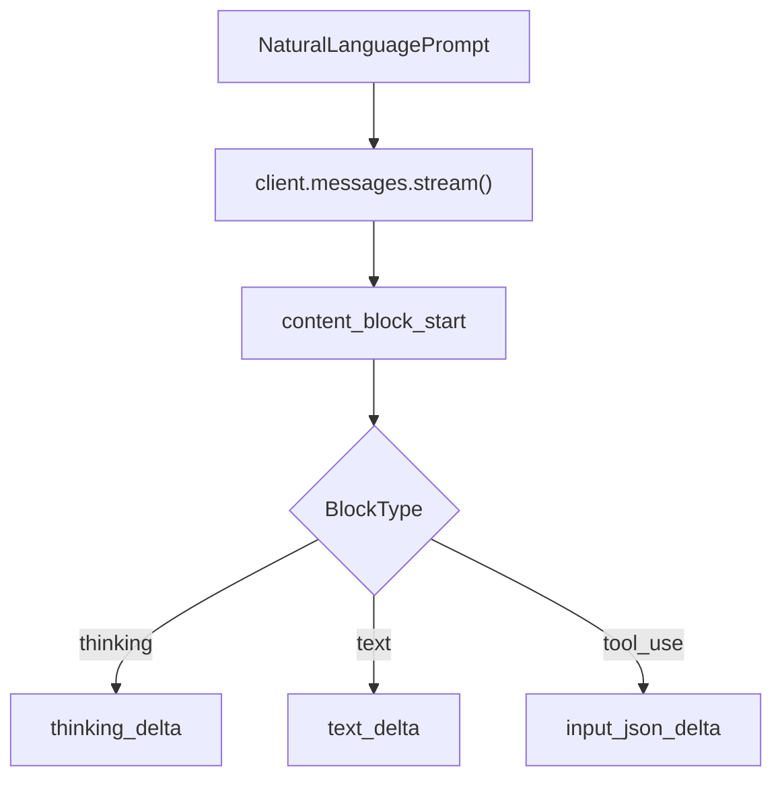
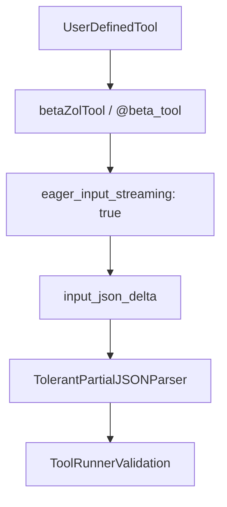
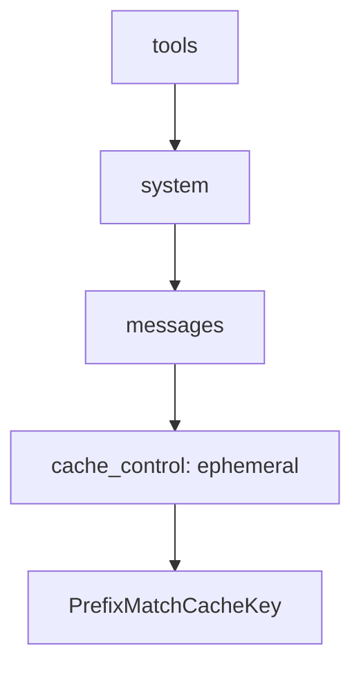
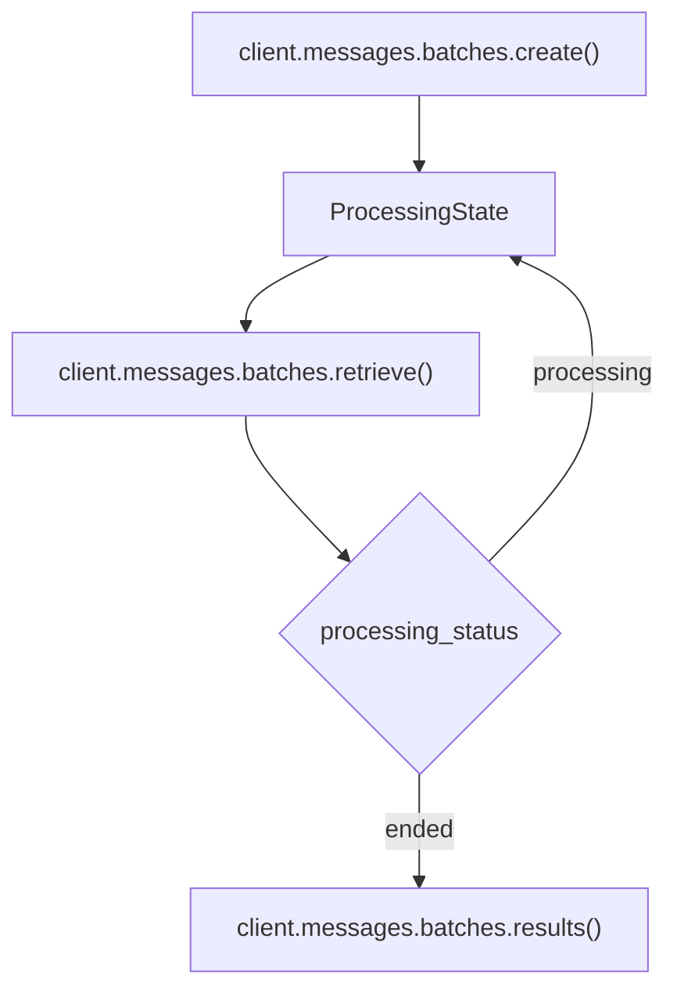
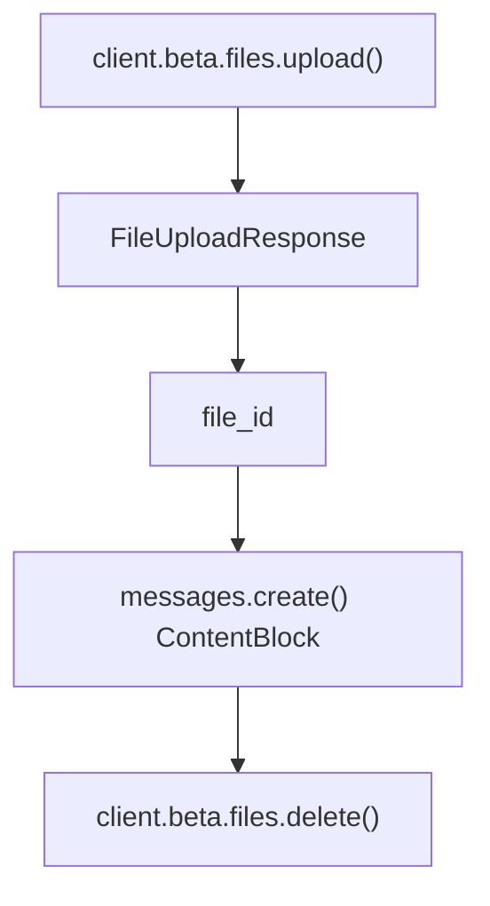
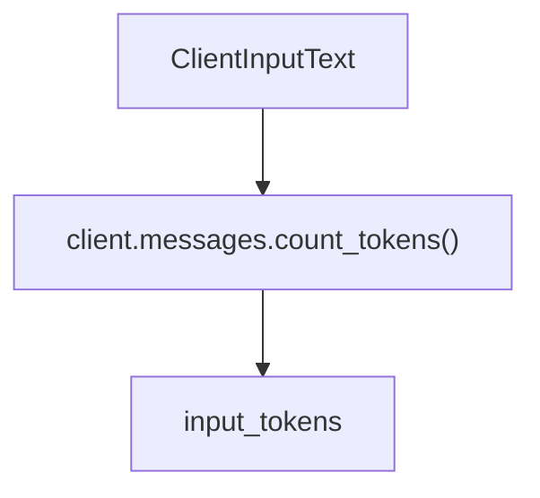
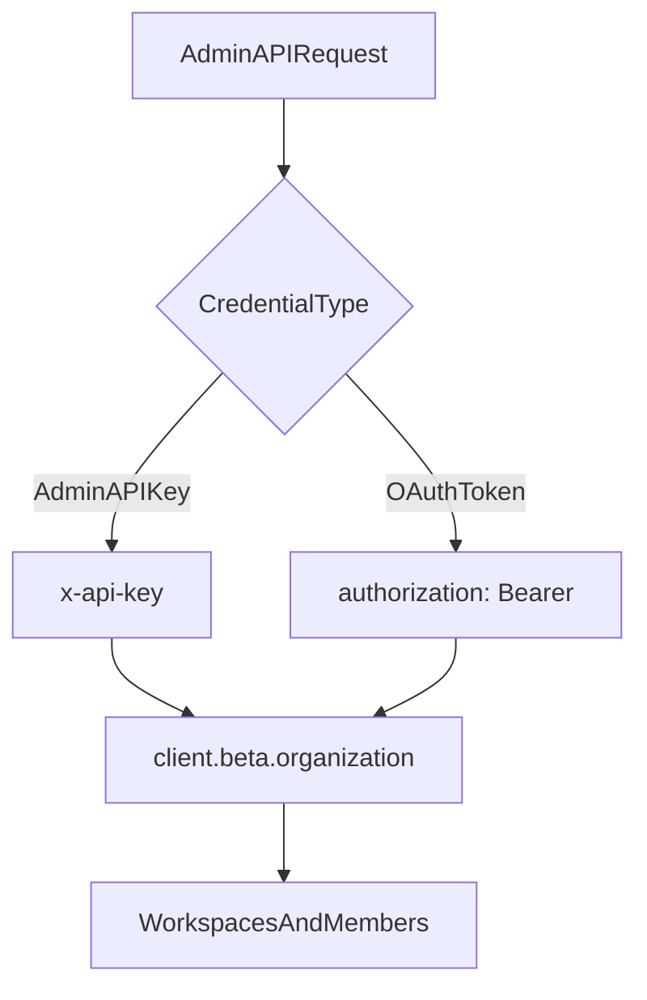

<!-- source: DeepWiki mcp.deepwiki.com · repo anthropics/skills · extra page Messages, Tool Use, and Caching · fetched 2026-10-30 -->

# Messages, Tool Use, and Caching

Relevant source files

The following files were used as context for generating this wiki page:

- [skills/claude-api/python/claude-api/batches.md](skills/claude-api/python/claude-api/batches.md)
- [skills/claude-api/python/claude-api/files-api.md](skills/claude-api/python/claude-api/files-api.md)
- [skills/claude-api/python/claude-api/streaming.md](skills/claude-api/python/claude-api/streaming.md)
- [skills/claude-api/shared/admin-api.md](skills/claude-api/shared/admin-api.md)
- [skills/claude-api/shared/error-codes.md](skills/claude-api/shared/error-codes.md)
- [skills/claude-api/shared/prompt-caching.md](skills/claude-api/shared/prompt-caching.md)
- [skills/claude-api/shared/token-counting.md](skills/claude-api/shared/token-counting.md)
- [skills/claude-api/shared/tool-use-concepts.md](skills/claude-api/shared/tool-use-concepts.md)
- [skills/claude-api/typescript/claude-api/streaming.md](skills/claude-api/typescript/claude-api/streaming.md)

This technical reference page details the Messages API surface provided by the Claude API. It covers streaming mechanisms, tool use concepts and server tools, prompt caching design and invariants, asynchronous message batches, the files API, token counting rules, HTTP error codes, and the organization admin API.

---

## 1. Streaming Mechanics

The Messages API supports streaming responses via Server-Sent Events (SSE). High-level SDK helpers (`client.messages.stream()` in Python and `client.messages.stream()` in TypeScript) accumulate state and expose text streams or final messages, while lower-level flags (`stream=True`) provide raw event iterators [skills/claude-api/python/claude-api/streaming.md:27-41]().

### Streaming Content Types and Thinking Blocks
Streaming responses handle text blocks, thinking blocks, and tool use blocks [skills/claude-api/python/claude-api/streaming.md:45-47](). Models using adaptive thinking (`thinking: {type: "adaptive"}`) emit `content_block_start` events for thinking or text blocks, followed by `content_block_delta` events (`thinking_delta` or `text_delta`) [skills/claude-api/python/claude-api/streaming.md:52-70]().

Sources: [skills/claude-api/python/claude-api/streaming.md:45-70](), [skills/claude-api/typescript/claude-api/streaming.md:24-60]()

---

## 2. Tool Use Concepts and Server Tools

Tool use allows Claude to interact with external functions and server-provided tools. 

### Tool Definition and Eager Input Streaming
User-defined tools require a `name`, `description`, and a JSON Schema for `input_schema` [skills/claude-api/shared/tool-use-concepts.md:11-33](). By default, the API buffers and validates each tool input parameter before emitting `input_json_delta` events [skills/claude-api/shared/tool-use-concepts.md:45-47](). Setting `eager_input_streaming: true` on a tool bypasses this buffering, streaming fragments as they are generated [skills/claude-api/shared/tool-use-concepts.md:45-47]().

Sources: [skills/claude-api/shared/tool-use-concepts.md:1-88](), [skills/claude-api/python/claude-api/streaming.md:74-140](), [skills/claude-api/typescript/claude-api/streaming.md:64-155]()

---

## 3. Prompt Caching

Prompt caching relies on a strict invariant: **Prompt caching is a prefix match; any change anywhere in the prefix invalidates everything after it** [skills/claude-api/shared/prompt-caching.md:5-7]().

### Render Order and Breakpoints
The render order for prompts is `tools` -> `system` -> `messages` [skills/claude-api/shared/prompt-caching.md:9-11](). Caching breakpoints are specified using `cache_control: {"type": "ephemeral"}` [skills/claude-api/shared/prompt-caching.md:41-52](). Mid-conversation system messages can be inserted via `role: "system"` inside `messages[]` to inject operator instructions without invalidating the cached prefix [skills/claude-api/shared/prompt-caching.md:65-83]().

Sources: [skills/claude-api/shared/prompt-caching.md:1-94]()

---

## 4. Message Batches API

The Batches API (`POST /v1/messages/batches`) processes asynchronous groups of Messages API requests at a 50% price reduction [skills/claude-api/python/claude-api/batches.md:1-10]().

### Batch Lifecycle and Execution
Batches accept up to 100,000 requests or 256 MB per batch, completing within 1 to 24 hours [skills/claude-api/python/claude-api/batches.md:5-10](). Results are retained for 29 days [skills/claude-api/python/claude-api/batches.md:5-10]().

Sources: [skills/claude-api/python/claude-api/batches.md:1-200]()

---

## 5. Files API

The Files API allows files to be uploaded once and referenced via `file_id` across multiple Messages API calls [skills/claude-api/python/claude-api/files-api.md:1-4]().

### File Management and Limits
- Maximum file size: 500 MB [skills/claude-api/python/claude-api/files-api.md:7-9]()
- Storage limit: 100 GB per organization [skills/claude-api/python/claude-api/files-api.md:7-10]()
- Supported file types include PDFs, text documents, and images referenced in message content blocks [skills/claude-api/python/claude-api/files-api.md:37-86]().

Sources: [skills/claude-api/python/claude-api/files-api.md:1-170]()

---

## 6. Token Counting

Token counts must be retrieved using the `count_tokens` endpoint (`POST /v1/messages/count_tokens`) as tokenization is model-specific [skills/claude-api/shared/token-counting.md:1-5](). Third-party tokenizers like `tiktoken` undercount Claude tokens significantly and should not be used [skills/claude-api/shared/token-counting.md:7-10]().

Sources: [skills/claude-api/shared/token-counting.md:1-56]()

---

## 7. HTTP Error Codes

The Claude API returns standard HTTP status codes indicating request outcomes, validation errors, and operational states [skills/claude-api/shared/error-codes.md:1-18]().

| Code | Error Type | Retryable | Common Cause |
| --- | --- | --- | --- |
| 400 | `invalid_request_error` | No | Malformed JSON or invalid parameter |
| 401 | `authentication_error` | No | Missing or invalid API key |
| 403 | `permission_error` | No | Credential lacks access |
| 404 | `not_found_error` | No | Model ID typo or unavailable model |
| 413 | `request_too_large` | No | Request body exceeds size limits |
| 429 | `rate_limit_error` | Yes | Too many requests |
| 500 | `api_error` | Yes | Anthropic service issue |
| 529 | `overloaded_error` | Yes | API temporarily overloaded |

Sources: [skills/claude-api/shared/error-codes.md:1-18]()

---

## 8. Admin API

The Admin API manages organization-level resources under `https://api.anthropic.com/v1/organizations/*` [skills/claude-api/shared/admin-api.md:1-5]().

### Authentication and Coverage
Management operations require an Admin API key (`sk-ant-admin...`) or an `org:admin` OAuth token [skills/claude-api/shared/admin-api.md:8-16](). It governs members, invites, workspaces, API keys, rate limits, service accounts, and workload identity federation (WIF) [skills/claude-api/shared/admin-api.md:3-60]().

Sources: [skills/claude-api/shared/admin-api.md:1-82]()

---

