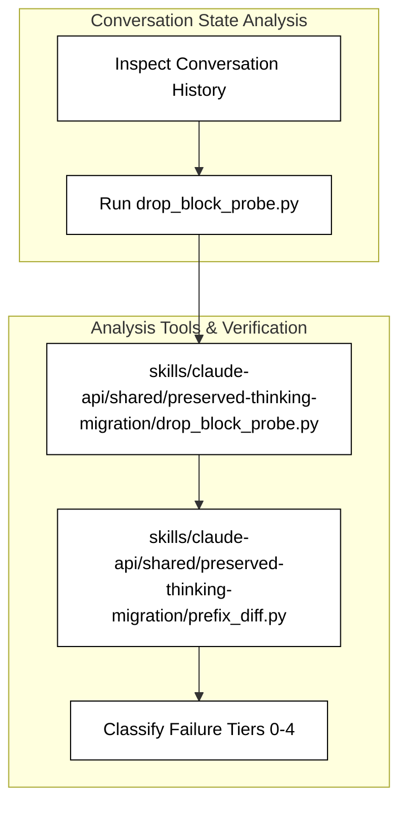

<!-- source: DeepWiki mcp.deepwiki.com · repo anthropics/skills · extra page Migration, Audits, Evals, and Cost Optimization · fetched 2026-10-30 -->

# Migration, Audits, Evals, and Cost Optimization

<details>
<summary>Relevant source files</summary>

The following files were used as context for generating this wiki page:

- [skills/claude-api/shared/agent-design.md](skills/claude-api/shared/agent-design.md)
- [skills/claude-api/shared/anthropic-cli.md](skills/claude-api/shared/anthropic-cli.md)
- [skills/claude-api/shared/claude-platform-on-aws.md](skills/claude-api/shared/claude-platform-on-aws.md)
- [skills/claude-api/shared/cost-optimization.md](skills/claude-api/shared/cost-optimization.md)
- [skills/claude-api/shared/evals/build-eval.md](skills/claude-api/shared/evals/build-eval.md)
- [skills/claude-api/shared/evals/eval-hillclimb.md](skills/claude-api/shared/evals/eval-hillclimb.md)
- [skills/claude-api/shared/model-migration.md](skills/claude-api/shared/model-migration.md)
- [skills/claude-api/shared/platform-availability.md](skills/claude-api/shared/platform-availability.md)
- [skills/claude-api/shared/preserved-thinking-migration.md](skills/claude-api/shared/preserved-thinking-migration.md)
- [skills/claude-api/shared/preserved-thinking-migration/causes.md](skills/claude-api/shared/preserved-thinking-migration/causes.md)
- [skills/claude-api/shared/prompt-audit.md](skills/claude-api/shared/prompt-audit.md)

</details>


This document covers operational workflows and maintenance guides for Claude-powered applications and agent systems. It details model upgrade paths, conversation signature preservation, prompt audits, evaluation frameworks, hill-climbing optimization, cost reduction strategies, the `ant` command-line interface, and cross-platform cloud integrations.

---

## 1. Model Migration Workflows

Migrating between Claude model generations requires systematic scoping, classification of codebase files, and adherence to breaking change profiles.

### Scope Confirmation and File Classification
Before executing edits, model migrations enforce strict scope verification (`skills/claude-api/shared/model-migration.md:43-54`). Edits must never proceed under ambiguous project-wide selectors without explicitly confirming scope (entire directory, subdirectory, or explicit file list). 

Migration files are classified to determine whether to swap model identifiers, insert parallel implementations, or skip deprecations. Key syntax changes include transitioning from legacy parameters like `budget_tokens` to `thinking: {type: "adaptive"}`, and removing transitional beta headers (`effort-2025-11-24`, `interleaved-thinking-2025-05-14`) as features reach General Availability (`skills/claude-api/shared/model-migration.md:39-40`).

```mermaid
graph TD
    subgraph NaturalLanguageSpace ["User Migration Request"]
        A[""Ambiguous Request""] --> B[""Step 0: Confirm Scope""]
    end
    subgraph CodeEntitySpace ["Migration Execution"]
        B --> C[""Step 1: Classify Files""]
        C --> D[""Swap Model Strings & Remove Beta Headers""]
        D --> E[""Validate via model-migration.md Checklist""]
    end
    
    classDef default stroke:#000,fill:#fff,color:#000;
```


*Diagram: Model Migration Scoping and Execution Flow*  
Sources: `skills/claude-api/shared/model-migration.md:1-54`

---

## 2. Preserved-Thinking Migration & Conversation Continuity

Advanced models utilize preserved thinking, where each `thinking` block's `signature` binds to the upstream conversation prefix (`system` prompt, `tools`, and preceding messages) and the model instance that generated it (`skills/claude-api/shared/preserved-thinking-migration.md:7-8`).

### The Conversation Integrity Check
When a conversation transcript is replayed, the API recomputes the signature record. If intermediate turns are rewritten, truncated, or re-rendered, the prefix check fails, resulting in either a `400` error (in `error` mode) or a `thinking_dropped` event (in `drop_block` mode) (`skills/claude-api/shared/preserved-thinking-migration.md:7-8`, `skills/claude-api/shared/preserved-thinking-migration/causes.md:14-18`).

- **Tier 0 (Fine):** Cache control markers, tool array reordering, server-side compaction, and standard retries do not break prefixes.
- **Tier 1-2 (Accidental/Fixable):** Re-rendered dynamic system prompts or mid-conversation tool schema mutations; resolved via append-only edits (`skills/claude-api/shared/preserved-thinking-migration.md:24-26`).
- **Tier 3-4 (Recurring/Stop):** Rolling truncation or prefix surgery; requires abandoning destructive pruning in favor of append-only patterns (`skills/claude-api/shared/preserved-thinking-migration.md:27-28`).


*Diagram: Preserved Thinking Diagnostic Pipeline*  
Sources: `skills/claude-api/shared/preserved-thinking-migration.md:11-28`, `skills/claude-api/shared/preserved-thinking-migration/causes.md:9-18`

---

## 3. Prompt Audits and Outdated Pattern Removal

Prompts and skill configurations accumulate legacy workarounds tuned for older models (e.g., excessive emphasis, rigid output scaffolds, or manual step-by-step scripts) (`skills/claude-api/shared/prompt-audit.md:5`). Because modern models adhere closely to instructions, outdated text increases token overhead and degrades performance.

### Audit Deliverables
Prompt auditing inventories four core surfaces: system prompt assembler code, tool definitions (`description` fields), agent instruction files (`CLAUDE.md`, `SKILL.md`), and request-building code (`skills/claude-api/shared/prompt-audit.md:33-35`). The audit outputs two required artifacts:
1. **Audit Report:** Documenting every finding with `file:line`, matched pattern, obsolescence reason, and confidence level (`skills/claude-api/shared/prompt-audit.md:10-12`).
2. **Proposed Diff:** Concrete edits for validated cruft, avoiding speculative deletions (`skills/claude-api/shared/prompt-audit.md:12-14`).

Sources: `skills/claude-api/shared/prompt-audit.md:1-42`

---

## 4. Eval Building and Hill-Climbing

Measuring whether a Claude application functions correctly across model upgrades or prompt rewrites requires systematic evaluation harnesses (`skills/claude-api/shared/evals/build-eval.md:5-7`).

### The Eval & Hill-Climbing Loop
An eval consists of an input example set, a test harness, and automated grading functions (`skills/claude-api/shared/evals/build-eval.md:7`). The iterative hill-climbing process executes as follows:
1. **Baseline Generation:** Establish costs, token usage, and transcript fidelity via `evals.json` or custom test runners (`skills/claude-api/shared/evals/eval-hillclimb.md:23`).
2. **Execution:** Run background batch evaluations (`run_in_background: true`) to record transcripts, model tags, usage metrics, and grading dictionaries (`skills/claude-api/shared/evals/eval-hillclimb.md:13-23`).
3. **Analysis & Iteration:** Analyze model transcripts for failure modes, apply targeted code or prompt updates, and measure scoring deltas against the test set (`skills/claude-api/shared/evals/eval-hillclimb.md:5-7`).

Sources: `skills/claude-api/shared/evals/build-eval.md:1-44`, `skills/claude-api/shared/evals/eval-hillclimb.md:1-26`

---

## 5. Cost Optimization and Spend per Completed Task

API optimization is measured by **cost per completed task, not cost per token**, balancing sticker prices against task completion efficiency and retry elimination (`skills/claude-api/shared/cost-optimization.md:5`).

### Optimization Levers
- **Free Wins:** Implement prompt caching, input-token hygiene (via prompt auditing), loop optimization, and batch processing before altering core architectures (`skills/claude-api/shared/cost-optimization.md:9`).
- **Tradeoffs:** Adjust effort parameters (`output_config: {effort: ...}`), token budgets, and model selections after establishing an eval-backed baseline (`skills/claude-api/shared/cost-optimization.md:10`, `skills/claude-api/shared/agent-design.md:11-12`).
- **Parameter Controls:** Adaptive thinking (`thinking: {type: "adaptive"}`) delegates reasoning depth control to Claude, while `effort` tiers govern thoroughness vs. efficiency (`skills/claude-api/shared/agent-design.md:9-12`).

Sources: `skills/claude-api/shared/cost-optimization.md:1-37`, `skills/claude-api/shared/agent-design.md:7-14`

---

## 6. The Anthropic CLI (`ant`)

The `ant` CLI provides shell subcommands for every Anthropic API resource, separating control-plane configuration from data-plane SDK workflows (`skills/claude-api/shared/anthropic-cli.md:1-7`).

### Control Plane vs. Data Plane
- **Control Plane (`ant`):** Manages static resources such as agents, environments, skills, vaults, and files stored as repo configurations (`skills/claude-api/shared/anthropic-cli.md:7-14`).
- **Data Plane (SDK):** Drives dynamic application sessions, event streams, and tool callback handling (`skills/claude-api/shared/anthropic-cli.md:7-14`).

```sh
# Example: Profile authentication and model invocation via ant CLI
ant auth login --profile production
ant --profile production models list
```

Sources: `skills/claude-api/shared/anthropic-cli.md:1-70`

---

## 7. Cloud Platform Backends and Availability

Claude models run across multiple cloud architectures and first-party endpoints. Feature availability differs across platforms, tracked via platform availability matrices (`skills/claude-api/shared/platform-availability.md:3-5`).

### Platform Overview Matrix

| Feature | First-Party (1P) | Claude Platform on AWS (P-AWS) | Amazon Bedrock | Google Cloud Vertex AI | Microsoft Foundry |
|---|---|---|---|---|---|
| Core Messages & Streaming | Yes | Yes | Yes | Yes | Yes |
| Adaptive Thinking / Effort | Yes | Yes | Yes | Yes | Yes |
| Prompt Caching (5m, 1h) | Yes | Yes | Yes | Yes | Yes |
| Server-Side Web Search | Yes | Yes | No | Yes (Basic) | Yes (Basic) |
| Managed Agents API | Beta | Beta | No | No | No |

### Claude Platform on AWS (`AnthropicAWS`)
Claude Platform on AWS offers Anthropic-operated access via AWS IAM, SigV4 authentication, and AWS Marketplace billing while maintaining same-day API parity with first-party endpoints (`skills/claude-api/shared/claude-platform-on-aws.md:1-3`). Model identifiers use bare first-party strings (`claude-opus-5-5`) without provider prefixes (`skills/claude-api/shared/claude-platform-on-aws.md:3`).

Sources: `skills/claude-api/shared/claude-platform-on-aws.md:1-60`, `skills/claude-api/shared/platform-availability.md:1-54`

---

