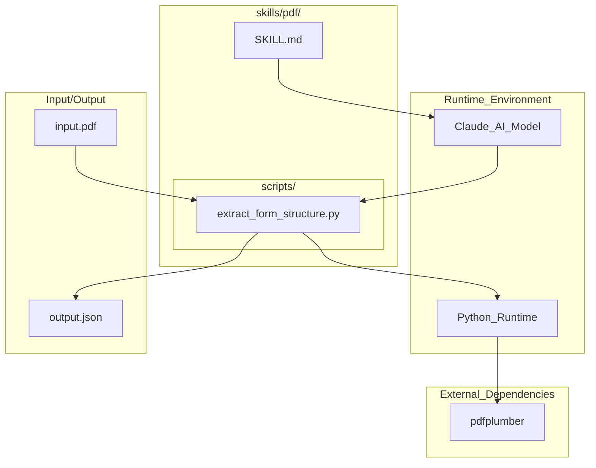
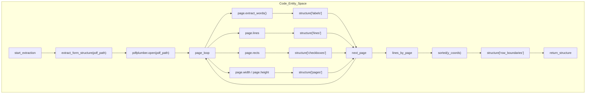
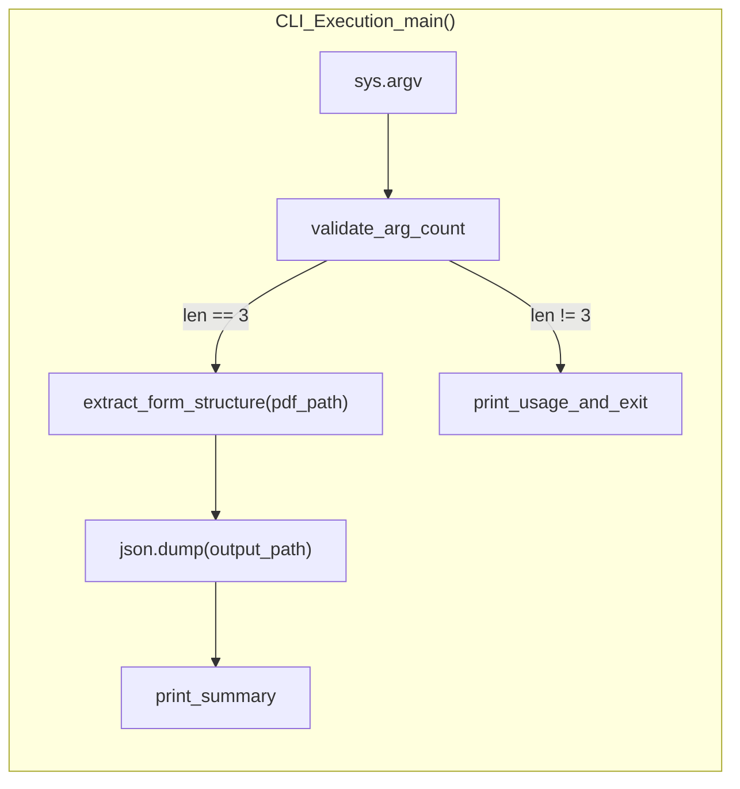

<!-- source: DeepWiki mcp.deepwiki.com · repo anthropics/skills · extra page PDF Skill · fetched 2026-10-30 -->

# PDF Skill

<details>
<summary>Relevant source files</summary>

The following files were used as context for generating this wiki page:

- [skills/docx/scripts/accept_changes.py](skills/docx/scripts/accept_changes.py)
- [skills/pdf/scripts/extract_form_structure.py](skills/pdf/scripts/extract_form_structure.py)

</details>


## Purpose and Scope

This document describes the PDF skill, a source-available document processing capability that enables Claude to extract form structure from non-fillable PDF documents. The skill analyzes PDF files to identify text labels, horizontal lines, checkboxes, and row boundaries, producing structured JSON output that facilitates form understanding and data extraction [skills/pdf/scripts/extract_form_structure.py:1-13]().

For information about other document processing skills, see Document Skills [3.1]. For details on the DOCX skill, see DOCX Skill [3.1.1]. For details on PPTX and XLSX skills, see PPTX Skill [3.1.3] and XLSX Skill [3.1.4].

Sources: [skills/pdf/scripts/extract_form_structure.py:1-13]()

## Overview

The PDF skill is a production-grade capability that powers Claude's PDF document processing features. Unlike fillable PDF forms with embedded form fields, many PDF documents are non-fillable—containing static text, lines, and shapes that visually represent a form but lack machine-readable field definitions. The PDF skill addresses this challenge by analyzing the visual layout of such documents [skills/pdf/scripts/extract_form_structure.py:1-13]().

| Capability | Description |
|------------|-------------|
| **Form Structure Extraction** | Identifies text labels, lines, checkboxes, and spatial relationships in non-fillable PDFs |
| **Coordinate Precision** | Captures exact x/y coordinates for all detected elements |
| **Row Boundary Detection** | Analyzes horizontal lines to determine row structure |
| **Checkbox Recognition** | Identifies small rectangles that function as checkbox elements |

The skill is source-available, serving as a reference implementation for complex PDF processing workflows.

Sources: [skills/pdf/scripts/extract_form_structure.py:1-13]()

## Skill Architecture

The PDF skill follows the standard skills directory structure with a `SKILL.md` definition file and supporting Python scripts in the `scripts/` subdirectory.

### Component Architecture



**Diagram: PDF Skill Component Architecture**

Sources: [skills/pdf/scripts/extract_form_structure.py:1-17](), [skills/pdf/scripts/extract_form_structure.py:29-30]()

The `SKILL.md` file contains instructions for Claude on when and how to invoke the PDF skill. When Claude determines that form structure extraction is needed, it executes the `extract_form_structure.py` script, which uses the `pdfplumber` library to parse PDF content and extract structural elements [skills/pdf/scripts/extract_form_structure.py:15-17](), [skills/pdf/scripts/extract_form_structure.py:29-30]().

Sources: [skills/pdf/scripts/extract_form_structure.py:1-17](), [skills/pdf/scripts/extract_form_structure.py:29-30]()

## Form Structure Extraction Pipeline

The core functionality is implemented in the `extract_form_structure()` function, which processes PDF files through a multi-stage extraction pipeline [skills/pdf/scripts/extract_form_structure.py:20-27]().

### Extraction Data Flow (Natural Language to Code Entities)



**Diagram: Form Structure Extraction Data Flow**

Sources: [skills/pdf/scripts/extract_form_structure.py:20-88]()

### Extraction Stages

The pipeline executes the following stages for each PDF page:

1. **Page Metadata Extraction**: Captures page dimensions (`width`, `height`) and page number [skills/pdf/scripts/extract_form_structure.py:30-35]().
2. **Text Label Extraction**: Uses `page.extract_words()` to obtain text elements with precise `x0`, `top`, `x1`, and `bottom` coordinates [skills/pdf/scripts/extract_form_structure.py:37-46]().
3. **Horizontal Line Detection**: Filters lines where the width exceeds 50% of the page width to identify row separators [skills/pdf/scripts/extract_form_structure.py:48-55]().
4. **Checkbox Identification**: Detects small square rectangles (width/height between 5-15 units, side difference < 2 units) [skills/pdf/scripts/extract_form_structure.py:57-69]().
5. **Row Boundary Calculation**: Groups lines by page, sorts them vertically, and computes vertical spans between consecutive lines [skills/pdf/scripts/extract_form_structure.py:71-86]().

Sources: [skills/pdf/scripts/extract_form_structure.py:20-88]()

## JSON Output Structure

The `extract_form_structure()` function returns a structured dictionary containing five primary top-level keys for layout reconstruction [skills/pdf/scripts/extract_form_structure.py:21-27]().

### Output Schema

| Field | Type | Description |
|-------|------|-------------|
| `pages` | Array | Page metadata including dimensions [skills/pdf/scripts/extract_form_structure.py:31-35]() |
| `labels` | Array | Text elements with bounding box coordinates [skills/pdf/scripts/extract_form_structure.py:39-46]() |
| `lines` | Array | Horizontal lines with y-coordinate and span [skills/pdf/scripts/extract_form_structure.py:50-55]() |
| `checkboxes` | Array | Small square rectangles with center points [skills/pdf/scripts/extract_form_structure.py:61-69]() |
| `row_boundaries` | Array | Vertical spacing between horizontal lines [skills/pdf/scripts/extract_form_structure.py:81-86]() |

### Page Metadata

```json
{
  "page_number": 1,
  "width": 612.0,
  "height": 792.0
}
```
Each page entry captures the page number and dimensions in PDF points (1/72 inch) [skills/pdf/scripts/extract_form_structure.py:31-35]().

### Text Labels

```json
{
  "page": 1,
  "text": "First Name:",
  "x0": 50.0,
  "top": 100.5,
  "x1": 120.3,
  "bottom": 112.0
}
```
Text labels include the extracted string and bounding box defined by `x0`, `top`, `x1`, and `bottom` [skills/pdf/scripts/extract_form_structure.py:37-46]().

### Horizontal Lines

```json
{
  "page": 1,
  "y": 115.2,
  "x0": 45.0,
  "x1": 567.0
}
```
Lines are filtered to include only those spanning at least 50% of the page width [skills/pdf/scripts/extract_form_structure.py:48-55]().

### Checkboxes

```json
{
  "page": 1,
  "x0": 200.0,
  "top": 150.0,
  "x1": 210.0,
  "bottom": 160.0,
  "center_x": 205.0,
  "center_y": 155.0
}
```
Checkbox detection uses geometric filtering: rectangles between 5-15 units that are nearly square. Center coordinates (`center_x`, `center_y`) are computed for spatial targeting [skills/pdf/scripts/extract_form_structure.py:57-69]().

### Row Boundaries

```json
{
  "page": 1,
  "row_top": 115.2,
  "row_bottom": 145.8,
  "row_height": 30.6
}
```
Derived from sorting horizontal lines and calculating vertical gaps [skills/pdf/scripts/extract_form_structure.py:71-86]().

Sources: [skills/pdf/scripts/extract_form_structure.py:21-88]()

## Command-Line Interface

The script can be invoked directly from the command line for standalone form structure extraction [skills/pdf/scripts/extract_form_structure.py:12-13]().

### Script Execution Flow (Code Entity Space)



**Diagram: Command-Line Execution Flow**

Sources: [skills/pdf/scripts/extract_form_structure.py:91-115]()

The `main()` function validates that exactly two arguments (`input.pdf` and `output.json`) are supplied via `sys.argv` before invoking `extract_form_structure()` and serializing the output [skills/pdf/scripts/extract_form_structure.py:91-115]().

Sources: [skills/pdf/scripts/extract_form_structure.py:91-115]()

## Dependencies

The PDF skill relies on the `pdfplumber` library for low-level PDF parsing [skills/pdf/scripts/extract_form_structure.py:17]().

| Library | Purpose |
|---------|---------|
| **pdfplumber** | Extraction of words, lines, and rectangles with precise coordinates [skills/pdf/scripts/extract_form_structure.py:29-69]() |

Sources: [skills/pdf/scripts/extract_form_structure.py:17](), [skills/pdf/scripts/extract_form_structure.py:29-69]()

## Integration with Claude

When Claude loads the PDF skill, the `SKILL.md` file instructs Claude on when form structure extraction is appropriate. The resulting JSON structure enables Claude to:

- Identify field labels by proximity to text elements.
- Locate input areas between horizontal lines.
- Map checkboxes to their associated labels.
- Understand multi-row table structures.
- Generate accurate field coordinates for form filling workflows [skills/pdf/scripts/extract_form_structure.py:1-13]().

Sources: [skills/pdf/scripts/extract_form_structure.py:1-13]()

---

