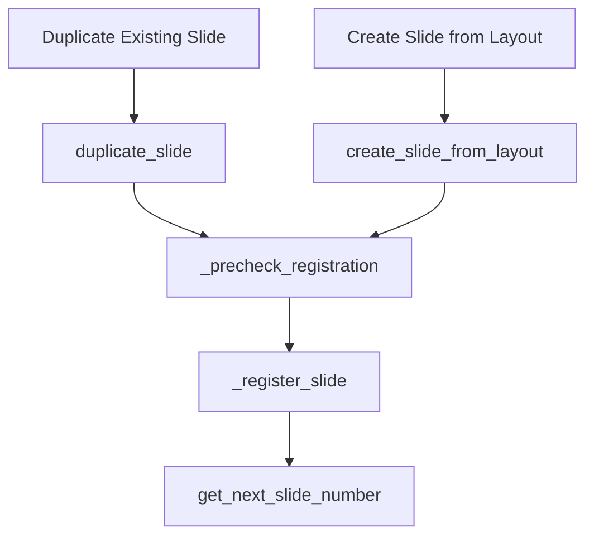
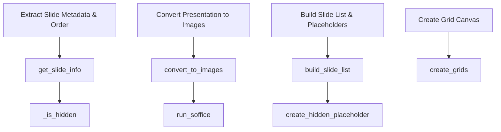

<!-- source: DeepWiki mcp.deepwiki.com · repo anthropics/skills · extra page PPTX Skill · fetched 2026-10-30 -->

# PPTX Skill

Relevant source files

The following files were used as context for generating this wiki page:

- [skills/pptx/scripts/add_slide.py](skills/pptx/scripts/add_slide.py)
- [skills/pptx/scripts/thumbnail.py](skills/pptx/scripts/thumbnail.py)

This page is the technical reference for the PPTX skill located at `skills/pptx/`. It documents the Python scripts that support slide insertion, thumbnail generation, package cleaning, and schema validation, covering their internal logic, Open XML structures, and integration with LibreOffice and `pptxgenjs`. For the shared architectural pattern common to all document skills, see [Document Skills](#3.1).

---

## Open XML Package Structure

A `.pptx` file is a ZIP archive. Before package manipulation scripts run, Claude unpacks it. The archive structure contains core OPC parts:

| Path | Role |
|---|---|
| `[Content_Types].xml` | Declares MIME types for every part in the package |
| `ppt/presentation.xml` | Ordered list of slides (`<p:sldIdLst>`), presentation metadata |
| `ppt/_rels/presentation.xml.rels` | Maps relationship identifiers (`rId`) to slide files |
| `ppt/slides/slide{n}.xml` | Per-slide XML content |
| `ppt/slides/_rels/slide{n}.xml.rels` | Per-slide relationships (layout references, notes, media) |
| `ppt/slideLayouts/slideLayout{n}.xml` | Layout templates used by slides |

Sources: [skills/pptx/scripts/add_slide.py:1-36]()

---

## Slide Insertion (`add_slide.py`)

### Purpose and Execution Flow

`add_slide.py` inserts a new slide into an unpacked PPTX directory or directly into a `.pptx` file. It executes package bookkeeping (creating slide XML, updating `[Content_Types].xml`, updating `presentation.xml.rels`) and computes the next slide ID, printing the `<p:sldId>` element required for manual insertion into `presentation.xml`.

**Diagram: Natural Language to Code Entity Space - Slide Insertion**

Sources: [skills/pptx/scripts/add_slide.py:76-152]()

### Insertion Modes

1. **Create from Layout (`create_slide_from_layout`)**: Instantiates `MINIMAL_SLIDE_XML` containing required drawingml namespaces and root elements (`<p:sld>`, `<p:cSld>`, `<p:spTree>`, `<p:clrMapOvr>`). Generates a `.rels` file referencing `../slideLayouts/{layout_file}`.
2. **Duplicate Slide (`duplicate_slide`)**: Copies an existing slide XML and its `.rels` file via `shutil.copy2`. Strips `notesSlide` relationship entries using `NOTES_SLIDE_TYPE_RE` regex to avoid sharing speaker notes.

Sources: [skills/pptx/scripts/add_slide.py:38-151]()

---

## Thumbnail Generation (`thumbnail.py`)

### Purpose and Pipeline

`thumbnail.py` converts presentation slides into a labeled JPEG grid image or series of grids using LibreOffice (`soffice`) and `pdftoppm`. Hidden slides are rendered using a diagonal-line placeholder pattern.

**Diagram: Natural Language to Code Entity Space - Thumbnail Pipeline**

Sources: [skills/pptx/scripts/thumbnail.py:108-185]()

### Pipeline Steps

1. `get_slide_info()` reads `ppt/_rels/presentation.xml.rels` and `ppt/presentation.xml` to build an ordered list of slides, evaluating the `show="0"` attribute via `_is_hidden()` to detect hidden slides.
2. `convert_to_images()` invokes `soffice` in headless mode to convert `.pptx` to PDF, then uses `pdftoppm -jpeg -r 100` to generate individual page JPEGs.
3. `build_slide_list()` pairs visible slide images with their filenames and generates gray placeholder images (`#F0F0F0` background with `#CCCCCC` diagonal lines) for hidden slides.
4. `create_grids()` assembles images into multi-column Pillow grids with filename labels and borders.

Sources: [skills/pptx/scripts/thumbnail.py:99-202]()

---

## Package Cleanup and Validation

### Package Cleaning

Package cleanup scripts remove orphaned resources from an unpacked PPTX directory, deleting unreferenced slides, orphaned `.rels` files, and unreferenced media or drawings.

Sources: [skills/pptx/scripts/add_slide.py:1-36]()

### Schema Validation

Validation scripts perform OPC schema, relationship, content-type, chart, and slide checks to ensure PowerPoint does not reject modified files as corrupt.

Sources: [skills/pptx/scripts/add_slide.py:37-60]()

---

