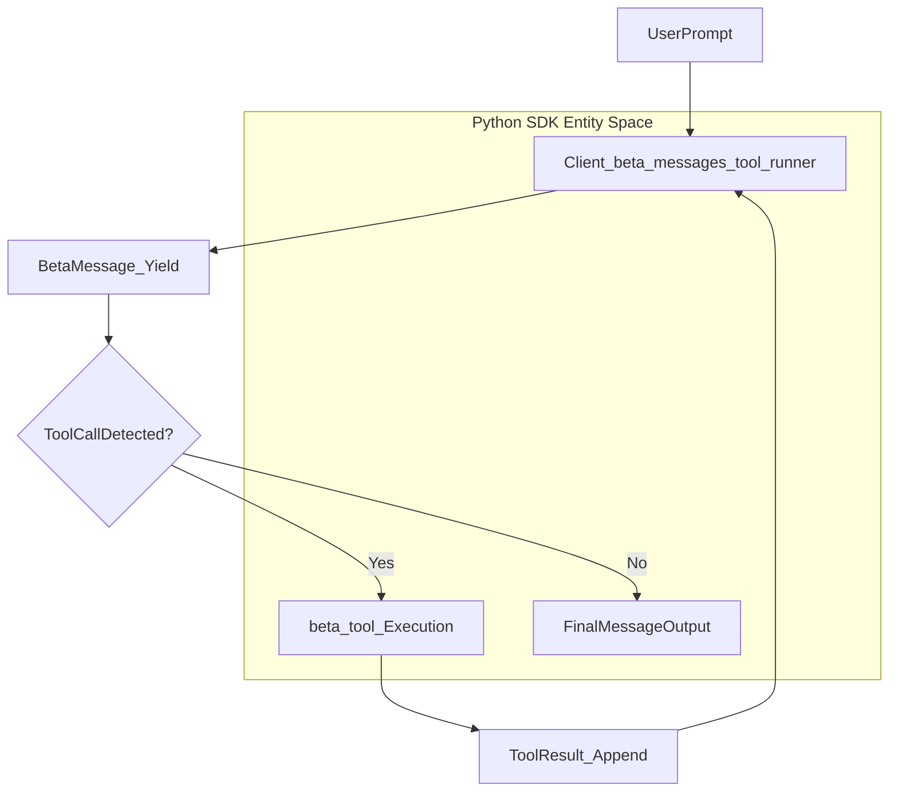
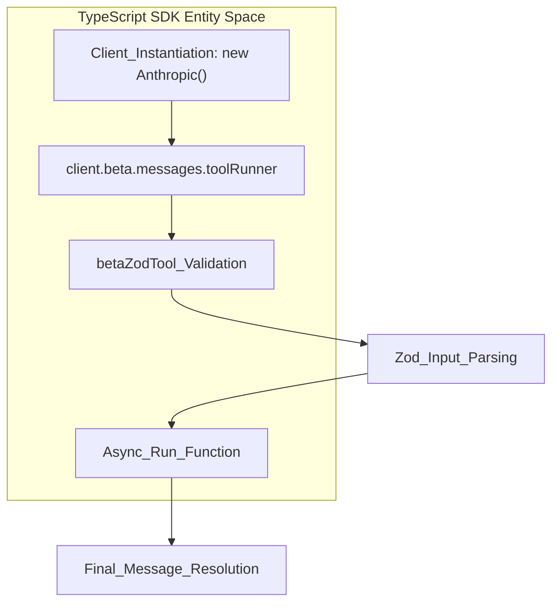

<!-- source: DeepWiki mcp.deepwiki.com · repo anthropics/skills · extra page SDK Language Guides · fetched 2026-10-30 -->

# SDK Language Guides

<details>
<summary>Relevant source files</summary>

The following files were used as context for generating this wiki page:

- [skills/claude-api/csharp/claude-api/README.md](skills/claude-api/csharp/claude-api/README.md)
- [skills/claude-api/csharp/claude-api/batches.md](skills/claude-api/csharp/claude-api/batches.md)
- [skills/claude-api/curl/examples.md](skills/claude-api/curl/examples.md)
- [skills/claude-api/go/claude-api/README.md](skills/claude-api/go/claude-api/README.md)
- [skills/claude-api/java/claude-api/README.md](skills/claude-api/java/claude-api/README.md)
- [skills/claude-api/java/claude-api/tool-use.md](skills/claude-api/java/claude-api/tool-use.md)
- [skills/claude-api/php/claude-api/README.md](skills/claude-api/php/claude-api/README.md)
- [skills/claude-api/php/claude-api/batches.md](skills/claude-api/php/claude-api/batches.md)
- [skills/claude-api/php/claude-api/tool-use.md](skills/claude-api/php/claude-api/tool-use.md)
- [skills/claude-api/python/claude-api/README.md](skills/claude-api/python/claude-api/README.md)
- [skills/claude-api/python/claude-api/sdk-upgrade.md](skills/claude-api/python/claude-api/sdk-upgrade.md)
- [skills/claude-api/python/claude-api/tool-use.md](skills/claude-api/python/claude-api/tool-use.md)
- [skills/claude-api/ruby/claude-api/README.md](skills/claude-api/ruby/claude-api/README.md)
- [skills/claude-api/ruby/claude-api/tool-use.md](skills/claude-api/ruby/claude-api/tool-use.md)
- [skills/claude-api/typescript/claude-api/README.md](skills/claude-api/typescript/claude-api/README.md)
- [skills/claude-api/typescript/claude-api/tool-use.md](skills/claude-api/typescript/claude-api/tool-use.md)

</details>


This page provides full technical documentation and architectural summaries for the per-language SDK documentation bundles included in the `claude-api` skill catalog (`skills/claude-api/`). It covers the official Anthropic client libraries for Python, TypeScript, Go, Java, Ruby, PHP, C#, as well as raw HTTP usage via cURL. Each language bundle follows a consistent modular structure (`README.md`, `tool-use.md`, streaming, batches, files API, and upgrade guides where applicable) to provide idiomatic, production-grade patterns for interacting with the Claude Messages API and beta features like the Tool Runner.

---

## 1. Shared Bundle Structure and Layout

The `claude-api` skill organizes language-specific reference materials into dedicated directories under `skills/claude-api/`. Across all languages, the documentation adheres to a uniform structure designed to accelerate onboarding, provide copy-pasteable client skeletons, and address advanced features such as prompt caching, structured outputs, extended thinking, and agentic tool loops.

```
skills/claude-api/
├── python/claude-api/      # Python SDK (anthropic >= 1.x)
├── typescript/claude-api/  # TypeScript SDK (@anthropic-ai/sdk)
├── go/claude-api/          # Go SDK (anthropic-sdk-go)
├── java/claude-api/        # Java SDK (com.anthropic.*)
├── csharp/claude-api/      # C# SDK (.NET / AnthropicClient)
├── php/claude-api/         # PHP SDK (Anthropic\Client)
├── ruby/claude-api/        # Ruby SDK (Anthropic::Client)
└── curl/                   # Raw HTTP / cURL examples & jq parsing
```

Each language bundle generally includes:
- **`README.md`**: Core installation, client initialization, environment variable resolution (`ANTHROPIC_API_KEY`), basic message requests, system prompts, vision inputs, and prompt caching.
- **`tool-use.md`**: Automated tool execution via SDK tool runners (e.g., `client.beta.messages.tool_runner()`), manual agentic loops, server-side tools (`web_search_20260209`, `web_fetch_20260209`), and Model Context Protocol (MCP) helpers.
- **Additional Topic Files**: Dedicated guides for streaming (SSE), message batches, files API, and major version upgrades (`sdk-upgrade.md`).

Sources: [skills/claude-api/python/claude-api/README.md:1-58](), [skills/claude-api/typescript/claude-api/README.md:1-27](), [skills/claude-api/go/claude-api/README.md:1-26](), [skills/claude-api/csharp/claude-api/README.md:1-22]()

---

## 2. Python SDK Guide (`anthropic` 1.x)

The Python SDK (`anthropic` 1.x, built on `httpx2`) provides both synchronous (`anthropic.Anthropic`) and asynchronous (`anthropic.AsyncAnthropic`) clients.

### Client Initialization & Overrides
Credentials are resolved automatically from environment variables (`ANTHROPIC_API_KEY`, `ANTHROPIC_AUTH_TOKEN`) or local CLI profiles (`ant auth login`). Per-request overrides are handled cleanly via `with_options()` without mutating the shared client instance:

```python
import anthropic

client = anthropic.Anthropic()

# Single-call override with timeout and retry configuration
response = client.with_options(timeout=5.0, max_retries=5).messages.create(
    model="claude-opus-5-5",
    max_tokens=1024,
    messages=[{"role": "user", "content": "Hello"}],
)
```

### Tool Runner & Decorators
The Python SDK features `@beta_tool` (and `@beta_async_tool`) decorators that automatically generate JSON schemas from type annotations and docstrings, feeding them directly into `client.beta.messages.tool_runner()`:

```python
import anthropic
from anthropic import beta_tool

client = anthropic.Anthropic()

@beta_tool
def get_weather(location: str, unit: str = "celsius") -> str:
    """Get current weather for a location."""
    return f"72°F and sunny in {location}"

runner = client.beta.messages.tool_runner(
    model="claude-opus-5-5",
    max_tokens=16000,
    tools=[get_weather],
    messages=[{"role": "user", "content": "What's the weather in Paris?"}],
)

for message in runner:
    print(message)
```



Sources: [skills/claude-api/python/claude-api/README.md:9-40](), [skills/claude-api/python/claude-api/tool-use.md:25-54](), [skills/claude-api/python/claude-api/sdk-upgrade.md:1-22]()

---

## 3. TypeScript SDK Guide (`@anthropic-ai/sdk`)

The TypeScript SDK provides robust discriminated unions for content blocks and helper utilities for Zod-backed tool definitions.

### ESM Imports & Client Setup
In ES modules, directory references like `__dirname` are undefined. The TypeScript documentation emphasizes using `import.meta.url` or bare relative paths for file operations:

```typescript
import Anthropic from "@anthropic-ai/sdk";

const client = new Anthropic();

const response = await client.messages.create({
  model: "claude-opus-5-5",
  max_tokens: 16000,
  messages: [{ role: "user", content: "What is the capital of France?" }],
});

for (const block of response.content) {
  if (block.type === "text") {
    console.log(block.text);
  }
}
```

### Zod Tool Runner
Using `betaZodTool` from `@anthropic-ai/sdk/helpers/beta/zod`, developers define type-safe tools with runtime validation:

```typescript
import Anthropic from "@anthropic-ai/sdk";
import { betaZodTool } from "@anthropic-ai/sdk/helpers/beta/zod";
import { z } from "zod";

const client = new Anthropic();

const getWeather = betaZodTool({
  name: "get_weather",
  description: "Get current weather for a location",
  inputSchema: z.object({
    location: z.string().describe("City and state"),
  }),
  run: async (input) => {
    return `72°F and sunny in ${input.location}`;
  },
});

const finalMessage = await client.beta.messages.toolRunner({
  model: "claude-opus-5-5",
  max_tokens: 16000,
  tools: [getWeather],
  messages: [{ role: "user", content: "What's the weather in Paris?" }],
});
```



Sources: [skills/claude-api/typescript/claude-api/README.md:7-46](), [skills/claude-api/typescript/claude-api/tool-use.md:19-54]()

---

## 4. Go SDK Guide (`anthropic-sdk-go`)

The Go SDK (`github.com/anthropics/anthropic-sdk-go`) leverages idiomatic Go structures, functional option patterns (`option.WithAPIKey`), and union types for thinking configurations and message parameters.

### Initialization & Message Creation
```go
import (
    "context"
    "fmt"
    "log"
    "github.com/anthropics/anthropic-sdk-go"
    "github.com/anthropics/anthropic-sdk-go/option"
)

client := anthropic.NewClient(
    option.WithAPIKey("your-api-key"),
)

response, err := client.Messages.New(context.Background(), anthropic.MessageNewParams{
    Model:     "claude-opus-5-5",
    MaxTokens: 16000,
    Messages: []anthropic.MessageParam{
        anthropic.NewUserMessage(anthropic.NewTextBlock("What is the capital of France?")),
    },
})
if err != nil {
    log.Fatal(err)
}

for _, block := range response.Content {
    switch variant := block.AsAny().(type) {
    case anthropic.TextBlock:
        fmt.Println(variant.Text)
    }
}
```

Sources: [skills/claude-api/go/claude-api/README.md:5-57]()

---

## 5. Java & C# SDK Guides

### Java SDK
Java integration utilizes builders and annotated classes implementing `Supplier<String>` for automatic execution via `BetaToolRunner`:

```java
import com.anthropic.models.beta.messages.MessageCreateParams;
import com.anthropic.models.beta.messages.BetaMessage;
import com.anthropic.helpers.BetaToolRunner;
import com.fasterxml.jackson.annotation.JsonClassDescription;
import com.fasterxml.jackson.annotation.JsonPropertyDescription;
import java.util.function.Supplier;

@JsonClassDescription("Get the weather in a given location")
static class GetWeather implements Supplier<String> {
    @JsonPropertyDescription("The city and state")
    public String location;

    @Override
    public String get() {
        return "The weather in " + location + " is sunny and 72°F";
    }
}
```

### C# SDK
The official .NET SDK (`AnthropicClient`) organizes types into strict namespaces (`Anthropic.Models.Messages`, `Anthropic.Models.Beta.Messages`, `Anthropic.Helpers.Beta`). Top-level statements and PascalCase properties map directly to wire-format fields:

```csharp
using System;
using Anthropic;
using Anthropic.Models.Messages;

AnthropicClient client = new();

var message = await client.Messages.Create(new MessageCreateParams
{
    Model = "claude-opus-5-5",
    MaxTokens = 1024,
    Messages = [ new() { Role = Role.User, Content = "Hello, Claude" } ],
});

Console.WriteLine(message.Content);
```

Sources: [skills/claude-api/csharp/claude-api/README.md:1-67](), [skills/claude-api/java/claude-api/tool-use.md:23-56]()

---

## 6. Ruby, PHP, and cURL / Raw HTTP Guides

### Ruby
Ruby supports raw schema definitions and the beta tool runner using `Anthropic::BaseModel` and `Anthropic::BaseTool`:

```ruby
class GetWeatherInput < Anthropic::BaseModel
  required :location, String, doc: "City and state"
end

class GetWeather < Anthropic::BaseTool
  doc "Get the current weather for a location"
  input_schema GetWeatherInput

  def call(input)
    "The weather in #{input.location} is sunny and 72°F."
  end
end
```

### PHP
The PHP SDK (`Anthropic\Client`) uses camelCase configuration keys that map to snake_case wire formats automatically, alongside structured output models:

```php
use Anthropic\Lib\Tools\BetaRunnableTool;

$weatherTool = new BetaRunnableTool(
    definition: [
        'name' => 'get_weather',
        'description' => 'Get the current weather for a location.',
        'inputSchema' => [
            'type' => 'object',
            'properties' => ['location' => ['type' => 'string']],
            'required' => ['location'],
        ],
    ],
    run: function (array $input): string {
        return "The weather in {$input['location']} is sunny and 72°F.";
    },
);
```

### cURL / Raw HTTP
For environments without an official SDK, raw requests use `curl` combined with `jq` for reliable JSON parsing:

```bash
response=$(curl -s https://api.anthropic.com/v1/messages \
  -H "Content-Type: application/json" \
  -H "x-api-key: $ANTHROPIC_API_KEY" \
  -H "anthropic-version: 2023-06-01" \
  -d '{"model":"claude-opus-5-5","max_tokens":16000,"messages":[{"role":"user","content":"Hello"}]}')

echo "$response" | jq -r '.content[0].text'
```

Sources: [skills/claude-api/curl/examples.md:1-45](), [skills/claude-api/ruby/claude-api/tool-use.md:23-48](), [skills/claude-api/php/claude-api/tool-use.md:23-43]()

---

