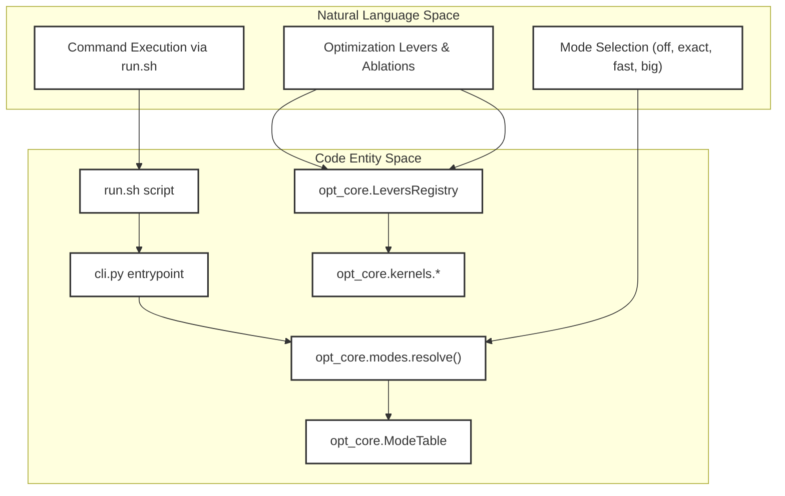
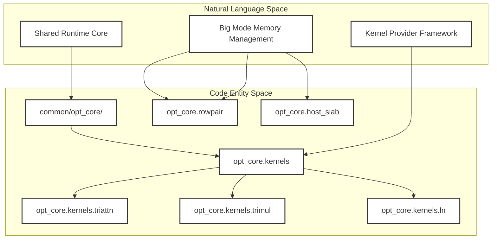

<!-- source: DeepWiki mcp.deepwiki.com · repo anthropics/uplifting-biomolecular-modeling · page 1 Overview: Inference Optimization Kits · fetched 2026-10-26 -->

# Overview: Inference Optimization Kits

Relevant source files

The following files were used as context for generating this wiki page:

- [af2ig/opt/forward/af2ig_kit/upstream/LICENSE.dl_binder_design.MIT.txt](af2ig/opt/forward/af2ig_kit/upstream/LICENSE.dl_binder_design.MIT.txt)
- [af2ig/third_party_licenses/dl_binder_design.MIT.txt](af2ig/third_party_licenses/dl_binder_design.MIT.txt)
- [af2ig/third_party_licenses/silent_tools.MIT.txt](af2ig/third_party_licenses/silent_tools.MIT.txt)
- [af3_jax/CHANGES.md](af3_jax/CHANGES.md)
- [af3_jax/opt/forward/fast_inference/HOWTO.md](af3_jax/opt/forward/fast_inference/HOWTO.md)
- [af3_jax/opt/forward/flashpairformer/README.md](af3_jax/opt/forward/flashpairformer/README.md)
- [af3_jax/opt/forward/flashpairformer/af3_flashpairformer/__init__.py](af3_jax/opt/forward/flashpairformer/af3_flashpairformer/__init__.py)
- [af3_jax/opt/forward/flashpairformer/af3_flashpairformer/patch.py](af3_jax/opt/forward/flashpairformer/af3_flashpairformer/patch.py)
- [atlasfold/opt/atlasfold_opt/__init__.py](atlasfold/opt/atlasfold_opt/__init__.py)
- [atlasfold/opt/atlasfold_opt/stack.py](atlasfold/opt/atlasfold_opt/stack.py)
- [atlasfold/stock/src/LICENSE](atlasfold/stock/src/LICENSE)
- [atlasfold/third_party_licenses/AtlasFold.MIT.txt](atlasfold/third_party_licenses/AtlasFold.MIT.txt)
- [boltz2/CHANGES.md](boltz2/CHANGES.md)
- [boltz2/README.md](boltz2/README.md)
- [boltz2/STOCK.md](boltz2/STOCK.md)
- [boltz2/environment/Dockerfile](boltz2/environment/Dockerfile)
- [boltz2/environment/apptainer.def](boltz2/environment/apptainer.def)
- [boltz2/opt/forward/dit_hoist/LICENSE](boltz2/opt/forward/dit_hoist/LICENSE)
- [boltz2/stock/src/LICENSE](boltz2/stock/src/LICENSE)
- [boltz2/third_party_licenses/Boltz.MIT.txt](boltz2/third_party_licenses/Boltz.MIT.txt)
- [boltz2/third_party_licenses/alphafold3-pytorch.MIT.txt](boltz2/third_party_licenses/alphafold3-pytorch.MIT.txt)
- [boltzgen/CHANGES.md](boltzgen/CHANGES.md)
- [boltzgen/README.md](boltzgen/README.md)
- [boltzgen/STOCK.md](boltzgen/STOCK.md)
- [boltzgen/environment/Dockerfile](boltzgen/environment/Dockerfile)
- [boltzgen/environment/apptainer.def](boltzgen/environment/apptainer.def)
- [borzoi/environment/apptainer.def](borzoi/environment/apptainer.def)
- [chai1/third_party_licenses/ColabFold.MIT.txt](chai1/third_party_licenses/ColabFold.MIT.txt)
- [chai1/third_party_licenses/ESM-fair-esm.MIT.txt](chai1/third_party_licenses/ESM-fair-esm.MIT.txt)
- [chrombpnet/third_party_licenses/bpnet-lite.MIT.txt](chrombpnet/third_party_licenses/bpnet-lite.MIT.txt)
- [chrombpnet/third_party_licenses/pyBigWig.MIT.txt](chrombpnet/third_party_licenses/pyBigWig.MIT.txt)
- [chrombpnet/third_party_licenses/tangermeme.MIT.txt](chrombpnet/third_party_licenses/tangermeme.MIT.txt)
- [colabdesign/opt/colabdesign_opt/__init__.py](colabdesign/opt/colabdesign_opt/__init__.py)
- [colabdesign/opt/pyproject.toml](colabdesign/opt/pyproject.toml)
- [colabdesign/stock/src/bindcraft/LICENSE](colabdesign/stock/src/bindcraft/LICENSE)
- [colabdesign/third_party_licenses/BindCraft.MIT.txt](colabdesign/third_party_licenses/BindCraft.MIT.txt)
- [colabdesign/third_party_licenses/ESM.MIT.txt](colabdesign/third_party_licenses/ESM.MIT.txt)
- [colabfold/opt/colabfold_opt/__init__.py](colabfold/opt/colabfold_opt/__init__.py)
- [colabfold/opt/colabfold_opt/cli.py](colabfold/opt/colabfold_opt/cli.py)
- [colabfold/opt/pyproject.toml](colabfold/opt/pyproject.toml)
- [colabfold/stock/src/colabfold/LICENSE](colabfold/stock/src/colabfold/LICENSE)
- [colabfold/third_party_licenses/ColabFold.MIT.txt](colabfold/third_party_licenses/ColabFold.MIT.txt)
- [common/README.md](common/README.md)
- [common/opt_core/CHANGES.md](common/opt_core/CHANGES.md)
- [common/opt_core/README.md](common/opt_core/README.md)
- [common/opt_core/opt_core/__init__.py](common/opt_core/opt_core/__init__.py)
- [common/opt_core/opt_core/capture/__init__.py](common/opt_core/opt_core/capture/__init__.py)
- [common/opt_core/opt_core/of3_sampler/__init__.py](common/opt_core/opt_core/of3_sampler/__init__.py)
- [common/opt_core/opt_core/of3_trunk/__init__.py](common/opt_core/opt_core/of3_trunk/__init__.py)
- [common/opt_core/opt_core/seq/__init__.py](common/opt_core/opt_core/seq/__init__.py)
- [common/opt_core/pyproject.toml](common/opt_core/pyproject.toml)
- [ef2inv/stock/src/LICENSE.md](ef2inv/stock/src/LICENSE.md)
- [enformer/stock/src/LICENSE](enformer/stock/src/LICENSE)
- [enformer/third_party_licenses/enformer-pytorch.MIT.txt](enformer/third_party_licenses/enformer-pytorch.MIT.txt)
- [esm_if1/stock/src/LICENSE](esm_if1/stock/src/LICENSE)
- [esm_if1/third_party_licenses/fair-esm.MIT.txt](esm_if1/third_party_licenses/fair-esm.MIT.txt)
- [genie3/README.md](genie3/README.md)
- [genie3/STOCK.md](genie3/STOCK.md)
- [genie3/configs/h100.env](genie3/configs/h100.env)
- [genie3/environment/Dockerfile](genie3/environment/Dockerfile)
- [genie3/environment/apptainer.def](genie3/environment/apptainer.def)
- [genie3/stock/PINS.json](genie3/stock/PINS.json)
- [gpnstar/STOCK.md](gpnstar/STOCK.md)
- [mosaic/opt/mosaic_opt/licenses/LICENSE.boltz-escalante-fork-1acc397b.MIT.txt](mosaic/opt/mosaic_opt/licenses/LICENSE.boltz-escalante-fork-1acc397b.MIT.txt)
- [mosaic/opt/mosaic_opt/licenses/LICENSE.joltz-ed0f0425.MIT.txt](mosaic/opt/mosaic_opt/licenses/LICENSE.joltz-ed0f0425.MIT.txt)
- [mosaic/opt/mosaic_opt/licenses/LICENSE.mosaic-70fec525.MIT.txt](mosaic/opt/mosaic_opt/licenses/LICENSE.mosaic-70fec525.MIT.txt)
- [mosaic/stock/src/boltz/LICENSE](mosaic/stock/src/boltz/LICENSE)
- [mosaic/stock/src/joltz/LICENSE](mosaic/stock/src/joltz/LICENSE)
- [mosaic/stock/src/joltz/NOTICE](mosaic/stock/src/joltz/NOTICE)
- [mosaic/stock/src/mosaic/LICENSE](mosaic/stock/src/mosaic/LICENSE)
- [mosaic/third_party_licenses/ColabFold.MIT.txt](mosaic/third_party_licenses/ColabFold.MIT.txt)
- [mosaic/third_party_licenses/alphafold3-pytorch.MIT.txt](mosaic/third_party_licenses/alphafold3-pytorch.MIT.txt)
- [mosaic/third_party_licenses/boltz.MIT.txt](mosaic/third_party_licenses/boltz.MIT.txt)
- [mosaic/third_party_licenses/joltz.MIT.txt](mosaic/third_party_licenses/joltz.MIT.txt)
- [mosaic/third_party_licenses/joltz.NOTICE.txt](mosaic/third_party_licenses/joltz.NOTICE.txt)
- [mosaic/third_party_licenses/mosaic.MIT.txt](mosaic/third_party_licenses/mosaic.MIT.txt)
- [openfold3/opt/openfold3_opt/cells/__init__.py](openfold3/opt/openfold3_opt/cells/__init__.py)
- [openfold3/opt/pyproject.toml](openfold3/opt/pyproject.toml)
- [openfold3/stock/src/pyproject.toml](openfold3/stock/src/pyproject.toml)
- [openfold3_ob0/opt/openfold3_ob0_opt/cells/__init__.py](openfold3_ob0/opt/openfold3_ob0_opt/cells/__init__.py)
- [openfold3_ob0/opt/pyproject.toml](openfold3_ob0/opt/pyproject.toml)
- [openfold3_ob0/stock/src/pyproject.toml](openfold3_ob0/stock/src/pyproject.toml)
- [progen2/environment/Dockerfile](progen2/environment/Dockerfile)
- [progen2/environment/requirements.lock](progen2/environment/requirements.lock)
- [rfdiffusion3/third_party_licenses/neurips19-graph-protein-design.MIT.txt](rfdiffusion3/third_party_licenses/neurips19-graph-protein-design.MIT.txt)
- [rosettafold3/opt/pyproject.toml](rosettafold3/opt/pyproject.toml)
- [rosettafold3/opt/rosettafold3_opt/__init__.py](rosettafold3/opt/rosettafold3_opt/__init__.py)
- [rosettafold3/third_party_licenses/neurips19-graph-protein-design.MIT.txt](rosettafold3/third_party_licenses/neurips19-graph-protein-design.MIT.txt)

The `anthropics/uplifting-biomolecular-modeling` repository provides 36 drop-in inference optimization kits designed to accelerate and reduce GPU memory consumption for prominent protein structure prediction, molecular design, protein/genomic language model, and genomics regression tools [boltz2/README.md:1-10](). Each kit maintains a strict structural separation between the unmodified upstream software release (`stock/`) and the optimization logic (`opt/`), coordinated via a shared runtime library (`common/opt_core`) [common/opt_core/README.md:1-10]().

Kits expose a standardized command-line vocabulary (`off`, `exact`, `fast`, `big`) through a unified execution harness (`run.sh`) without altering upstream application interfaces [boltz2/README.md:3-9](). 

For comprehensive details on how kits are structured, installed, configured, and categorized across domains, refer to the parent-managed child pages:
- For directory organization and asset inventories, see [Repository Layout and Kit Anatomy](#1.1).
- For setup instructions, environment routes (`run.sh`), and card configurations, see [Getting Started: Install, Check, Run](#1.2).
- For an exhaustive tour of the 36 optimization kits grouped by biological and computational domain, see [Kit Catalog by Domain](#1.3).

---

## Architectural Bridge: Natural Language to Code Entities

To understand how user-facing concepts map directly to the codebase, the diagrams below bridge natural language operational concepts to their exact underlying code structures and module hierarchies.

*Sources: `boltz2/README.md:78-95`, `common/opt_core/README.md:1-15`*

*Sources: `common/opt_core/README.md:1-10`, `common/opt_core/README.md:70-85`*

---

## High-Level Kit Architecture

Every kit in the repository adheres to a standardized pattern that isolates upstream code from high-performance drop-in replacements [boltz2/README.md:3-10](). The shared core library (`common/opt_core`) supplies foundational primitives including JAX/PyTorch framework glue, precision policies, compilation cache managers, and memory offloading routines [common/opt_core/README.md:3-10]().

| Component | Target Directory | Primary Responsibility |
| --- | --- | --- |
| **Upstream Stock** | `<kit>/stock/` | Unmodified reference implementation of the ML tool [boltz2/README.md:6]() |
| **Optimization Pack** | `<kit>/opt/` | Patched modules, fast-inference drivers, and compiled kernels [boltz2/README.md:3-10]() |
| **Shared Runtime** | `common/opt_core/` | Kernel providers, cell tables, rowpair sharding, and mode resolution [common/opt_core/README.md:1-10]() |
| **Environment Configs** | `<kit>/environment/` | Pinned locks, Dockerfiles, Apptainer definitions, and hardware profiles [boltz2/README.md:17-45]() |

For a deeper dive into directory structures and asset layouts, consult [Repository Layout and Kit Anatomy](#1.1).

*Sources: `boltz2/README.md:3-45`, `common/opt_core/README.md:1-15`*

---

## Execution Modes and Vocabulary

Optimization kits share a common operational vocabulary governed by `opt_core` [common/opt_core/README.md:3-10](). Execution modes dictate performance characteristics and numerical fidelity without requiring upstream code modifications [boltz2/README.md:3-10]().

- **`off`**: Bypasses all optimizations, executing the pristine upstream stock code [boltz2/README.md:6]().
- **`exact`**: Applies accelerated kernels and optimizations guaranteed to yield bit-identical outputs to upstream [boltz2/README.md:7]().
- **`fast`**: (Default) Leverages optimized kernels within acceptable numeric tolerances, matching upstream seed-to-seed variation [boltz2/README.md:8]().
- **`big`**: Combines `fast` optimizations with memory-saving mechanisms (such as row-sharded pair stacks and host slab offloading) to process large inputs [boltz2/README.md:9]().

For instructions on invoking these modes via `run.sh`, managing container/venv environments, and handling weight checkpoints, see [Getting Started: Install, Check, Run](#1.2).

*Sources: `boltz2/README.md:3-10`, `common/opt_core/README.md:35-50`*

---

## Domain Coverage

The 36 optimization kits span across four major computational biology domains:
1. **Structure Prediction & Cofolding**: AlphaFold3 variants, Boltz-1/2, Chai-1, OpenFold3, Protenix, and RoseTTAFold3 [boltz2/README.md:1-10]().
2. **Protein Design**: ProteinMPNN, RFdiffusion variants, ColabDesign, and specialized binder design engines [af2ig/opt/forward/af2ig_kit/upstream/LICENSE.dl_binder_design.MIT.txt:1-5]().
3. **Protein & Genomic Language Models**: ESMFold, ESM, ProGen2, Evo2, and GPN-Star [mosaic/opt/mosaic_opt/licenses/LICENSE.boltz-escalante-fork-1acc397b.MIT.txt:1-10]().
4. **Genomics Regression & Interpretation**: Enformer, Borzoi, and ChromBPNet [chrombpnet/third_party_licenses/pyBigWig.MIT.txt:1-5]().

For a complete catalog of all 36 kits with direct paths and domain categorization, see [Kit Catalog by Domain](#1.3).

*Sources: `boltz2/README.md:1-10`, `mosaic/opt/mosaic_opt/licenses/LICENSE.boltz-escalante-fork-1acc397b.MIT.txt:1-10`*

---

