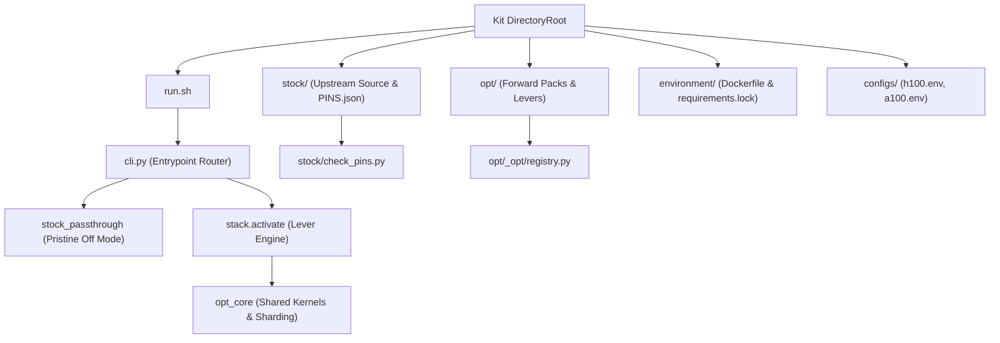
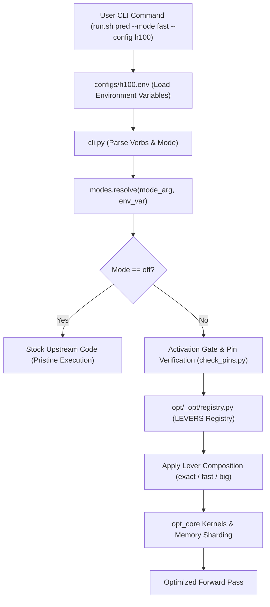

<!-- source: DeepWiki mcp.deepwiki.com · repo anthropics/uplifting-biomolecular-modeling · page 1.1 Repository Layout and Kit Anatomy · fetched 2026-10-26 -->

# Repository Layout and Kit Anatomy

<details>
<summary>Relevant source files</summary>

The following files were used as context for generating this wiki page:

- [af2ig/environment/apptainer.def](af2ig/environment/apptainer.def)
- [af3_jax/environment/apptainer.def](af3_jax/environment/apptainer.def)
- [af3_jax/stock/PINS.json](af3_jax/stock/PINS.json)
- [af3_jax/stock/src/OF3_AF3_PORTING_NOTES.md](af3_jax/stock/src/OF3_AF3_PORTING_NOTES.md)
- [af3_jax/stock/src/scripts/of3_verification/README.md](af3_jax/stock/src/scripts/of3_verification/README.md)
- [af3_jax/stock/src/scripts/of3_verification/audit_structure.py](af3_jax/stock/src/scripts/of3_verification/audit_structure.py)
- [af3_torch/environment/apptainer.def](af3_torch/environment/apptainer.def)
- [af3_torch/stock/PINS.json](af3_torch/stock/PINS.json)
- [boltz2/CHANGES.md](boltz2/CHANGES.md)
- [boltz2/README.md](boltz2/README.md)
- [boltz2/STOCK.md](boltz2/STOCK.md)
- [boltz2/environment/Dockerfile](boltz2/environment/Dockerfile)
- [boltz2/environment/apptainer.def](boltz2/environment/apptainer.def)
- [boltzgen/CHANGES.md](boltzgen/CHANGES.md)
- [boltzgen/README.md](boltzgen/README.md)
- [boltzgen/STOCK.md](boltzgen/STOCK.md)
- [boltzgen/environment/Dockerfile](boltzgen/environment/Dockerfile)
- [boltzgen/environment/apptainer.def](boltzgen/environment/apptainer.def)
- [borzoi/environment/apptainer.def](borzoi/environment/apptainer.def)
- [chrombpnet/environment/apptainer.def](chrombpnet/environment/apptainer.def)
- [colabfold/environment/apptainer.def](colabfold/environment/apptainer.def)
- [complexa/environment/apptainer.def](complexa/environment/apptainer.def)
- [e1/README.md](e1/README.md)
- [e1/environment/apptainer.def](e1/environment/apptainer.def)
- [e1/opt/e1_opt/report.py](e1/opt/e1_opt/report.py)
- [ef2inv/CHANGES.md](ef2inv/CHANGES.md)
- [ef2inv/README.md](ef2inv/README.md)
- [ef2inv/environment/apptainer.def](ef2inv/environment/apptainer.def)
- [esm_if1/README.md](esm_if1/README.md)
- [esm_if1/environment/apptainer.def](esm_if1/environment/apptainer.def)
- [esmc/CHANGES.md](esmc/CHANGES.md)
- [esmc/README.md](esmc/README.md)
- [esmc/environment/Dockerfile](esmc/environment/Dockerfile)
- [esmc/environment/apptainer.def](esmc/environment/apptainer.def)
- [esmfold2/CHANGES.md](esmfold2/CHANGES.md)
- [esmfold2/README.md](esmfold2/README.md)
- [esmfold2/environment/apptainer.def](esmfold2/environment/apptainer.def)
- [evo2/README.md](evo2/README.md)
- [evo2/environment/apptainer.def](evo2/environment/apptainer.def)
- [evo2/run.sh](evo2/run.sh)
- [flashzoi/opt/flashzoi_opt/report.py](flashzoi/opt/flashzoi_opt/report.py)
- [genie3/README.md](genie3/README.md)
- [genie3/STOCK.md](genie3/STOCK.md)
- [genie3/configs/h100.env](genie3/configs/h100.env)
- [genie3/environment/Dockerfile](genie3/environment/Dockerfile)
- [genie3/environment/apptainer.def](genie3/environment/apptainer.def)
- [genie3/stock/PINS.json](genie3/stock/PINS.json)
- [gpnstar/STOCK.md](gpnstar/STOCK.md)
- [openfold3/README.md](openfold3/README.md)
- [openfold3/STOCK.md](openfold3/STOCK.md)
- [openfold3/environment/Dockerfile](openfold3/environment/Dockerfile)
- [openfold3/environment/apptainer.def](openfold3/environment/apptainer.def)
- [openfold3/stock/PINS.json](openfold3/stock/PINS.json)
- [openfold3/stock/src/docker/Dockerfile.blackwell](openfold3/stock/src/docker/Dockerfile.blackwell)
- [openfold3_ob0/README.md](openfold3_ob0/README.md)
- [openfold3_ob0/STOCK.md](openfold3_ob0/STOCK.md)
- [openfold3_ob0/environment/Dockerfile](openfold3_ob0/environment/Dockerfile)
- [openfold3_ob0/environment/apptainer.def](openfold3_ob0/environment/apptainer.def)
- [openfold3_ob0/stock/PINS.json](openfold3_ob0/stock/PINS.json)
- [progen2/README.md](progen2/README.md)
- [progen2/STOCK.md](progen2/STOCK.md)
- [progen2/environment/Dockerfile](progen2/environment/Dockerfile)
- [progen2/environment/apptainer.def](progen2/environment/apptainer.def)
- [progen2/environment/requirements.lock](progen2/environment/requirements.lock)
- [protenix_v1/README.md](protenix_v1/README.md)
- [protenix_v1/environment/Dockerfile](protenix_v1/environment/Dockerfile)
- [protenix_v1/environment/apptainer.def](protenix_v1/environment/apptainer.def)
- [protenix_v2/README.md](protenix_v2/README.md)
- [protenix_v2/environment/Dockerfile](protenix_v2/environment/Dockerfile)
- [protenix_v2/environment/apptainer.def](protenix_v2/environment/apptainer.def)
- [pxdesign/CHANGES.md](pxdesign/CHANGES.md)
- [pxdesign/README.md](pxdesign/README.md)
- [pxdesign/environment/apptainer.def](pxdesign/environment/apptainer.def)
- [rosettafold3/environment/Dockerfile](rosettafold3/environment/Dockerfile)
- [rosettafold3/environment/apptainer.def](rosettafold3/environment/apptainer.def)

</details>


## Purpose and Scope
This document specifies the standard structural architecture and layout conventions utilized across all inference optimization kits within the `anthropics/uplifting-biomolecular-modeling` repository. Each kit encapsulates a specific upstream biomolecular machine learning tool, maintaining a strict separation between unmodified stock release code (`stock/`), drop-in optimization forward packs (`opt/`), execution wrappers (`run.sh`), container environments (`environment/`), and hardware-specific configurations (`configs/`).

---

## 1. Standard Per-Kit Directory Layout

Every optimization kit in the repository adheres to a uniform directory structure. Understanding this layout is essential for navigating kits, auditing optimizations, and managing execution environments.

```
<kit_name>/
├── README.md               # User-facing guide: installation routes (A/B/C) and run examples
├── STOCK.md                # Software stack specification, pinned versions, and environment variables
├── CHANGES.md              # Detailed behavioral breakdown of what each optimization mode alters vs. stock
├── run.sh                  # Unified shell wrapper implementing execution verbs (install, check, pred/design, warm)
├── configs/                # Hardware-specific environment profiles (h100.env, a100.env, h200.env)
├── environment/            # Container definitions (Dockerfile, apptainer.def) and dependency locks (requirements.lock)
├── stock/                  # Unmodified upstream release code, wheels, source tree, and PINS.json metadata
├── upstream_issues/        # Documentation of upstream bugs, patches, and compatibility notes
└── opt/                    # Kit-specific optimization engine, lever registries, and patched modules
    ├── <kit>_opt/          # Core optimization wiring, mode resolution, and cli entrypoints
    └── forward/            # Acceleration packs, fused kernels, and patched forward forward drivers
```

- **`stock/`**: Contains the upstream release wheel, unpacked source tree, and a `PINS.json` manifest recording exact commit hashes, wheel SHAs, and dependency pins [openfold3/stock/PINS.json:1-35]().
- **`opt/`**: Houses the optimization engine (`opt/<kit>_opt/`) and forward packs (`opt/forward/`) which dynamically patch or replace upstream forward methods under specific execution modes [ef2inv/CHANGES.md:1-5]().
- **`environment/`**: Houses container provisioning files (`Dockerfile`, `apptainer.def`) and exact dependency lockfiles (`requirements.lock`) [boltzgen/README.md:33-47]().
- **`configs/`**: Environment files defining GPU target architecture flags, compiler paths, and cache directories for specific hardware (`h100.env`, `a100.env`) [boltzgen/README.md:73-74]().

### Diagram 1: Kit Directory Layout to Code Entity Architecture
This diagram bridges high-level kit directory components to their corresponding code entities and execution entrypoints within the codebase.



Sources: `boltzgen/README.md:33-74`(), `openfold3/stock/PINS.json:1-35`(), `esmfold2/CHANGES.md:1-10`()

---

## 2. Anatomy of Core Kit Files

Kits rely on a standardized set of documentation and control files that dictate how the system verifies its environment, resolves execution modes, and executes workloads.

### Control and Documentation Files
- **`run.sh`**: The standard shell entrypoint implementing verbs such as `install`, `check`, `pred` (or `design`/`score`), and `warm` [boltzgen/README.md:54-60](). It configures environment variables from `configs/<card>.env` before invoking Python entrypoints.
- **`STOCK.md`**: The definitive specification of the pinned software stack (Python, PyTorch, Triton, CUDA versions) and required host environment variables [openfold3/stock/PINS.json:51-67]().
- **`CHANGES.md`**: A mode-by-mode catalog of optimizations (`off`, `exact`, `fast`, `big`), detailing numerical tolerances, kernel providers, and fallback conditions for every individual lever [ef2inv/CHANGES.md:1-11](), [esmfold2/CHANGES.md:1-20]().
- **`PINS.json`**: A machine-readable JSON manifest recording upstream repository tags, wheel digests, expected weights checksums, and environment validation rules [openfold3/stock/PINS.json:1-35]().

### Diagram 2: Kit Execution and Mode Resolution Pipeline
This diagram illustrates how user CLI flags and configuration files flow through mode resolution, pin verification, and lever activation into the shared runtime (`opt_core`).



Sources: `boltzgen/README.md:73-80`(), `openfold3/README.md:50-70`(), `esmfold2/CHANGES.md:1-10`()

---

## 3. How to Read and Audit a Kit

When inspecting or debugging an optimization kit, engineers follow a systematic reading protocol across the kit's anatomy:

1. **Verify the Pin Contract (`PINS.json` & `STOCK.md`)**: Ensure that the installed upstream package matches the exact wheel hash and dependency versions specified in `stock/PINS.json` [openfold3/stock/PINS.json:1-22](). Mismatches trigger a hard refusal (`NOT ACTIVE`, exit code 3) to prevent silent numeric drift.
2. **Inspect Mode Behavior (`CHANGES.md`)**: Read `CHANGES.md` to determine whether a given mode (`exact` vs. `fast` vs. `big`) preserves bitwise parity or permits reordered floating-point accumulation [ef2inv/CHANGES.md:10-49]().
3. **Trace Lever Registries (`opt/<kit>_opt/registry.py`)**: Examine the activation state of individual levers. Kits enforce an ACTIVE / NOT ACTIVE contract: every lever must either engage successfully, step aside with an explicit logged reason (`state=stepped_aside reason=<word>`), or cause the run to refuse activation [ef2inv/CHANGES.md:5-9]().
4. **Execute Verification Verbs (`run.sh check`)**: Always execute `bash run.sh check --config <card> --mode <mode>` prior to production runs to validate hardware compatibility, JIT compile caches, and weight availability [boltzgen/README.md:58-60](), [openfold3/README.md:52-55]().

Sources: `boltzgen/README.md:54-71`(), `openfold3/stock/PINS.json:1-35`(), `ef2inv/CHANGES.md:1-12`()

---

