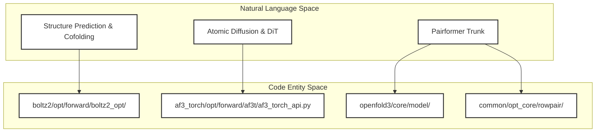
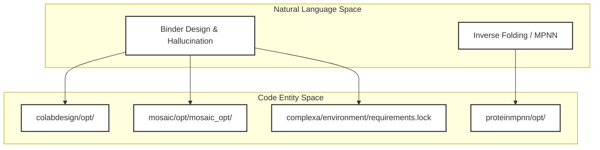
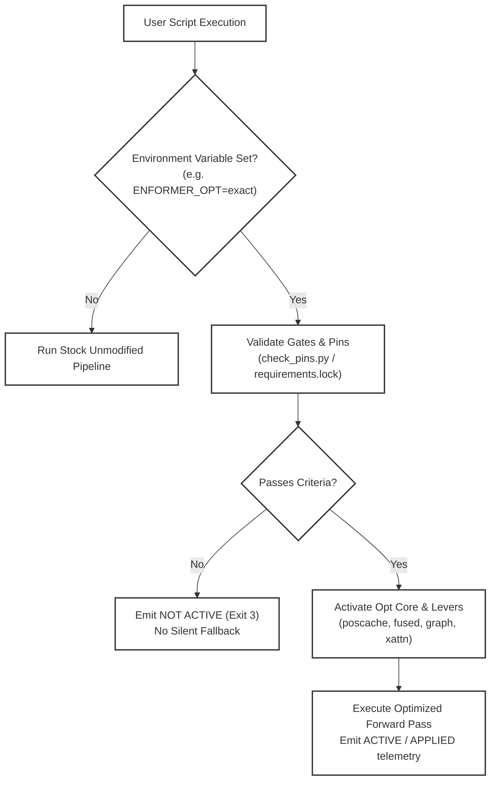

<!-- source: DeepWiki mcp.deepwiki.com · repo anthropics/uplifting-biomolecular-modeling · page 1.3 Kit Catalog by Domain · fetched 2026-10-26 -->

# Kit Catalog by Domain

Relevant source files

The following files were used as context for generating this wiki page:

- [af2ig/CHANGES.md](af2ig/CHANGES.md)
- [af2ig/README.md](af2ig/README.md)
- [af2ig/STOCK.md](af2ig/STOCK.md)
- [af2ig/THIRD_PARTY_NOTICES.md](af2ig/THIRD_PARTY_NOTICES.md)
- [af2ig/opt/af2ig_opt/__init__.py](af2ig/opt/af2ig_opt/__init__.py)
- [af2ig/opt/forward/af2ig_kit/LICENSE](af2ig/opt/forward/af2ig_kit/LICENSE)
- [af2ig/opt/forward/af2ig_kit/MANIFEST.json](af2ig/opt/forward/af2ig_kit/MANIFEST.json)
- [af2ig/opt/forward/af2ig_kit/README.md](af2ig/opt/forward/af2ig_kit/README.md)
- [af2ig/opt/forward/af2ig_kit/upstream/LICENSE.dl_binder_design.MIT.txt](af2ig/opt/forward/af2ig_kit/upstream/LICENSE.dl_binder_design.MIT.txt)
- [af2ig/opt/forward/af2ig_kit/upstream/UPSTREAM.md](af2ig/opt/forward/af2ig_kit/upstream/UPSTREAM.md)
- [af2ig/opt/pyproject.toml](af2ig/opt/pyproject.toml)
- [af2ig/stock/PINS.json](af2ig/stock/PINS.json)
- [af2ig/third_party_licenses/dl_binder_design.MIT.txt](af2ig/third_party_licenses/dl_binder_design.MIT.txt)
- [af2ig/third_party_licenses/silent_tools.MIT.txt](af2ig/third_party_licenses/silent_tools.MIT.txt)
- [af3_jax/README.md](af3_jax/README.md)
- [af3_jax/STOCK.md](af3_jax/STOCK.md)
- [af3_jax/environment/Dockerfile](af3_jax/environment/Dockerfile)
- [af3_jax/opt/af3_jax_opt/__init__.py](af3_jax/opt/af3_jax_opt/__init__.py)
- [af3_jax/opt/pyproject.toml](af3_jax/opt/pyproject.toml)
- [af3_torch/CHANGES.md](af3_torch/CHANGES.md)
- [af3_torch/README.md](af3_torch/README.md)
- [af3_torch/STOCK.md](af3_torch/STOCK.md)
- [af3_torch/environment/Dockerfile](af3_torch/environment/Dockerfile)
- [af3_torch/environment/requirements-jax.lock](af3_torch/environment/requirements-jax.lock)
- [af3_torch/environment/requirements-torch.lock](af3_torch/environment/requirements-torch.lock)
- [af3_torch/opt/af3_torch_opt/__init__.py](af3_torch/opt/af3_torch_opt/__init__.py)
- [af3_torch/opt/af3_torch_opt/big.py](af3_torch/opt/af3_torch_opt/big.py)
- [af3_torch/opt/forward/af3t/README.md](af3_torch/opt/forward/af3t/README.md)
- [af3_torch/opt/forward/af3t/af3_torch/af3_torch_api.py](af3_torch/opt/forward/af3t/af3_torch/af3_torch_api.py)
- [af3_torch/opt/pyproject.toml](af3_torch/opt/pyproject.toml)
- [af3_torch/run.sh](af3_torch/run.sh)
- [atlasfold/THIRD_PARTY_NOTICES.md](atlasfold/THIRD_PARTY_NOTICES.md)
- [atlasfold/stock/src/LICENSE](atlasfold/stock/src/LICENSE)
- [atlasfold/third_party_licenses/AtlasFold.MIT.txt](atlasfold/third_party_licenses/AtlasFold.MIT.txt)
- [boltz2/opt/forward/dit_hoist/LICENSE](boltz2/opt/forward/dit_hoist/LICENSE)
- [boltz2/stock/src/LICENSE](boltz2/stock/src/LICENSE)
- [boltz2/third_party_licenses/Boltz.MIT.txt](boltz2/third_party_licenses/Boltz.MIT.txt)
- [boltz2/third_party_licenses/alphafold3-pytorch.MIT.txt](boltz2/third_party_licenses/alphafold3-pytorch.MIT.txt)
- [chai1/third_party_licenses/ColabFold.MIT.txt](chai1/third_party_licenses/ColabFold.MIT.txt)
- [chai1/third_party_licenses/ESM-fair-esm.MIT.txt](chai1/third_party_licenses/ESM-fair-esm.MIT.txt)
- [chrombpnet/third_party_licenses/bpnet-lite.MIT.txt](chrombpnet/third_party_licenses/bpnet-lite.MIT.txt)
- [chrombpnet/third_party_licenses/pyBigWig.MIT.txt](chrombpnet/third_party_licenses/pyBigWig.MIT.txt)
- [chrombpnet/third_party_licenses/tangermeme.MIT.txt](chrombpnet/third_party_licenses/tangermeme.MIT.txt)
- [colabdesign/STOCK.md](colabdesign/STOCK.md)
- [colabdesign/THIRD_PARTY_NOTICES.md](colabdesign/THIRD_PARTY_NOTICES.md)
- [colabdesign/environment/Dockerfile](colabdesign/environment/Dockerfile)
- [colabdesign/stock/PINS.json](colabdesign/stock/PINS.json)
- [colabdesign/stock/src/bindcraft/LICENSE](colabdesign/stock/src/bindcraft/LICENSE)
- [colabdesign/third_party_licenses/BindCraft.MIT.txt](colabdesign/third_party_licenses/BindCraft.MIT.txt)
- [colabdesign/third_party_licenses/ESM.MIT.txt](colabdesign/third_party_licenses/ESM.MIT.txt)
- [colabfold/STOCK.md](colabfold/STOCK.md)
- [colabfold/THIRD_PARTY_NOTICES.md](colabfold/THIRD_PARTY_NOTICES.md)
- [colabfold/environment/Dockerfile](colabfold/environment/Dockerfile)
- [colabfold/stock/PINS.json](colabfold/stock/PINS.json)
- [colabfold/stock/src/colabfold/LICENSE](colabfold/stock/src/colabfold/LICENSE)
- [colabfold/third_party_licenses/ColabFold.MIT.txt](colabfold/third_party_licenses/ColabFold.MIT.txt)
- [complexa/environment/requirements.lock](complexa/environment/requirements.lock)
- [ef2inv/stock/src/LICENSE.md](ef2inv/stock/src/LICENSE.md)
- [enformer/CHANGES.md](enformer/CHANGES.md)
- [enformer/README.md](enformer/README.md)
- [enformer/STOCK.md](enformer/STOCK.md)
- [enformer/environment/Dockerfile](enformer/environment/Dockerfile)
- [enformer/environment/apptainer.def](enformer/environment/apptainer.def)
- [enformer/opt/enformer_opt/__init__.py](enformer/opt/enformer_opt/__init__.py)
- [enformer/opt/enformer_opt/__main__.py](enformer/opt/enformer_opt/__main__.py)
- [enformer/opt/enformer_opt/_runtime.py](enformer/opt/enformer_opt/_runtime.py)
- [enformer/opt/forward/enformer_kit/engines/enformer/kits/v0_2/__init__.py](enformer/opt/forward/enformer_kit/engines/enformer/kits/v0_2/__init__.py)
- [enformer/opt/pyproject.toml](enformer/opt/pyproject.toml)
- [enformer/run.sh](enformer/run.sh)
- [enformer/stock/src/LICENSE](enformer/stock/src/LICENSE)
- [enformer/third_party_licenses/enformer-pytorch.MIT.txt](enformer/third_party_licenses/enformer-pytorch.MIT.txt)
- [enformer_deepmind/CHANGES.md](enformer_deepmind/CHANGES.md)
- [enformer_deepmind/README.md](enformer_deepmind/README.md)
- [enformer_deepmind/STOCK.md](enformer_deepmind/STOCK.md)
- [enformer_deepmind/environment/Dockerfile](enformer_deepmind/environment/Dockerfile)
- [enformer_deepmind/opt/enformer_deepmind_opt/__init__.py](enformer_deepmind/opt/enformer_deepmind_opt/__init__.py)
- [enformer_deepmind/opt/enformer_deepmind_opt/__main__.py](enformer_deepmind/opt/enformer_deepmind_opt/__main__.py)
- [enformer_deepmind/opt/enformer_deepmind_opt/_runtime.py](enformer_deepmind/opt/enformer_deepmind_opt/_runtime.py)
- [enformer_deepmind/opt/enformer_deepmind_opt/ops/BUILD.json](enformer_deepmind/opt/enformer_deepmind_opt/ops/BUILD.json)
- [enformer_deepmind/opt/enformer_deepmind_opt/ops/README.md](enformer_deepmind/opt/enformer_deepmind_opt/ops/README.md)
- [enformer_deepmind/opt/enformer_deepmind_opt/ops/__init__.py](enformer_deepmind/opt/enformer_deepmind_opt/ops/__init__.py)
- [enformer_deepmind/opt/enformer_deepmind_opt/ops/build.sh](enformer_deepmind/opt/enformer_deepmind_opt/ops/build.sh)
- [enformer_deepmind/opt/enformer_deepmind_opt/ops/edm_layernorm.cu.cc](enformer_deepmind/opt/enformer_deepmind_opt/ops/edm_layernorm.cu.cc)
- [enformer_deepmind/opt/pyproject.toml](enformer_deepmind/opt/pyproject.toml)
- [enformer_deepmind/run.sh](enformer_deepmind/run.sh)
- [esm_if1/stock/src/LICENSE](esm_if1/stock/src/LICENSE)
- [esm_if1/third_party_licenses/fair-esm.MIT.txt](esm_if1/third_party_licenses/fair-esm.MIT.txt)
- [evo2/opt/evo2_opt/cli.py](evo2/opt/evo2_opt/cli.py)
- [mosaic/opt/mosaic_opt/licenses/LICENSE.boltz-escalante-fork-1acc397b.MIT.txt](mosaic/opt/mosaic_opt/licenses/LICENSE.boltz-escalante-fork-1acc397b.MIT.txt)
- [mosaic/opt/mosaic_opt/licenses/LICENSE.joltz-ed0f0425.MIT.txt](mosaic/opt/mosaic_opt/licenses/LICENSE.joltz-ed0f0425.MIT.txt)
- [mosaic/opt/mosaic_opt/licenses/LICENSE.mosaic-70fec525.MIT.txt](mosaic/opt/mosaic_opt/licenses/LICENSE.mosaic-70fec525.MIT.txt)
- [mosaic/stock/src/boltz/LICENSE](mosaic/stock/src/boltz/LICENSE)
- [mosaic/stock/src/joltz/LICENSE](mosaic/stock/src/joltz/LICENSE)
- [mosaic/stock/src/joltz/NOTICE](mosaic/stock/src/joltz/NOTICE)
- [mosaic/stock/src/mosaic/LICENSE](mosaic/stock/src/mosaic/LICENSE)
- [mosaic/third_party_licenses/AlphaFold.NOTICE.txt](mosaic/third_party_licenses/AlphaFold.NOTICE.txt)
- [mosaic/third_party_licenses/ColabFold.MIT.txt](mosaic/third_party_licenses/ColabFold.MIT.txt)
- [mosaic/third_party_licenses/alphafold3-pytorch.MIT.txt](mosaic/third_party_licenses/alphafold3-pytorch.MIT.txt)
- [mosaic/third_party_licenses/boltz.MIT.txt](mosaic/third_party_licenses/boltz.MIT.txt)
- [mosaic/third_party_licenses/joltz.MIT.txt](mosaic/third_party_licenses/joltz.MIT.txt)
- [mosaic/third_party_licenses/joltz.NOTICE.txt](mosaic/third_party_licenses/joltz.NOTICE.txt)
- [mosaic/third_party_licenses/mosaic.MIT.txt](mosaic/third_party_licenses/mosaic.MIT.txt)
- [progen2/opt/forward/engines/progen2/kits/v0_ew/ext.py](progen2/opt/forward/engines/progen2/kits/v0_ew/ext.py)
- [rfdiffusion3/third_party_licenses/neurips19-graph-protein-design.MIT.txt](rfdiffusion3/third_party_licenses/neurips19-graph-protein-design.MIT.txt)
- [rosettafold3/third_party_licenses/neurips19-graph-protein-design.MIT.txt](rosettafold3/third_party_licenses/neurips19-graph-protein-design.MIT.txt)

## Purpose and Scope

This page provides a comprehensive catalog of the 36 drop-in inference optimization kits contained within the repository. The repository organizes performance acceleration modules around distinct upstream biomolecular machine learning tools. Each kit follows a standardized dual layout (`stock/` for immutable reference code and `opt/` for optimized forward packs) and integrates with the shared runtime core (`common/opt_core`) [.gitmodules:1-30](). 

This catalog categorizes the kits into four major functional domains:
1. **Structure Prediction and Cofolding** (multimer structure prediction, atomic diffusion, and pairformer networks)
2. **Protein and Genomic Design** (inverse folding, hallucination, and binder design)
3. **Protein and Genomic Language Models** (autoregressive language models, masked LMs, and evolutionary models)
4. **Genomics Regression and Epigenomics** (sequence-to-activity tracks, chromatin accessibility, and expression predictors)

Sources: [.gitmodules:1-30]()

---

## 1. Structure Prediction and Cofolding Domain

Structure prediction kits optimize large-scale biophysical pipelines, replacing slow triangular operations, pairformers, and diffusion transformers with accelerated CUDA/Triton kernels or XLA compilation paths.

### Kit Directory Index

| Kit Name | Directory Path | Upstream Model / Target | Primary Acceleration Strategy |
| :--- | :--- | :--- | :--- |
| `boltz2` | `boltz2/` | Boltz-2 biomolecular cofolding | `dit_hoist`, `pairfuse`, graph execution |
| `af3_torch` | `af3_torch/` | AlphaFold 3 (PyTorch port) | `af3t` xfold, fused attention, kernel caching |
| `af3_jax` | `af3_jax/` | AlphaFold 3 (JAX / OpenFold3 base) | `rowpair` sharding, Pallas kernels |
| `chai1` | `chai1/` | Chai-1 structure prediction | ESM integration, optimized pairbias attention |
| `openfold3` | `openfold3/` | OpenFold3 architecture | Custom cell compiler, fast triangle multiplication |
| `protenix` | `protenix/` | Protenix multimer predictor | `FlashPairformer`, memory-efficient trunk |
| `rf3` | `rf3/` | RoseTTAFold3 | `xattempt`, fast DiT execution |
| `atlasfold` | `atlasfold/` | AtlasFold pipeline | Hook-based attention substitution |

### Domain Architecture and Code Mapping

The following diagram bridges the high-level natural language domain concepts (structure prediction, pairformers, diffusion) to the concrete code entities and package modules implementing them in the repository.

Sources: [af3_torch/opt/forward/af3t/af3_torch_api.py:1-40](), [boltz2/stock/src/LICENSE:1-21]()

---

## 2. Protein and Genomic Design Domain

Design kits target inverse folding, sequence optimization, binder design, and conditional structure generation, accelerating sampling loops and score evaluations.

### Kit Directory Index

| Kit Name | Directory Path | Upstream Model / Target | Primary Acceleration Strategy |
| :--- | :--- | :--- | :--- |
| `colabdesign` | `colabdesign/` | ColabDesign (AlphaFold2 / ESM) | Custom JAX kernels, `hoist_prev`, `txla` |
| `af2ig` | `af2ig/` | AlphaFold2 Inverse Genetics / DL_BinderDesign | Patched upstream files, `silent_tools` integration |
| `proteinmpnn` | `proteinmpnn/` | ProteinMPNN sequence design | Exact worker pool acceleration, batched graph forward |
| `rfdiffusion1` | `rfdiffusion1/` | RFdiffusion (v1) | Optimized SE(3) transformer blocks |
| `rfdiffusion3` | `rfdiffusion3/` | RFdiffusion3 | Accelerated diffusion schedule & graph caching |
| `caliby` | `caliby/` | Caliby design scoring | Streamlined scoring datapath |
| `mosaic` | `mosaic/` | Mosaic / Joltz design suite | `joltz` tensor optimizations |
| `genie3` | `genie3/` | Genie3 generative backbone | JIT-compiled backbone generation loops |
| `complexa` | `complexa/` | Proteina-Complexa | Colabdesign community model integration |

### Design Optimization Mapping

Sources: [mosaic/opt/mosaic_opt/licenses/LICENSE.joltz-ed0f0425.MIT.txt:1-21](), [complexa/environment/requirements.lock:30-45]()

---

## 3. Protein and Genomic Language Models Domain

Language model kits optimize large transformer and state-space model architectures for sequence representation, generation, and variant effect prediction.

### Kit Directory Index

| Kit Name | Directory Path | Upstream Model / Target | Primary Acceleration Strategy |
| :--- | :--- | :--- | :--- |
| `esmfold2` | `esmfold2/` | ESMFold v2 | `fast_inference` drivers, customized trunk attention |
| `esmc` | `esmc/` | ESM-C (Evolutionary Scale Cambrium) | Optimized transformer blocks, FlashAttention integration |
| `progen2` | `progen2/` | ProGen2 protein language model | Engine kits, causal mask acceleration |
| `evo2` | `evo2/` | Evo2 genomic StripedHyena / 7B model | `kfft`, `rmsnorm`, speculative decoding (`specdec`) |
| `esm_if1` | `esm_if1/` | ESM-IF1 inverse folding model | Fused GVP (Geometric Vector Perceptron) layers |

### Language Model Execution Flow

Language model kits override upstream inference functions via dynamic runtime monkey-patching or wrapper classes when activated via environment variables (e.g., `ESMFOLD2_OPT`).

Sources: [enformer/README.md:1-15](), [enformer/STOCK.md:1-25]()

---

## 4. Genomics Regression and Epigenomics Domain

Genomics regression kits focus on high-throughput sequence-to-function models predicting epigenetic marks, transcription factor binding, and gene expression.

### Kit Directory Index

| Kit Name | Directory Path | Upstream Model / Target | Primary Acceleration Strategy |
| :--- | :--- | :--- | :--- |
| `enformer` | `enformer/` | Enformer (PyTorch release) | Positional cache, fused attention, CUDA graphs (`poscache`, `fused`, `graph`, `xattn`) |
| `enformer_deepmind` | `enformer_deepmind/` | Enformer (TensorFlow Hub release) | SavedModel optimization, custom op library |
| `borzoi` | `borzoi/` | Borzoi large-window expression model | Datapath sharding, memory slab reuse |
| `flashzoi` | `flashzoi/` | Flashzoi accelerated Borzoi/Enformer variant | `kits_v1_25` Triton operator fusion |
| `chrombpnet` | `chrombpnet/` | ChromBPNet accessibility predictor | Torch/TF dual kits, prebuilt Triton caches |

### Genomics Activation and Runtime Verification

The initialization and activation flow for genomics regression kits (such as `enformer` and `enformer_deepmind`) follows the strict activation gate contract:

Sources: [enformer/README.md:60-103](), [enformer_deepmind/README.md:50-70](), [enformer_deepmind/STOCK.md:50-61]()

---

## Shared Runtime Integration Across Domains

Regardless of the functional domain, all 36 kits rely on the uniform interfaces provided by `common/opt_core/`. The following table details the common behavioral components shared across domains:

| Component | Target Module | Domain Application |
| :--- | :--- | :--- |
| **Mode Resolution** | `common/opt_core/modes.py` | Resolves `off`, `exact`, `fast`, `big` across all kits |
| **Kernel Provider Tables** | `common/opt_core/kernels/` | Manages APB cell tables, Refusal states, and fallback ABIs |
| **Rowpair Sharding** | `common/opt_core/rowpair/` | Memory distribution for multi-GPU structure prediction |
| **Pin Verification** | `stock/check_pins.py` | Cryptographic SHA256 validation of upstream weights and code snapshots |

Sources: [enformer_deepmind/STOCK.md:1-15](), [complexa/environment/requirements.lock:1-15]()

---

