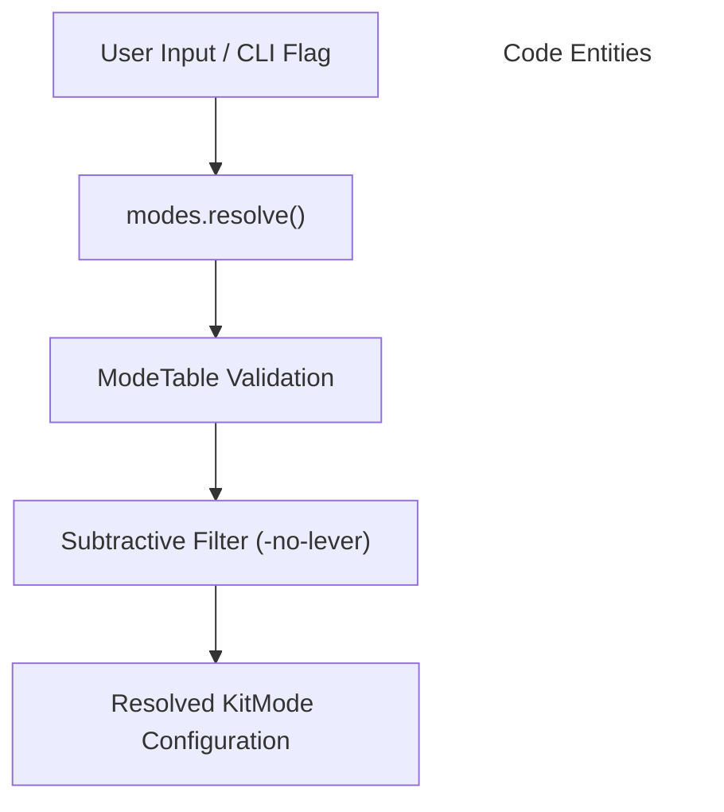
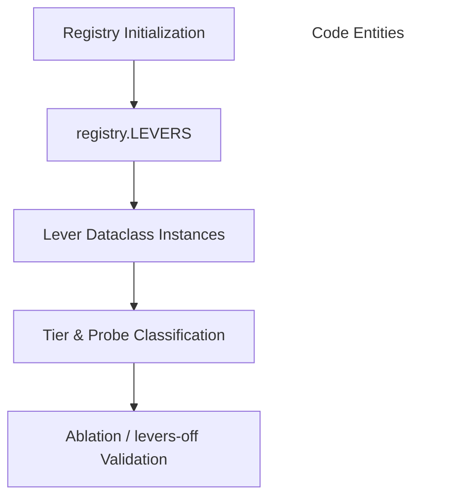
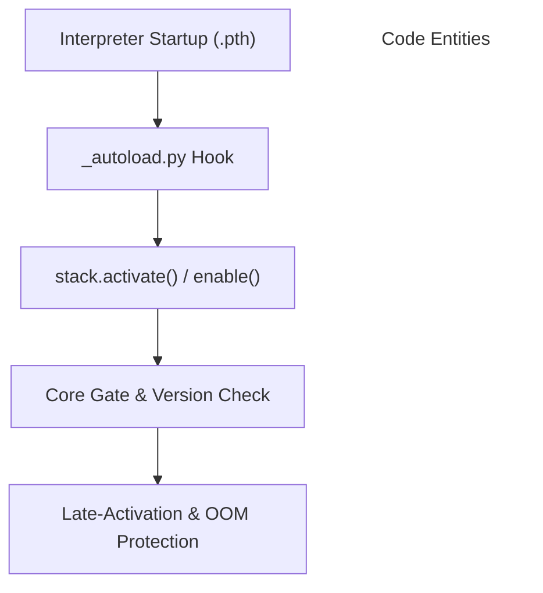
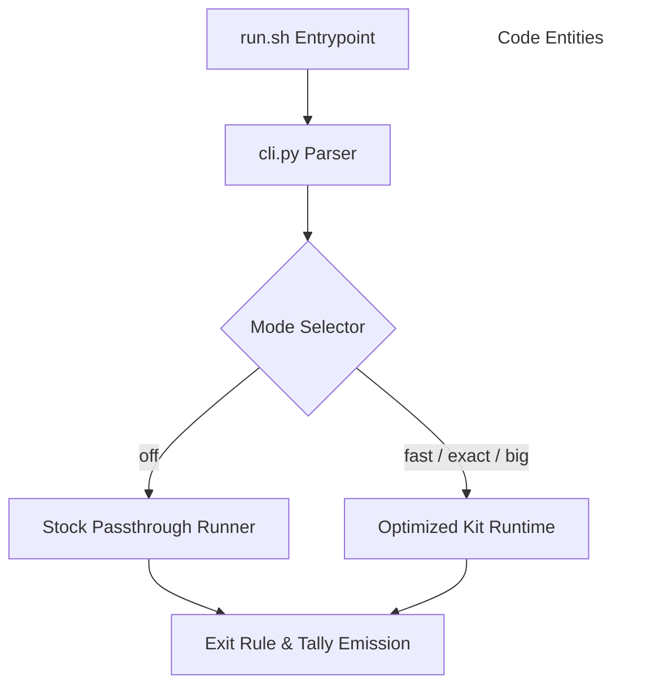
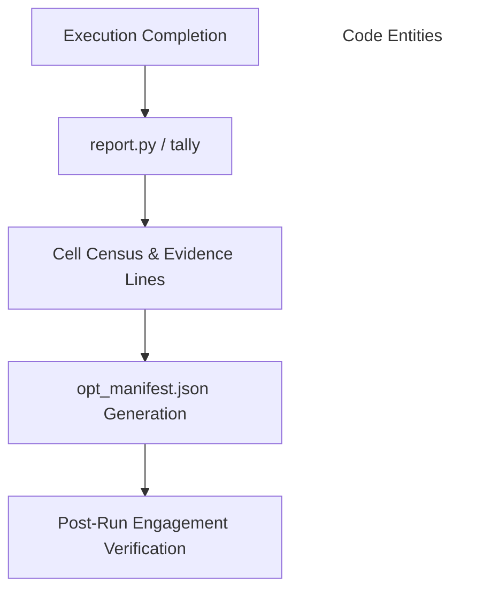

<!-- source: DeepWiki mcp.deepwiki.com · repo anthropics/uplifting-biomolecular-modeling · page 2 Kit Runtime Architecture · fetched 2026-10-26 -->

# Kit Runtime Architecture

Relevant source files

The following files were used as context for generating this wiki page:

- [af3_torch/opt/af3_torch_opt/tests/test_install_verb.py](af3_torch/opt/af3_torch_opt/tests/test_install_verb.py)
- [boltz2/opt/boltz2_opt/tests/test_worker_attach_stubbed.py](boltz2/opt/boltz2_opt/tests/test_worker_attach_stubbed.py)
- [boltz2/opt/boltz2_opt/worker_launch.py](boltz2/opt/boltz2_opt/worker_launch.py)
- [boltzgen/opt/boltzgen_opt/stack.py](boltzgen/opt/boltzgen_opt/stack.py)
- [boltzgen/opt/boltzgen_opt/tests/test_install_verb.py](boltzgen/opt/boltzgen_opt/tests/test_install_verb.py)
- [borzoi/opt/borzoi_opt/modes.py](borzoi/opt/borzoi_opt/modes.py)
- [chai1/opt/chai1_opt/stack.py](chai1/opt/chai1_opt/stack.py)
- [chai1/opt/chai1_opt/tests/test_triattn_core.py](chai1/opt/chai1_opt/tests/test_triattn_core.py)
- [chrombpnet/opt/chrombpnet_opt/stack.py](chrombpnet/opt/chrombpnet_opt/stack.py)
- [colabdesign/opt/colabdesign_opt/stack.py](colabdesign/opt/colabdesign_opt/stack.py)
- [colabdesign/opt/colabdesign_opt/tests/test_ablation.py](colabdesign/opt/colabdesign_opt/tests/test_ablation.py)
- [colabdesign/opt/colabdesign_opt/tests/test_activation.py](colabdesign/opt/colabdesign_opt/tests/test_activation.py)
- [colabfold/opt/colabfold_opt/tests/test_core_older.py](colabfold/opt/colabfold_opt/tests/test_core_older.py)
- [colabfold/opt/colabfold_opt/tests/test_n_gpu.py](colabfold/opt/colabfold_opt/tests/test_n_gpu.py)
- [colabfold/opt/colabfold_opt/tests/test_no_model_run.py](colabfold/opt/colabfold_opt/tests/test_no_model_run.py)
- [colabfold/opt/colabfold_opt/tests/test_run_sh.py](colabfold/opt/colabfold_opt/tests/test_run_sh.py)
- [common/opt_core/opt_core/gates.py](common/opt_core/opt_core/gates.py)
- [common/opt_core/opt_core/instances.py](common/opt_core/opt_core/instances.py)
- [e1/opt/e1_opt/stack.py](e1/opt/e1_opt/stack.py)
- [enformer/opt/enformer_opt/tests/test_binary_sums.py](enformer/opt/enformer_opt/tests/test_binary_sums.py)
- [esmc/opt/esmc_opt/stack.py](esmc/opt/esmc_opt/stack.py)
- [esmfold2/opt/esmfold2_opt/stack.py](esmfold2/opt/esmfold2_opt/stack.py)
- [esmfold2/opt/esmfold2_opt/tests/test_fast_subset_big.py](esmfold2/opt/esmfold2_opt/tests/test_fast_subset_big.py)
- [esmfold2/opt/esmfold2_opt/tests/test_rowchunk_floor.py](esmfold2/opt/esmfold2_opt/tests/test_rowchunk_floor.py)
- [flashzoi/opt/flashzoi_opt/stack.py](flashzoi/opt/flashzoi_opt/stack.py)
- [genie3/opt/genie3_opt/stack.py](genie3/opt/genie3_opt/stack.py)
- [gpnstar/opt/gpnstar_opt/stack.py](gpnstar/opt/gpnstar_opt/stack.py)
- [gpnstar/opt/gpnstar_opt/tests/test_gpn_probe.py](gpnstar/opt/gpnstar_opt/tests/test_gpn_probe.py)
- [mosaic/opt/mosaic_opt/stack.py](mosaic/opt/mosaic_opt/stack.py)
- [opendde/opt/opendde_opt/stack.py](opendde/opt/opendde_opt/stack.py)
- [openfold3/opt/openfold3_opt/env.py](openfold3/opt/openfold3_opt/env.py)
- [openfold3/stock/src/openfold3/tests/test_sequence_local_atom_attention.py](openfold3/stock/src/openfold3/tests/test_sequence_local_atom_attention.py)
- [openfold3_ob0/opt/openfold3_ob0_opt/__init__.py](openfold3_ob0/opt/openfold3_ob0_opt/__init__.py)
- [openfold3_ob0/stock/src/openfold3/tests/test_heads.py](openfold3_ob0/stock/src/openfold3/tests/test_heads.py)
- [openfold3_ob0/stock/src/openfold3/tests/test_sequence_local_atom_attention.py](openfold3_ob0/stock/src/openfold3/tests/test_sequence_local_atom_attention.py)
- [progen2/opt/progen2_opt/stack.py](progen2/opt/progen2_opt/stack.py)
- [proteinmpnn/opt/proteinmpnn_opt/stack.py](proteinmpnn/opt/proteinmpnn_opt/stack.py)
- [proteinmpnn/opt/proteinmpnn_opt/tests/test_itemtime.py](proteinmpnn/opt/proteinmpnn_opt/tests/test_itemtime.py)
- [protenix_v1/opt/protenix_v1_opt/big.py](protenix_v1/opt/protenix_v1_opt/big.py)
- [protenix_v1/opt/protenix_v1_opt/stack.py](protenix_v1/opt/protenix_v1_opt/stack.py)
- [protenix_v2/opt/protenix_opt/big.py](protenix_v2/opt/protenix_opt/big.py)
- [protenix_v2/opt/protenix_opt/cli.py](protenix_v2/opt/protenix_opt/cli.py)
- [protenix_v2/opt/protenix_opt/stack.py](protenix_v2/opt/protenix_opt/stack.py)
- [protenix_v2/opt/protenix_opt/tests/test_a100_rows.py](protenix_v2/opt/protenix_opt/tests/test_a100_rows.py)
- [protenix_v2/opt/protenix_opt/tests/test_supported_gpu.py](protenix_v2/opt/protenix_opt/tests/test_supported_gpu.py)
- [protenix_v2/opt/protenix_opt/tests/test_triatt_exact.py](protenix_v2/opt/protenix_opt/tests/test_triatt_exact.py)
- [protenix_v2/opt/protenix_opt/tests/test_triatt_procuda.py](protenix_v2/opt/protenix_opt/tests/test_triatt_procuda.py)
- [pxdesign/opt/pxdesign_opt/stack.py](pxdesign/opt/pxdesign_opt/stack.py)
- [rfdiffusion1/opt/rfdiffusion1_opt/stack.py](rfdiffusion1/opt/rfdiffusion1_opt/stack.py)
- [rfdiffusion3/opt/rfdiffusion3_opt/stack.py](rfdiffusion3/opt/rfdiffusion3_opt/stack.py)
- [rfdiffusion3/opt/rfdiffusion3_opt/tests/test_config_runsh.py](rfdiffusion3/opt/rfdiffusion3_opt/tests/test_config_runsh.py)
- [rosettafold3/opt/rosettafold3_opt/stack.py](rosettafold3/opt/rosettafold3_opt/stack.py)

The Kit Runtime Architecture defines the standardized lifecycle through which 36 inference optimization kits engage upstream biomolecular modeling tools. This architecture governs how user-facing execution modes translate into specific kernel transformations, enforces safety and version gates at interpreter start, manages kit CLIs with pristine stock fallback options, and records post-run evidence into structured telemetry manifests.

For a detailed breakdown of individual mechanisms, refer to the child pages linked throughout this overview.

---

## 2.1 Modes and Mode Resolution

Kits operate under a common set of execution modes defined in the shared vocabulary: `off`, `exact`, `fast`, and `big`. Mode resolution parses environment variables (such as `<KIT>_OPT`) or command-line flags through `modes.resolve()`, evaluating subtractive patterns (e.g., `<mode>-no-<lever>`) and verifying compatibility via `ModeTable` and locking tests [colabdesign/opt/colabdesign_opt/tests/test_ablation.py:1-7]().

For deep technical details, implementation specifics of `ModeTable`, and mode locking tests, see [Modes and Mode Resolution](#2.1).

Sources: `colabdesign/opt/colabdesign_opt/tests/test_ablation.py:1-7`, `colabdesign/opt/colabdesign_opt/stack.py:35-53`

---

## 2.2 Lever Registries and Ablation

Every kit maintains a `LEVERS` registry populated with `Lever` dataclass instances. Levers are categorized into classes—such as forward, datapath, serving, and orchestration—and assigned precision tiers. The system supports probe grammars, targeted ablation, and "levers-off" testing to measure speedups against baseline implementations [colabdesign/opt/colabdesign_opt/tests/test_ablation.py:1-6]().

For detailed coverage of the `Lever` dataclass, registry structures, tier assignments, probe grammars, and ablation testing, see [Lever Registries and Ablation](#2.2).

Sources: `colabdesign/opt/colabdesign_opt/tests/test_ablation.py:1-6`

---

## 2.3 Activation, Gates and Autoload

Kit activation relies on routines like `stack.activate()` and `stack.enable()`, protected by late-activation detection mechanisms and core gate version floors [boltzgen/opt/boltzgen_opt/stack.py:1-34](). Automatic loading is achieved via `.pth` autoload hooks and `sitecustomize` modules [colabdesign/opt/colabdesign_opt/tests/test_activation.py:1-7](). These mechanisms operate in both in-process and subprocess modes while enforcing fail-loud behaviors upon out-of-memory (OOM) conditions or core mismatches.

For deep technical documentation on `.pth` hooks, late-activation rules, core gate version constraints, and OOM handling, see [Activation, Gates and Autoload](#2.3).

Sources: `colabdesign/opt/colabdesign_opt/tests/test_activation.py:1-7`, `boltzgen/opt/boltzgen_opt/stack.py:1-34`

---

## 2.4 Kit CLIs and Stock Routes

Each kit exposes a uniform command-line interface structured around `cli.py` and `run.sh` entry points [colabfold/opt/colabfold_opt/tests/test_run_sh.py:1-3](). Stock passthrough runners (`stock_*`) guarantee that running a kit with optimizations disabled (`off`) remains byte-for-byte pristine compared to upstream distributions. Exit rules handle clean termination, error codes, and tally emission [colabfold/opt/colabfold_opt/tests/test_no_model_run.py:1-10]().

For detailed implementation structures of per-kit CLIs, stock passthrough execution, and exit validation rules, see [Kit CLIs and Stock Routes](#2.4).

Sources: `colabfold/opt/colabfold_opt/tests/test_run_sh.py:1-3`, `colabfold/opt/colabfold_opt/tests/test_no_model_run.py:1-10`

---

## 2.5 Reporting, Manifests and Evidence

Post-run validation and provenance tracking are handled by `report.py`, tally generators, and `opt_manifest.json` generation [colabfold/opt/colabfold_opt/tests/test_no_model_run.py:60-75](). Cell censuses, evidence lines, and lever-line test suites verify that optimizations successfully engaged during execution rather than silently falling back to stock operators.

For comprehensive details on telemetry reporting, manifest schemas (`opt_manifest.json`), and post-run evidence verification, see [Reporting, Manifests and Evidence](#2.5).

Sources: `colabfold/opt/colabfold_opt/tests/test_no_model_run.py:60-75`

---

