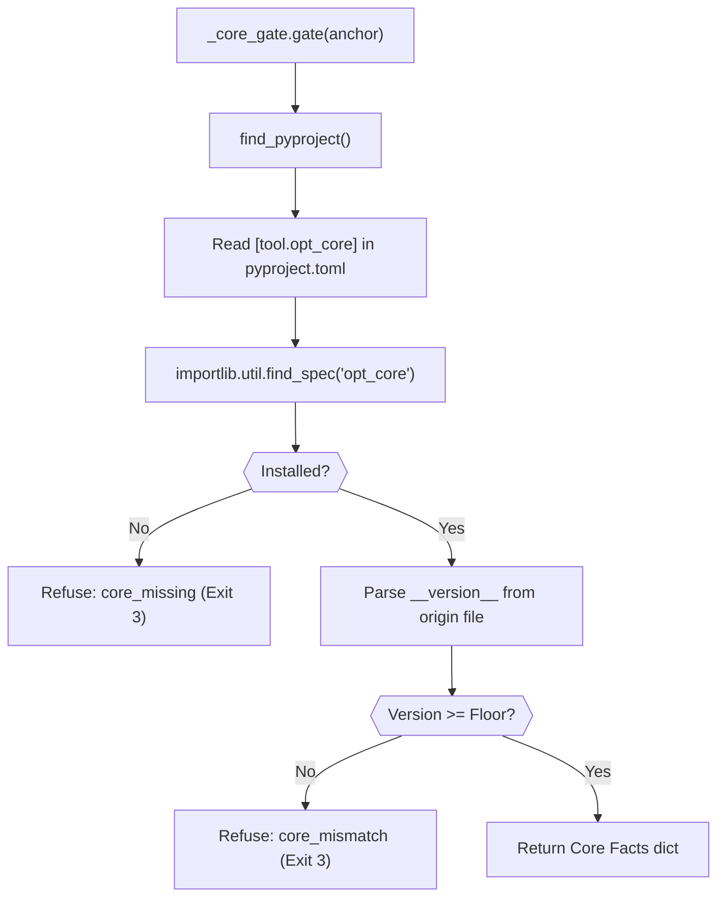
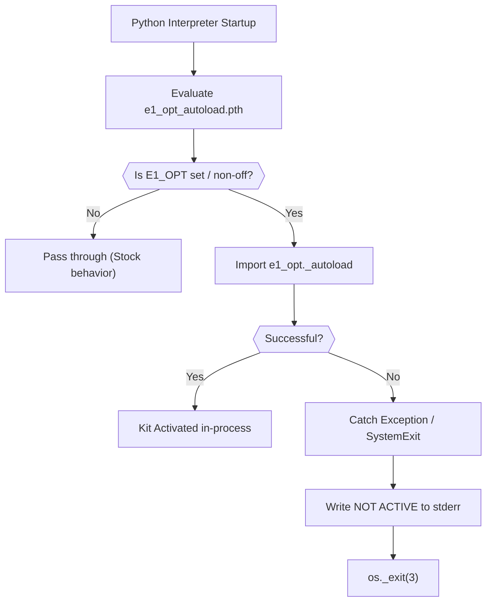

<!-- source: DeepWiki mcp.deepwiki.com · repo anthropics/uplifting-biomolecular-modeling · page 2.3 Activation, Gates and Autoload · fetched 2026-10-26 -->

# Activation, Gates and Autoload

Relevant source files

The following files were used as context for generating this wiki page:

- [af2ig/opt/af2ig_opt/_core_gate.py](af2ig/opt/af2ig_opt/_core_gate.py)
- [af3_jax/opt/af3_jax_opt/_autoload.py](af3_jax/opt/af3_jax_opt/_autoload.py)
- [af3_jax/opt/af3_jax_opt/_core_gate.py](af3_jax/opt/af3_jax_opt/_core_gate.py)
- [af3_jax/opt/af3_jax_opt/tests/test_run_sh.py](af3_jax/opt/af3_jax_opt/tests/test_run_sh.py)
- [af3_jax/opt/af3_jax_opt_autoload.pth](af3_jax/opt/af3_jax_opt_autoload.pth)
- [af3_torch/opt/af3_torch_opt/_autoload.py](af3_torch/opt/af3_torch_opt/_autoload.py)
- [af3_torch/opt/af3_torch_opt/_core_gate.py](af3_torch/opt/af3_torch_opt/_core_gate.py)
- [af3_torch/opt/af3_torch_opt/tests/test_run_sh.py](af3_torch/opt/af3_torch_opt/tests/test_run_sh.py)
- [af3_torch/opt/af3_torch_opt_autoload.pth](af3_torch/opt/af3_torch_opt_autoload.pth)
- [atlasfold/opt/atlasfold_opt/_core_gate.py](atlasfold/opt/atlasfold_opt/_core_gate.py)
- [atlasfold/opt/atlasfold_opt_autoload.pth](atlasfold/opt/atlasfold_opt_autoload.pth)
- [boltz2/opt/boltz2_opt/_autoload.py](boltz2/opt/boltz2_opt/_autoload.py)
- [boltz2/opt/boltz2_opt/_core_gate.py](boltz2/opt/boltz2_opt/_core_gate.py)
- [boltz2/opt/boltz2_opt/tests/test_rf6_pth_gate.py](boltz2/opt/boltz2_opt/tests/test_rf6_pth_gate.py)
- [boltz2/opt/boltz2_opt/tests/test_worker_attach_stubbed.py](boltz2/opt/boltz2_opt/tests/test_worker_attach_stubbed.py)
- [boltz2/opt/boltz2_opt/worker_launch.py](boltz2/opt/boltz2_opt/worker_launch.py)
- [boltz2/opt/boltz2_opt_autoload.pth](boltz2/opt/boltz2_opt_autoload.pth)
- [boltzgen/opt/boltzgen_opt/_autoload.py](boltzgen/opt/boltzgen_opt/_autoload.py)
- [boltzgen/opt/boltzgen_opt/_core_gate.py](boltzgen/opt/boltzgen_opt/_core_gate.py)
- [boltzgen/opt/boltzgen_opt/stack.py](boltzgen/opt/boltzgen_opt/stack.py)
- [boltzgen/opt/boltzgen_opt_autoload.pth](boltzgen/opt/boltzgen_opt_autoload.pth)
- [borzoi/opt/borzoi_opt/modes.py](borzoi/opt/borzoi_opt/modes.py)
- [borzoi/opt/borzoi_opt_autoload.pth](borzoi/opt/borzoi_opt_autoload.pth)
- [caliby/opt/caliby_opt/_core_gate.py](caliby/opt/caliby_opt/_core_gate.py)
- [caliby/opt/caliby_opt_autoload.pth](caliby/opt/caliby_opt_autoload.pth)
- [chai1/opt/chai1_opt/__init__.py](chai1/opt/chai1_opt/__init__.py)
- [chai1/opt/chai1_opt/_autoload.py](chai1/opt/chai1_opt/_autoload.py)
- [chai1/opt/chai1_opt/_core_gate.py](chai1/opt/chai1_opt/_core_gate.py)
- [chai1/opt/chai1_opt/stack.py](chai1/opt/chai1_opt/stack.py)
- [chai1/opt/chai1_opt_autoload.pth](chai1/opt/chai1_opt_autoload.pth)
- [chrombpnet/opt/chrombpnet_opt/__init__.py](chrombpnet/opt/chrombpnet_opt/__init__.py)
- [chrombpnet/opt/chrombpnet_opt/_autoload.py](chrombpnet/opt/chrombpnet_opt/_autoload.py)
- [chrombpnet/opt/chrombpnet_opt/cli.py](chrombpnet/opt/chrombpnet_opt/cli.py)
- [chrombpnet/opt/chrombpnet_opt/report.py](chrombpnet/opt/chrombpnet_opt/report.py)
- [chrombpnet/opt/chrombpnet_opt/stack.py](chrombpnet/opt/chrombpnet_opt/stack.py)
- [chrombpnet/opt/chrombpnet_opt_autoload.pth](chrombpnet/opt/chrombpnet_opt_autoload.pth)
- [chrombpnet/opt/kit/torch/chrombpnet_k1/_oom.py](chrombpnet/opt/kit/torch/chrombpnet_k1/_oom.py)
- [chrombpnet/opt/kit_ho/tf/chrombpnet_fastkit/_oom.py](chrombpnet/opt/kit_ho/tf/chrombpnet_fastkit/_oom.py)
- [colabdesign/opt/colabdesign_opt/_core_gate.py](colabdesign/opt/colabdesign_opt/_core_gate.py)
- [colabdesign/opt/colabdesign_opt/stack.py](colabdesign/opt/colabdesign_opt/stack.py)
- [colabfold/opt/colabfold_opt/_core_gate.py](colabfold/opt/colabfold_opt/_core_gate.py)
- [colabfold/opt/colabfold_opt/tests/test_env_route_pth.py](colabfold/opt/colabfold_opt/tests/test_env_route_pth.py)
- [common/opt_core/kit_template/_core_gate.py](common/opt_core/kit_template/_core_gate.py)
- [common/opt_core/opt_core/gates.py](common/opt_core/opt_core/gates.py)
- [common/opt_core/opt_core/instances.py](common/opt_core/opt_core/instances.py)
- [common/opt_core/opt_core/oom.py](common/opt_core/opt_core/oom.py)
- [common/opt_core/tests/test_oom.py](common/opt_core/tests/test_oom.py)
- [complexa/opt/complexa_opt/_core_gate.py](complexa/opt/complexa_opt/_core_gate.py)
- [complexa/opt/complexa_opt_autoload.pth](complexa/opt/complexa_opt_autoload.pth)
- [e1/opt/e1_opt/stack.py](e1/opt/e1_opt/stack.py)
- [e1/opt/e1_opt_autoload.pth](e1/opt/e1_opt_autoload.pth)
- [ef2inv/opt/ef2inv_opt/_core_gate.py](ef2inv/opt/ef2inv_opt/_core_gate.py)
- [enformer/opt/enformer_opt_autoload.pth](enformer/opt/enformer_opt_autoload.pth)
- [enformer_deepmind/opt/enformer_deepmind_opt_autoload.pth](enformer_deepmind/opt/enformer_deepmind_opt_autoload.pth)
- [esm_if1/opt/esm_if1_opt/_core_gate.py](esm_if1/opt/esm_if1_opt/_core_gate.py)
- [esmc/opt/esmc_opt/_oom.py](esmc/opt/esmc_opt/_oom.py)
- [esmc/opt/esmc_opt/stack.py](esmc/opt/esmc_opt/stack.py)
- [esmc/opt/esmc_opt/tests/test_oom.py](esmc/opt/esmc_opt/tests/test_oom.py)
- [esmc/opt/esmc_opt_autoload.pth](esmc/opt/esmc_opt_autoload.pth)
- [esmfold2/opt/esmfold2_opt/_core_gate.py](esmfold2/opt/esmfold2_opt/_core_gate.py)
- [esmfold2/opt/esmfold2_opt/stack.py](esmfold2/opt/esmfold2_opt/stack.py)
- [esmfold2/opt/esmfold2_opt/tests/test_oom_fail_loud.py](esmfold2/opt/esmfold2_opt/tests/test_oom_fail_loud.py)
- [esmfold2/opt/esmfold2_opt_autoload.pth](esmfold2/opt/esmfold2_opt_autoload.pth)
- [evo2/opt/evo2_opt/_oom.py](evo2/opt/evo2_opt/_oom.py)
- [evo2/opt/evo2_opt_autoload.pth](evo2/opt/evo2_opt_autoload.pth)
- [flashzoi/opt/flashzoi_opt/stack.py](flashzoi/opt/flashzoi_opt/stack.py)
- [flashzoi/opt/flashzoi_opt/tests/test_oom_fail_loud.py](flashzoi/opt/flashzoi_opt/tests/test_oom_fail_loud.py)
- [flashzoi/opt/flashzoi_opt_autoload.pth](flashzoi/opt/flashzoi_opt_autoload.pth)
- [flashzoi/opt/forward/kits_v1_25/engines/flashzoi/kits/v1_25/_oom.py](flashzoi/opt/forward/kits_v1_25/engines/flashzoi/kits/v1_25/_oom.py)
- [genie3/opt/genie3_opt/_autoload.py](genie3/opt/genie3_opt/_autoload.py)
- [genie3/opt/genie3_opt/_core_gate.py](genie3/opt/genie3_opt/_core_gate.py)
- [genie3/opt/genie3_opt/stack.py](genie3/opt/genie3_opt/stack.py)
- [genie3/opt/genie3_opt/tests/test_resource_guards.py](genie3/opt/genie3_opt/tests/test_resource_guards.py)
- [genie3/opt/genie3_opt_autoload.pth](genie3/opt/genie3_opt_autoload.pth)
- [gpnstar/opt/gpnstar_opt/_core_gate.py](gpnstar/opt/gpnstar_opt/_core_gate.py)
- [gpnstar/opt/gpnstar_opt/stack.py](gpnstar/opt/gpnstar_opt/stack.py)
- [gpnstar/opt/gpnstar_opt/tests/test_gpn_probe.py](gpnstar/opt/gpnstar_opt/tests/test_gpn_probe.py)
- [mosaic/opt/mosaic_opt/_core_gate.py](mosaic/opt/mosaic_opt/_core_gate.py)
- [mosaic/opt/mosaic_opt/stack.py](mosaic/opt/mosaic_opt/stack.py)
- [mosaic/opt/mosaic_opt_autoload.pth](mosaic/opt/mosaic_opt_autoload.pth)
- [opendde/opt/forward/fast_inference/levers/ACCEL/odde_served_levers.py](opendde/opt/forward/fast_inference/levers/ACCEL/odde_served_levers.py)
- [opendde/opt/forward/fast_inference/levers/ACCEL/sitecustomize.py](opendde/opt/forward/fast_inference/levers/ACCEL/sitecustomize.py)
- [opendde/opt/forward/fast_inference/levers/ARMT/sitecustomize.py](opendde/opt/forward/fast_inference/levers/ARMT/sitecustomize.py)
- [opendde/opt/forward/fast_inference/levers/OFFLOAD/sitecustomize.py](opendde/opt/forward/fast_inference/levers/OFFLOAD/sitecustomize.py)
- [opendde/opt/forward/fast_inference/levers/XL/sitecustomize.py](opendde/opt/forward/fast_inference/levers/XL/sitecustomize.py)
- [opendde/opt/opendde_opt/_core_gate.py](opendde/opt/opendde_opt/_core_gate.py)
- [opendde/opt/opendde_opt/stack.py](opendde/opt/opendde_opt/stack.py)
- [opendde/opt/opendde_opt/tests/test_activation.py](opendde/opt/opendde_opt/tests/test_activation.py)
- [opendde/opt/opendde_opt/tests/test_env_routes.py](opendde/opt/opendde_opt/tests/test_env_routes.py)
- [opendde/opt/opendde_opt/tests/test_hook_chain.py](opendde/opt/opendde_opt/tests/test_hook_chain.py)
- [opendde/opt/opendde_opt_autoload.pth](opendde/opt/opendde_opt_autoload.pth)
- [openfold3/opt/openfold3_opt/_core_gate.py](openfold3/opt/openfold3_opt/_core_gate.py)
- [openfold3/opt/openfold3_opt/env.py](openfold3/opt/openfold3_opt/env.py)
- [openfold3/opt/openfold3_opt/tests/test_env_probe_a13.py](openfold3/opt/openfold3_opt/tests/test_env_probe_a13.py)
- [openfold3/opt/openfold3_opt/tests/test_rf6_pth_gate.py](openfold3/opt/openfold3_opt/tests/test_rf6_pth_gate.py)
- [openfold3/opt/openfold3_opt_autoload.pth](openfold3/opt/openfold3_opt_autoload.pth)
- [openfold3_ob0/opt/openfold3_ob0_opt/__init__.py](openfold3_ob0/opt/openfold3_ob0_opt/__init__.py)
- [openfold3_ob0/opt/openfold3_ob0_opt/_core_gate.py](openfold3_ob0/opt/openfold3_ob0_opt/_core_gate.py)
- [openfold3_ob0/opt/openfold3_ob0_opt/tests/test_env_probe_a13.py](openfold3_ob0/opt/openfold3_ob0_opt/tests/test_env_probe_a13.py)
- [openfold3_ob0/opt/openfold3_ob0_opt/tests/test_rf6_pth_gate.py](openfold3_ob0/opt/openfold3_ob0_opt/tests/test_rf6_pth_gate.py)
- [openfold3_ob0/opt/openfold3_ob0_opt_autoload.pth](openfold3_ob0/opt/openfold3_ob0_opt_autoload.pth)
- [progen2/opt/progen2_opt/stack.py](progen2/opt/progen2_opt/stack.py)
- [progen2/opt/progen2_opt/tests/test_oom_fail_loud.py](progen2/opt/progen2_opt/tests/test_oom_fail_loud.py)
- [progen2/opt/serving/pipeline_v0_4/_oom.py](progen2/opt/serving/pipeline_v0_4/_oom.py)
- [proteinmpnn/opt/proteinmpnn_opt/_core_gate.py](proteinmpnn/opt/proteinmpnn_opt/_core_gate.py)
- [proteinmpnn/opt/proteinmpnn_opt/stack.py](proteinmpnn/opt/proteinmpnn_opt/stack.py)
- [protenix_v1/opt/protenix_v1_opt/_core_gate.py](protenix_v1/opt/protenix_v1_opt/_core_gate.py)
- [protenix_v1/opt/protenix_v1_opt/big.py](protenix_v1/opt/protenix_v1_opt/big.py)
- [protenix_v1/opt/protenix_v1_opt/stack.py](protenix_v1/opt/protenix_v1_opt/stack.py)
- [protenix_v1/opt/protenix_v1_opt/tests/test_autoload.py](protenix_v1/opt/protenix_v1_opt/tests/test_autoload.py)
- [protenix_v1/opt/protenix_v1_opt/tests/test_autoload_hook.py](protenix_v1/opt/protenix_v1_opt/tests/test_autoload_hook.py)
- [protenix_v1/opt/protenix_v1_opt_autoload.pth](protenix_v1/opt/protenix_v1_opt_autoload.pth)
- [protenix_v2/opt/protenix_opt/_core_gate.py](protenix_v2/opt/protenix_opt/_core_gate.py)
- [protenix_v2/opt/protenix_opt/big.py](protenix_v2/opt/protenix_opt/big.py)
- [protenix_v2/opt/protenix_opt/cli.py](protenix_v2/opt/protenix_opt/cli.py)
- [protenix_v2/opt/protenix_opt/stack.py](protenix_v2/opt/protenix_opt/stack.py)
- [protenix_v2/opt/protenix_opt_autoload.pth](protenix_v2/opt/protenix_opt_autoload.pth)
- [protenix_v2/tests/test_rf6_pth_gate.py](protenix_v2/tests/test_rf6_pth_gate.py)
- [pxdesign/opt/pxdesign_opt/_core_gate.py](pxdesign/opt/pxdesign_opt/_core_gate.py)
- [pxdesign/opt/pxdesign_opt/stack.py](pxdesign/opt/pxdesign_opt/stack.py)
- [pxdesign/opt/pxdesign_opt/tests/test_activation_rules.py](pxdesign/opt/pxdesign_opt/tests/test_activation_rules.py)
- [pxdesign/opt/pxdesign_opt/tests/test_oom_propagation.py](pxdesign/opt/pxdesign_opt/tests/test_oom_propagation.py)
- [pxdesign/opt/pxdesign_opt_autoload.pth](pxdesign/opt/pxdesign_opt_autoload.pth)
- [rfdiffusion1/opt/rfdiffusion1_opt/_core_gate.py](rfdiffusion1/opt/rfdiffusion1_opt/_core_gate.py)
- [rfdiffusion1/opt/rfdiffusion1_opt/stack.py](rfdiffusion1/opt/rfdiffusion1_opt/stack.py)
- [rfdiffusion3/opt/rfdiffusion3_opt/stack.py](rfdiffusion3/opt/rfdiffusion3_opt/stack.py)
- [rosettafold3/opt/rosettafold3_opt/_core_gate.py](rosettafold3/opt/rosettafold3_opt/_core_gate.py)
- [rosettafold3/opt/rosettafold3_opt/stack.py](rosettafold3/opt/rosettafold3_opt/stack.py)
- [rosettafold3/opt/rosettafold3_opt/tests/test_run_sh_probe.py](rosettafold3/opt/rosettafold3_opt/tests/test_run_sh_probe.py)
- [rosettafold3/opt/rosettafold3_opt_autoload.pth](rosettafold3/opt/rosettafold3_opt_autoload.pth)

## Purpose and Scope
This document details the runtime activation mechanics, pre-import core gating, `.pth` autoload hooks, site customization, process vs. in-process execution pathways, late-activation safeguards, and out-of-memory (OOM) fail-loud error handling used across optimization kits. 

Sources: `boltzgen/opt/boltzgen_opt/stack.py:1-34()`, `genie3/opt/genie3_opt/_core_gate.py:1-15()`

---

## 1. Core Gates and Version Floors

Before any toolkit imports `opt_core` or downstream model frameworks, an entry gate validates the runtime environment. This is implemented via lightweight, zero-dependency `_core_gate.py` modules embedded within each kit package.

The core gate performs the following validation steps:
1. Locates the nearest `pyproject.toml` file containing a `[tool.opt_core]` configuration table [genie3/opt/genie3_opt/_core_gate.py:66-77]().
2. Parses the minimum required `version` and target `path` specifications [genie3/opt/genie3_opt/_core_gate.py:121-125]().
3. Uses `importlib.util.find_spec("opt_core")` to locate the installed core package **without importing it**, preventing premature module-loading side effects [genie3/opt/genie3_opt/_core_gate.py:88-93]().
4. Inspects the `__version__` string inside the located `opt_core/__init__.py` file [genie3/opt/genie3_opt/_core_gate.py:95-102]().
5. Compares version tuples via `version_tuple()`; if the installed version is older than the floor, or if `opt_core` is missing, it writes a structured `NOT ACTIVE` diagnostic to `sys.stderr` and terminates via `SystemExit(3)` (`CoreGateRefused`) [genie3/opt/genie3_opt/_core_gate.py:36-39(), 105-131]().

Sources: `genie3/opt/genie3_opt/_core_gate.py:1-136()`, `openfold3_ob0/opt/openfold3_ob0_opt/__init__.py:40-58()`

---

## 2. Autoload Hooks and `.pth` Integration

Kits support zero-code integration through Python `.pth` path configuration files placed in site-packages (e.g., `e1_opt_autoload.pth`, `openfold3_ob0_opt_autoload.pth`). These hooks intercept python interpreter initialization before user scripts execute.

### Data Flow of `.pth` Execution
* When Python starts, it executes inline statements inside `.pth` files.
* The hook checks whether the kit's environment variable (e.g., `E1_OPT`, `OPENFOLD3_OB0_OPT`) is set and not equal to `off` [e1/opt/e1_opt_autoload.pth:1-2()]().
* If active, it imports the kit's `_autoload` submodule. If an exception occurs or configuration fails, it catches `SystemExit` or `BaseException`, prints a formatted `NOT ACTIVE` message to `sys.stderr`, and forces a hard termination via `os._exit(3)` [e1/opt/e1_opt_autoload.pth:1-2()]().

Sources: `e1/opt/e1_opt_autoload.pth:1-3()`, `openfold3_ob0/opt/openfold3_ob0_opt_autoload.pth:1-1()`

---

## 3. Process vs. In-Process Activation Forms

Kits define two primary modes of execution for running optimized workflows, balancing process isolation with programmatic integration:

1. **Process Form (Runner / Child Process)**:
   * Executed via kit CLIs (e.g., `boltzgen-opt design`) [boltzgen/opt/boltzgen_opt/stack.py:5-8]()
   * Spawns a child process runner script (`python forward/.../src/xa_run.py`) with an environment built via `mode_env()` [boltzgen/opt/boltzgen_opt/stack.py:5-8]().
   * Exports `BOLTZGEN_OPT=<mode>` and a one-shot handover flag `BOLTZGEN_OPT_HANDOVER=1`, ensuring that child processes activate the package precisely once upon interpreter start [boltzgen/opt/boltzgen_opt/stack.py:8-12]().
   * Lever modules patch target classes during import within the child, and their execution lines are monitored via stdout/stderr pattern matching (`RUNNER_LINES`) [boltzgen/opt/boltzgen_opt/stack.py:12-14(), 74-81]().

2. **In-Process Form (`enable(mode)`)**:
   * Invoked directly within a user Python session calling upstream APIs (e.g., `chai_lab` or `openfold3`) [chai1/opt/chai1_opt/stack.py:11-15(), openfold3_ob0/opt/openfold3_ob0_opt/__init__.py:60-70]().
   * `activate()` resolves the mode, configures `sys.path` ordering to put optimization layers at the front, executes required bootstrap hooks (`sitecustomize`, `bg_hook`), and applies monkey-patches at import time [boltzgen/opt/boltzgen_opt/stack.py:13-18()]().

Sources: `boltzgen/opt/boltzgen_opt/stack.py:1-34()`, `openfold3_ob0/opt/openfold3_ob0_opt/__init__.py:60-78()`

---

## 4. Late-Activation Protection

To prevent undefined behavior, inconsistent monkey-patching, or silent partial state corruption, kits enforce strict **late-activation rules**. 

* Once upstream model instances are instantiated (tracked via constructor wrappers or garbage-collection scans of model classes like `Boltz`, `ESMC`, or `ESMFold2Model`), subsequent activation attempts are blocked [boltzgen/opt/boltzgen_opt/stack.py:25-33(), esmc/opt/esmc_opt/stack.py:11-14(), esmfold2/opt/esmfold2_opt/stack.py:60-65()]().
* If any target optimization module has already been imported or patched by another route, activation fails with an `ActivationError` [boltzgen/opt/boltzgen_opt/stack.py:20-23(), openfold3_ob0/opt/openfold3_ob0_opt/__init__.py:25-28()]().
* Calling `activate(..., dry_run=True)` (or `check`) validates gates and resolutions without importing model weights or mutating `sys.modules` [boltzgen/opt/boltzgen_opt/stack.py:33]().

Sources: `boltzgen/opt/boltzgen_opt/stack.py:25-34()`, `esmc/opt/esmc_opt/stack.py:11-15()`, `esmfold2/opt/esmfold2_opt/stack.py:60-65()`

---

## 5. Out-of-Memory (OOM) Fail-Loud Discipline

Kits operate under a strict **fail-loud** policy regarding resource exhaustion. 

* **No Silent Fallbacks**: Served handlers never catch an `OutOfMemoryError` to transparently fall back to a slower or smaller unoptimized configuration. Because fallback pathways require distinct memory profiles, letting OOMs propagate allows callers and benchmark harnesses to record true failure boundaries [genie3/opt/genie3_opt/tests/test_resource_guards.py:10-15()]().
* **Classifier Integration**: Memory errors are identified exclusively via the shared core classifier `opt_core.oom.is_oom` [boltzgen/opt/boltzgen_opt/stack.py:51(), esmc/opt/esmc_opt/_oom.py:1](). Core forward drivers and patch modules intentionally omit local exception handlers around tensor operations to ensure exceptions surface immediately.
* **Pre-Run Capacity Guards**: Prior to execution, batch capacity and resident memory requirements are projected against device limits (e.g., via `g3batch.capacity_verdict()`). If a batch cannot fit safely within card bounds, it aborts pre-execution with an explicit exit status rather than failing mid-inference [genie3/opt/genie3_opt/tests/test_resource_guards.py:6-12()]().

Sources: `genie3/opt/genie3_opt/tests/test_resource_guards.py:1-19()`, `boltzgen/opt/boltzgen_opt/stack.py:50-51()`

---

